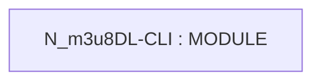

# Repository Architecture Analysis: nilaoda/N_m3u8DL-CLI

## Metadata
- **SHA**: `985f6e57c33de552561edd8f7b141a69bd75484c`
- **Primary Ecosystem**: .NET

## Quality Metrics
- **avg_cyclomatic_complexity**: 32.08
- **component_count**: 1
- **files_analyzed**: 52
- **framework**: ASP.NET Core
- **loc**: 15844
- **max_cyclomatic_complexity**: 166
- **sloc**: 12736

# Architecture: nilaoda/N_m3u8DL-CLI

## Context
- **Repository**: `nilaoda/N_m3u8DL-CLI`
- **SHA**: `985f6e57c33de552561edd8f7b141a69bd75484c`
- **Ecosystem**: .NET
- **Framework**: Unknown

## Building Block View

## Component Details
- **N_m3u8DL-CLI** (`N_m3u8DL-CLI/N_m3u8DL-CLI.csproj`): MODULE

## CI/CD Pipeline Topology

