# Repository Architecture Analysis: nvbn/thefuck

## Metadata
- **SHA**: `c7e7e1d884d3bb241ea6448f72a989434c2a35ec`
- **Primary Ecosystem**: Python

## Quality Metrics
- **avg_cyclomatic_complexity**: 2.16
- **component_count**: 12
- **files_analyzed**: 416
- **framework**: Unknown
- **loc**: 16354
- **max_cyclomatic_complexity**: 11
- **sloc**: 12511

# Architecture: nvbn/thefuck

## Context
- **Repository**: `nvbn/thefuck`
- **SHA**: `c7e7e1d884d3bb241ea6448f72a989434c2a35ec`
- **Ecosystem**: Python
- **Framework**: Unknown

## Building Block View

```mermaid
graph TD;
    test_get_output["test_get_output : API_ROUTE"]
    test_get_output_invalid_continuation_byte["test_get_output_invalid_continuation_byte : API_ROUTE"]
    test_get_output_unicode_misspell["test_get_output_unicode_misspell : API_ROUTE"]
    test_wait_output_timeout["test_wait_output_timeout : API_ROUTE"]
    test_wait_output_timeout_children["test_wait_output_timeout_children : API_ROUTE"]
    test_kill_process_access_denied["test_kill_process_access_denied : API_ROUTE"]
    test_match_mocked["test_match_mocked : API_ROUTE"]
    test_get_new_command_mocked["test_get_new_command_mocked : API_ROUTE"]
    test_call_with_n["test_call_with_n : API_ROUTE"]
    test_call_without_n["test_call_without_n : API_ROUTE"]
    repo_root(["nvbn/thefuck"])
    repo_root --> test_call_with_n
    repo_root --> test_call_without_n
    repo_root --> test_get_new_command_mocked
    repo_root --> test_get_output
    repo_root --> test_get_output_invalid_continuation_byte
    repo_root --> test_get_output_unicode_misspell
    repo_root --> test_kill_process_access_denied
    repo_root --> test_match_mocked
    repo_root --> test_wait_output_timeout
    repo_root --> test_wait_output_timeout_children
```

## Component Details
- **test_get_output** (`tests/output_readers/test_rerun.py`): API_ROUTE
- **test_get_output_invalid_continuation_byte** (`tests/output_readers/test_rerun.py`): API_ROUTE
- **test_get_output_unicode_misspell** (`tests/output_readers/test_rerun.py`): API_ROUTE
- **test_wait_output_timeout** (`tests/output_readers/test_rerun.py`): API_ROUTE
- **test_wait_output_timeout_children** (`tests/output_readers/test_rerun.py`): API_ROUTE
- **test_kill_process_access_denied** (`tests/output_readers/test_rerun.py`): API_ROUTE
- **test_match_mocked** (`tests/rules/test_pacman.py`): API_ROUTE
- **test_get_new_command_mocked** (`tests/rules/test_pacman.py`): API_ROUTE
- **test_match_mocked** (`tests/rules/test_pacman_not_found.py`): API_ROUTE
- **test_get_new_command_mocked** (`tests/rules/test_pacman_not_found.py`): API_ROUTE
- **test_call_with_n** (`tests/test_utils.py`): API_ROUTE
- **test_call_without_n** (`tests/test_utils.py`): API_ROUTE

## CI/CD Pipeline Topology

