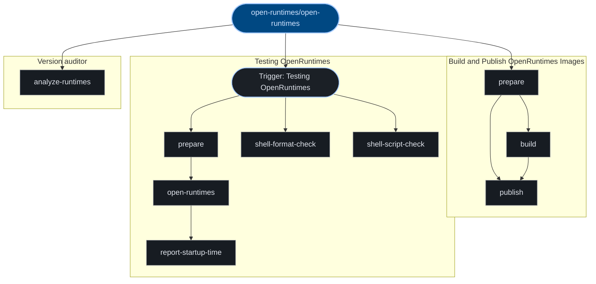

# Repository Architecture Analysis: open-runtimes/open-runtimes

## Metadata
- **SHA**: `e78dcbcfc0f8bc10f45d2b192c85756b86b808ae`
- **Primary Ecosystem**: JavaScript/TypeScript

## Quality Metrics
- **ast_engine**: tree-sitter
- **avg_cognitive_complexity**: 6.59
- **avg_cyclomatic_complexity**: 6.79
- **component_count**: 98
- **dead_code_count**: 1
- **dead_code_symbols**: 1 entry(ies)
- **duplication_pct**: 65.21
- **file_complexities**: 25 entry(ies)
- **files_analyzed**: 257
- **fitness_passed**: False
- **fitness_violation_count**: 3
- **framework**: Next.js
- **import_edges**: 100 entry(ies)
- **loc**: 16521
- **max_cognitive_complexity**: 103
- **max_cyclomatic_complexity**: 69
- **sloc**: 13699
- **test_file_count**: 421

# Architecture: open-runtimes/open-runtimes

## Context
- **Repository**: `open-runtimes/open-runtimes`
- **SHA**: `e78dcbcfc0f8bc10f45d2b192c85756b86b808ae`
- **Ecosystem**: JavaScript/TypeScript
- **Framework**: Next.js

## Building Block View

```mermaid
graph TD;
  classDef atlasRoot fill:#004882,stroke:#a3c9ff,stroke-width:2px,color:#d3e4ff
  classDef atlasCategory fill:#212428,stroke:#E87A48,stroke-width:1.5px,color:#dfe3eb
  classDef atlasWorkflow fill:#1b2026,stroke:#a3c9ff,stroke-width:1.5px,color:#dfe3eb
  classDef atlasJob fill:#171c22,stroke:#8d9199,stroke-width:1px,color:#dfe3eb
  classDef atlasTarget fill:#005227,stroke:#8bd99b,stroke-width:1.5px,color:#a7f6b6
  classDef atlasAlert fill:#93000a,stroke:#ffb4ab,stroke-width:1.5px,color:#ffdad6
  classDef atlasMore fill:#252a31,stroke:#8d9199,stroke-dasharray:4 4,color:#c3c6cf
    repo_root(["open-runtimes/open-runtimes (98 components)"]):::atlasRoot
    dir_0_tests["tests (56)"]:::atlasCategory
    repo_root --> dir_0_tests
    sub_0_0_resources_functions_remix["resources/functions/remix (10)"]:::atlasWorkflow
    dir_0_tests --> sub_0_0_resources_functions_remix
    sub_0_1_resources_functions_tanstack_start_native["resources/functions/tanstack_start_native (9)"]:::atlasWorkflow
    dir_0_tests --> sub_0_1_resources_functions_tanstack_start_native
    sub_0_2_resources_functions_tanstack_start_nitro_listener["resources/functions/tanstack_start_nitro_listener (9)"]:::atlasWorkflow
    dir_0_tests --> sub_0_2_resources_functions_tanstack_start_nitro_listener
    sub_0_more["+11 more submodules (28)"]:::atlasMore
    dir_0_tests --> sub_0_more
    dir_1_runtimes["runtimes (41)"]:::atlasCategory
    repo_root --> dir_1_runtimes
    sub_1_0_dart["dart (20)"]:::atlasWorkflow
    dir_1_runtimes --> sub_1_0_dart
    sub_1_1_ruby["ruby (6)"]:::atlasWorkflow
    dir_1_runtimes --> sub_1_1_ruby
    sub_1_2_dotnet["dotnet (4)"]:::atlasWorkflow
    dir_1_runtimes --> sub_1_2_dotnet
    sub_1_more["+6 more submodules (11)"]:::atlasMore
    dir_1_runtimes --> sub_1_more
    dir_2__github[".github (1)"]:::atlasCategory
    repo_root --> dir_2__github
```

## Component Details

Showing top 60 representative components out of 98 across 3 module group(s):

- **Module `tests`** (56 components — UI_COMPONENT: 41, MODULE: 14, API_ROUTE: 1)
- **Module `runtimes`** (41 components — module: 35, MODULE: 6)
- **Module `.github`** (1 components — MODULE: 1)

- **App** (`tests/resources/functions/remix/app/root.tsx`): UI_COMPONENT
- **DotNetRuntime** (`runtimes/dotnet/versions/10/DotNetRuntime.csproj`): MODULE
- **DotNetRuntime** (`runtimes/dotnet/versions/6.0/DotNetRuntime.csproj`): MODULE
- **DotNetRuntime** (`runtimes/dotnet/versions/7.0/DotNetRuntime.csproj`): MODULE
- **DotNetRuntime** (`runtimes/dotnet/versions/8.0/DotNetRuntime.csproj`): MODULE
- **GET_api_**** (`tests/resources/functions/angular/src/server.ts`): API_ROUTE
- **Index** (`tests/resources/functions/remix/app/routes/_index.tsx`): UI_COMPONENT
- **Index** (`tests/resources/functions/remix/app/routes/concurrency.tsx`): UI_COMPONENT
- **Index** (`tests/resources/functions/remix/app/routes/date.tsx`): UI_COMPONENT
- **Index** (`tests/resources/functions/remix/app/routes/exception.tsx`): UI_COMPONENT
- **Index** (`tests/resources/functions/remix/app/routes/hidden.tsx`): UI_COMPONENT
- **Index** (`tests/resources/functions/remix/app/routes/library.tsx`): UI_COMPONENT
- **Index** (`tests/resources/functions/remix/app/routes/logs.tsx`): UI_COMPONENT
- **Layout** (`tests/resources/functions/remix/app/root.tsx`): UI_COMPONENT
- **Route** (`tests/resources/functions/tanstack_start_native/src/routes/__root.tsx`): UI_COMPONENT
- **Route** (`tests/resources/functions/tanstack_start_native/src/routes/concurrency.tsx`): UI_COMPONENT
- **Route** (`tests/resources/functions/tanstack_start_native/src/routes/date.tsx`): UI_COMPONENT
- **Route** (`tests/resources/functions/tanstack_start_native/src/routes/exception.tsx`): UI_COMPONENT
- **Route** (`tests/resources/functions/tanstack_start_native/src/routes/hidden.tsx`): UI_COMPONENT
- **Route** (`tests/resources/functions/tanstack_start_native/src/routes/index.tsx`): UI_COMPONENT
- **Route** (`tests/resources/functions/tanstack_start_native/src/routes/library.tsx`): UI_COMPONENT
- **Route** (`tests/resources/functions/tanstack_start_native/src/routes/logs.tsx`): UI_COMPONENT
- **Route** (`tests/resources/functions/tanstack_start_nitro_listener/src/routes/__root.tsx`): UI_COMPONENT
- **Route** (`tests/resources/functions/tanstack_start_nitro_listener/src/routes/concurrency.tsx`): UI_COMPONENT
- **Route** (`tests/resources/functions/tanstack_start_nitro_listener/src/routes/date.tsx`): UI_COMPONENT
- **Route** (`tests/resources/functions/tanstack_start_nitro_listener/src/routes/exception.tsx`): UI_COMPONENT
- **Route** (`tests/resources/functions/tanstack_start_nitro_listener/src/routes/hidden.tsx`): UI_COMPONENT
- **Route** (`tests/resources/functions/tanstack_start_nitro_listener/src/routes/index.tsx`): UI_COMPONENT
- **Route** (`tests/resources/functions/tanstack_start_nitro_listener/src/routes/library.tsx`): UI_COMPONENT
- **Route** (`tests/resources/functions/tanstack_start_nitro_listener/src/routes/logs.tsx`): UI_COMPONENT
- **Route** (`tests/resources/functions/tanstack_start_nitro_v2/src/routes/__root.tsx`): UI_COMPONENT
- **Route** (`tests/resources/functions/tanstack_start_nitro_v2/src/routes/concurrency.tsx`): UI_COMPONENT
- **Route** (`tests/resources/functions/tanstack_start_nitro_v2/src/routes/date.tsx`): UI_COMPONENT
- **Route** (`tests/resources/functions/tanstack_start_nitro_v2/src/routes/exception.tsx`): UI_COMPONENT
- **Route** (`tests/resources/functions/tanstack_start_nitro_v2/src/routes/hidden.tsx`): UI_COMPONENT
- **Route** (`tests/resources/functions/tanstack_start_nitro_v2/src/routes/index.tsx`): UI_COMPONENT
- **Route** (`tests/resources/functions/tanstack_start_nitro_v2/src/routes/library.tsx`): UI_COMPONENT
- **Route** (`tests/resources/functions/tanstack_start_nitro_v2/src/routes/logs.tsx`): UI_COMPONENT
- **Route** (`tests/resources/functions/tanstack_start_nitro_v3/src/routes/__root.tsx`): UI_COMPONENT
- **Route** (`tests/resources/functions/tanstack_start_nitro_v3/src/routes/concurrency.tsx`): UI_COMPONENT
- **Route** (`tests/resources/functions/tanstack_start_nitro_v3/src/routes/date.tsx`): UI_COMPONENT
- **Route** (`tests/resources/functions/tanstack_start_nitro_v3/src/routes/exception.tsx`): UI_COMPONENT
- **Route** (`tests/resources/functions/tanstack_start_nitro_v3/src/routes/hidden.tsx`): UI_COMPONENT
- **Route** (`tests/resources/functions/tanstack_start_nitro_v3/src/routes/index.tsx`): UI_COMPONENT
- **Route** (`tests/resources/functions/tanstack_start_nitro_v3/src/routes/library.tsx`): UI_COMPONENT
- **Route** (`tests/resources/functions/tanstack_start_nitro_v3/src/routes/logs.tsx`): UI_COMPONENT
- **analog** (`tests/resources/functions/analog/package.json`): MODULE
- **angular** (`tests/resources/functions/angular/package.json`): MODULE
- **astro** (`tests/resources/functions/astro/package.json`): MODULE
- **code** (`tests/resources/functions/bun/latest/package.json`): MODULE
- **code** (`tests/resources/functions/node/latest/package.json`): MODULE
- **config** (`runtimes/php/versions/latest/src/config.php`): module
- **config** (`runtimes/ruby/versions/latest/src/config.rb`): module
- **execute** (`runtimes/ruby/versions/3.0/src/execute.rb`): module
- **execute** (`runtimes/ruby/versions/latest/src/execute.rb`): module
- **lib** (`runtimes/rust/versions/latest/src/function/lib.rs`): module
- **logger** (`runtimes/php/versions/latest/src/logger.php`): module
- **logger** (`runtimes/ruby/versions/latest/src/logger.rb`): module
- **main** (`runtimes/go/versions/latest/src/main.go`): module
- **main** (`runtimes/rust/versions/latest/src/main.rs`): module

## 6-Dimension Repository Scorecard

- **Overall Grade**: `F` (54.65/100)
- **Technical Debt Score**: 45.35
- **Estimated Remediation Effort**: 46.13h

| Dimension | Grade | Score | Weight | Details |
| :--- | :---: | :---: | :---: | :--- |
| Code Quality | `F` | 32.84 | 0.20 | avg_cc=6.79, max_cc=69, duplication=65.21%, dead_code=1 |
| Dependency Health | `A` | 100.00 | 0.15 | dependencies=7109, outdated=0, vulnerable=0, has_lockfile=True |
| Maintainability | `F` | 47.23 | 0.15 | avg_cognitive=6.59, max_cognitive=103, fitness_violations=3, oversized_files=1 |
| Pipeline Health | `D` | 66.00 | 0.15 | workflows=3, operational_antipatterns=10, parallel_branches=True |
| Security | `F` | 28.00 | 0.20 | vulnerabilities=0, secrets=0, pipeline_security_findings=7 |
| Test Coverage | `C` | 70.00 | 0.15 | coverage=unavailable, ci_test_job=True, test_files_detected=True |

## Architecture Fitness & Workspace Boundaries

- **[MEDIUM] `ATRUSS-ARCH-005` (COMPLEXITY_THRESHOLD)**: Repository duplication_pct (65.21) exceeds policy threshold (15.0).
- **[MEDIUM] `ATRUSS-ARCH-005` (COMPLEXITY_THRESHOLD)**: Repository max_cognitive_complexity (103.0) exceeds policy threshold (25.0).
- **[MEDIUM] `ATRUSS-ARCH-005` (COMPLEXITY_THRESHOLD)**: Repository max_cyclomatic_complexity (69.0) exceeds policy threshold (20.0).

## Supply Chain Dependencies, Vulnerabilities & Secrets

- **Dependencies Parsed**: 7109 | **Vulnerabilities**: 0 | **Secrets**: 0

### Inventory Sample
- `com.fasterxml.jackson.core:jackson-databind` `2.18.11` (Maven, `runtimes/kotlin/versions/1.6/build.gradle`)
- `com.fasterxml.jackson.core:jackson-databind` `2.18.11` (Maven, `runtimes/kotlin/versions/1.8/build.gradle`)
- `com.fasterxml.jackson.core:jackson-databind` `2.18.11` (Maven, `runtimes/kotlin/versions/1.9/build.gradle`)
- `com.fasterxml.jackson.core:jackson-databind` `2.18.11` (Maven, `runtimes/kotlin/versions/2.0/build.gradle`)
- `com.fasterxml.jackson.core:jackson-databind` `2.18.11` (Maven, `runtimes/kotlin/versions/2.3/build.gradle`)
- `com.fasterxml.jackson.core:jackson-databind` `2.18.11` (Maven, `runtimes/kotlin/versions/latest/build.gradle`)
- `com.google.code.gson:gson` `2.9.0` (Maven, `runtimes/java/versions/11.0/build.gradle`)
- `com.google.code.gson:gson` `2.9.0` (Maven, `runtimes/java/versions/17.0/build.gradle`)
- `com.google.code.gson:gson` `2.9.0` (Maven, `runtimes/java/versions/18.0/build.gradle`)
- `com.google.code.gson:gson` `2.9.0` (Maven, `runtimes/java/versions/21.0/build.gradle`)
- `com.google.code.gson:gson` `2.9.0` (Maven, `runtimes/java/versions/22/build.gradle`)
- `com.google.code.gson:gson` `2.9.0` (Maven, `runtimes/java/versions/25/build.gradle`)
- `com.google.code.gson:gson` `2.9.0` (Maven, `runtimes/java/versions/8.0/build.gradle`)
- `com.google.code.gson:gson` `2.9.0` (Maven, `runtimes/java/versions/latest/build.gradle`)
- `com.google.code.gson:gson` `2.9.0` (Maven, `runtimes/kotlin/versions/1.6/build.gradle`)
- `com.google.code.gson:gson` `2.9.0` (Maven, `runtimes/kotlin/versions/1.8/build.gradle`)
- `com.google.code.gson:gson` `2.9.0` (Maven, `runtimes/kotlin/versions/1.9/build.gradle`)
- `com.google.code.gson:gson` `2.9.0` (Maven, `runtimes/kotlin/versions/2.0/build.gradle`)
- `com.google.code.gson:gson` `2.9.0` (Maven, `runtimes/kotlin/versions/2.3/build.gradle`)
- `com.google.code.gson:gson` `2.9.0` (Maven, `runtimes/kotlin/versions/latest/build.gradle`)
- `io.javalin:javalin` `4.6.8` (Maven, `runtimes/java/versions/8.0/build.gradle`)
- `io.javalin:javalin` `4.6.8` (Maven, `runtimes/java/versions/latest/build.gradle`)
- `io.javalin:javalin` `4.6.8` (Maven, `runtimes/kotlin/versions/1.6/build.gradle`)
- `io.javalin:javalin` `4.6.8` (Maven, `runtimes/kotlin/versions/1.8/build.gradle`)
- `io.javalin:javalin` `4.6.8` (Maven, `runtimes/kotlin/versions/1.9/build.gradle`)
- `io.javalin:javalin` `4.6.8` (Maven, `runtimes/kotlin/versions/2.0/build.gradle`)
- `io.javalin:javalin` `4.6.8` (Maven, `runtimes/kotlin/versions/2.3/build.gradle`)
- `io.javalin:javalin` `4.6.8` (Maven, `runtimes/kotlin/versions/latest/build.gradle`)
- `io.javalin:javalin` `6.1.3` (Maven, `runtimes/java/versions/11.0/build.gradle`)
- `io.javalin:javalin` `6.1.3` (Maven, `runtimes/java/versions/17.0/build.gradle`)
- ... (+7079 more dependencies)

## Section 7: Code-to-Cloud Deployment Traceability

```mermaid
flowchart LR
    classDef atlasCategory fill:#212428,stroke:#E87A48,stroke-width:1.5px,color:#dfe3eb
    classDef atlasWorkflow fill:#1b2026,stroke:#a3c9ff,stroke-width:1.5px,color:#dfe3eb
    classDef atlasJob fill:#171c22,stroke:#8d9199,stroke-width:1px,color:#dfe3eb
    classDef atlasTarget fill:#005227,stroke:#8bd99b,stroke-width:1.5px,color:#a7f6b6
    subgraph code_modules["Code Modules"]
        mod__github_workflows_version_audit[".github/workflows/version-audit"]:::atlasCategory
        mod_8efc7635_b5c9_4274_a531_6ed15d1f78fa["8efc7635-b5c9-4274-a531-6ed15d1f78fa"]:::atlasCategory
        mod_runtimes_bun["runtimes/bun"]:::atlasCategory
        mod_runtimes_bun_versions_latest["runtimes/bun/versions/latest"]:::atlasCategory
        mod_runtimes_cpp["runtimes/cpp"]:::atlasCategory
        mod_runtimes_dart["runtimes/dart"]:::atlasCategory
        mod_runtimes_deno["runtimes/deno"]:::atlasCategory
        mod_runtimes_dotnet["runtimes/dotnet"]:::atlasCategory
        mod_runtimes_dotnet_versions_10["runtimes/dotnet/versions/10"]:::atlasCategory
        mod_runtimes_dotnet_versions_8_0["runtimes/dotnet/versions/8.0"]:::atlasCategory
        mod_runtimes_flutter["runtimes/flutter"]:::atlasCategory
        mod_runtimes_go["runtimes/go"]:::atlasCategory
        mod_runtimes_go_versions_latest_src["runtimes/go/versions/latest/src"]:::atlasCategory
        mod_runtimes_java["runtimes/java"]:::atlasCategory
        mod_runtimes_java_versions_22["runtimes/java/versions/22"]:::atlasCategory
        mod_runtimes_java_versions_25["runtimes/java/versions/25"]:::atlasCategory
        mod_runtimes_java_versions_8_0["runtimes/java/versions/8.0"]:::atlasCategory
        mod_runtimes_java_versions_latest["runtimes/java/versions/latest"]:::atlasCategory
        mod_runtimes_kotlin["runtimes/kotlin"]:::atlasCategory
        mod_runtimes_kotlin_versions_1_9["runtimes/kotlin/versions/1.9"]:::atlasCategory
        mod_runtimes_kotlin_versions_latest["runtimes/kotlin/versions/latest"]:::atlasCategory
        mod_runtimes_node["runtimes/node"]:::atlasCategory
        mod_runtimes_node_versions_latest["runtimes/node/versions/latest"]:::atlasCategory
        mod_runtimes_php["runtimes/php"]:::atlasCategory
        mod_runtimes_php_versions_latest["runtimes/php/versions/latest"]:::atlasCategory
        mod_runtimes_python["runtimes/python"]:::atlasCategory
        mod_runtimes_python_versions_latest["runtimes/python/versions/latest"]:::atlasCategory
        mod_runtimes_ruby["runtimes/ruby"]:::atlasCategory
        mod_runtimes_ruby_versions_latest["runtimes/ruby/versions/latest"]:::atlasCategory
        mod_runtimes_rust["runtimes/rust"]:::atlasCategory
        mod_runtimes_rust_versions_latest["runtimes/rust/versions/latest"]:::atlasCategory
        mod_runtimes_rust_versions_latest_src_function["runtimes/rust/versions/latest/src/function"]:::atlasCategory
        mod_runtimes_static["runtimes/static"]:::atlasCategory
        mod_runtimes_swift["runtimes/swift"]:::atlasCategory
        mod_tests_resources_functions_bun_latest["tests/resources/functions/bun/latest"]:::atlasCategory
        mod_tests_resources_functions_dotnet_10["tests/resources/functions/dotnet/10"]:::atlasCategory
        mod_tests_resources_functions_dotnet_8_0["tests/resources/functions/dotnet/8.0"]:::atlasCategory
        mod_tests_resources_functions_go_latest["tests/resources/functions/go/latest"]:::atlasCategory
        mod_tests_resources_functions_java_22["tests/resources/functions/java/22"]:::atlasCategory
        mod_tests_resources_functions_node_latest["tests/resources/functions/node/latest"]:::atlasCategory
        mod_tests_resources_functions_nuxt_server["tests/resources/functions/nuxt/server"]:::atlasCategory
        mod_tests_resources_functions_php["tests/resources/functions/php"]:::atlasCategory
        mod_tests_resources_functions_php_latest["tests/resources/functions/php/latest"]:::atlasCategory
        mod_tests_resources_functions_python_latest["tests/resources/functions/python/latest"]:::atlasCategory
        mod_tests_resources_functions_ruby_latest["tests/resources/functions/ruby/latest"]:::atlasCategory
        mod_tests_resources_functions_rust_latest["tests/resources/functions/rust/latest"]:::atlasCategory
    end
    subgraph build_artifacts["Build Artifacts / Containers"]
        art_runtimes_bun_Dockerfile["runtimes/bun/Dockerfile"]:::atlasWorkflow
        art_runtimes_cpp_Dockerfile["runtimes/cpp/Dockerfile"]:::atlasWorkflow
        art_runtimes_dart_Dockerfile["runtimes/dart/Dockerfile"]:::atlasWorkflow
        art_runtimes_deno_Dockerfile["runtimes/deno/Dockerfile"]:::atlasWorkflow
        art_runtimes_dotnet_Dockerfile["runtimes/dotnet/Dockerfile"]:::atlasWorkflow
        art_runtimes_flutter_Dockerfile["runtimes/flutter/Dockerfile"]:::atlasWorkflow
        art_runtimes_go_Dockerfile["runtimes/go/Dockerfile"]:::atlasWorkflow
        art_runtimes_java_Dockerfile["runtimes/java/Dockerfile"]:::atlasWorkflow
        art_runtimes_kotlin_Dockerfile["runtimes/kotlin/Dockerfile"]:::atlasWorkflow
        art_runtimes_node_Dockerfile["runtimes/node/Dockerfile"]:::atlasWorkflow
        art_runtimes_php_Dockerfile["runtimes/php/Dockerfile"]:::atlasWorkflow
        art_runtimes_python_Dockerfile["runtimes/python/Dockerfile"]:::atlasWorkflow
        art_runtimes_ruby_Dockerfile["runtimes/ruby/Dockerfile"]:::atlasWorkflow
        art_runtimes_rust_Dockerfile["runtimes/rust/Dockerfile"]:::atlasWorkflow
        art_runtimes_static_Dockerfile["runtimes/static/Dockerfile"]:::atlasWorkflow
        art_runtimes_swift_Dockerfile["runtimes/swift/Dockerfile"]:::atlasWorkflow
    end
    subgraph ci_jobs["CI/CD Jobs"]
        job_test_yaml_open_runtimes["test.yaml#open-runtimes"]:::atlasJob
        job_test_yaml_shell_script_check["test.yaml#shell-script-check"]:::atlasJob
        job_version_audit_yml_analyze_runtimes["version-audit.yml#analyze-runtimes"]:::atlasJob
    end
    mod__github_workflows_version_audit -->|BUILT_BY| job_version_audit_yml_analyze_runtimes
    mod_8efc7635_b5c9_4274_a531_6ed15d1f78fa -->|BUILT_BY| job_test_yaml_open_runtimes
    mod_runtimes_bun -->|PACKAGED_BY| art_runtimes_bun_Dockerfile
    mod_runtimes_bun -->|PACKAGED_BY| art_runtimes_cpp_Dockerfile
    mod_runtimes_bun -->|PACKAGED_BY| art_runtimes_dart_Dockerfile
    mod_runtimes_bun -->|PACKAGED_BY| art_runtimes_deno_Dockerfile
    mod_runtimes_bun -->|PACKAGED_BY| art_runtimes_dotnet_Dockerfile
    mod_runtimes_bun -->|PACKAGED_BY| art_runtimes_flutter_Dockerfile
    mod_runtimes_bun -->|PACKAGED_BY| art_runtimes_go_Dockerfile
    mod_runtimes_bun -->|PACKAGED_BY| art_runtimes_java_Dockerfile
    mod_runtimes_bun -->|PACKAGED_BY| art_runtimes_kotlin_Dockerfile
    mod_runtimes_bun -->|PACKAGED_BY| art_runtimes_node_Dockerfile
    mod_runtimes_bun -->|PACKAGED_BY| art_runtimes_php_Dockerfile
    mod_runtimes_bun -->|PACKAGED_BY| art_runtimes_python_Dockerfile
    mod_runtimes_bun -->|PACKAGED_BY| art_runtimes_ruby_Dockerfile
    mod_runtimes_bun -->|PACKAGED_BY| art_runtimes_rust_Dockerfile
    mod_runtimes_bun -->|PACKAGED_BY| art_runtimes_static_Dockerfile
    mod_runtimes_bun -->|PACKAGED_BY| art_runtimes_swift_Dockerfile
    mod_runtimes_bun_versions_latest -->|PACKAGED_BY| art_runtimes_php_Dockerfile
    mod_runtimes_cpp -->|PACKAGED_BY| art_runtimes_cpp_Dockerfile
    mod_runtimes_dart -->|PACKAGED_BY| art_runtimes_dart_Dockerfile
    mod_runtimes_dart -->|PACKAGED_BY| art_runtimes_flutter_Dockerfile
    mod_runtimes_deno -->|PACKAGED_BY| art_runtimes_deno_Dockerfile
    mod_runtimes_deno -->|PACKAGED_BY| art_runtimes_node_Dockerfile
    mod_runtimes_dotnet -->|PACKAGED_BY| art_runtimes_dotnet_Dockerfile
    mod_runtimes_dotnet_versions_10 -->|PACKAGED_BY| art_runtimes_python_Dockerfile
    mod_runtimes_dotnet_versions_8_0 -->|PACKAGED_BY| art_runtimes_flutter_Dockerfile
    mod_runtimes_flutter -->|PACKAGED_BY| art_runtimes_flutter_Dockerfile
    mod_runtimes_go -->|PACKAGED_BY| art_runtimes_cpp_Dockerfile
    mod_runtimes_go -->|PACKAGED_BY| art_runtimes_go_Dockerfile
    mod_runtimes_go -->|PACKAGED_BY| art_runtimes_php_Dockerfile
    mod_runtimes_go_versions_latest_src -->|PACKAGED_BY| art_runtimes_bun_Dockerfile
    mod_runtimes_go_versions_latest_src -->|PACKAGED_BY| art_runtimes_cpp_Dockerfile
    mod_runtimes_go_versions_latest_src -->|PACKAGED_BY| art_runtimes_dart_Dockerfile
    mod_runtimes_go_versions_latest_src -->|PACKAGED_BY| art_runtimes_deno_Dockerfile
    mod_runtimes_go_versions_latest_src -->|PACKAGED_BY| art_runtimes_dotnet_Dockerfile
    mod_runtimes_go_versions_latest_src -->|PACKAGED_BY| art_runtimes_go_Dockerfile
    mod_runtimes_go_versions_latest_src -->|PACKAGED_BY| art_runtimes_java_Dockerfile
    mod_runtimes_go_versions_latest_src -->|PACKAGED_BY| art_runtimes_kotlin_Dockerfile
    mod_runtimes_go_versions_latest_src -->|PACKAGED_BY| art_runtimes_node_Dockerfile
    mod_runtimes_go_versions_latest_src -->|PACKAGED_BY| art_runtimes_php_Dockerfile
    mod_runtimes_go_versions_latest_src -->|PACKAGED_BY| art_runtimes_rust_Dockerfile
    mod_runtimes_go_versions_latest_src -->|PACKAGED_BY| art_runtimes_swift_Dockerfile
    mod_runtimes_java -->|BUILT_BY| job_test_yaml_shell_script_check
    mod_runtimes_java -->|PACKAGED_BY| art_runtimes_deno_Dockerfile
    mod_runtimes_java -->|PACKAGED_BY| art_runtimes_java_Dockerfile
    mod_runtimes_java -->|PACKAGED_BY| art_runtimes_kotlin_Dockerfile
    mod_runtimes_java_versions_22 -->|PACKAGED_BY| art_runtimes_java_Dockerfile
    mod_runtimes_java_versions_22 -->|PACKAGED_BY| art_runtimes_kotlin_Dockerfile
    mod_runtimes_java_versions_25 -->|PACKAGED_BY| art_runtimes_java_Dockerfile
    mod_runtimes_java_versions_25 -->|PACKAGED_BY| art_runtimes_kotlin_Dockerfile
    mod_runtimes_java_versions_25 -->|PACKAGED_BY| art_runtimes_node_Dockerfile
    mod_runtimes_java_versions_8_0 -->|PACKAGED_BY| art_runtimes_flutter_Dockerfile
    mod_runtimes_java_versions_latest -->|BUILT_BY| job_test_yaml_shell_script_check
    mod_runtimes_java_versions_latest -->|PACKAGED_BY| art_runtimes_php_Dockerfile
    mod_runtimes_kotlin -->|BUILT_BY| job_test_yaml_shell_script_check
    mod_runtimes_kotlin -->|PACKAGED_BY| art_runtimes_kotlin_Dockerfile
    mod_runtimes_kotlin_versions_1_9 -->|PACKAGED_BY| art_runtimes_cpp_Dockerfile
    mod_runtimes_kotlin_versions_latest -->|BUILT_BY| job_test_yaml_shell_script_check
    mod_runtimes_kotlin_versions_latest -->|PACKAGED_BY| art_runtimes_php_Dockerfile
    mod_runtimes_node -->|PACKAGED_BY| art_runtimes_deno_Dockerfile
    mod_runtimes_node -->|PACKAGED_BY| art_runtimes_node_Dockerfile
    mod_runtimes_node_versions_latest -->|PACKAGED_BY| art_runtimes_php_Dockerfile
    mod_runtimes_php -->|PACKAGED_BY| art_runtimes_php_Dockerfile
    mod_runtimes_php_versions_latest -->|PACKAGED_BY| art_runtimes_php_Dockerfile
    mod_runtimes_python -->|PACKAGED_BY| art_runtimes_bun_Dockerfile
    mod_runtimes_python -->|PACKAGED_BY| art_runtimes_deno_Dockerfile
    mod_runtimes_python -->|PACKAGED_BY| art_runtimes_node_Dockerfile
    mod_runtimes_python -->|PACKAGED_BY| art_runtimes_python_Dockerfile
    mod_runtimes_python_versions_latest -->|PACKAGED_BY| art_runtimes_php_Dockerfile
    mod_runtimes_ruby -->|PACKAGED_BY| art_runtimes_ruby_Dockerfile
    mod_runtimes_ruby_versions_latest -->|PACKAGED_BY| art_runtimes_php_Dockerfile
    mod_runtimes_rust -->|PACKAGED_BY| art_runtimes_python_Dockerfile
    mod_runtimes_rust -->|PACKAGED_BY| art_runtimes_rust_Dockerfile
    mod_runtimes_rust_versions_latest -->|PACKAGED_BY| art_runtimes_php_Dockerfile
    mod_runtimes_rust_versions_latest_src_function -->|PACKAGED_BY| art_runtimes_cpp_Dockerfile
    mod_runtimes_rust_versions_latest_src_function -->|PACKAGED_BY| art_runtimes_dart_Dockerfile
    mod_runtimes_rust_versions_latest_src_function -->|PACKAGED_BY| art_runtimes_deno_Dockerfile
    mod_runtimes_rust_versions_latest_src_function -->|PACKAGED_BY| art_runtimes_dotnet_Dockerfile
    mod_runtimes_rust_versions_latest_src_function -->|PACKAGED_BY| art_runtimes_go_Dockerfile
    mod_runtimes_rust_versions_latest_src_function -->|PACKAGED_BY| art_runtimes_java_Dockerfile
    mod_runtimes_rust_versions_latest_src_function -->|PACKAGED_BY| art_runtimes_kotlin_Dockerfile
    mod_runtimes_rust_versions_latest_src_function -->|PACKAGED_BY| art_runtimes_rust_Dockerfile
    mod_runtimes_rust_versions_latest_src_function -->|PACKAGED_BY| art_runtimes_swift_Dockerfile
    mod_runtimes_static -->|PACKAGED_BY| art_runtimes_deno_Dockerfile
    mod_runtimes_static -->|PACKAGED_BY| art_runtimes_flutter_Dockerfile
    mod_runtimes_static -->|PACKAGED_BY| art_runtimes_rust_Dockerfile
    mod_runtimes_static -->|PACKAGED_BY| art_runtimes_static_Dockerfile
    mod_runtimes_swift -->|PACKAGED_BY| art_runtimes_swift_Dockerfile
    mod_tests_resources_functions_bun_latest -->|PACKAGED_BY| art_runtimes_php_Dockerfile
    mod_tests_resources_functions_dotnet_10 -->|PACKAGED_BY| art_runtimes_python_Dockerfile
    mod_tests_resources_functions_dotnet_8_0 -->|PACKAGED_BY| art_runtimes_flutter_Dockerfile
    mod_tests_resources_functions_go_latest -->|PACKAGED_BY| art_runtimes_php_Dockerfile
    mod_tests_resources_functions_java_22 -->|PACKAGED_BY| art_runtimes_java_Dockerfile
    mod_tests_resources_functions_java_22 -->|PACKAGED_BY| art_runtimes_kotlin_Dockerfile
    mod_tests_resources_functions_node_latest -->|PACKAGED_BY| art_runtimes_php_Dockerfile
    mod_tests_resources_functions_nuxt_server -->|PACKAGED_BY| art_runtimes_bun_Dockerfile
    mod_tests_resources_functions_nuxt_server -->|PACKAGED_BY| art_runtimes_dart_Dockerfile
    mod_tests_resources_functions_nuxt_server -->|PACKAGED_BY| art_runtimes_deno_Dockerfile
    mod_tests_resources_functions_nuxt_server -->|PACKAGED_BY| art_runtimes_flutter_Dockerfile
    mod_tests_resources_functions_nuxt_server -->|PACKAGED_BY| art_runtimes_go_Dockerfile
    mod_tests_resources_functions_nuxt_server -->|PACKAGED_BY| art_runtimes_node_Dockerfile
    mod_tests_resources_functions_nuxt_server -->|PACKAGED_BY| art_runtimes_php_Dockerfile
    mod_tests_resources_functions_nuxt_server -->|PACKAGED_BY| art_runtimes_python_Dockerfile
    mod_tests_resources_functions_nuxt_server -->|PACKAGED_BY| art_runtimes_static_Dockerfile
    mod_tests_resources_functions_php -->|PACKAGED_BY| art_runtimes_php_Dockerfile
    mod_tests_resources_functions_php_latest -->|PACKAGED_BY| art_runtimes_php_Dockerfile
    mod_tests_resources_functions_python_latest -->|PACKAGED_BY| art_runtimes_php_Dockerfile
    mod_tests_resources_functions_ruby_latest -->|PACKAGED_BY| art_runtimes_php_Dockerfile
    mod_tests_resources_functions_rust_latest -->|PACKAGED_BY| art_runtimes_php_Dockerfile
    art_runtimes_java_Dockerfile -->|BUILT_BY| job_test_yaml_shell_script_check
    art_runtimes_kotlin_Dockerfile -->|BUILT_BY| job_test_yaml_shell_script_check
```

- `.github/workflows/version-audit` (code_module) --[BUILT_BY]--> `version-audit.yml#analyze-runtimes` (ci_job)
- `8efc7635-b5c9-4274-a531-6ed15d1f78fa` (code_module) --[BUILT_BY]--> `test.yaml#open-runtimes` (ci_job)
- `runtimes/bun` (code_module) --[PACKAGED_BY]--> `runtimes/bun/Dockerfile` (container)
- `runtimes/bun` (code_module) --[PACKAGED_BY]--> `runtimes/cpp/Dockerfile` (container)
- `runtimes/bun` (code_module) --[PACKAGED_BY]--> `runtimes/dart/Dockerfile` (container)
- `runtimes/bun` (code_module) --[PACKAGED_BY]--> `runtimes/deno/Dockerfile` (container)
- `runtimes/bun` (code_module) --[PACKAGED_BY]--> `runtimes/dotnet/Dockerfile` (container)
- `runtimes/bun` (code_module) --[PACKAGED_BY]--> `runtimes/flutter/Dockerfile` (container)
- `runtimes/bun` (code_module) --[PACKAGED_BY]--> `runtimes/go/Dockerfile` (container)
- `runtimes/bun` (code_module) --[PACKAGED_BY]--> `runtimes/java/Dockerfile` (container)
- `runtimes/bun` (code_module) --[PACKAGED_BY]--> `runtimes/kotlin/Dockerfile` (container)
- `runtimes/bun` (code_module) --[PACKAGED_BY]--> `runtimes/node/Dockerfile` (container)
- `runtimes/bun` (code_module) --[PACKAGED_BY]--> `runtimes/php/Dockerfile` (container)
- `runtimes/bun` (code_module) --[PACKAGED_BY]--> `runtimes/python/Dockerfile` (container)
- `runtimes/bun` (code_module) --[PACKAGED_BY]--> `runtimes/ruby/Dockerfile` (container)
- `runtimes/bun` (code_module) --[PACKAGED_BY]--> `runtimes/rust/Dockerfile` (container)
- `runtimes/bun` (code_module) --[PACKAGED_BY]--> `runtimes/static/Dockerfile` (container)
- `runtimes/bun` (code_module) --[PACKAGED_BY]--> `runtimes/swift/Dockerfile` (container)
- `runtimes/bun/versions/latest` (code_module) --[PACKAGED_BY]--> `runtimes/php/Dockerfile` (container)
- `runtimes/cpp` (code_module) --[PACKAGED_BY]--> `runtimes/cpp/Dockerfile` (container)
- `runtimes/dart` (code_module) --[PACKAGED_BY]--> `runtimes/dart/Dockerfile` (container)
- `runtimes/dart` (code_module) --[PACKAGED_BY]--> `runtimes/flutter/Dockerfile` (container)
- `runtimes/deno` (code_module) --[PACKAGED_BY]--> `runtimes/deno/Dockerfile` (container)
- `runtimes/deno` (code_module) --[PACKAGED_BY]--> `runtimes/node/Dockerfile` (container)
- `runtimes/dotnet` (code_module) --[PACKAGED_BY]--> `runtimes/dotnet/Dockerfile` (container)
- `runtimes/dotnet/versions/10` (code_module) --[PACKAGED_BY]--> `runtimes/python/Dockerfile` (container)
- `runtimes/dotnet/versions/8.0` (code_module) --[PACKAGED_BY]--> `runtimes/flutter/Dockerfile` (container)
- `runtimes/flutter` (code_module) --[PACKAGED_BY]--> `runtimes/flutter/Dockerfile` (container)
- `runtimes/go` (code_module) --[PACKAGED_BY]--> `runtimes/cpp/Dockerfile` (container)
- `runtimes/go` (code_module) --[PACKAGED_BY]--> `runtimes/go/Dockerfile` (container)
- `runtimes/go` (code_module) --[PACKAGED_BY]--> `runtimes/php/Dockerfile` (container)
- `runtimes/go/versions/latest/src` (code_module) --[PACKAGED_BY]--> `runtimes/bun/Dockerfile` (container)
- `runtimes/go/versions/latest/src` (code_module) --[PACKAGED_BY]--> `runtimes/cpp/Dockerfile` (container)
- `runtimes/go/versions/latest/src` (code_module) --[PACKAGED_BY]--> `runtimes/dart/Dockerfile` (container)
- `runtimes/go/versions/latest/src` (code_module) --[PACKAGED_BY]--> `runtimes/deno/Dockerfile` (container)
- `runtimes/go/versions/latest/src` (code_module) --[PACKAGED_BY]--> `runtimes/dotnet/Dockerfile` (container)
- `runtimes/go/versions/latest/src` (code_module) --[PACKAGED_BY]--> `runtimes/go/Dockerfile` (container)
- `runtimes/go/versions/latest/src` (code_module) --[PACKAGED_BY]--> `runtimes/java/Dockerfile` (container)
- `runtimes/go/versions/latest/src` (code_module) --[PACKAGED_BY]--> `runtimes/kotlin/Dockerfile` (container)
- `runtimes/go/versions/latest/src` (code_module) --[PACKAGED_BY]--> `runtimes/node/Dockerfile` (container)

## CI/CD Pipeline Topology

