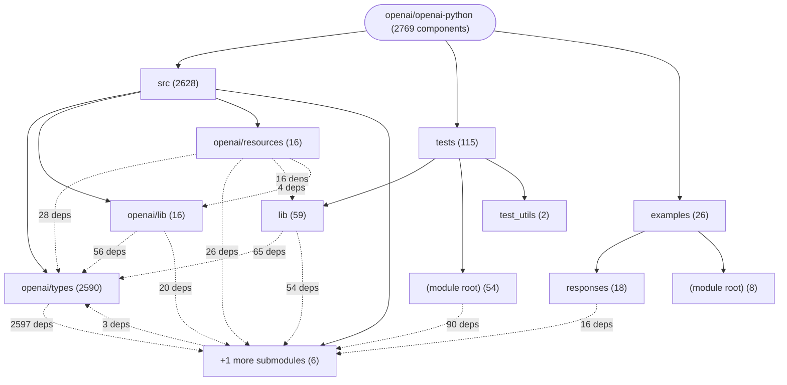

# Repository Architecture Analysis: openai/openai-python

## Metadata
- **SHA**: `59738a289ee82c7b86bf1e10230cceb6daa9716d`
- **Primary Ecosystem**: Python

## Quality Metrics
- **avg_cyclomatic_complexity**: 3.61
- **component_count**: 2769
- **files_analyzed**: 2554
- **framework**: Unknown
- **loc**: 389546
- **max_cyclomatic_complexity**: 171
- **sloc**: 310498

# Architecture: openai/openai-python

## Context
- **Repository**: `openai/openai-python`
- **SHA**: `59738a289ee82c7b86bf1e10230cceb6daa9716d`
- **Ecosystem**: Python
- **Framework**: Unknown

## Building Block View

## Component Details

Showing top 60 representative components out of 2769 across 3 module group(s):

- **Module `src`** (2628 components — DATA_ACCESS_LAYER: 2604, SERVICE: 24)
- **Module `tests`** (115 components — DATA_ACCESS_LAYER: 92, API_ROUTE: 23)
- **Module `examples`** (26 components — DATA_ACCESS_LAYER: 26)

- **BetaResponseWsError** (`src/openai/types/beta/beta_responses_server_event.py`): DATA_ACCESS_LAYER (deps: BaseModel, BetaResponseAudioDeltaEvent, BetaResponseAudioDoneEvent, BetaResponseAudioTranscriptDeltaEvent, BetaResponseAudioTranscriptDoneEvent, BetaResponseCodeInterpreterCallCodeDeltaEvent (+58 more))
- **BetaResponseWsErrorAgent** (`src/openai/types/beta/beta_responses_server_event.py`): DATA_ACCESS_LAYER (deps: BaseModel, BetaResponseAudioDeltaEvent, BetaResponseAudioDoneEvent, BetaResponseAudioTranscriptDeltaEvent, BetaResponseAudioTranscriptDoneEvent, BetaResponseCodeInterpreterCallCodeDeltaEvent (+58 more))
- **BetaResponseWsErrorError** (`src/openai/types/beta/beta_responses_server_event.py`): DATA_ACCESS_LAYER (deps: BaseModel, BetaResponseAudioDeltaEvent, BetaResponseAudioDoneEvent, BetaResponseAudioTranscriptDeltaEvent, BetaResponseAudioTranscriptDoneEvent, BetaResponseCodeInterpreterCallCodeDeltaEvent (+58 more))
- **BetaResponseWsErrorErrorMisalignment** (`src/openai/types/beta/beta_responses_server_event.py`): DATA_ACCESS_LAYER (deps: BaseModel, BetaResponseAudioDeltaEvent, BetaResponseAudioDoneEvent, BetaResponseAudioTranscriptDeltaEvent, BetaResponseAudioTranscriptDoneEvent, BetaResponseCodeInterpreterCallCodeDeltaEvent (+58 more))
- **BetaResponseWsErrorErrorMisalignmentSteer** (`src/openai/types/beta/beta_responses_server_event.py`): DATA_ACCESS_LAYER (deps: BaseModel, BetaResponseAudioDeltaEvent, BetaResponseAudioDoneEvent, BetaResponseAudioTranscriptDeltaEvent, BetaResponseAudioTranscriptDoneEvent, BetaResponseCodeInterpreterCallCodeDeltaEvent (+58 more))
- **ResponseWsError** (`src/openai/types/responses/responses_server_event.py`): DATA_ACCESS_LAYER (deps: BaseModel, ResponseAudioDeltaEvent, ResponseAudioDoneEvent, ResponseAudioTranscriptDeltaEvent, ResponseAudioTranscriptDoneEvent, ResponseCodeInterpreterCallCodeDeltaEvent (+56 more))
- **ResponseWsErrorError** (`src/openai/types/responses/responses_server_event.py`): DATA_ACCESS_LAYER (deps: BaseModel, ResponseAudioDeltaEvent, ResponseAudioDoneEvent, ResponseAudioTranscriptDeltaEvent, ResponseAudioTranscriptDoneEvent, ResponseCodeInterpreterCallCodeDeltaEvent (+56 more))
- **ResponseWsErrorErrorMisalignment** (`src/openai/types/responses/responses_server_event.py`): DATA_ACCESS_LAYER (deps: BaseModel, ResponseAudioDeltaEvent, ResponseAudioDoneEvent, ResponseAudioTranscriptDeltaEvent, ResponseAudioTranscriptDoneEvent, ResponseCodeInterpreterCallCodeDeltaEvent (+56 more))
- **ResponseWsErrorErrorMisalignmentSteer** (`src/openai/types/responses/responses_server_event.py`): DATA_ACCESS_LAYER (deps: BaseModel, ResponseAudioDeltaEvent, ResponseAudioDoneEvent, ResponseAudioTranscriptDeltaEvent, ResponseAudioTranscriptDoneEvent, ResponseCodeInterpreterCallCodeDeltaEvent (+56 more))
- **ConversationItemRetrieved** (`src/openai/types/realtime/realtime_server_event.py`): DATA_ACCESS_LAYER (deps: BaseModel, ConversationCreatedEvent, ConversationItem, ConversationItemAdded, ConversationItemCreatedEvent, ConversationItemDeletedEvent (+38 more))
- **OutputAudioBufferCleared** (`src/openai/types/realtime/realtime_server_event.py`): DATA_ACCESS_LAYER (deps: BaseModel, ConversationCreatedEvent, ConversationItem, ConversationItemAdded, ConversationItemCreatedEvent, ConversationItemDeletedEvent (+38 more))
- **OutputAudioBufferStarted** (`src/openai/types/realtime/realtime_server_event.py`): DATA_ACCESS_LAYER (deps: BaseModel, ConversationCreatedEvent, ConversationItem, ConversationItemAdded, ConversationItemCreatedEvent, ConversationItemDeletedEvent (+38 more))
- **OutputAudioBufferStopped** (`src/openai/types/realtime/realtime_server_event.py`): DATA_ACCESS_LAYER (deps: BaseModel, ConversationCreatedEvent, ConversationItem, ConversationItemAdded, ConversationItemCreatedEvent, ConversationItemDeletedEvent (+38 more))
- **ConversationItemRetrieved** (`src/openai/types/beta/realtime/realtime_server_event.py`): DATA_ACCESS_LAYER (deps: BaseModel, ConversationCreatedEvent, ConversationItem, ConversationItemCreatedEvent, ConversationItemDeletedEvent, ConversationItemInputAudioTranscriptionCompletedEvent (+26 more))
- **OutputAudioBufferCleared** (`src/openai/types/beta/realtime/realtime_server_event.py`): DATA_ACCESS_LAYER (deps: BaseModel, ConversationCreatedEvent, ConversationItem, ConversationItemCreatedEvent, ConversationItemDeletedEvent, ConversationItemInputAudioTranscriptionCompletedEvent (+26 more))
- **OutputAudioBufferStarted** (`src/openai/types/beta/realtime/realtime_server_event.py`): DATA_ACCESS_LAYER (deps: BaseModel, ConversationCreatedEvent, ConversationItem, ConversationItemCreatedEvent, ConversationItemDeletedEvent, ConversationItemInputAudioTranscriptionCompletedEvent (+26 more))
- **OutputAudioBufferStopped** (`src/openai/types/beta/realtime/realtime_server_event.py`): DATA_ACCESS_LAYER (deps: BaseModel, ConversationCreatedEvent, ConversationItem, ConversationItemCreatedEvent, ConversationItemDeletedEvent, ConversationItemInputAudioTranscriptionCompletedEvent (+26 more))
- **AdditionalTools** (`src/openai/types/beta/beta_response_item.py`): DATA_ACCESS_LAYER (deps: BaseModel, BetaResponseApplyPatchToolCall, BetaResponseApplyPatchToolCallOutput, BetaResponseCodeInterpreterToolCall, BetaResponseCompactionItem, BetaResponseComputerToolCall (+17 more))
- **AdditionalTools** (`src/openai/types/beta/beta_response_output_item.py`): DATA_ACCESS_LAYER (deps: BaseModel, BetaResponseApplyPatchToolCall, BetaResponseApplyPatchToolCallOutput, BetaResponseCodeInterpreterToolCall, BetaResponseCompactionItem, BetaResponseComputerToolCall (+17 more))
- **AdditionalToolsAgent** (`src/openai/types/beta/beta_response_item.py`): DATA_ACCESS_LAYER (deps: BaseModel, BetaResponseApplyPatchToolCall, BetaResponseApplyPatchToolCallOutput, BetaResponseCodeInterpreterToolCall, BetaResponseCompactionItem, BetaResponseComputerToolCall (+17 more))
- **AdditionalToolsAgent** (`src/openai/types/beta/beta_response_output_item.py`): DATA_ACCESS_LAYER (deps: BaseModel, BetaResponseApplyPatchToolCall, BetaResponseApplyPatchToolCallOutput, BetaResponseCodeInterpreterToolCall, BetaResponseCompactionItem, BetaResponseComputerToolCall (+17 more))
- **AgentMessage** (`src/openai/types/beta/beta_response_item.py`): DATA_ACCESS_LAYER (deps: BaseModel, BetaResponseApplyPatchToolCall, BetaResponseApplyPatchToolCallOutput, BetaResponseCodeInterpreterToolCall, BetaResponseCompactionItem, BetaResponseComputerToolCall (+17 more))
- **AgentMessage** (`src/openai/types/beta/beta_response_output_item.py`): DATA_ACCESS_LAYER (deps: BaseModel, BetaResponseApplyPatchToolCall, BetaResponseApplyPatchToolCallOutput, BetaResponseCodeInterpreterToolCall, BetaResponseCompactionItem, BetaResponseComputerToolCall (+17 more))
- **AgentMessageAgent** (`src/openai/types/beta/beta_response_item.py`): DATA_ACCESS_LAYER (deps: BaseModel, BetaResponseApplyPatchToolCall, BetaResponseApplyPatchToolCallOutput, BetaResponseCodeInterpreterToolCall, BetaResponseCompactionItem, BetaResponseComputerToolCall (+17 more))
- **AgentMessageAgent** (`src/openai/types/beta/beta_response_output_item.py`): DATA_ACCESS_LAYER (deps: BaseModel, BetaResponseApplyPatchToolCall, BetaResponseApplyPatchToolCallOutput, BetaResponseCodeInterpreterToolCall, BetaResponseCompactionItem, BetaResponseComputerToolCall (+17 more))
- **AgentMessageContentComputerScreenshot** (`src/openai/types/beta/beta_response_item.py`): DATA_ACCESS_LAYER (deps: BaseModel, BetaResponseApplyPatchToolCall, BetaResponseApplyPatchToolCallOutput, BetaResponseCodeInterpreterToolCall, BetaResponseCompactionItem, BetaResponseComputerToolCall (+17 more))
- **AgentMessageContentComputerScreenshot** (`src/openai/types/beta/beta_response_output_item.py`): DATA_ACCESS_LAYER (deps: BaseModel, BetaResponseApplyPatchToolCall, BetaResponseApplyPatchToolCallOutput, BetaResponseCodeInterpreterToolCall, BetaResponseCompactionItem, BetaResponseComputerToolCall (+17 more))
- **AgentMessageContentComputerScreenshotPromptCacheBreakpoint** (`src/openai/types/beta/beta_response_item.py`): DATA_ACCESS_LAYER (deps: BaseModel, BetaResponseApplyPatchToolCall, BetaResponseApplyPatchToolCallOutput, BetaResponseCodeInterpreterToolCall, BetaResponseCompactionItem, BetaResponseComputerToolCall (+17 more))
- **AgentMessageContentComputerScreenshotPromptCacheBreakpoint** (`src/openai/types/beta/beta_response_output_item.py`): DATA_ACCESS_LAYER (deps: BaseModel, BetaResponseApplyPatchToolCall, BetaResponseApplyPatchToolCallOutput, BetaResponseCodeInterpreterToolCall, BetaResponseCompactionItem, BetaResponseComputerToolCall (+17 more))
- **AgentMessageContentEncryptedContent** (`src/openai/types/beta/beta_response_item.py`): DATA_ACCESS_LAYER (deps: BaseModel, BetaResponseApplyPatchToolCall, BetaResponseApplyPatchToolCallOutput, BetaResponseCodeInterpreterToolCall, BetaResponseCompactionItem, BetaResponseComputerToolCall (+17 more))
- **AgentMessageContentEncryptedContent** (`src/openai/types/beta/beta_response_output_item.py`): DATA_ACCESS_LAYER (deps: BaseModel, BetaResponseApplyPatchToolCall, BetaResponseApplyPatchToolCallOutput, BetaResponseCodeInterpreterToolCall, BetaResponseCompactionItem, BetaResponseComputerToolCall (+17 more))
- **AgentMessageContentReasoningText** (`src/openai/types/beta/beta_response_item.py`): DATA_ACCESS_LAYER (deps: BaseModel, BetaResponseApplyPatchToolCall, BetaResponseApplyPatchToolCallOutput, BetaResponseCodeInterpreterToolCall, BetaResponseCompactionItem, BetaResponseComputerToolCall (+17 more))
- **AgentMessageContentReasoningText** (`src/openai/types/beta/beta_response_output_item.py`): DATA_ACCESS_LAYER (deps: BaseModel, BetaResponseApplyPatchToolCall, BetaResponseApplyPatchToolCallOutput, BetaResponseCodeInterpreterToolCall, BetaResponseCompactionItem, BetaResponseComputerToolCall (+17 more))
- **AgentMessageContentSummaryText** (`src/openai/types/beta/beta_response_item.py`): DATA_ACCESS_LAYER (deps: BaseModel, BetaResponseApplyPatchToolCall, BetaResponseApplyPatchToolCallOutput, BetaResponseCodeInterpreterToolCall, BetaResponseCompactionItem, BetaResponseComputerToolCall (+17 more))
- **AgentMessageContentSummaryText** (`src/openai/types/beta/beta_response_output_item.py`): DATA_ACCESS_LAYER (deps: BaseModel, BetaResponseApplyPatchToolCall, BetaResponseApplyPatchToolCallOutput, BetaResponseCodeInterpreterToolCall, BetaResponseCompactionItem, BetaResponseComputerToolCall (+17 more))
- **AgentMessageContentText** (`src/openai/types/beta/beta_response_item.py`): DATA_ACCESS_LAYER (deps: BaseModel, BetaResponseApplyPatchToolCall, BetaResponseApplyPatchToolCallOutput, BetaResponseCodeInterpreterToolCall, BetaResponseCompactionItem, BetaResponseComputerToolCall (+17 more))
- **AgentMessageContentText** (`src/openai/types/beta/beta_response_output_item.py`): DATA_ACCESS_LAYER (deps: BaseModel, BetaResponseApplyPatchToolCall, BetaResponseApplyPatchToolCallOutput, BetaResponseCodeInterpreterToolCall, BetaResponseCompactionItem, BetaResponseComputerToolCall (+17 more))
- **ImageGenerationCall** (`src/openai/types/beta/beta_response_item.py`): DATA_ACCESS_LAYER (deps: BaseModel, BetaResponseApplyPatchToolCall, BetaResponseApplyPatchToolCallOutput, BetaResponseCodeInterpreterToolCall, BetaResponseCompactionItem, BetaResponseComputerToolCall (+17 more))
- **ImageGenerationCall** (`src/openai/types/beta/beta_response_output_item.py`): DATA_ACCESS_LAYER (deps: BaseModel, BetaResponseApplyPatchToolCall, BetaResponseApplyPatchToolCallOutput, BetaResponseCodeInterpreterToolCall, BetaResponseCompactionItem, BetaResponseComputerToolCall (+17 more))
- **ImageGenerationCallAgent** (`src/openai/types/beta/beta_response_item.py`): DATA_ACCESS_LAYER (deps: BaseModel, BetaResponseApplyPatchToolCall, BetaResponseApplyPatchToolCallOutput, BetaResponseCodeInterpreterToolCall, BetaResponseCompactionItem, BetaResponseComputerToolCall (+17 more))
- **ImageGenerationCallAgent** (`src/openai/types/beta/beta_response_output_item.py`): DATA_ACCESS_LAYER (deps: BaseModel, BetaResponseApplyPatchToolCall, BetaResponseApplyPatchToolCallOutput, BetaResponseCodeInterpreterToolCall, BetaResponseCompactionItem, BetaResponseComputerToolCall (+17 more))
- **ImageGenerationCallError** (`src/openai/types/beta/beta_response_item.py`): DATA_ACCESS_LAYER (deps: BaseModel, BetaResponseApplyPatchToolCall, BetaResponseApplyPatchToolCallOutput, BetaResponseCodeInterpreterToolCall, BetaResponseCompactionItem, BetaResponseComputerToolCall (+17 more))
- **ImageGenerationCallError** (`src/openai/types/beta/beta_response_output_item.py`): DATA_ACCESS_LAYER (deps: BaseModel, BetaResponseApplyPatchToolCall, BetaResponseApplyPatchToolCallOutput, BetaResponseCodeInterpreterToolCall, BetaResponseCompactionItem, BetaResponseComputerToolCall (+17 more))
- **ImageGenerationCallErrorModerationDetails** (`src/openai/types/beta/beta_response_item.py`): DATA_ACCESS_LAYER (deps: BaseModel, BetaResponseApplyPatchToolCall, BetaResponseApplyPatchToolCallOutput, BetaResponseCodeInterpreterToolCall, BetaResponseCompactionItem, BetaResponseComputerToolCall (+17 more))
- **ImageGenerationCallErrorModerationDetails** (`src/openai/types/beta/beta_response_output_item.py`): DATA_ACCESS_LAYER (deps: BaseModel, BetaResponseApplyPatchToolCall, BetaResponseApplyPatchToolCallOutput, BetaResponseCodeInterpreterToolCall, BetaResponseCompactionItem, BetaResponseComputerToolCall (+17 more))
- **ImageGenerationCallSvgUsage** (`src/openai/types/beta/beta_response_item.py`): DATA_ACCESS_LAYER (deps: BaseModel, BetaResponseApplyPatchToolCall, BetaResponseApplyPatchToolCallOutput, BetaResponseCodeInterpreterToolCall, BetaResponseCompactionItem, BetaResponseComputerToolCall (+17 more))
- **ImageGenerationCallSvgUsage** (`src/openai/types/beta/beta_response_output_item.py`): DATA_ACCESS_LAYER (deps: BaseModel, BetaResponseApplyPatchToolCall, BetaResponseApplyPatchToolCallOutput, BetaResponseCodeInterpreterToolCall, BetaResponseCompactionItem, BetaResponseComputerToolCall (+17 more))
- **LocalShellCall** (`src/openai/types/beta/beta_response_item.py`): DATA_ACCESS_LAYER (deps: BaseModel, BetaResponseApplyPatchToolCall, BetaResponseApplyPatchToolCallOutput, BetaResponseCodeInterpreterToolCall, BetaResponseCompactionItem, BetaResponseComputerToolCall (+17 more))
- **LocalShellCall** (`src/openai/types/beta/beta_response_output_item.py`): DATA_ACCESS_LAYER (deps: BaseModel, BetaResponseApplyPatchToolCall, BetaResponseApplyPatchToolCallOutput, BetaResponseCodeInterpreterToolCall, BetaResponseCompactionItem, BetaResponseComputerToolCall (+17 more))
- **LocalShellCallAction** (`src/openai/types/beta/beta_response_item.py`): DATA_ACCESS_LAYER (deps: BaseModel, BetaResponseApplyPatchToolCall, BetaResponseApplyPatchToolCallOutput, BetaResponseCodeInterpreterToolCall, BetaResponseCompactionItem, BetaResponseComputerToolCall (+17 more))
- **LocalShellCallAction** (`src/openai/types/beta/beta_response_output_item.py`): DATA_ACCESS_LAYER (deps: BaseModel, BetaResponseApplyPatchToolCall, BetaResponseApplyPatchToolCallOutput, BetaResponseCodeInterpreterToolCall, BetaResponseCompactionItem, BetaResponseComputerToolCall (+17 more))
- **LocalShellCallAgent** (`src/openai/types/beta/beta_response_item.py`): DATA_ACCESS_LAYER (deps: BaseModel, BetaResponseApplyPatchToolCall, BetaResponseApplyPatchToolCallOutput, BetaResponseCodeInterpreterToolCall, BetaResponseCompactionItem, BetaResponseComputerToolCall (+17 more))
- **LocalShellCallAgent** (`src/openai/types/beta/beta_response_output_item.py`): DATA_ACCESS_LAYER (deps: BaseModel, BetaResponseApplyPatchToolCall, BetaResponseApplyPatchToolCallOutput, BetaResponseCodeInterpreterToolCall, BetaResponseCompactionItem, BetaResponseComputerToolCall (+17 more))
- **LocalShellCallOutput** (`src/openai/types/beta/beta_response_item.py`): DATA_ACCESS_LAYER (deps: BaseModel, BetaResponseApplyPatchToolCall, BetaResponseApplyPatchToolCallOutput, BetaResponseCodeInterpreterToolCall, BetaResponseCompactionItem, BetaResponseComputerToolCall (+17 more))
- **LocalShellCallOutput** (`src/openai/types/beta/beta_response_output_item.py`): DATA_ACCESS_LAYER (deps: BaseModel, BetaResponseApplyPatchToolCall, BetaResponseApplyPatchToolCallOutput, BetaResponseCodeInterpreterToolCall, BetaResponseCompactionItem, BetaResponseComputerToolCall (+17 more))
- **LocalShellCallOutputAgent** (`src/openai/types/beta/beta_response_item.py`): DATA_ACCESS_LAYER (deps: BaseModel, BetaResponseApplyPatchToolCall, BetaResponseApplyPatchToolCallOutput, BetaResponseCodeInterpreterToolCall, BetaResponseCompactionItem, BetaResponseComputerToolCall (+17 more))
- **LocalShellCallOutputAgent** (`src/openai/types/beta/beta_response_output_item.py`): DATA_ACCESS_LAYER (deps: BaseModel, BetaResponseApplyPatchToolCall, BetaResponseApplyPatchToolCallOutput, BetaResponseCodeInterpreterToolCall, BetaResponseCompactionItem, BetaResponseComputerToolCall (+17 more))
- **McpApprovalRequest** (`src/openai/types/beta/beta_response_item.py`): DATA_ACCESS_LAYER (deps: BaseModel, BetaResponseApplyPatchToolCall, BetaResponseApplyPatchToolCallOutput, BetaResponseCodeInterpreterToolCall, BetaResponseCompactionItem, BetaResponseComputerToolCall (+17 more))
- **McpApprovalRequest** (`src/openai/types/beta/beta_response_output_item.py`): DATA_ACCESS_LAYER (deps: BaseModel, BetaResponseApplyPatchToolCall, BetaResponseApplyPatchToolCallOutput, BetaResponseCodeInterpreterToolCall, BetaResponseCompactionItem, BetaResponseComputerToolCall (+17 more))
- **McpApprovalRequestAgent** (`src/openai/types/beta/beta_response_item.py`): DATA_ACCESS_LAYER (deps: BaseModel, BetaResponseApplyPatchToolCall, BetaResponseApplyPatchToolCallOutput, BetaResponseCodeInterpreterToolCall, BetaResponseCompactionItem, BetaResponseComputerToolCall (+17 more))

## CI/CD Pipeline Topology

