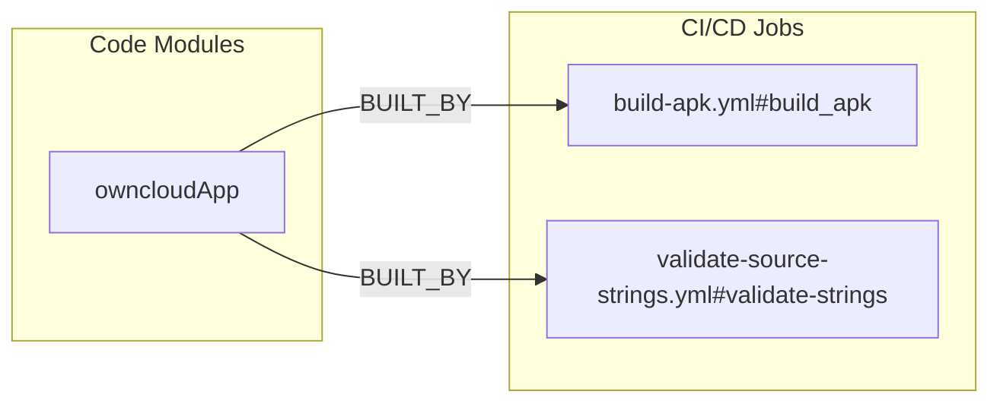
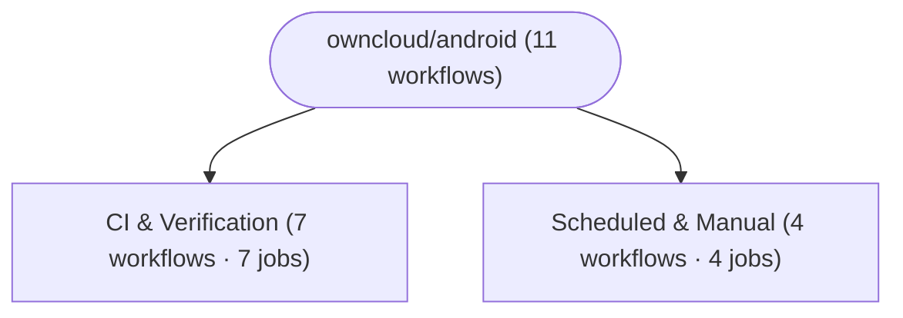

# Repository Architecture Analysis: owncloud/android

## Metadata
- **SHA**: `dc748c73c4d491107a27eb22490dafe7cde2903c`
- **Primary Ecosystem**: Java

## Quality Metrics
- **ast_engine**: tree-sitter
- **avg_cognitive_complexity**: 3.56
- **avg_cyclomatic_complexity**: 6.0
- **component_count**: 0
- **dead_code_count**: 2
- **dead_code_symbols**: 2 entry(ies)
- **duplication_pct**: 85.31
- **file_complexities**: 25 entry(ies)
- **files_analyzed**: 1012
- **fitness_passed**: False
- **fitness_violation_count**: 3
- **framework**: Java Maven/Gradle
- **import_edges**: 100 entry(ies)
- **loc**: 118084
- **max_cognitive_complexity**: 382
- **max_cyclomatic_complexity**: 338
- **sloc**: 77624
- **test_file_count**: 119

## 6-Dimension Repository Scorecard

- **Overall Grade**: `D` (63.85/100)
- **Technical Debt Score**: 36.15
- **Estimated Remediation Effort**: 61.10h

| Dimension | Grade | Score | Weight | Details |
| :--- | :---: | :---: | :---: | :--- |
| Code Quality | `F` | 34.00 | 0.20 | avg_cc=6.00, max_cc=338, duplication=85.31%, dead_code=2 |
| Dependency Health | `B` | 85.00 | 0.15 | dependencies=6, outdated=0, vulnerable=0, has_lockfile=False |
| Maintainability | `F` | 37.00 | 0.15 | avg_cognitive=3.56, max_cognitive=382, fitness_violations=3, oversized_files=15 |
| Pipeline Health | `F` | 55.00 | 0.15 | workflows=11, operational_antipatterns=13, parallel_branches=False |
| Security | `A` | 100.00 | 0.20 | vulnerabilities=0, secrets=0, pipeline_security_findings=0 |
| Test Coverage | `C` | 70.00 | 0.15 | coverage=unavailable, ci_test_job=True, test_files_detected=True |

## Architecture Fitness & Workspace Boundaries

- **[MEDIUM] `ATRUSS-ARCH-005` (COMPLEXITY_THRESHOLD)**: Repository duplication_pct (85.31) exceeds policy threshold (15.0).
- **[MEDIUM] `ATRUSS-ARCH-005` (COMPLEXITY_THRESHOLD)**: Repository max_cognitive_complexity (382.0) exceeds policy threshold (25.0).
- **[MEDIUM] `ATRUSS-ARCH-005` (COMPLEXITY_THRESHOLD)**: Repository max_cyclomatic_complexity (338.0) exceeds policy threshold (20.0).

## Supply Chain Dependencies, Vulnerabilities & Secrets

- **Dependencies Parsed**: 6 | **Vulnerabilities**: 0 | **Secrets**: 0

### Inventory Sample
- `com.facebook.stetho:stetho-okhttp3` `1.6.0` (Maven, `owncloudComLibrary/build.gradle`)
- `com.github.owncloud:dav4android` `oc_support_2.1.5` (Maven, `owncloudComLibrary/build.gradle`)
- `com.squareup.okhttp3:okhttp` `4.9.2` (Maven, `owncloudComLibrary/build.gradle`)
- `junit:junit` `4.13.2` (Maven, `owncloudComLibrary/build.gradle`)
- `org.apache.commons:commons-lang3` `3.20.0` (Maven, `owncloudComLibrary/build.gradle`)
- `org.robolectric:robolectric` `4.16.1` (Maven, `owncloudComLibrary/build.gradle`)

## Section 7: Code-to-Cloud Deployment Traceability

- `owncloudApp` (code_module) --[BUILT_BY]--> `build-apk.yml#build_apk` (ci_job)
- `owncloudApp` (code_module) --[BUILT_BY]--> `validate-source-strings.yml#validate-strings` (ci_job)

## CI/CD Pipeline Topology

