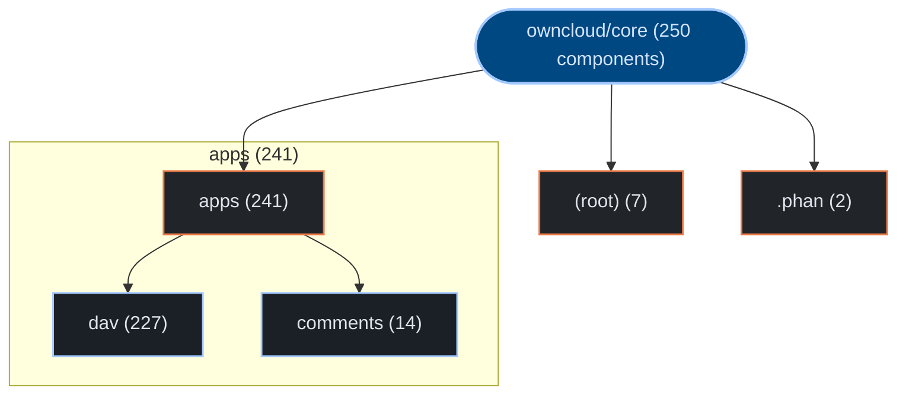

# Repository Architecture Analysis: owncloud/core

## Metadata
- **SHA**: `40cdd07f62ac962cbe07878c45d0f75c4c33d582`
- **Primary Ecosystem**: PHP

## Quality Metrics
- **ast_engine**: fallback
- **avg_cognitive_complexity**: 0.0
- **avg_cyclomatic_complexity**: 0.0
- **component_count**: 250
- **dead_code_count**: 0
- **dead_code_symbols**: 0 entry(ies)
- **duplication_pct**: 0.0
- **file_complexities**: 0 entry(ies)
- **files_analyzed**: 2309
- **fitness_passed**: True
- **fitness_violation_count**: 0
- **framework**: Symfony
- **import_edges**: 0 entry(ies)
- **loc**: 412318
- **max_cognitive_complexity**: 0
- **max_cyclomatic_complexity**: 0
- **sloc**: 231795
- **test_file_count**: 1622

# Architecture: owncloud/core

## Context
- **Repository**: `owncloud/core`
- **SHA**: `40cdd07f62ac962cbe07878c45d0f75c4c33d582`
- **Ecosystem**: PHP
- **Framework**: Symfony

## Building Block View

## Component Details

Showing top 60 representative components out of 250 across 3 module group(s):

- **Module `apps`** (241 components — module: 241)
- **Module `(root)`** (7 components — module: 7)
- **Module `.phan`** (2 components — module: 2)

- **AbstractCalDavBackendTest** (`apps/dav/tests/unit/CalDAV/AbstractCalDavBackendTest.php`): module
- **AbstractCustomPropertiesBackend** (`apps/dav/lib/DAV/AbstractCustomPropertiesBackend.php`): module
- **AbstractTrashBinNode** (`apps/dav/lib/TrashBin/AbstractTrashBinNode.php`): module
- **ActivityListenerTest** (`apps/comments/tests/unit/ActivityListenerTest.php`): module
- **AddressBook** (`apps/dav/lib/CardDAV/AddressBook.php`): module
- **AddressBookImpl** (`apps/dav/lib/CardDAV/AddressBookImpl.php`): module
- **AddressBookImplTest** (`apps/dav/tests/unit/CardDAV/AddressBookImplTest.php`): module
- **AddressBookRoot** (`apps/dav/lib/CardDAV/AddressBookRoot.php`): module
- **AddressBookTest** (`apps/dav/tests/unit/CardDAV/AddressBookTest.php`): module
- **AppEnabledPlugin** (`apps/dav/lib/Connector/Sabre/AppEnabledPlugin.php`): module
- **Application** (`apps/dav/lib/AppInfo/Application.php`): module
- **ApplicationTest** (`apps/dav/tests/unit/AppInfo/ApplicationTest.php`): module
- **AssemblyStream** (`apps/dav/lib/Upload/AssemblyStream.php`): module
- **AssemblyStreamZsync** (`apps/dav/lib/Upload/AssemblyStreamZsync.php`): module
- **Auth** (`apps/dav/lib/Connector/Sabre/Auth.php`): module
- **Auth** (`apps/dav/tests/unit/Connector/Sabre/RequestTest/Auth.php`): module
- **AuthTest** (`apps/dav/tests/unit/Connector/Sabre/AuthTest.php`): module
- **AutorenamePlugin** (`apps/dav/lib/Connector/Sabre/AutorenamePlugin.php`): module
- **AvatarHome** (`apps/dav/lib/Avatars/AvatarHome.php`): module
- **AvatarHomeTest** (`apps/dav/tests/unit/Avatars/AvatarHomeTest.php`): module
- **AvatarNode** (`apps/dav/lib/Avatars/AvatarNode.php`): module
- **AvatarNodeTest** (`apps/dav/tests/unit/Avatars/AvatarNodeTest.php`): module
- **Backend** (`apps/dav/lib/DAV/Sharing/Backend.php`): module
- **BirthdayService** (`apps/dav/lib/CalDAV/BirthdayService.php`): module
- **BirthdayServiceTest** (`apps/dav/tests/unit/CardDAV/BirthdayServiceTest.php`): module
- **BlockLegacyClientPlugin** (`apps/dav/lib/Connector/Sabre/BlockLegacyClientPlugin.php`): module
- **BlockLegacyClientPluginTest** (`apps/dav/tests/unit/Connector/Sabre/BlockLegacyClientPluginTest.php`): module
- **BrowserErrorPagePlugin** (`apps/dav/lib/Files/BrowserErrorPagePlugin.php`): module
- **BrowserErrorPagePluginTest** (`apps/dav/tests/unit/DAV/BrowserErrorPagePluginTest.php`): module
- **CalDavBackend** (`apps/dav/lib/CalDAV/CalDavBackend.php`): module
- **CalDavBackendTest** (`apps/dav/tests/unit/CalDAV/CalDavBackendTest.php`): module
- **Calendar** (`apps/dav/lib/CalDAV/Calendar.php`): module
- **CalendarHome** (`apps/dav/lib/CalDAV/CalendarHome.php`): module
- **CalendarObject** (`apps/dav/lib/CalDAV/CalendarObject.php`): module
- **CalendarRoot** (`apps/dav/lib/CalDAV/CalendarRoot.php`): module
- **CalendarTest** (`apps/dav/tests/unit/CalDAV/CalendarTest.php`): module
- **Capabilities** (`apps/dav/lib/Capabilities.php`): module
- **CardDavBackend** (`apps/dav/lib/CardDAV/CardDavBackend.php`): module
- **CardDavBackendTest** (`apps/dav/tests/unit/CardDAV/CardDavBackendTest.php`): module
- **ChecksumList** (`apps/dav/lib/Connector/Sabre/ChecksumList.php`): module
- **ChunkLocationProvider** (`apps/dav/lib/Upload/ChunkLocationProvider.php`): module
- **ChunkingPlugin** (`apps/dav/lib/Upload/ChunkingPlugin.php`): module
- **ChunkingPluginZsync** (`apps/dav/lib/Upload/ChunkingPluginZsync.php`): module
- **CleanProperties** (`apps/dav/lib/BackgroundJob/CleanProperties.php`): module
- **CleanPropertiesTest** (`apps/dav/tests/unit/BackgroundJob/CleanPropertiesTest.php`): module
- **CleanupChunks** (`apps/dav/lib/Command/CleanupChunks.php`): module
- **CleanupChunksTest** (`apps/dav/tests/unit/Command/CleanupChunksTest.php`): module
- **CommentNode** (`apps/comments/lib/Dav/CommentNode.php`): module
- **CommentPropertiesPlugin** (`apps/dav/lib/Connector/Sabre/CommentPropertiesPlugin.php`): module
- **CommentsNodeTest** (`apps/comments/tests/unit/Dav/CommentsNodeTest.php`): module
- **CommentsPlugin** (`apps/comments/lib/Dav/CommentsPlugin.php`): module
- **CommentsPluginTest** (`apps/comments/tests/unit/Dav/CommentsPluginTest.php`): module
- **CommentsPropertiesPluginTest** (`apps/dav/tests/unit/Connector/Sabre/CommentsPropertiesPluginTest.php`): module
- **ContactsManager** (`apps/dav/lib/CardDAV/ContactsManager.php`): module
- **ContactsManagerTest** (`apps/dav/tests/unit/CardDAV/ContactsManagerTest.php`): module
- **Converter** (`apps/dav/lib/CardDAV/Converter.php`): module
- **ConverterTest** (`apps/dav/tests/unit/CardDAV/ConverterTest.php`): module
- **CopyEtagHeaderPlugin** (`apps/dav/lib/Connector/Sabre/CopyEtagHeaderPlugin.php`): module
- **CopyEtagHeaderPluginTest** (`apps/dav/tests/unit/Connector/Sabre/CopyEtagHeaderPluginTest.php`): module
- **CopyPlugin** (`apps/dav/lib/DAV/CopyPlugin.php`): module

## 6-Dimension Repository Scorecard

- **Overall Grade**: `C` (79.30/100)
- **Technical Debt Score**: 20.70
- **Estimated Remediation Effort**: 9.18h

| Dimension | Grade | Score | Weight | Details |
| :--- | :---: | :---: | :---: | :--- |
| Code Quality | `A` | 100.00 | 0.20 | avg_cc=0.00, max_cc=0, duplication=0.00%, dead_code=0 |
| Dependency Health | `A` | 100.00 | 0.15 | dependencies=55, outdated=0, vulnerable=0, has_lockfile=False |
| Maintainability | `A` | 100.00 | 0.15 | avg_cognitive=0.00, max_cognitive=0, fitness_violations=0, oversized_files=0 |
| Pipeline Health | `F` | 40.00 | 0.15 | workflows=0 |
| Security | `D` | 64.00 | 0.20 | vulnerabilities=0, secrets=2, pipeline_security_findings=0 |
| Test Coverage | `C` | 70.00 | 0.15 | coverage=unavailable, ci_test_job=False, test_files_detected=True |

## Supply Chain Dependencies, Vulnerabilities & Secrets

- **Dependencies Parsed**: 55 | **Vulnerabilities**: 0 | **Secrets**: 2

### Secret Findings (Redacted)
- **[HIGH] `ATRUSS-SEC-005`** at `apps/files_external/l10n/ja.js:9` (`"Please provide a valid app key and secret." : "有効なア***REDACTED***",`)
- **[HIGH] `ATRUSS-SEC-005`** at `apps/files_external/l10n/ja.json:7` (`"Please provide a valid app key and secret." : "有効なア***REDACTED***",`)

### Inventory Sample
- `bantu/ini-get-wrapper` `1.0.1` (composer, `composer.json`)
- `behat/behat` `3.0` (composer, `vendor-bin/behat/composer.json`)
- `behat/mink-extension` `2.2` (composer, `vendor-bin/behat/composer.json`)
- `behat/mink-goutte-driver` `1.2` (composer, `vendor-bin/behat/composer.json`)
- `behat/mink-selenium2-driver` `dev-master` (composer, `vendor-bin/behat/composer.json`)
- `composer/semver` `1.4` (composer, `composer.json`)
- `deepdiver/zipstreamer` `1.1` (composer, `composer.json`)
- `deepdiver1975/tarstreamer` `0.1.1` (composer, `composer.json`)
- `dg/composer-cleaner` `2.0` (composer, `composer.json`)
- `doctrine/dbal` `2.5` (composer, `composer.json`)
- `guzzlehttp/guzzle` `5.3` (composer, `composer.json`)
- `icewind/smb` `3.1.1` (composer, `apps/files_external/3rdparty/composer.json`)
- `icewind/streams` `0.2.0` (composer, `apps/files_external/3rdparty/icewind/smb/composer.json`)
- `icewind/streams` `0.7.1` (composer, `apps/files_external/3rdparty/composer.json`)
- `icewind/streams` `0.7.1` (composer, `composer.json`)
- `interfasys/lognormalizer` `1.0` (composer, `composer.json`)
- `jarnaiz/behat-junit-formatter` `1.3` (composer, `vendor-bin/behat/composer.json`)
- `jeremeamia/superclosure` `2.4` (composer, `composer.json`)
- `league/flysystem` `1.0` (composer, `composer.json`)
- `lukasreschke/id3parser` `0.0.3` (composer, `composer.json`)
- `nikic/php-parser` `4.0` (composer, `composer.json`)
- `owncloud/coding-standard` `1.0` (composer, `vendor-bin/owncloud-codestyle/composer.json`)
- `patchwork/jsqueeze` `2.0` (composer, `composer.json`)
- `patchwork/utf8` `1.3` (composer, `composer.json`)
- `pear/archive_tar` `1.4.7` (composer, `composer.json`)
- `pear/pear-core-minimal` `1.10` (composer, `composer.json`)
- `phan/phan` `0.12.11` (composer, `vendor-bin/phan/composer.json`)
- `phpseclib/phpseclib` `2.0` (composer, `composer.json`)
- `phpstan/phpstan` `0.11` (composer, `vendor-bin/phpstan/composer.json`)
- `pimple/pimple` `3.2.3` (composer, `composer.json`)
- ... (+25 more dependencies)

## CI/CD Pipeline Topology

