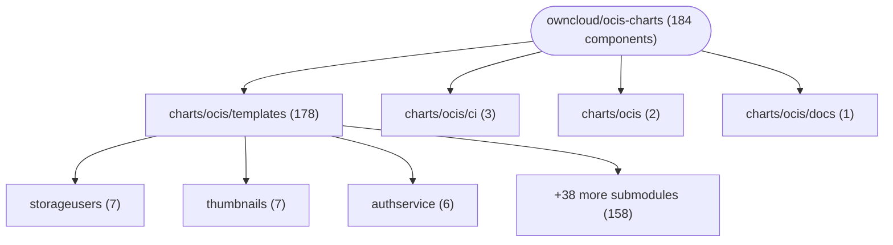

# Repository Architecture Analysis: owncloud/ocis-charts

## Metadata
- **SHA**: `36a4490a94c033c610fcda0de7a62d25206bff02`
- **Primary Ecosystem**: Go

## Quality Metrics
- **ast_engine**: fallback
- **avg_cognitive_complexity**: 0.0
- **avg_cyclomatic_complexity**: 0.0
- **component_count**: 184
- **dead_code_count**: 0
- **dead_code_symbols**: 0 entry(ies)
- **duplication_pct**: 0.0
- **file_complexities**: 0 entry(ies)
- **files_analyzed**: 184
- **fitness_passed**: True
- **fitness_violation_count**: 0
- **framework**: Unknown
- **import_edges**: 0 entry(ies)
- **loc**: 20142
- **max_cognitive_complexity**: 0
- **max_cyclomatic_complexity**: 0
- **sloc**: 9200

# Architecture: owncloud/ocis-charts

## Context
- **Repository**: `owncloud/ocis-charts`
- **SHA**: `36a4490a94c033c610fcda0de7a62d25206bff02`
- **Ecosystem**: Go
- **Framework**: Unknown

## Building Block View

## Component Details

Showing top 60 representative components out of 184 across 4 module group(s):

- **Module `charts/ocis/templates`** (178 components — module: 178)
- **Module `charts/ocis/ci`** (3 components — module: 3)
- **Module `charts/ocis`** (2 components — module: 2)
- **Module `charts/ocis/docs`** (1 components — module: 1)

- **Chart** (`charts/ocis/Chart.yaml`): module
- **absolute-minimum-values** (`charts/ocis/ci/absolute-minimum-values.yaml`): module
- **config** (`charts/ocis/templates/appregistry/config.yaml`): module
- **config** (`charts/ocis/templates/frontend/config.yaml`): module
- **config** (`charts/ocis/templates/policies/config.yaml`): module
- **config** (`charts/ocis/templates/proxy/config.yaml`): module
- **config** (`charts/ocis/templates/settings/config.yaml`): module
- **config** (`charts/ocis/templates/sharing/config.yaml`): module
- **config** (`charts/ocis/templates/web/config.yaml`): module
- **configmap** (`charts/ocis/templates/authservice/configmap.yaml`): module
- **configmap** (`charts/ocis/templates/graph/configmap.yaml`): module
- **configmap** (`charts/ocis/templates/storageusers/configmap.yaml`): module
- **deployment** (`charts/ocis/templates/activitylog/deployment.yaml`): module
- **deployment** (`charts/ocis/templates/antivirus/deployment.yaml`): module
- **deployment** (`charts/ocis/templates/appregistry/deployment.yaml`): module
- **deployment** (`charts/ocis/templates/audit/deployment.yaml`): module
- **deployment** (`charts/ocis/templates/authapp/deployment.yaml`): module
- **deployment** (`charts/ocis/templates/authmachine/deployment.yaml`): module
- **deployment** (`charts/ocis/templates/authservice/deployment.yaml`): module
- **deployment** (`charts/ocis/templates/clientlog/deployment.yaml`): module
- **deployment** (`charts/ocis/templates/collaboration/deployment.yaml`): module
- **deployment** (`charts/ocis/templates/eventhistory/deployment.yaml`): module
- **deployment** (`charts/ocis/templates/frontend/deployment.yaml`): module
- **deployment** (`charts/ocis/templates/gateway/deployment.yaml`): module
- **deployment** (`charts/ocis/templates/graph/deployment.yaml`): module
- **deployment** (`charts/ocis/templates/groups/deployment.yaml`): module
- **deployment** (`charts/ocis/templates/idm/deployment.yaml`): module
- **deployment** (`charts/ocis/templates/idp/deployment.yaml`): module
- **deployment** (`charts/ocis/templates/nats/deployment.yaml`): module
- **deployment** (`charts/ocis/templates/notifications/deployment.yaml`): module
- **deployment** (`charts/ocis/templates/ocdav/deployment.yaml`): module
- **deployment** (`charts/ocis/templates/ocm/deployment.yaml`): module
- **deployment** (`charts/ocis/templates/ocs/deployment.yaml`): module
- **deployment** (`charts/ocis/templates/policies/deployment.yaml`): module
- **deployment** (`charts/ocis/templates/postprocessing/deployment.yaml`): module
- **deployment** (`charts/ocis/templates/proxy/deployment.yaml`): module
- **deployment** (`charts/ocis/templates/search/deployment.yaml`): module
- **deployment** (`charts/ocis/templates/settings/deployment.yaml`): module
- **deployment** (`charts/ocis/templates/sharing/deployment.yaml`): module
- **deployment** (`charts/ocis/templates/sse/deployment.yaml`): module
- **deployment** (`charts/ocis/templates/storagepubliclink/deployment.yaml`): module
- **deployment** (`charts/ocis/templates/storageshares/deployment.yaml`): module
- **deployment** (`charts/ocis/templates/storagesystem/deployment.yaml`): module
- **deployment** (`charts/ocis/templates/storageusers/deployment.yaml`): module
- **deployment** (`charts/ocis/templates/storageusersvault/deployment.yaml`): module
- **deployment** (`charts/ocis/templates/thumbnails/deployment.yaml`): module
- **deployment** (`charts/ocis/templates/userlog/deployment.yaml`): module
- **deployment** (`charts/ocis/templates/users/deployment.yaml`): module
- **deployment** (`charts/ocis/templates/web/deployment.yaml`): module
- **deployment** (`charts/ocis/templates/webdav/deployment.yaml`): module
- **deployment** (`charts/ocis/templates/webfinger/deployment.yaml`): module
- **deployment-values** (`charts/ocis/ci/deployment-values.yaml`): module
- **extra-resources** (`charts/ocis/templates/extra-resources.yaml`): module
- **hpa** (`charts/ocis/templates/activitylog/hpa.yaml`): module
- **hpa** (`charts/ocis/templates/antivirus/hpa.yaml`): module
- **hpa** (`charts/ocis/templates/audit/hpa.yaml`): module
- **hpa** (`charts/ocis/templates/authapp/hpa.yaml`): module
- **hpa** (`charts/ocis/templates/authmachine/hpa.yaml`): module
- **hpa** (`charts/ocis/templates/authservice/hpa.yaml`): module
- **hpa** (`charts/ocis/templates/clientlog/hpa.yaml`): module

## 6-Dimension Repository Scorecard

- **Overall Grade**: `D` (60.50/100)
- **Technical Debt Score**: 39.50
- **Estimated Remediation Effort**: 25.88h

| Dimension | Grade | Score | Weight | Details |
| :--- | :---: | :---: | :---: | :--- |
| Code Quality | `A` | 100.00 | 0.20 | avg_cc=0.00, max_cc=0, duplication=0.00%, dead_code=0 |
| Dependency Health | `A` | 90.00 | 0.15 | dependencies=0 (no manifests parsed) |
| Maintainability | `A` | 100.00 | 0.15 | avg_cognitive=0.00, max_cognitive=0, fitness_violations=0, oversized_files=0 |
| Pipeline Health | `F` | 40.00 | 0.15 | workflows=0 |
| Security | `F` | 0.00 | 0.20 | vulnerabilities=0, secrets=8, pipeline_security_findings=0 |
| Test Coverage | `F` | 40.00 | 0.15 | coverage=unavailable, ci_test_job=False, test_files_detected=False |

## Supply Chain Dependencies, Vulnerabilities & Secrets

- **Dependencies Parsed**: 0 | **Vulnerabilities**: 0 | **Secrets**: 8

### Secret Findings (Redacted)
- **[HIGH] `ATRUSS-SEC-005`** at `deployments/external-user-management/charts/keycloak/000-cert-secret.yaml:4` (`tls.key: LS0t***REDACTED***`)
- **[HIGH] `ATRUSS-SEC-005`** at `deployments/external-user-management/charts/keycloak/002-ocis-realm.yaml:528` (`secret: "6jOG***REDACTED***"`)
- **[HIGH] `ATRUSS-SEC-005`** at `deployments/external-user-management/charts/keycloak/002-ocis-realm.yaml:556` (`secret: "dInF***REDACTED***"`)
- **[HIGH] `ATRUSS-SEC-005`** at `deployments/external-user-management/charts/keycloak/002-ocis-realm.yaml:608` (`secret: "KFeF***REDACTED***"`)
- **[HIGH] `ATRUSS-SEC-005`** at `deployments/external-user-management/charts/keycloak/002-ocis-realm.yaml:731` (`secret: "kxSA***REDACTED***"`)
- **[HIGH] `ATRUSS-SEC-005`** at `deployments/external-user-management/charts/keycloak/002-ocis-realm.yaml:822` (`secret: "UBnt***REDACTED***"`)
- **[HIGH] `ATRUSS-SEC-005`** at `deployments/ocis-office/addons/collabora/proofkey.yaml:8` (`proof_key: LS0t***REDACTED***`)
- **[HIGH] `ATRUSS-SEC-005`** at `deployments/ocis-office/addons/collabora/proofkey.yaml:9` (`proof_key.pub: c3No***REDACTED***`)

## CI/CD Pipeline Topology

