# Repository Architecture Analysis: owncloud/ocis

## Metadata
- **SHA**: `eff619182b6bcffd8731a0a7124cf09bab5e1df8`
- **Primary Ecosystem**: Go

## Quality Metrics
- **ast_engine**: fallback
- **avg_cognitive_complexity**: 0.0
- **avg_cyclomatic_complexity**: 0.0
- **component_count**: 316
- **dead_code_count**: 0
- **dead_code_symbols**: 0 entry(ies)
- **duplication_pct**: 0.0
- **file_complexities**: 0 entry(ies)
- **files_analyzed**: 1548
- **fitness_passed**: True
- **fitness_violation_count**: 0
- **framework**: Go Service
- **import_edges**: 0 entry(ies)
- **loc**: 202986
- **max_cognitive_complexity**: 0
- **max_cyclomatic_complexity**: 0
- **sloc**: 163210
- **test_file_count**: 1418

# Architecture: owncloud/ocis

## Context
- **Repository**: `owncloud/ocis`
- **SHA**: `eff619182b6bcffd8731a0a7124cf09bab5e1df8`
- **Ecosystem**: Go
- **Framework**: Go Service

## Building Block View

```mermaid
graph TD;
  classDef atlasRoot fill:#004882,stroke:#a3c9ff,stroke-width:2px,color:#d3e4ff
  classDef atlasCategory fill:#212428,stroke:#E87A48,stroke-width:1.5px,color:#dfe3eb
  classDef atlasWorkflow fill:#1b2026,stroke:#a3c9ff,stroke-width:1.5px,color:#dfe3eb
  classDef atlasJob fill:#171c22,stroke:#8d9199,stroke-width:1px,color:#dfe3eb
  classDef atlasTarget fill:#005227,stroke:#8bd99b,stroke-width:1.5px,color:#a7f6b6
  classDef atlasAlert fill:#93000a,stroke:#ffb4ab,stroke-width:1.5px,color:#ffdad6
  classDef atlasMore fill:#252a31,stroke:#8d9199,stroke-dasharray:4 4,color:#c3c6cf
    repo_root(["owncloud/ocis (316 components)"]):::atlasRoot
    dir_0_ocis_pkg["ocis-pkg (158)"]:::atlasCategory
    repo_root --> dir_0_ocis_pkg
    sub_0_0_config["config (14)"]:::atlasWorkflow
    dir_0_ocis_pkg --> sub_0_0_config
    sub_0_1_service["service (12)"]:::atlasWorkflow
    dir_0_ocis_pkg --> sub_0_1_service
    sub_0_2_kql["kql (11)"]:::atlasWorkflow
    dir_0_ocis_pkg --> sub_0_2_kql
    sub_0_more["+35 more submodules (121)"]:::atlasMore
    dir_0_ocis_pkg --> sub_0_more
    dir_1_deployments["deployments (65)"]:::atlasCategory
    repo_root --> dir_1_deployments
    sub_1_0_examples_ocis_full["examples/ocis_full (33)"]:::atlasWorkflow
    dir_1_deployments --> sub_1_0_examples_ocis_full
    sub_1_1_examples_ocis_ocm["examples/ocis_ocm (18)"]:::atlasWorkflow
    dir_1_deployments --> sub_1_1_examples_ocis_ocm
    sub_1_2_examples_ocis_multi["examples/ocis_multi (5)"]:::atlasWorkflow
    dir_1_deployments --> sub_1_2_examples_ocis_multi
    sub_1_more["+3 more submodules (9)"]:::atlasMore
    dir_1_deployments --> sub_1_more
    dir_2_ocis["ocis (35)"]:::atlasCategory
    repo_root --> dir_2_ocis
    sub_2_0_pkg["pkg (34)"]:::atlasWorkflow
    dir_2_ocis --> sub_2_0_pkg
    sub_2_1_cmd["cmd (1)"]:::atlasWorkflow
    dir_2_ocis --> sub_2_1_cmd
    dir_3_protogen["protogen (34)"]:::atlasCategory
    repo_root --> dir_3_protogen
    sub_3_0_gen_ocis_services["gen/ocis/services (20)"]:::atlasWorkflow
    dir_3_protogen --> sub_3_0_gen_ocis_services
    sub_3_1_gen_ocis_messages["gen/ocis/messages (14)"]:::atlasWorkflow
    dir_3_protogen --> sub_3_1_gen_ocis_messages
    dir_4_services["services (21)"]:::atlasCategory
    repo_root --> dir_4_services
    sub_4_0_activitylog_pkg["activitylog/pkg (20)"]:::atlasWorkflow
    dir_4_services --> sub_4_0_activitylog_pkg
    sub_4_1_activitylog_cmd["activitylog/cmd (1)"]:::atlasWorkflow
    dir_4_services --> sub_4_1_activitylog_cmd
    dir_other_modules["+2 more modules (3)"]:::atlasMore
    repo_root --> dir_other_modules
```

## Component Details

Showing top 60 representative components out of 316 across 7 module group(s):

- **Module `ocis-pkg`** (158 components — module: 158)
- **Module `deployments`** (65 components — module: 65)
- **Module `ocis`** (35 components — module: 35)
- **Module `protogen`** (34 components — module: 34)
- **Module `services`** (21 components — module: 21)
- **Module `internal`** (2 components — module: 2)
- **Module `tests`** (1 components — module: 1)

- **account** (`ocis-pkg/middleware/account.go`): module
- **advanced-search** (`deployments/examples/ocis_full/web_extensions/advanced-search.yml`): module
- **app** (`ocis-pkg/clihelper/app.go`): module
- **app-registry** (`deployments/examples/ocis_full/config/ocis/app-registry.yaml`): module
- **app-registry** (`deployments/examples/ocis_ocm/config/ocis/app-registry.yaml`): module
- **apps** (`deployments/examples/ocis_ocm/config/ocis/apps.yaml`): module
- **ast** (`ocis-pkg/ast/ast.go`): module
- **backup** (`ocis/pkg/backup/backup.go`): module
- **backup** (`ocis/pkg/command/backup.go`): module
- **backup_test** (`ocis/pkg/backup/backup_test.go`): module
- **benchmark** (`ocis/pkg/command/benchmark.go`): module
- **cache** (`ocis-pkg/sync/cache.go`): module
- **cache_test** (`ocis-pkg/sync/cache_test.go`): module
- **cast** (`ocis-pkg/kql/cast.go`): module
- **checker** (`ocis-pkg/handlers/checker.go`): module
- **checker_test** (`ocis-pkg/handlers/checker_test.go`): module
- **checkgrpc** (`ocis-pkg/checks/checkgrpc.go`): module
- **checkhttp** (`ocis-pkg/checks/checkhttp.go`): module
- **checknats** (`ocis-pkg/checks/checknats.go`): module
- **checknats_test** (`ocis-pkg/checks/checknats_test.go`): module
- **checktcp** (`ocis-pkg/checks/checktcp.go`): module
- **claims** (`ocis-pkg/oidc/claims.go`): module
- **claims_test** (`ocis-pkg/oidc/claims_test.go`): module
- **claimsmapper** (`ocis-pkg/claimsmapper/claimsmapper.go`): module
- **claimsmapper_test** (`ocis-pkg/claimsmapper/claimsmapper_test.go`): module
- **clamav** (`deployments/examples/ocis_full/clamav.yml`): module
- **client** (`ocis-pkg/keycloak/client.go`): module
- **client** (`ocis-pkg/oidc/client.go`): module
- **client** (`ocis-pkg/service/grpc/client.go`): module
- **client_test** (`ocis-pkg/keycloak/client_test.go`): module
- **client_test** (`ocis-pkg/oidc/client_test.go`): module
- **client_test** (`ocis-pkg/service/grpc/client_test.go`): module
- **collabora** (`deployments/examples/ocis_full/collabora.yml`): module
- **collabora** (`deployments/examples/ocis_full/debug/collabora.yml`): module
- **collabora-ocm** (`deployments/examples/ocis_ocm/collabora-ocm.yml`): module
- **command** (`ocis/pkg/register/command.go`): module
- **common** (`ocis/pkg/command/helper/common.go`): module
- **config** (`ocis-pkg/config/config.go`): module
- **config** (`ocis-pkg/tracing/config.go`): module
- **config** (`ocis/pkg/runtime/config/config.go`): module
- **config** (`services/activitylog/pkg/config/config.go`): module
- **config_suite_test** (`ocis-pkg/config/config_suite_test.go`): module
- **config_test** (`ocis-pkg/config/config_test.go`): module
- **connect** (`ocis-pkg/kql/connect.go`): module
- **context** (`ocis-pkg/oidc/context.go`): module
- **creds_fields_test** (`ocis-pkg/config/creds_fields_test.go`): module
- **creds_scope** (`ocis-pkg/config/envdecode/creds_scope.go`): module
- **creds_scope_test** (`ocis-pkg/config/envdecode/creds_scope_test.go`): module
- **crypto** (`ocis-pkg/crypto/crypto.go`): module
- **crypto_suite_test** (`ocis-pkg/crypto/crypto_suite_test.go`): module
- **crypto_test** (`ocis-pkg/crypto/crypto_test.go`): module
- **csp** (`deployments/examples/ocis_full/config/ocis/csp.yaml`): module
- **csp** (`deployments/examples/ocis_keycloak/config/ocis/csp.yaml`): module
- **csp** (`deployments/examples/ocis_multi/config/ocis/csp.yaml`): module
- **csp** (`deployments/examples/ocis_ocm/config/ocis/csp.yaml`): module
- **csp-ocm** (`deployments/examples/ocis_multi/config/ocis/csp-ocm.yaml`): module
- **csp-ocm** (`deployments/examples/ocis_ocm/config/ocis/csp-ocm.yaml`): module
- **csp-ocm-next** (`deployments/examples/ocis_ocm/config/ocis/csp-ocm-next.yaml`): module
- **debug** (`services/activitylog/pkg/config/debug.go`): module
- **decomposedfs** (`ocis/pkg/command/decomposedfs.go`): module

## 6-Dimension Repository Scorecard

- **Overall Grade**: `D` (63.95/100)
- **Technical Debt Score**: 36.05
- **Estimated Remediation Effort**: 72.01h

| Dimension | Grade | Score | Weight | Details |
| :--- | :---: | :---: | :---: | :--- |
| Code Quality | `A` | 100.00 | 0.20 | avg_cc=0.00, max_cc=0, duplication=0.00%, dead_code=0 |
| Dependency Health | `A` | 100.00 | 0.15 | dependencies=2311, outdated=0, vulnerable=0, has_lockfile=True |
| Maintainability | `A` | 100.00 | 0.15 | avg_cognitive=0.00, max_cognitive=0, fitness_violations=0, oversized_files=0 |
| Pipeline Health | `F` | 23.00 | 0.15 | workflows=14, operational_antipatterns=13, parallel_branches=True |
| Security | `F` | 0.00 | 0.20 | vulnerabilities=0, secrets=20, pipeline_security_findings=6 |
| Test Coverage | `C` | 70.00 | 0.15 | coverage=unavailable, ci_test_job=True, test_files_detected=True |

## Supply Chain Dependencies, Vulnerabilities & Secrets

- **Dependencies Parsed**: 2311 | **Vulnerabilities**: 0 | **Secrets**: 20

### Secret Findings (Redacted)
- **[HIGH] `ATRUSS-SEC-005`** at `deployments/examples/ocis_full/config/keycloak/clients/android_app.json:8` (`"secret": "dInF***REDACTED***",`)
- **[HIGH] `ATRUSS-SEC-005`** at `deployments/examples/ocis_full/config/keycloak/clients/cyberduck.json:9` (`"secret": "yoqI***REDACTED***",`)
- **[HIGH] `ATRUSS-SEC-005`** at `deployments/examples/ocis_full/config/keycloak/clients/desktop_client.json:8` (`"secret": "UBnt***REDACTED***",`)
- **[HIGH] `ATRUSS-SEC-005`** at `deployments/examples/ocis_full/config/keycloak/clients/ios_app.json:8` (`"secret": "KFeF***REDACTED***",`)
- **[HIGH] `ATRUSS-SEC-005`** at `deployments/examples/ocis_full/config/keycloak/ocis-realm.dist.json:834` (`"secret": "pIw3***REDACTED***",`)
- **[HIGH] `ATRUSS-SEC-005`** at `deployments/examples/ocis_full/config/keycloak/ocis-realm.dist.json:878` (`"secret": "PY3v***REDACTED***",`)
- **[HIGH] `ATRUSS-SEC-005`** at `deployments/examples/ocis_full/config/keycloak/ocis-realm.dist.json:1000` (`"secret": "3mks***REDACTED***",`)
- **[HIGH] `ATRUSS-SEC-005`** at `deployments/examples/ocis_full/config/keycloak/ocis-realm.dist.json:1033` (`"secret": "dInF***REDACTED***",`)
- **[HIGH] `ATRUSS-SEC-005`** at `deployments/examples/ocis_full/config/keycloak/ocis-realm.dist.json:1094` (`"secret": "KFeF***REDACTED***",`)
- **[HIGH] `ATRUSS-SEC-005`** at `deployments/examples/ocis_full/config/keycloak/ocis-realm.dist.json:1308` (`"secret": "UBnt***REDACTED***",`)
- **[HIGH] `ATRUSS-SEC-005`** at `deployments/examples/ocis_keycloak/config/keycloak/clients/android_app.json:8` (`"secret": "dInF***REDACTED***",`)
- **[HIGH] `ATRUSS-SEC-005`** at `deployments/examples/ocis_keycloak/config/keycloak/clients/cyberduck.json:9` (`"secret": "yoqI***REDACTED***",`)
- **[HIGH] `ATRUSS-SEC-005`** at `deployments/examples/ocis_keycloak/config/keycloak/clients/desktop_client.json:8` (`"secret": "UBnt***REDACTED***",`)
- **[HIGH] `ATRUSS-SEC-005`** at `deployments/examples/ocis_keycloak/config/keycloak/clients/ios_app.json:8` (`"secret": "KFeF***REDACTED***",`)
- **[HIGH] `ATRUSS-SEC-005`** at `deployments/examples/ocis_keycloak/config/keycloak/ocis-realm.dist.json:835` (`"secret": "pIw3***REDACTED***",`)
- **[HIGH] `ATRUSS-SEC-005`** at `deployments/examples/ocis_keycloak/config/keycloak/ocis-realm.dist.json:879` (`"secret": "PY3v***REDACTED***",`)
- **[HIGH] `ATRUSS-SEC-005`** at `deployments/examples/ocis_keycloak/config/keycloak/ocis-realm.dist.json:1001` (`"secret": "3mks***REDACTED***",`)
- **[HIGH] `ATRUSS-SEC-005`** at `deployments/examples/ocis_keycloak/config/keycloak/ocis-realm.dist.json:1034` (`"secret": "dInF***REDACTED***",`)
- **[HIGH] `ATRUSS-SEC-005`** at `deployments/examples/ocis_keycloak/config/keycloak/ocis-realm.dist.json:1095` (`"secret": "KFeF***REDACTED***",`)
- **[HIGH] `ATRUSS-SEC-005`** at `deployments/examples/ocis_keycloak/config/keycloak/ocis-realm.dist.json:1309` (`"secret": "UBnt***REDACTED***",`)

### Inventory Sample
- `codespell` `2.4.3` (PyPI, `vendor/go.opentelemetry.io/otel/requirements.txt`)
- `ankitpokhrel/tus-php` `2.3` (composer, `vendor-bin/behat/composer.json`)
- `behat/behat` `3.13` (composer, `vendor-bin/behat/composer.json`)
- `behat/gherkin` `4.9` (composer, `vendor-bin/behat/composer.json`)
- `behat/mink` `1.7.1` (composer, `vendor-bin/behat/composer.json`)
- `ciaranmcnulty/behat-stepthroughextension` `dev-master` (composer, `vendor-bin/behat/composer.json`)
- `friends-of-behat/mink-extension` `2.7` (composer, `vendor-bin/behat/composer.json`)
- `guzzlehttp/guzzle` `7.7` (composer, `vendor-bin/behat/composer.json`)
- `laminas/laminas-ldap` `2.15` (composer, `vendor-bin/behat/composer.json`)
- `owncloud/coding-standard` `5.3.1` (composer, `vendor-bin/owncloud-codestyle/composer.json`)
- `phpunit/phpunit` `9.6` (composer, `vendor-bin/behat/composer.json`)
- `rdx/behat-variables` `1.2` (composer, `vendor-bin/behat/composer.json`)
- `sabre/xml` `2.2` (composer, `vendor-bin/behat/composer.json`)
- `sensiolabs/behat-page-object-extension` `2.3` (composer, `vendor-bin/behat/composer.json`)
- `splitbrain/php-archive` `1.3` (composer, `vendor-bin/behat/composer.json`)
- `spomky-labs/otphp` `11.5` (composer, `composer.json`)
- `squizlabs/php_codesniffer` `3.7` (composer, `vendor-bin/php_codesniffer/composer.json`)
- `swaggest/json-schema` `0.12.42` (composer, `vendor-bin/behat/composer.json`)
- `symfony/translation` `5.4` (composer, `vendor-bin/behat/composer.json`)
- `dario.cat/mergo` `1.0.2` (golang, `go.mod`)
- `github.com/CiscoM31/godata` `1.0.11` (golang, `go.mod`)
- `github.com/KimMachineGun/automemlimit` `1.0.1` (golang, `go.mod`)
- `github.com/Masterminds/semver` `1.5.0` (golang, `go.mod`)
- `github.com/MicahParks/keyfunc/v2` `2.1.0` (golang, `go.mod`)
- `github.com/Nerzal/gocloak/v13` `13.9.0` (golang, `go.mod`)
- `github.com/bbalet/stopwords` `1.0.0` (golang, `go.mod`)
- `github.com/beevik/etree` `1.8.1` (golang, `go.mod`)
- `github.com/blevesearch/bleve/v2` `2.6.1` (golang, `go.mod`)
- `github.com/cenkalti/backoff` `2.2.1+incompatible` (golang, `go.mod`)
- `github.com/cenkalti/backoff/v5` `5.0.3` (golang, `go.mod`)
- ... (+2281 more dependencies)

## Section 7: Code-to-Cloud Deployment Traceability

```mermaid
flowchart LR
    classDef atlasCategory fill:#212428,stroke:#E87A48,stroke-width:1.5px,color:#dfe3eb
    classDef atlasWorkflow fill:#1b2026,stroke:#a3c9ff,stroke-width:1.5px,color:#dfe3eb
    classDef atlasJob fill:#171c22,stroke:#8d9199,stroke-width:1px,color:#dfe3eb
    classDef atlasTarget fill:#005227,stroke:#8bd99b,stroke-width:1.5px,color:#a7f6b6
    subgraph code_modules["Code Modules"]
        mod_deployments_examples_ocis_full["deployments/examples/ocis_full"]:::atlasCategory
        mod_deployments_examples_ocis_hello["deployments/examples/ocis_hello"]:::atlasCategory
        mod_deployments_examples_ocis_keycloak["deployments/examples/ocis_keycloak"]:::atlasCategory
        mod_deployments_examples_ocis_ldap["deployments/examples/ocis_ldap"]:::atlasCategory
        mod_deployments_examples_ocis_multi["deployments/examples/ocis_multi"]:::atlasCategory
        mod_deployments_examples_ocis_ocm["deployments/examples/ocis_ocm"]:::atlasCategory
        mod_ed3215ce_d600_4b13_a950_220c2e140160["ed3215ce-d600-4b13-a950-220c2e140160"]:::atlasCategory
        mod_ocis_docker["ocis/docker"]:::atlasCategory
        mod_tests_ldap_smoke_distributed["tests/ldap-smoke-distributed"]:::atlasCategory
        mod_tests_ociswrapper["tests/ociswrapper"]:::atlasCategory
        mod_tools_ci_reporter["tools/ci-reporter"]:::atlasCategory
        mod_web["web"]:::atlasCategory
        mod_web_deployments_examples_ocis_web["web/deployments/examples/ocis_web"]:::atlasCategory
        mod_web_docker["web/docker"]:::atlasCategory
    end
    subgraph build_artifacts["Build Artifacts / Containers"]
        art_Dockerfile["Dockerfile"]:::atlasWorkflow
        art_deployments_examples_ocis_full_docker_compose_yml["deployments/examples/ocis_full/docker-compose.yml"]:::atlasWorkflow
        art_deployments_examples_ocis_hello_docker_compose_yml["deployments/examples/ocis_hello/docker-compose.yml"]:::atlasWorkflow
        art_deployments_examples_ocis_hello_monitoring_tracing_docker_compose_additions_yml["deployments/examples/ocis_hello/monitoring_tracing/docker-compose-additions.yml"]:::atlasWorkflow
        art_deployments_examples_ocis_keycloak_docker_compose_yml["deployments/examples/ocis_keycloak/docker-compose.yml"]:::atlasWorkflow
        art_deployments_examples_ocis_keycloak_monitoring_tracing_docker_compose_additions_yml["deployments/examples/ocis_keycloak/monitoring_tracing/docker-compose-additions.yml"]:::atlasWorkflow
        art_deployments_examples_ocis_ldap_docker_compose_yml["deployments/examples/ocis_ldap/docker-compose.yml"]:::atlasWorkflow
        art_deployments_examples_ocis_ldap_monitoring_tracing_docker_compose_additions_yml["deployments/examples/ocis_ldap/monitoring_tracing/docker-compose-additions.yml"]:::atlasWorkflow
        art_deployments_examples_ocis_multi_docker_compose_yml["deployments/examples/ocis_multi/docker-compose.yml"]:::atlasWorkflow
        art_deployments_examples_ocis_multi_monitoring_tracing_docker_compose_additions_yml["deployments/examples/ocis_multi/monitoring_tracing/docker-compose-additions.yml"]:::atlasWorkflow
        art_deployments_examples_ocis_ocm_docker_compose_yml["deployments/examples/ocis_ocm/docker-compose.yml"]:::atlasWorkflow
        art_ocis_docker_Dockerfile_linux_amd64["ocis/docker/Dockerfile.linux.amd64"]:::atlasWorkflow
        art_ocis_docker_Dockerfile_linux_arm64["ocis/docker/Dockerfile.linux.arm64"]:::atlasWorkflow
        art_ocis_docker_Dockerfile_linux_debug_amd64["ocis/docker/Dockerfile.linux.debug.amd64"]:::atlasWorkflow
        art_ocis_docker_Dockerfile_linux_debug_arm64["ocis/docker/Dockerfile.linux.debug.arm64"]:::atlasWorkflow
        art_tests_config_k8s_traefik_config_yaml["tests/config/k8s/traefik-config.yaml"]:::atlasWorkflow
        art_tests_config_k8s_values_yaml["tests/config/k8s/values.yaml"]:::atlasWorkflow
        art_tests_ldap_smoke_distributed_docker_compose_yml["tests/ldap-smoke-distributed/docker-compose.yml"]:::atlasWorkflow
        art_web_deployments_examples_ocis_web_docker_compose_yml["web/deployments/examples/ocis_web/docker-compose.yml"]:::atlasWorkflow
        art_web_deployments_examples_ocis_web_monitoring_tracing_docker_compose_additions_yml["web/deployments/examples/ocis_web/monitoring_tracing/docker-compose-additions.yml"]:::atlasWorkflow
        art_web_docker_compose_yml["web/docker-compose.yml"]:::atlasWorkflow
        art_web_docker_Dockerfile["web/docker/Dockerfile"]:::atlasWorkflow
    end
    subgraph ci_jobs["CI/CD Jobs"]
        job_acceptance_tests_yml_build_and_test["acceptance-tests.yml#build-and-test"]:::atlasJob
        job_acceptance_tests_yml_cli_tests["acceptance-tests.yml#cli-tests"]:::atlasJob
        job_acceptance_tests_yml_core_api_tests["acceptance-tests.yml#core-api-tests"]:::atlasJob
        job_acceptance_tests_yml_e2e_tests["acceptance-tests.yml#e2e-tests"]:::atlasJob
        job_acceptance_tests_yml_external_ldap_distributed_tests["acceptance-tests.yml#external-ldap-distributed-tests"]:::atlasJob
        job_acceptance_tests_yml_ldap_pool_tests["acceptance-tests.yml#ldap-pool-tests"]:::atlasJob
        job_acceptance_tests_yml_local_api_tests["acceptance-tests.yml#local-api-tests"]:::atlasJob
        job_k8s_yml_api_tests["k8s.yml#api-tests"]:::atlasJob
        job_k8s_yml_e2e_tests["k8s.yml#e2e-tests"]:::atlasJob
        job_release_npm_packages_yml_release_npm["release-npm-packages.yml#release-npm"]:::atlasJob
        job_release_yml_license_check["release.yml#license-check"]:::atlasJob
        job_web_tests_yml_detect_web_changes["web-tests.yml#detect-web-changes"]:::atlasJob
        job_web_tests_yml_web_build_test["web-tests.yml#web-build-test"]:::atlasJob
        job_web_tests_yml_web_tests_passed["web-tests.yml#web-tests-passed"]:::atlasJob
        job_weekly_pipeline_report_yml_generate_report["weekly_pipeline_report.yml#generate-report"]:::atlasJob
    end
    subgraph runtime_envs["Runtime Environments"]
        env_kubernetes["kubernetes"]:::atlasTarget
    end
    job_k8s_yml_api_tests -->|DEPLOYS_TO| env_kubernetes
    job_k8s_yml_e2e_tests -->|DEPLOYS_TO| env_kubernetes
    mod_deployments_examples_ocis_full -->|PACKAGED_BY| art_deployments_examples_ocis_full_docker_compose_yml
    mod_deployments_examples_ocis_hello -->|PACKAGED_BY| art_deployments_examples_ocis_hello_docker_compose_yml
    mod_deployments_examples_ocis_hello -->|PACKAGED_BY| art_deployments_examples_ocis_hello_monitoring_tracing_docker_compose_additions_yml
    mod_deployments_examples_ocis_keycloak -->|PACKAGED_BY| art_deployments_examples_ocis_keycloak_docker_compose_yml
    mod_deployments_examples_ocis_keycloak -->|PACKAGED_BY| art_deployments_examples_ocis_keycloak_monitoring_tracing_docker_compose_additions_yml
    mod_deployments_examples_ocis_ldap -->|PACKAGED_BY| art_deployments_examples_ocis_ldap_docker_compose_yml
    mod_deployments_examples_ocis_ldap -->|PACKAGED_BY| art_deployments_examples_ocis_ldap_monitoring_tracing_docker_compose_additions_yml
    mod_deployments_examples_ocis_ldap -->|PACKAGED_BY| art_tests_ldap_smoke_distributed_docker_compose_yml
    mod_deployments_examples_ocis_multi -->|PACKAGED_BY| art_deployments_examples_ocis_multi_docker_compose_yml
    mod_deployments_examples_ocis_multi -->|PACKAGED_BY| art_deployments_examples_ocis_multi_monitoring_tracing_docker_compose_additions_yml
    mod_deployments_examples_ocis_ocm -->|PACKAGED_BY| art_deployments_examples_ocis_ocm_docker_compose_yml
    mod_ed3215ce_d600_4b13_a950_220c2e140160 -->|PACKAGED_BY| art_Dockerfile
    mod_ocis_docker -->|PACKAGED_BY| art_Dockerfile
    mod_ocis_docker -->|PACKAGED_BY| art_deployments_examples_ocis_full_docker_compose_yml
    mod_ocis_docker -->|PACKAGED_BY| art_deployments_examples_ocis_hello_docker_compose_yml
    mod_ocis_docker -->|PACKAGED_BY| art_deployments_examples_ocis_keycloak_docker_compose_yml
    mod_ocis_docker -->|PACKAGED_BY| art_deployments_examples_ocis_ldap_docker_compose_yml
    mod_ocis_docker -->|PACKAGED_BY| art_deployments_examples_ocis_multi_docker_compose_yml
    mod_ocis_docker -->|PACKAGED_BY| art_deployments_examples_ocis_ocm_docker_compose_yml
    mod_ocis_docker -->|PACKAGED_BY| art_ocis_docker_Dockerfile_linux_amd64
    mod_ocis_docker -->|PACKAGED_BY| art_ocis_docker_Dockerfile_linux_arm64
    mod_ocis_docker -->|PACKAGED_BY| art_ocis_docker_Dockerfile_linux_debug_amd64
    mod_ocis_docker -->|PACKAGED_BY| art_ocis_docker_Dockerfile_linux_debug_arm64
    mod_ocis_docker -->|PACKAGED_BY| art_web_deployments_examples_ocis_web_docker_compose_yml
    mod_ocis_docker -->|PACKAGED_BY| art_web_docker_compose_yml
    mod_ocis_docker -->|PACKAGED_BY| art_web_docker_Dockerfile
    mod_tests_ldap_smoke_distributed -->|BUILT_BY| job_acceptance_tests_yml_external_ldap_distributed_tests
    mod_tests_ldap_smoke_distributed -->|PACKAGED_BY| art_tests_ldap_smoke_distributed_docker_compose_yml
    mod_tests_ociswrapper -->|BUILT_BY| job_acceptance_tests_yml_build_and_test
    mod_tests_ociswrapper -->|BUILT_BY| job_acceptance_tests_yml_cli_tests
    mod_tests_ociswrapper -->|BUILT_BY| job_acceptance_tests_yml_core_api_tests
    mod_tests_ociswrapper -->|BUILT_BY| job_acceptance_tests_yml_e2e_tests
    mod_tests_ociswrapper -->|BUILT_BY| job_acceptance_tests_yml_ldap_pool_tests
    mod_tests_ociswrapper -->|BUILT_BY| job_acceptance_tests_yml_local_api_tests
    mod_tests_ociswrapper -->|BUILT_BY| job_k8s_yml_api_tests
    mod_tools_ci_reporter -->|BUILT_BY| job_weekly_pipeline_report_yml_generate_report
    mod_web -->|BUILT_BY| job_k8s_yml_api_tests
    mod_web -->|BUILT_BY| job_k8s_yml_e2e_tests
    mod_web -->|BUILT_BY| job_release_yml_license_check
    mod_web -->|BUILT_BY| job_web_tests_yml_detect_web_changes
    mod_web -->|BUILT_BY| job_web_tests_yml_web_build_test
    mod_web -->|BUILT_BY| job_web_tests_yml_web_tests_passed
    mod_web -->|DEPLOYED_BY| job_release_npm_packages_yml_release_npm
    mod_web -->|PACKAGED_BY| art_deployments_examples_ocis_full_docker_compose_yml
    mod_web -->|PACKAGED_BY| art_deployments_examples_ocis_hello_docker_compose_yml
    mod_web -->|PACKAGED_BY| art_deployments_examples_ocis_keycloak_docker_compose_yml
    mod_web -->|PACKAGED_BY| art_deployments_examples_ocis_multi_docker_compose_yml
    mod_web -->|PACKAGED_BY| art_deployments_examples_ocis_ocm_docker_compose_yml
    mod_web -->|PACKAGED_BY| art_web_deployments_examples_ocis_web_docker_compose_yml
    mod_web -->|PACKAGED_BY| art_web_docker_compose_yml
    mod_web -->|PACKAGED_BY| art_web_docker_Dockerfile
    mod_web -->|PACKAGED_BY| art_tests_config_k8s_values_yaml
    mod_web_deployments_examples_ocis_web -->|PACKAGED_BY| art_web_deployments_examples_ocis_web_docker_compose_yml
    mod_web_deployments_examples_ocis_web -->|PACKAGED_BY| art_web_deployments_examples_ocis_web_monitoring_tracing_docker_compose_additions_yml
    mod_web_docker -->|PACKAGED_BY| art_Dockerfile
    mod_web_docker -->|PACKAGED_BY| art_deployments_examples_ocis_full_docker_compose_yml
    mod_web_docker -->|PACKAGED_BY| art_deployments_examples_ocis_hello_docker_compose_yml
    mod_web_docker -->|PACKAGED_BY| art_deployments_examples_ocis_keycloak_docker_compose_yml
    mod_web_docker -->|PACKAGED_BY| art_deployments_examples_ocis_ldap_docker_compose_yml
    mod_web_docker -->|PACKAGED_BY| art_deployments_examples_ocis_multi_docker_compose_yml
    mod_web_docker -->|PACKAGED_BY| art_deployments_examples_ocis_ocm_docker_compose_yml
    mod_web_docker -->|PACKAGED_BY| art_ocis_docker_Dockerfile_linux_amd64
    mod_web_docker -->|PACKAGED_BY| art_ocis_docker_Dockerfile_linux_arm64
    mod_web_docker -->|PACKAGED_BY| art_ocis_docker_Dockerfile_linux_debug_amd64
    mod_web_docker -->|PACKAGED_BY| art_ocis_docker_Dockerfile_linux_debug_arm64
    mod_web_docker -->|PACKAGED_BY| art_web_deployments_examples_ocis_web_docker_compose_yml
    mod_web_docker -->|PACKAGED_BY| art_web_docker_compose_yml
    mod_web_docker -->|PACKAGED_BY| art_web_docker_Dockerfile
    art_tests_ldap_smoke_distributed_docker_compose_yml -->|BUILT_BY| job_acceptance_tests_yml_external_ldap_distributed_tests
    art_web_docker_compose_yml -->|BUILT_BY| job_web_tests_yml_detect_web_changes
    art_web_docker_compose_yml -->|DEPLOYED_BY| job_release_npm_packages_yml_release_npm
    art_web_docker_compose_yml -->|PACKAGED_BY| art_tests_config_k8s_values_yaml
    art_tests_config_k8s_traefik_config_yaml -->|BUILT_BY| job_k8s_yml_api_tests
    art_tests_config_k8s_traefik_config_yaml -->|BUILT_BY| job_k8s_yml_e2e_tests
    art_tests_config_k8s_values_yaml -->|BUILT_BY| job_k8s_yml_api_tests
    art_tests_config_k8s_values_yaml -->|BUILT_BY| job_k8s_yml_e2e_tests
```

- `k8s.yml#api-tests` (ci_job) --[DEPLOYS_TO]--> `kubernetes` (environment)
- `k8s.yml#e2e-tests` (ci_job) --[DEPLOYS_TO]--> `kubernetes` (environment)
- `deployments/examples/ocis_full` (code_module) --[PACKAGED_BY]--> `deployments/examples/ocis_full/docker-compose.yml` (container)
- `deployments/examples/ocis_hello` (code_module) --[PACKAGED_BY]--> `deployments/examples/ocis_hello/docker-compose.yml` (container)
- `deployments/examples/ocis_hello` (code_module) --[PACKAGED_BY]--> `deployments/examples/ocis_hello/monitoring_tracing/docker-compose-additions.yml` (container)
- `deployments/examples/ocis_keycloak` (code_module) --[PACKAGED_BY]--> `deployments/examples/ocis_keycloak/docker-compose.yml` (container)
- `deployments/examples/ocis_keycloak` (code_module) --[PACKAGED_BY]--> `deployments/examples/ocis_keycloak/monitoring_tracing/docker-compose-additions.yml` (container)
- `deployments/examples/ocis_ldap` (code_module) --[PACKAGED_BY]--> `deployments/examples/ocis_ldap/docker-compose.yml` (container)
- `deployments/examples/ocis_ldap` (code_module) --[PACKAGED_BY]--> `deployments/examples/ocis_ldap/monitoring_tracing/docker-compose-additions.yml` (container)
- `deployments/examples/ocis_ldap` (code_module) --[PACKAGED_BY]--> `tests/ldap-smoke-distributed/docker-compose.yml` (container)
- `deployments/examples/ocis_multi` (code_module) --[PACKAGED_BY]--> `deployments/examples/ocis_multi/docker-compose.yml` (container)
- `deployments/examples/ocis_multi` (code_module) --[PACKAGED_BY]--> `deployments/examples/ocis_multi/monitoring_tracing/docker-compose-additions.yml` (container)
- `deployments/examples/ocis_ocm` (code_module) --[PACKAGED_BY]--> `deployments/examples/ocis_ocm/docker-compose.yml` (container)
- `ed3215ce-d600-4b13-a950-220c2e140160` (code_module) --[PACKAGED_BY]--> `Dockerfile` (container)
- `ocis/docker` (code_module) --[PACKAGED_BY]--> `Dockerfile` (container)
- `ocis/docker` (code_module) --[PACKAGED_BY]--> `deployments/examples/ocis_full/docker-compose.yml` (container)
- `ocis/docker` (code_module) --[PACKAGED_BY]--> `deployments/examples/ocis_hello/docker-compose.yml` (container)
- `ocis/docker` (code_module) --[PACKAGED_BY]--> `deployments/examples/ocis_keycloak/docker-compose.yml` (container)
- `ocis/docker` (code_module) --[PACKAGED_BY]--> `deployments/examples/ocis_ldap/docker-compose.yml` (container)
- `ocis/docker` (code_module) --[PACKAGED_BY]--> `deployments/examples/ocis_multi/docker-compose.yml` (container)
- `ocis/docker` (code_module) --[PACKAGED_BY]--> `deployments/examples/ocis_ocm/docker-compose.yml` (container)
- `ocis/docker` (code_module) --[PACKAGED_BY]--> `ocis/docker/Dockerfile.linux.amd64` (container)
- `ocis/docker` (code_module) --[PACKAGED_BY]--> `ocis/docker/Dockerfile.linux.arm64` (container)
- `ocis/docker` (code_module) --[PACKAGED_BY]--> `ocis/docker/Dockerfile.linux.debug.amd64` (container)
- `ocis/docker` (code_module) --[PACKAGED_BY]--> `ocis/docker/Dockerfile.linux.debug.arm64` (container)
- `ocis/docker` (code_module) --[PACKAGED_BY]--> `web/deployments/examples/ocis_web/docker-compose.yml` (container)
- `ocis/docker` (code_module) --[PACKAGED_BY]--> `web/docker-compose.yml` (container)
- `ocis/docker` (code_module) --[PACKAGED_BY]--> `web/docker/Dockerfile` (container)
- `tests/ldap-smoke-distributed` (code_module) --[BUILT_BY]--> `acceptance-tests.yml#external-ldap-distributed-tests` (ci_job)
- `tests/ldap-smoke-distributed` (code_module) --[PACKAGED_BY]--> `tests/ldap-smoke-distributed/docker-compose.yml` (container)
- `tests/ociswrapper` (code_module) --[BUILT_BY]--> `acceptance-tests.yml#build-and-test` (ci_job)
- `tests/ociswrapper` (code_module) --[BUILT_BY]--> `acceptance-tests.yml#cli-tests` (ci_job)
- `tests/ociswrapper` (code_module) --[BUILT_BY]--> `acceptance-tests.yml#core-api-tests` (ci_job)
- `tests/ociswrapper` (code_module) --[BUILT_BY]--> `acceptance-tests.yml#e2e-tests` (ci_job)
- `tests/ociswrapper` (code_module) --[BUILT_BY]--> `acceptance-tests.yml#ldap-pool-tests` (ci_job)
- `tests/ociswrapper` (code_module) --[BUILT_BY]--> `acceptance-tests.yml#local-api-tests` (ci_job)
- `tests/ociswrapper` (code_module) --[BUILT_BY]--> `k8s.yml#api-tests` (ci_job)
- `tools/ci-reporter` (code_module) --[BUILT_BY]--> `weekly_pipeline_report.yml#generate-report` (ci_job)
- `web` (code_module) --[BUILT_BY]--> `k8s.yml#api-tests` (ci_job)
- `web` (code_module) --[BUILT_BY]--> `k8s.yml#e2e-tests` (ci_job)

## CI/CD Pipeline Topology

```mermaid
graph TD;
  classDef atlasRoot fill:#004882,stroke:#a3c9ff,stroke-width:2px,color:#d3e4ff
  classDef atlasCategory fill:#212428,stroke:#E87A48,stroke-width:1.5px,color:#dfe3eb
  classDef atlasWorkflow fill:#1b2026,stroke:#a3c9ff,stroke-width:1.5px,color:#dfe3eb
  classDef atlasJob fill:#171c22,stroke:#8d9199,stroke-width:1px,color:#dfe3eb
  classDef atlasTarget fill:#005227,stroke:#8bd99b,stroke-width:1.5px,color:#a7f6b6
  classDef atlasAlert fill:#93000a,stroke:#ffb4ab,stroke-width:1.5px,color:#ffdad6
  classDef atlasMore fill:#252a31,stroke:#8d9199,stroke-dasharray:4 4,color:#c3c6cf
  pipeline_root(["owncloud/ocis (14 workflows)"]):::atlasRoot
  grp_0_Scheduled___Manual["Scheduled & Manual (6 workflows · 24 jobs)"]:::atlasCategory
  pipeline_root --> grp_0_Scheduled___Manual
  wf_0_Acceptance_Tests["Acceptance Tests (17 jobs)"]:::atlasWorkflow
  grp_0_Scheduled___Manual --> wf_0_Acceptance_Tests
  job_0_detect_changes["detect-changes"]:::atlasJob
  job_0_build_and_test["build-and-test"]:::atlasJob
  job_0_local_api_tests["local-api-tests"]:::atlasJob
  wf_0_Acceptance_Tests --> job_0_detect_changes
  job_0_detect_changes --> job_0_build_and_test
  job_0_build_and_test --> job_0_local_api_tests
  wf_5_Acceptance_Tests_K8S["Acceptance Tests K8S (2 jobs)"]:::atlasWorkflow
  grp_0_Scheduled___Manual --> wf_5_Acceptance_Tests_K8S
  job_5_api_tests["api-tests"]:::atlasJob
  job_5_e2e_tests["e2e-tests"]:::atlasJob
  wf_5_Acceptance_Tests_K8S --> job_5_api_tests
  wf_5_Acceptance_Tests_K8S --> job_5_e2e_tests
  wf_10_Translation_Sync["Translation Sync (2 jobs)"]:::atlasWorkflow
  grp_0_Scheduled___Manual --> wf_10_Translation_Sync
  job_10_sync["sync"]:::atlasJob
  job_10_sync_web["sync-web"]:::atlasJob
  wf_10_Translation_Sync --> job_10_sync
  job_10_sync --> job_10_sync_web
  grp_1_CI___Verification["CI & Verification (4 workflows · 6 jobs)"]:::atlasCategory
  pipeline_root --> grp_1_CI___Verification
  wf_1_Check_licenses["Check licenses (1 jobs)"]:::atlasWorkflow
  grp_1_CI___Verification --> wf_1_Check_licenses
  job_1_license_check["license-check"]:::atlasJob
  wf_1_Check_licenses --> job_1_license_check
  wf_6_Validate_PR_title["Validate PR title (1 jobs)"]:::atlasWorkflow
  grp_1_CI___Verification --> wf_6_Validate_PR_title
  job_6_validate_pr_title["validate-pr-title"]:::atlasJob
  wf_6_Validate_PR_title --> job_6_validate_pr_title
  wf_11_Web_Tests["Web Tests (3 jobs)"]:::atlasWorkflow
  grp_1_CI___Verification --> wf_11_Web_Tests
  job_11_detect_web_changes["detect-web-changes"]:::atlasJob
  job_11_web_build_test["web-build-test"]:::atlasJob
  job_11_web_tests_passed["web-tests-passed"]:::atlasJob
  wf_11_Web_Tests --> job_11_detect_web_changes
  job_11_detect_web_changes --> job_11_web_build_test
  job_11_detect_web_changes --> job_11_web_tests_passed
  job_11_web_build_test --> job_11_web_tests_passed
  grp_2_Release___Deploy["Release & Deploy (3 workflows · 10 jobs)"]:::atlasCategory
  pipeline_root --> grp_2_Release___Deploy
  wf_3_Test_Deployment_Examples["Test Deployment Examples (1 jobs)"]:::atlasWorkflow
  grp_2_Release___Deploy --> wf_3_Test_Deployment_Examples
  job_3_test["test"]:::atlasJob
  wf_3_Test_Deployment_Examples --> job_3_test
  wf_7_Release_NPM_packages["Release NPM packages (1 jobs)"]:::atlasWorkflow
  grp_2_Release___Deploy --> wf_7_Release_NPM_packages
  job_7_release_npm["release-npm"]:::atlasJob
  wf_7_Release_NPM_packages --> job_7_release_npm
  wf_8_Release["Release (8 jobs)"]:::atlasWorkflow
  grp_2_Release___Deploy --> wf_8_Release
  job_8_determine_release_type["determine-release-type"]:::atlasJob
  job_8_generate_code["generate-code"]:::atlasJob
  wf_8_Release --> job_8_determine_release_type
  job_8_determine_release_type --> job_8_generate_code
  grp_3_Security___Governance["Security & Governance (1 workflows · 1 jobs)"]:::atlasCategory
  pipeline_root --> grp_3_Security___Governance
  wf_9_Remove_stale_branches["Remove stale branches (1 jobs)"]:::atlasWorkflow
  grp_3_Security___Governance --> wf_9_Remove_stale_branches
  wf_more["+4 more workflows"]:::atlasMore
  pipeline_root --> wf_more
```

