# Repository Architecture Analysis: owncloud/richdocuments

## Metadata
- **SHA**: `343291f22b3c88593156269700feefe9af443dcf`
- **Primary Ecosystem**: PHP

## Quality Metrics
- **ast_engine**: fallback
- **avg_cognitive_complexity**: 0.0
- **avg_cyclomatic_complexity**: 0.0
- **component_count**: 47
- **dead_code_count**: 0
- **dead_code_symbols**: 0 entry(ies)
- **duplication_pct**: 0.0
- **file_complexities**: 0 entry(ies)
- **files_analyzed**: 47
- **fitness_passed**: True
- **fitness_violation_count**: 0
- **framework**: Symfony
- **import_edges**: 0 entry(ies)
- **loc**: 8385
- **max_cognitive_complexity**: 0
- **max_cyclomatic_complexity**: 0
- **sloc**: 5141
- **test_file_count**: 18

# Architecture: owncloud/richdocuments

## Context
- **Repository**: `owncloud/richdocuments`
- **SHA**: `343291f22b3c88593156269700feefe9af443dcf`
- **Ecosystem**: PHP
- **Framework**: Symfony

## Building Block View

```mermaid
graph TD;
  classDef atlasRoot fill:#004882,stroke:#a3c9ff,stroke-width:2px,color:#d3e4ff
  classDef atlasCategory fill:#212428,stroke:#E87A48,stroke-width:1.5px,color:#dfe3eb
  classDef atlasWorkflow fill:#1b2026,stroke:#a3c9ff,stroke-width:1.5px,color:#dfe3eb
  classDef atlasJob fill:#171c22,stroke:#8d9199,stroke-width:1px,color:#dfe3eb
  classDef atlasTarget fill:#005227,stroke:#8bd99b,stroke-width:1.5px,color:#a7f6b6
  classDef atlasAlert fill:#93000a,stroke:#ffb4ab,stroke-width:1.5px,color:#ffdad6
  classDef atlasMore fill:#252a31,stroke:#8d9199,stroke-dasharray:4 4,color:#c3c6cf
    repo_root(["owncloud/richdocuments (47 components)"]):::atlasRoot
    subgraph sg_dir_0_lib["lib (20)"]
      direction TB
      dir_0_lib["lib (20)"]:::atlasCategory
      sub_0_0__module_root_["(module root) (7)"]:::atlasWorkflow
      dir_0_lib --> sub_0_0__module_root_
      sub_0_1_Controller["Controller (6)"]:::atlasWorkflow
      dir_0_lib --> sub_0_1_Controller
      sub_0_2_Db["Db (2)"]:::atlasWorkflow
      dir_0_lib --> sub_0_2_Db
      sub_0_more["+4 more submodules (5)"]:::atlasMore
      dir_0_lib --> sub_0_more
    end
    repo_root --> dir_0_lib
    subgraph sg_dir_1_tests["tests (15)"]
      direction TB
      dir_1_tests["tests (15)"]:::atlasCategory
      sub_1_0_unit["unit (11)"]:::atlasWorkflow
      dir_1_tests --> sub_1_0_unit
      sub_1_1_acceptance["acceptance (4)"]:::atlasWorkflow
      dir_1_tests --> sub_1_1_acceptance
    end
    repo_root --> dir_1_tests
    dir_2_appinfo["appinfo (5)"]:::atlasCategory
    repo_root --> dir_2_appinfo
    dir_3__root_["(root) (3)"]:::atlasCategory
    repo_root --> dir_3__root_
    dir_4_templates["templates (3)"]:::atlasCategory
    repo_root --> dir_4_templates
    dir_other_modules["+1 more modules (1)"]:::atlasMore
    repo_root --> dir_other_modules
```

## Component Details
- **.php-cs-fixer.dist** (`.php-cs-fixer.dist.php`): module
- **admin** (`admin.php`): module
- **settings** (`settings.php`): module
- **config** (`.phan/config.php`): module
- **app** (`appinfo/app.php`): module
- **routes** (`appinfo/routes.php`): module
- **Version20190310162809** (`appinfo/Migrations/Version20190310162809.php`): module
- **Version20190623184232** (`appinfo/Migrations/Version20190623184232.php`): module
- **Version20190710194710** (`appinfo/Migrations/Version20190710194710.php`): module
- **AppConfig** (`lib/AppConfig.php`): module
- **Db** (`lib/Db.php`): module
- **DiscoveryService** (`lib/DiscoveryService.php`): module
- **DocumentService** (`lib/DocumentService.php`): module
- **FederationService** (`lib/FederationService.php`): module
- **FileService** (`lib/FileService.php`): module
- **Helper** (`lib/Helper.php`): module
- **Application** (`lib/AppInfo/Application.php`): module
- **CleanupExpiredWopiTokens** (`lib/BackgroundJob/CleanupExpiredWopiTokens.php`): module
- **DocumentController** (`lib/Controller/DocumentController.php`): module
- **DocumentRevisionController** (`lib/Controller/DocumentRevisionController.php`): module
- **OCSFederationController** (`lib/Controller/OCSFederationController.php`): module
- **SettingsController** (`lib/Controller/SettingsController.php`): module
- **WebAssetController** (`lib/Controller/WebAssetController.php`): module
- **WopiController** (`lib/Controller/WopiController.php`): module
- **Storage** (`lib/Db/Storage.php`): module
- **Wopi** (`lib/Db/Wopi.php`): module
- **DownloadResponse** (`lib/Http/DownloadResponse.php`): module
- **Admin** (`lib/Panels/Admin.php`): module
- **Personal** (`lib/Panels/Personal.php`): module
- **documents** (`templates/documents.php`): module
- **settings-admin** (`templates/settings-admin.php`): module
- **settings-personal** (`templates/settings-personal.php`): module
- **behat** (`tests/acceptance/config/behat.php`): module
- **SecureViewContext** (`tests/acceptance/features/bootstrap/SecureViewContext.php`): module
- **bootstrap** (`tests/acceptance/features/bootstrap/bootstrap.php`): module
- **AdminAdditionalSettingsPage** (`tests/acceptance/features/lib/AdminAdditionalSettingsPage.php`): module
- **AppConfigTest** (`tests/unit/AppConfigTest.php`): module
- **DiscoveryServiceTest** (`tests/unit/DiscoveryServiceTest.php`): module
- **DocumentServiceTest** (`tests/unit/DocumentServiceTest.php`): module
- **FederationServiceTest** (`tests/unit/FederationServiceTest.php`): module
- **FileServiceTest** (`tests/unit/FileServiceTest.php`): module
- **ApplicationTest** (`tests/unit/AppInfo/ApplicationTest.php`): module
- **CleanupExpiredWopiTokensTest** (`tests/unit/BackgroundJob/CleanupExpiredWopiTokensTest.php`): module
- **DocumentControllerTest** (`tests/unit/Controller/DocumentControllerTest.php`): module
- **DocumentRevisionControllerTest** (`tests/unit/Controller/DocumentRevisionControllerTest.php`): module
- **WopiControllerTest** (`tests/unit/Controller/WopiControllerTest.php`): module
- **WopiTest** (`tests/unit/Db/WopiTest.php`): module

## 6-Dimension Repository Scorecard

- **Overall Grade**: `B` (87.85/100)
- **Technical Debt Score**: 12.15
- **Estimated Remediation Effort**: 11.04h

| Dimension | Grade | Score | Weight | Details |
| :--- | :---: | :---: | :---: | :--- |
| Code Quality | `A` | 100.00 | 0.20 | avg_cc=0.00, max_cc=0, duplication=0.00%, dead_code=0 |
| Dependency Health | `A` | 100.00 | 0.15 | dependencies=583, outdated=0, vulnerable=0, has_lockfile=True |
| Maintainability | `A` | 100.00 | 0.15 | avg_cognitive=0.00, max_cognitive=0, fitness_violations=0, oversized_files=0 |
| Pipeline Health | `F` | 49.00 | 0.15 | workflows=6, operational_antipatterns=13, parallel_branches=True |
| Security | `A` | 100.00 | 0.20 | vulnerabilities=0, secrets=0, pipeline_security_findings=0 |
| Test Coverage | `C` | 70.00 | 0.15 | coverage=unavailable, ci_test_job=True, test_files_detected=True |

## Supply Chain Dependencies, Vulnerabilities & Secrets

- **Dependencies Parsed**: 583 | **Vulnerabilities**: 0 | **Secrets**: 0

### Inventory Sample
- `behat/behat` `3.31` (composer, `vendor-bin/behat/composer.json`)
- `behat/mink` `1.7.1` (composer, `vendor-bin/behat/composer.json`)
- `behat/mink-selenium2-driver` `1.5` (composer, `vendor-bin/behat/composer.json`)
- `ciaranmcnulty/behat-stepthroughextension` `dev-master` (composer, `vendor-bin/behat/composer.json`)
- `friends-of-behat/mink-extension` `2.7` (composer, `vendor-bin/behat/composer.json`)
- `guzzlehttp/guzzle` `7.12` (composer, `vendor-bin/behat/composer.json`)
- `helmich/phpunit-json-assert` `3.5` (composer, `vendor-bin/behat/composer.json`)
- `owncloud/coding-standard` `5.3` (composer, `vendor-bin/owncloud-codestyle/composer.json`)
- `phan/phan` `5.4` (composer, `vendor-bin/phan/composer.json`)
- `phpstan/phpstan` `1.10` (composer, `vendor-bin/phpstan/composer.json`)
- `phpunit/phpunit` `9.6` (composer, `vendor-bin/behat/composer.json`)
- `rdx/behat-variables` `1.2` (composer, `vendor-bin/behat/composer.json`)
- `sabre/xml` `2.2` (composer, `vendor-bin/behat/composer.json`)
- `sensiolabs/behat-page-object-extension` `2.3` (composer, `vendor-bin/behat/composer.json`)
- `squizlabs/php_codesniffer` `3.7` (composer, `vendor-bin/php_codesniffer/composer.json`)
- `symfony/translation` `5.4` (composer, `vendor-bin/behat/composer.json`)
- `@ownclouders/eslint-config` `12.5.1` (npm, `package.json`)
- `@ownclouders/eslint-config` `12.5.1` (npm, `pnpm-lock.yaml`)
- `@ownclouders/extension-sdk` `12.5.1` (npm, `package.json`)
- `@ownclouders/extension-sdk` `12.5.1` (npm, `pnpm-lock.yaml`)
- `@ownclouders/prettier-config` `0.0.2` (npm, `package.json`)
- `@ownclouders/prettier-config` `0.0.2` (npm, `pnpm-lock.yaml`)
- `@ownclouders/tsconfig` `0.0.7` (npm, `package.json`)
- `@ownclouders/tsconfig` `0.0.7` (npm, `pnpm-lock.yaml`)
- `@ownclouders/web-pkg` `0.0.3` (npm, `pnpm-lock.yaml`)
- `@types/node` `26.6.6` (npm, `package.json`)
- `@types/node` `26.6.6` (npm, `pnpm-lock.yaml`)
- `axios` `1.21.0` (npm, `package.json`)
- `axios` `1.21.0` (npm, `pnpm-lock.yaml`)
- `easygettext` `*` (npm, `package.json`)
- ... (+553 more dependencies)

## CI/CD Pipeline Topology

```mermaid
graph TD;
  classDef atlasRoot fill:#004882,stroke:#a3c9ff,stroke-width:2px,color:#d3e4ff
  classDef atlasCategory fill:#212428,stroke:#E87A48,stroke-width:1.5px,color:#dfe3eb
  classDef atlasWorkflow fill:#1b2026,stroke:#a3c9ff,stroke-width:1.5px,color:#dfe3eb
  classDef atlasJob fill:#171c22,stroke:#8d9199,stroke-width:1px,color:#dfe3eb
  classDef atlasTarget fill:#005227,stroke:#8bd99b,stroke-width:1.5px,color:#a7f6b6
  classDef atlasAlert fill:#93000a,stroke:#ffb4ab,stroke-width:1.5px,color:#ffdad6
  classDef atlasMore fill:#252a31,stroke:#8d9199,stroke-dasharray:4 4,color:#c3c6cf
  pipeline_root(["owncloud/richdocuments (6 workflows)"]):::atlasRoot
  subgraph sg_grp_0_CI___Verification["CI & Verification (2 workflows · 8 jobs)"]
    direction TB
    subgraph sg_wf_0_Lint_PR_title["Lint PR title (1 jobs)"]
      direction TB
      wf_0_Lint_PR_title(["Trigger: Lint PR title"]):::atlasWorkflow
      job_0_lint["lint"]:::atlasJob
      wf_0_Lint_PR_title --> job_0_lint
    end
    pipeline_root --> wf_0_Lint_PR_title
    subgraph sg_wf_1_CI["CI (7 jobs)"]
      direction TB
      wf_1_CI(["Trigger: CI"]):::atlasWorkflow
      job_1_get_vars["get-vars"]:::atlasJob
      job_1_semantic_git_messages["semantic-git-messages"]:::atlasJob
      job_1_php_code_style["php-code-style"]:::atlasJob
      wf_1_CI --> job_1_get_vars
      wf_1_CI --> job_1_semantic_git_messages
      job_1_get_vars --> job_1_php_code_style
    end
    pipeline_root --> wf_1_CI
  end
  subgraph sg_grp_1_Scheduled___Manual["Scheduled & Manual (2 workflows · 2 jobs)"]
    direction TB
    subgraph sg_wf_4_Translation_Sync["Translation Sync (1 jobs)"]
      direction TB
      wf_4_Translation_Sync(["Trigger: Translation Sync"]):::atlasWorkflow
      job_4_sync["sync"]:::atlasJob
      wf_4_Translation_Sync --> job_4_sync
    end
    pipeline_root --> wf_4_Translation_Sync
    subgraph sg_wf_5_Zizmor["Zizmor (1 jobs)"]
      direction TB
      wf_5_Zizmor(["Trigger: Zizmor"]):::atlasWorkflow
      job_5_zizmor["zizmor"]:::atlasJob
      wf_5_Zizmor --> job_5_zizmor
    end
    pipeline_root --> wf_5_Zizmor
  end
  subgraph sg_grp_2_Release___Deploy["Release & Deploy (1 workflows · 1 jobs)"]
    direction TB
    subgraph sg_wf_2_Release["Release (1 jobs)"]
      direction TB
      wf_2_Release(["Trigger: Release"]):::atlasWorkflow
      job_2_release["release"]:::atlasJob
      wf_2_Release --> job_2_release
    end
    pipeline_root --> wf_2_Release
  end
  subgraph sg_grp_3_Security___Governance["Security & Governance (1 workflows · 1 jobs)"]
    direction TB
    subgraph sg_wf_3_Security_Scan["Security Scan (1 jobs)"]
      direction TB
      wf_3_Security_Scan(["Trigger: Security Scan"]):::atlasWorkflow
      job_3_trivy["trivy"]:::atlasJob
      wf_3_Security_Scan --> job_3_trivy
    end
    pipeline_root --> wf_3_Security_Scan
  end
```

