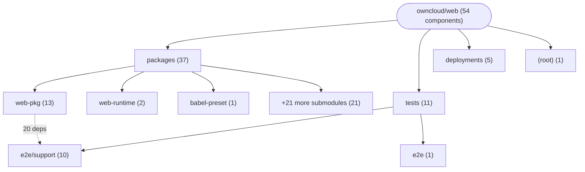
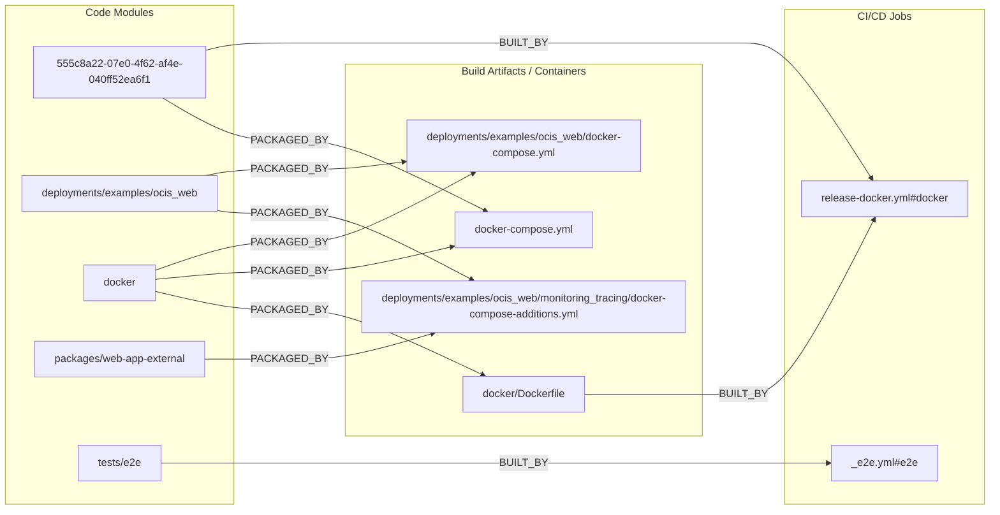
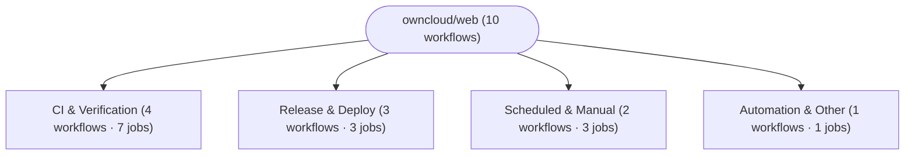

# Repository Architecture Analysis: owncloud/web

## Metadata
- **SHA**: `b16a34fdf5569d2fd63b1ff3c575c1a4ee569ad3`
- **Primary Ecosystem**: JavaScript/TypeScript

## Quality Metrics
- **ast_engine**: tree-sitter
- **avg_cognitive_complexity**: 1.94
- **avg_cyclomatic_complexity**: 2.29
- **component_count**: 54
- **dead_code_count**: 20
- **dead_code_symbols**: 20 entry(ies)
- **duplication_pct**: 87.21
- **file_complexities**: 25 entry(ies)
- **files_analyzed**: 1203
- **fitness_passed**: False
- **fitness_violation_count**: 3
- **framework**: React (Vite)
- **import_edges**: 100 entry(ies)
- **loc**: 121033
- **max_cognitive_complexity**: 105
- **max_cyclomatic_complexity**: 40
- **sloc**: 99643
- **test_file_count**: 697

# Architecture: owncloud/web

## Context
- **Repository**: `owncloud/web`
- **SHA**: `b16a34fdf5569d2fd63b1ff3c575c1a4ee569ad3`
- **Ecosystem**: JavaScript/TypeScript
- **Framework**: React (Vite)

## Building Block View

## Component Details
- **555c8a22-07e0-4f62-af4e-040ff52ea6f1** (`package.json`): MODULE
- **@ownclouders/babel-preset** (`packages/babel-preset/package.json`): MODULE
- **@ownclouders/design-system** (`packages/design-system/package.json`): MODULE
- **@ownclouders/eslint-config** (`packages/eslint-config/package.json`): MODULE
- **@ownclouders/extension-sdk** (`packages/extension-sdk/package.json`): MODULE
- **@ownclouders/prettier-config** (`packages/prettier-config/package.json`): MODULE
- **@ownclouders/tsconfig** (`packages/tsconfig/package.json`): MODULE
- **web-app-activities** (`packages/web-app-activities/package.json`): MODULE
- **web-app-admin-settings** (`packages/web-app-admin-settings/package.json`): MODULE
- **web-app-app-store** (`packages/web-app-app-store/package.json`): MODULE
- **epub-reader** (`packages/web-app-epub-reader/package.json`): MODULE
- **external** (`packages/web-app-external/package.json`): MODULE
- **web-app-files** (`packages/web-app-files/package.json`): MODULE
- **html-editor** (`packages/web-app-html-editor/package.json`): MODULE
- **web-app-ocm** (`packages/web-app-ocm/package.json`): MODULE
- **web-app-password-protected-folders** (`packages/web-app-password-protected-folders/package.json`): MODULE
- **pdf-viewer** (`packages/web-app-pdf-viewer/package.json`): MODULE
- **preview** (`packages/web-app-preview/package.json`): MODULE
- **web-app-search** (`packages/web-app-search/package.json`): MODULE
- **text-editor** (`packages/web-app-text-editor/package.json`): MODULE
- **web-app-webfinger** (`packages/web-app-webfinger/package.json`): MODULE
- **@ownclouders/web-client** (`packages/web-client/package.json`): MODULE
- **@ownclouders/web-pkg** (`packages/web-pkg/package.json`): MODULE
- **web-runtime** (`packages/web-runtime/package.json`): MODULE
- **@ownclouders/web-test-helpers** (`packages/web-test-helpers/package.json`): MODULE
- **e2e** (`tests/e2e/package.json`): MODULE
- **EDITOR_MODE_EDIT** (`packages/web-pkg/src/composables/actions/files/useFileActions.ts`): UI_COMPONENT (deps: API_api_index, API_davSpaces_index, API_external_index, API_graph_index, API_keycloak_index, API_provision_index, API_share_index, API_token_index, API_userSettings_index, AppStore)
- **EDITOR_MODE_CREATE** (`packages/web-pkg/src/composables/actions/files/useFileActions.ts`): UI_COMPONENT (deps: API_api_index, API_davSpaces_index, API_external_index, API_graph_index, API_keycloak_index, API_provision_index, API_share_index, API_token_index, API_userSettings_index, AppStore)
- **HttpClient** (`packages/web-pkg/src/http/client.ts`): SERVICE
- **ArchiverService** (`packages/web-pkg/src/services/archiver.ts`): SERVICE
- **CacheService** (`packages/web-pkg/src/services/cache.ts`): SERVICE
- **LoadingService** (`packages/web-pkg/src/services/loadingService.ts`): SERVICE
- **AppProviderService** (`packages/web-pkg/src/services/appProvider/service.ts`): SERVICE (deps: ClientService, HttpClient)
- **ClientService** (`packages/web-pkg/src/services/client/client.ts`): SERVICE
- **FolderService** (`packages/web-pkg/src/services/folder/folderService.ts`): SERVICE
- **PasswordPolicyService** (`packages/web-pkg/src/services/passwordPolicy/passwordPolicy.ts`): SERVICE
- **PreviewService** (`packages/web-pkg/src/services/preview/previewService.ts`): SERVICE (deps: CacheService, ClientService, HttpClient)
- **UppyService** (`packages/web-pkg/src/services/uppy/uppyService.ts`): SERVICE
- **AuthService** (`packages/web-runtime/src/services/auth/authService.ts`): SERVICE
- **API_api_index** (`tests/e2e/support/api/index.ts`): API_ROUTE
- **API_davSpaces_index** (`tests/e2e/support/api/davSpaces/index.ts`): API_ROUTE
- **API_external_index** (`tests/e2e/support/api/external/index.ts`): API_ROUTE
- **API_graph_index** (`tests/e2e/support/api/graph/index.ts`): API_ROUTE
- **API_keycloak_index** (`tests/e2e/support/api/keycloak/index.ts`): API_ROUTE
- **API_provision_index** (`tests/e2e/support/api/provision/index.ts`): API_ROUTE
- **API_share_index** (`tests/e2e/support/api/share/index.ts`): API_ROUTE
- **API_token_index** (`tests/e2e/support/api/token/index.ts`): API_ROUTE
- **API_userSettings_index** (`tests/e2e/support/api/userSettings/index.ts`): API_ROUTE
- **AppStore** (`tests/e2e/support/objects/app-store/index.ts`): SERVICE
- **docker-compose** (`deployments/examples/ocis_web/docker-compose.yml`): module
- **app-registry** (`deployments/examples/ocis_web/config/ocis/app-registry.yaml`): module
- **csp** (`deployments/examples/ocis_web/config/ocis/csp.yaml`): module
- **proxy** (`deployments/examples/ocis_web/config/ocis/proxy.yaml`): module
- **docker-compose-additions** (`deployments/examples/ocis_web/monitoring_tracing/docker-compose-additions.yml`): module

## 6-Dimension Repository Scorecard

- **Overall Grade**: `F` (44.30/100)
- **Technical Debt Score**: 55.70
- **Estimated Remediation Effort**: 74.37h

| Dimension | Grade | Score | Weight | Details |
| :--- | :---: | :---: | :---: | :--- |
| Code Quality | `F` | 30.00 | 0.20 | avg_cc=2.29, max_cc=40, duplication=87.21%, dead_code=20 |
| Dependency Health | `A` | 100.00 | 0.15 | dependencies=1782, outdated=0, vulnerable=0, has_lockfile=True |
| Maintainability | `F` | 37.00 | 0.15 | avg_cognitive=1.94, max_cognitive=105, fitness_violations=3, oversized_files=8 |
| Pipeline Health | `F` | 3.00 | 0.15 | workflows=10, operational_antipatterns=17, parallel_branches=True |
| Security | `F` | 34.00 | 0.20 | vulnerabilities=0, secrets=1, pipeline_security_findings=5 |
| Test Coverage | `C` | 70.00 | 0.15 | coverage=unavailable, ci_test_job=True, test_files_detected=True |

## Architecture Fitness & Workspace Boundaries

- **[MEDIUM] `ATRUSS-ARCH-005` (COMPLEXITY_THRESHOLD)**: Repository duplication_pct (87.21) exceeds policy threshold (15.0).
- **[MEDIUM] `ATRUSS-ARCH-005` (COMPLEXITY_THRESHOLD)**: Repository max_cognitive_complexity (105.0) exceeds policy threshold (25.0).
- **[MEDIUM] `ATRUSS-ARCH-005` (COMPLEXITY_THRESHOLD)**: Repository max_cyclomatic_complexity (40.0) exceeds policy threshold (20.0).

### Workspace Packages
- **@ownclouders/babel-preset** (`packages/babel-preset`, react_ts_js, pnpm)
- **@ownclouders/design-system** (`packages/design-system`, react_ts_js, pnpm) -> internal deps: `@ownclouders/web-test-helpers`
- **@ownclouders/eslint-config** (`packages/eslint-config`, react_ts_js, pnpm)
- **@ownclouders/extension-sdk** (`packages/extension-sdk`, react_ts_js, pnpm)
- **@ownclouders/prettier-config** (`packages/prettier-config`, react_ts_js, pnpm)
- **@ownclouders/tsconfig** (`packages/tsconfig`, react_ts_js, pnpm)
- **web-app-activities** (`packages/web-app-activities`, react_ts_js, pnpm) -> internal deps: `@ownclouders/design-system, @ownclouders/web-client, @ownclouders/web-pkg, @ownclouders/web-test-helpers`
- **web-app-admin-settings** (`packages/web-app-admin-settings`, react_ts_js, pnpm) -> internal deps: `@ownclouders/design-system, @ownclouders/web-client, @ownclouders/web-pkg, @ownclouders/web-test-helpers`
- **web-app-app-store** (`packages/web-app-app-store`, react_ts_js, pnpm) -> internal deps: `@ownclouders/design-system, @ownclouders/web-client, @ownclouders/web-pkg, @ownclouders/web-test-helpers`
- **epub-reader** (`packages/web-app-epub-reader`, react_ts_js, pnpm) -> internal deps: `@ownclouders/web-client, @ownclouders/web-pkg, @ownclouders/web-test-helpers`
- **external** (`packages/web-app-external`, react_ts_js, pnpm) -> internal deps: `@ownclouders/web-client, @ownclouders/web-pkg, @ownclouders/web-test-helpers`
- **web-app-files** (`packages/web-app-files`, react_ts_js, pnpm) -> internal deps: `@ownclouders/design-system, @ownclouders/web-client, @ownclouders/web-pkg, @ownclouders/web-test-helpers, web-app-search`
- **html-editor** (`packages/web-app-html-editor`, react_ts_js, pnpm) -> internal deps: `@ownclouders/web-client, @ownclouders/web-pkg, @ownclouders/web-test-helpers`
- **web-app-ocm** (`packages/web-app-ocm`, react_ts_js, pnpm) -> internal deps: `@ownclouders/design-system, @ownclouders/web-client, @ownclouders/web-pkg`
- **web-app-password-protected-folders** (`packages/web-app-password-protected-folders`, react_ts_js, pnpm) -> internal deps: `@ownclouders/web-client, @ownclouders/web-pkg, @ownclouders/web-test-helpers`
- **pdf-viewer** (`packages/web-app-pdf-viewer`, react_ts_js, pnpm) -> internal deps: `@ownclouders/web-pkg, @ownclouders/web-test-helpers`
- **preview** (`packages/web-app-preview`, react_ts_js, pnpm) -> internal deps: `@ownclouders/web-client, @ownclouders/web-pkg, @ownclouders/web-test-helpers`
- **web-app-search** (`packages/web-app-search`, react_ts_js, pnpm) -> internal deps: `@ownclouders/design-system, @ownclouders/web-client, @ownclouders/web-pkg, @ownclouders/web-test-helpers`
- **text-editor** (`packages/web-app-text-editor`, react_ts_js, pnpm) -> internal deps: `@ownclouders/web-client, @ownclouders/web-pkg, @ownclouders/web-test-helpers`
- **web-app-webfinger** (`packages/web-app-webfinger`, react_ts_js, pnpm) -> internal deps: `@ownclouders/design-system, @ownclouders/web-client, @ownclouders/web-pkg, @ownclouders/web-test-helpers`
- **@ownclouders/web-client** (`packages/web-client`, react_ts_js, pnpm)
- **@ownclouders/web-pkg** (`packages/web-pkg`, react_ts_js, pnpm) -> internal deps: `@ownclouders/design-system, @ownclouders/web-client, @ownclouders/web-test-helpers`
- **web-runtime** (`packages/web-runtime`, react_ts_js, pnpm) -> internal deps: `@ownclouders/design-system, @ownclouders/web-client, @ownclouders/web-pkg, @ownclouders/web-test-helpers`
- **@ownclouders/web-test-helpers** (`packages/web-test-helpers`, react_ts_js, pnpm) -> internal deps: `@ownclouders/design-system, @ownclouders/web-client, @ownclouders/web-pkg`
- **e2e** (`tests/e2e`, react_ts_js, pnpm)

## Supply Chain Dependencies, Vulnerabilities & Secrets

- **Dependencies Parsed**: 1782 | **Vulnerabilities**: 0 | **Secrets**: 1

### Secret Findings (Redacted)
- **[HIGH] `ATRUSS-SEC-005`** at `dev/docker/ocis.idp.config.yaml:30` (`secret: UBnt***REDACTED***`)

### Inventory Sample
- `@ai-zen/node-fetch-event-source` `2.1.4` (npm, `pnpm-lock.yaml`)
- `@ai-zen/node-fetch-event-source` `2.1.4` (npm, `tests/e2e/package.json`)
- `@axe-core/playwright` `4.11.0` (npm, `package.json`)
- `@axe-core/playwright` `4.11.0` (npm, `pnpm-lock.yaml`)
- `@babel/core` `7.28.5` (npm, `package.json`)
- `@babel/core` `7.28.5` (npm, `packages/design-system/package.json`)
- `@babel/core` `7.28.5` (npm, `pnpm-lock.yaml`)
- `@babel/eslint-parser` `7.28.6` (npm, `packages/eslint-config/package.json`)
- `@babel/eslint-parser` `7.28.6` (npm, `pnpm-lock.yaml`)
- `@babel/helper-plugin-utils` `7.28.6` (npm, `packages/babel-preset/package.json`)
- `@babel/helper-plugin-utils` `7.28.6` (npm, `pnpm-lock.yaml`)
- `@babel/plugin-transform-runtime` `7.28.5` (npm, `packages/design-system/package.json`)
- `@babel/plugin-transform-runtime` `7.28.5` (npm, `pnpm-lock.yaml`)
- `@babel/preset-env` `7.28.5` (npm, `package.json`)
- `@babel/preset-env` `7.28.5` (npm, `packages/design-system/package.json`)
- `@babel/preset-env` `7.28.5` (npm, `pnpm-lock.yaml`)
- `@babel/register` `7.28.3` (npm, `package.json`)
- `@babel/register` `7.28.3` (npm, `pnpm-lock.yaml`)
- `@babel/runtime` `7.28.4` (npm, `packages/design-system/package.json`)
- `@babel/runtime` `7.28.4` (npm, `pnpm-lock.yaml`)
- `@casl/ability` `6.8.1` (npm, `packages/web-client/package.json`)
- `@casl/ability` `6.8.1` (npm, `packages/web-pkg/package.json`)
- `@casl/ability` `6.8.1` (npm, `packages/web-runtime/package.json`)
- `@casl/ability` `6.8.1` (npm, `packages/web-test-helpers/package.json`)
- `@casl/ability` `6.8.1` (npm, `pnpm-lock.yaml`)
- `@casl/vue` `2.2.6` (npm, `packages/web-pkg/package.json`)
- `@casl/vue` `2.2.6` (npm, `packages/web-runtime/package.json`)
- `@casl/vue` `2.2.6` (npm, `packages/web-test-helpers/package.json`)
- `@casl/vue` `2.2.6` (npm, `pnpm-lock.yaml`)
- `@chevrotain/regexp-to-ast` `11.2.0` (npm, `package.json`)
- ... (+1752 more dependencies)

## Section 7: Code-to-Cloud Deployment Traceability

- `555c8a22-07e0-4f62-af4e-040ff52ea6f1` (code_module) --[BUILT_BY]--> `release-docker.yml#docker` (ci_job)
- `555c8a22-07e0-4f62-af4e-040ff52ea6f1` (code_module) --[PACKAGED_BY]--> `docker-compose.yml` (container)
- `deployments/examples/ocis_web` (code_module) --[PACKAGED_BY]--> `deployments/examples/ocis_web/docker-compose.yml` (container)
- `deployments/examples/ocis_web` (code_module) --[PACKAGED_BY]--> `deployments/examples/ocis_web/monitoring_tracing/docker-compose-additions.yml` (container)
- `docker` (code_module) --[PACKAGED_BY]--> `deployments/examples/ocis_web/docker-compose.yml` (container)
- `docker` (code_module) --[PACKAGED_BY]--> `docker-compose.yml` (container)
- `docker` (code_module) --[PACKAGED_BY]--> `docker/Dockerfile` (container)
- `packages/web-app-external` (code_module) --[PACKAGED_BY]--> `deployments/examples/ocis_web/monitoring_tracing/docker-compose-additions.yml` (container)
- `tests/e2e` (code_module) --[BUILT_BY]--> `_e2e.yml#e2e` (ci_job)
- `docker/Dockerfile` (container) --[BUILT_BY]--> `release-docker.yml#docker` (ci_job)

## CI/CD Pipeline Topology

