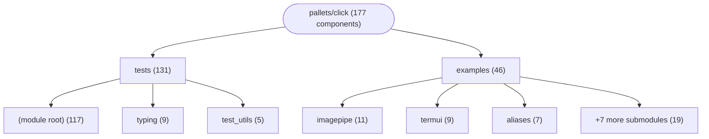

# Repository Architecture Analysis: pallets/click

## Metadata
- **SHA**: `e38188e9e205005d5af5f9e59df51904c984586a`
- **Primary Ecosystem**: Python

## Quality Metrics
- **avg_cyclomatic_complexity**: 2.64
- **component_count**: 177
- **files_analyzed**: 105
- **framework**: Unknown
- **loc**: 31585
- **max_cyclomatic_complexity**: 35
- **sloc**: 24278

# Architecture: pallets/click

## Context
- **Repository**: `pallets/click`
- **SHA**: `e38188e9e205005d5af5f9e59df51904c984586a`
- **Ecosystem**: Python
- **Framework**: Unknown

## Building Block View

## Component Details

Showing top 60 representative components out of 177 across 2 module group(s):

- **Module `tests`** (131 components — CLI_COMMAND: 131)
- **Module `examples`** (46 components — CLI_COMMAND: 46)

- **a** (`tests/test_chain.py`): CLI_COMMAND
- **alias** (`examples/aliases/aliases.py`): CLI_COMMAND
- **b** (`tests/test_chain.py`): CLI_COMMAND
- **bar** (`tests/test_arguments.py`): CLI_COMMAND
- **bdist** (`tests/test_chain.py`): CLI_COMMAND
- **blur_cmd** (`examples/imagepipe/imagepipe.py`): CLI_COMMAND
- **c** (`tests/test_chain.py`): CLI_COMMAND
- **clear** (`examples/termui/termui.py`): CLI_COMMAND
- **cli** (`examples/aliases/aliases.py`): CLI_COMMAND
- **cli** (`examples/colors/colors.py`): CLI_COMMAND
- **cli** (`examples/complex/complex/cli.py`): CLI_COMMAND
- **cli** (`examples/complex/complex/commands/cmd_init.py`): CLI_COMMAND
- **cli** (`examples/complex/complex/commands/cmd_status.py`): CLI_COMMAND
- **cli** (`examples/inout/inout.py`): CLI_COMMAND
- **cli** (`examples/validation/validation.py`): CLI_COMMAND
- **cli** (`tests/test_abort_interrupt.py`): CLI_COMMAND
- **cli** (`tests/test_arguments.py`): CLI_COMMAND
- **cli** (`tests/test_basic.py`): CLI_COMMAND
- **cli** (`tests/test_command_decorators.py`): CLI_COMMAND
- **cli** (`tests/test_commands.py`): CLI_COMMAND
- **cli** (`tests/test_context.py`): CLI_COMMAND
- **cli** (`tests/test_defaults.py`): CLI_COMMAND
- **cli** (`tests/test_formatting.py`): CLI_COMMAND
- **cli** (`tests/test_info_dict.py`): CLI_COMMAND
- **cli** (`tests/test_normalization.py`): CLI_COMMAND
- **cli** (`tests/test_options.py`): CLI_COMMAND
- **cli** (`tests/test_stream_lifecycle.py`): CLI_COMMAND
- **cli** (`tests/test_termui.py`): CLI_COMMAND
- **cli** (`tests/test_testing.py`): CLI_COMMAND
- **cli** (`tests/test_utils/test_echo.py`): CLI_COMMAND
- **cli** (`tests/test_utils/test_open_file.py`): CLI_COMMAND
- **cli** (`tests/typing/typing_aliased_group.py`): CLI_COMMAND
- **cli2** (`tests/test_options.py`): CLI_COMMAND
- **cli_alt** (`tests/test_options.py`): CLI_COMMAND
- **cli_args** (`tests/test_testing.py`): CLI_COMMAND
- **cli_empty_stderr** (`tests/test_testing.py`): CLI_COMMAND
- **cli_env** (`tests/test_testing.py`): CLI_COMMAND
- **cli_float** (`tests/test_testing.py`): CLI_COMMAND
- **cli_float_ctx_exit** (`tests/test_testing.py`): CLI_COMMAND
- **cli_int** (`tests/test_testing.py`): CLI_COMMAND
- **cli_int_ctx_exit** (`tests/test_testing.py`): CLI_COMMAND
- **cli_no_error** (`tests/test_testing.py`): CLI_COMMAND
- **cli_optional** (`tests/test_basic.py`): CLI_COMMAND
- **cli_stderr** (`tests/test_testing.py`): CLI_COMMAND
- **cli_string** (`tests/test_testing.py`): CLI_COMMAND
- **cli_string_ctx_exit** (`tests/test_testing.py`): CLI_COMMAND
- **cli_variadic** (`tests/test_basic.py`): CLI_COMMAND
- **cli_with_choices** (`tests/test_options.py`): CLI_COMMAND
- **cli_with_choices** (`tests/test_termui.py`): CLI_COMMAND
- **cli_without_choices** (`tests/test_options.py`): CLI_COMMAND
- **cli_without_choices** (`tests/test_termui.py`): CLI_COMMAND
- **clone** (`examples/aliases/aliases.py`): CLI_COMMAND
- **clone** (`examples/repo/repo.py`): CLI_COMMAND
- **cmd** (`tests/test_arguments.py`): CLI_COMMAND
- **cmd** (`tests/test_basic.py`): CLI_COMMAND
- **cmd** (`tests/test_formatting.py`): CLI_COMMAND
- **cmd** (`tests/test_options.py`): CLI_COMMAND
- **cmd** (`tests/test_termui.py`): CLI_COMMAND
- **cmd1** (`tests/test_command_decorators.py`): CLI_COMMAND
- **cmd1** (`tests/test_formatting.py`): CLI_COMMAND

## CI/CD Pipeline Topology

