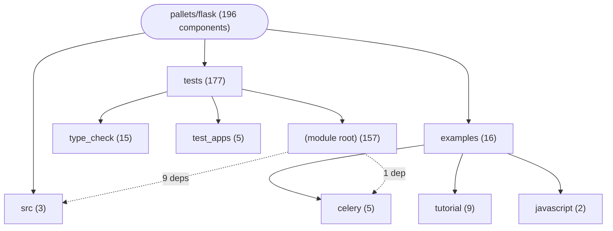

# Repository Architecture Analysis: pallets/flask

## Metadata
- **SHA**: `49943b5a94413a530761350f04e896f76e8d620e`
- **Primary Ecosystem**: Python

## Quality Metrics
- **avg_cyclomatic_complexity**: 1.97
- **component_count**: 196
- **files_analyzed**: 100
- **framework**: Flask
- **loc**: 19161
- **max_cyclomatic_complexity**: 27
- **sloc**: 13881

# Architecture: pallets/flask

## Context
- **Repository**: `pallets/flask`
- **SHA**: `49943b5a94413a530761350f04e896f76e8d620e`
- **Ecosystem**: Python
- **Framework**: Unknown

## Building Block View

## Component Details

Showing top 60 representative components out of 196 across 3 module group(s):

- **Module `tests`** (177 components — API_ROUTE: 166, CLI_COMMAND: 10, DATA_ACCESS_LAYER: 1)
- **Module `examples`** (16 components — API_ROUTE: 15, CLI_COMMAND: 1)
- **Module `src`** (3 components — CLI_COMMAND: 3)

- **add** (`examples/celery/src/task_app/views.py`): API_ROUTE (deps: result)
- **block** (`examples/celery/src/task_app/views.py`): API_ROUTE (deps: result)
- **check** (`tests/test_cli.py`): CLI_COMMAND (deps: run_command)
- **custom_command** (`tests/test_cli.py`): CLI_COMMAND (deps: run_command)
- **late_command** (`tests/test_cli.py`): CLI_COMMAND (deps: run_command)
- **merged_command** (`tests/test_cli.py`): CLI_COMMAND (deps: run_command)
- **nested_command** (`tests/test_cli.py`): CLI_COMMAND (deps: run_command)
- **process** (`examples/celery/src/task_app/views.py`): API_ROUTE (deps: result)
- **show** (`tests/test_cli.py`): CLI_COMMAND (deps: run_command)
- **test** (`tests/test_cli.py`): CLI_COMMAND (deps: run_command)
- **test2** (`tests/test_cli.py`): CLI_COMMAND (deps: run_command)
- **testcmd** (`tests/test_cli.py`): CLI_COMMAND (deps: run_command)
- **Test** (`tests/test_config.py`): DATA_ACCESS_LAYER
- **a** (`tests/test_blueprints.py`): API_ROUTE
- **about** (`tests/test_basic.py`): API_ROUTE
- **about** (`tests/test_blueprints.py`): API_ROUTE
- **action** (`tests/test_testing.py`): API_ROUTE
- **add** (`examples/javascript/js_example/views.py`): API_ROUTE
- **add** (`tests/test_json.py`): API_ROUTE
- **allow_abort** (`tests/test_basic.py`): API_ROUTE
- **app_forbidden** (`tests/test_blueprints.py`): API_ROUTE
- **app_index** (`tests/test_blueprints.py`): API_ROUTE
- **app_page** (`tests/test_blueprints.py`): API_ROUTE
- **app_test** (`tests/test_user_error_handler.py`): API_ROUTE
- **async_route** (`tests/type_check/typing_route.py`): API_ROUTE
- **b** (`tests/test_blueprints.py`): API_ROUTE
- **backend_no** (`tests/test_blueprints.py`): API_ROUTE
- **bar** (`tests/test_blueprints.py`): API_ROUTE
- **bar_foo** (`tests/test_blueprints.py`): API_ROUTE
- **blue_deco_test** (`tests/test_blueprints.py`): API_ROUTE
- **blue_func_test** (`tests/test_blueprints.py`): API_ROUTE
- **bp_endpoint** (`tests/test_blueprints.py`): API_ROUTE
- **bp_error** (`tests/test_async.py`): API_ROUTE
- **bp_forbidden** (`tests/test_blueprints.py`): API_ROUTE
- **bp_forbidden_test** (`tests/test_user_error_handler.py`): API_ROUTE
- **bp_index** (`tests/test_async.py`): API_ROUTE
- **bp_page** (`tests/test_blueprints.py`): API_ROUTE
- **bp_registered_test** (`tests/test_user_error_handler.py`): API_ROUTE
- **bp_test** (`tests/test_user_error_handler.py`): API_ROUTE
- **broken_func** (`tests/test_basic.py`): API_ROUTE
- **bump** (`tests/test_basic.py`): API_ROUTE
- **catch_all** (`tests/test_basic.py`): API_ROUTE
- **child_index** (`tests/test_blueprints.py`): API_ROUTE
- **child_no** (`tests/test_blueprints.py`): API_ROUTE
- **clear** (`tests/test_basic.py`): API_ROUTE
- **create** (`examples/tutorial/flaskr/blog.py`): API_ROUTE
- **custom_test** (`tests/test_user_error_handler.py`): API_ROUTE
- **delete** (`examples/tutorial/flaskr/blog.py`): API_ROUTE
- **do_abort** (`tests/test_user_error_handler.py`): API_ROUTE
- **do_custom** (`tests/test_user_error_handler.py`): API_ROUTE
- **do_error** (`tests/test_user_error_handler.py`): API_ROUTE
- **do_get** (`tests/test_basic.py`): API_ROUTE
- **do_nothing** (`tests/test_basic.py`): API_ROUTE
- **do_raise** (`tests/test_user_error_handler.py`): API_ROUTE
- **do_set** (`tests/test_basic.py`): API_ROUTE
- **dump_session_contents** (`tests/test_basic.py`): API_ROUTE
- **echo** (`tests/test_testing.py`): API_ROUTE
- **error** (`tests/test_async.py`): API_ROUTE
- **error** (`tests/test_basic.py`): API_ROUTE
- **error** (`tests/test_blueprints.py`): API_ROUTE

## CI/CD Pipeline Topology

