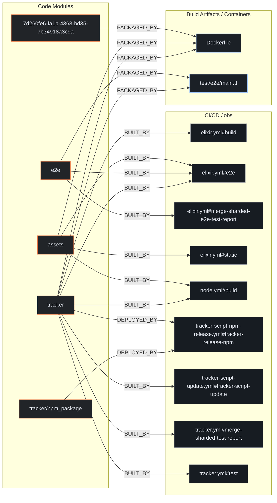

# Repository Architecture Analysis: plausible/analytics

## Metadata
- **SHA**: `8e5982c237c8d17be02170e8063b3dd9b8e76085`
- **Primary Ecosystem**: Elixir

## Quality Metrics
- **ast_engine**: tree-sitter
- **avg_cognitive_complexity**: 2.42
- **avg_cyclomatic_complexity**: 2.75
- **component_count**: 459
- **dead_code_count**: 6
- **dead_code_symbols**: 6 entry(ies)
- **duplication_pct**: 13.5
- **file_complexities**: 25 entry(ies)
- **files_analyzed**: 1635
- **fitness_passed**: False
- **fitness_violation_count**: 21
- **framework**: Phoenix
- **import_edges**: 100 entry(ies)
- **loc**: 294891
- **max_cognitive_complexity**: 141
- **max_cyclomatic_complexity**: 59
- **sloc**: 245290
- **test_file_count**: 579

# Architecture: plausible/analytics

## Context
- **Repository**: `plausible/analytics`
- **SHA**: `8e5982c237c8d17be02170e8063b3dd9b8e76085`
- **Ecosystem**: Elixir
- **Framework**: Phoenix

## Building Block View

```mermaid
graph TD;
  classDef atlasRoot fill:#004882,stroke:#a3c9ff,stroke-width:2px,color:#d3e4ff
  classDef atlasCategory fill:#212428,stroke:#E87A48,stroke-width:1.5px,color:#dfe3eb
  classDef atlasWorkflow fill:#1b2026,stroke:#a3c9ff,stroke-width:1.5px,color:#dfe3eb
  classDef atlasJob fill:#171c22,stroke:#8d9199,stroke-width:1px,color:#dfe3eb
  classDef atlasTarget fill:#005227,stroke:#8bd99b,stroke-width:1.5px,color:#a7f6b6
  classDef atlasAlert fill:#93000a,stroke:#ffb4ab,stroke-width:1.5px,color:#ffdad6
  classDef atlasMore fill:#252a31,stroke:#8d9199,stroke-dasharray:4 4,color:#c3c6cf
    repo_root(["plausible/analytics (459 components)"]):::atlasRoot
    dir_0_assets["assets (204)"]:::atlasCategory
    repo_root --> dir_0_assets
    sub_0_0_js["js (201)"]:::atlasWorkflow
    dir_0_assets --> sub_0_0_js
    sub_0_1_test_utils["test-utils (2)"]:::atlasWorkflow
    dir_0_assets --> sub_0_1_test_utils
    sub_0_2__module_root_["(module root) (1)"]:::atlasWorkflow
    dir_0_assets --> sub_0_2__module_root_
    dir_1_lib["lib (130)"]:::atlasCategory
    repo_root --> dir_1_lib
    sub_1_0_plausible["plausible (116)"]:::atlasWorkflow
    dir_1_lib --> sub_1_0_plausible
    sub_1_1_mix["mix (7)"]:::atlasWorkflow
    dir_1_lib --> sub_1_1_mix
    sub_1_2__module_root_["(module root) (5)"]:::atlasWorkflow
    dir_1_lib --> sub_1_2__module_root_
    sub_1_more["+1 more submodules (2)"]:::atlasMore
    dir_1_lib --> sub_1_more
    dir_2_extra["extra (105)"]:::atlasCategory
    repo_root --> dir_2_extra
    sub_2_0_lib_plausible["lib/plausible (60)"]:::atlasWorkflow
    dir_2_extra --> sub_2_0_lib_plausible
    sub_2_1_lib_plausible_web["lib/plausible_web (44)"]:::atlasWorkflow
    dir_2_extra --> sub_2_1_lib_plausible_web
    sub_2_2_lib["lib (1)"]:::atlasWorkflow
    dir_2_extra --> sub_2_2_lib
    dir_3_config["config (10)"]:::atlasCategory
    repo_root --> dir_3_config
    dir_4__root_["(root) (5)"]:::atlasCategory
    repo_root --> dir_4__root_
    dir_other_modules["+2 more modules (5)"]:::atlasMore
    repo_root --> dir_other_modules
    sub_0_1_test_utils -.->|"14 deps"| sub_0_0_js
```

## Component Details

Showing top 60 representative components out of 459 across 7 module group(s):

- **Module `assets`** (204 components — UI_COMPONENT: 203, MODULE: 1)
- **Module `lib`** (130 components — module: 130)
- **Module `extra`** (105 components — module: 105)
- **Module `config`** (10 components — module: 10)
- **Module `(root)`** (5 components — module: 5)
- **Module `tracker`** (4 components — MODULE: 2, API_ROUTE: 2)
- **Module `e2e`** (1 components — MODULE: 1)

- **Devices** (`assets/js/dashboard/stats/devices/index.tsx`): UI_COMPONENT (deps: Bar, BrowserIcon, BrowserWindowIcon, CursorIcon, DEFAULT_METRIC_COLUMN_WIDTH, DashboardStateContextProvider (+33 more))
- **FiltersBar** (`assets/js/dashboard/nav-menu/filters-bar.tsx`): UI_COMPONENT (deps: AppNavigationLink, AppliedFilterPillsList, BlurMenuButtonOnEscape, BrowserIcon, BrowserWindowIcon, CursorIcon (+31 more))
- **MissingSegmentPillMenu** (`assets/js/dashboard/nav-menu/segments/segment-pill-menu.tsx`): UI_COMPONENT (deps: AppNavigationLink, BlurMenuButtonOnEscape, BrowserIcon, BrowserWindowIcon, CursorIcon, DesktopIcon (+29 more))
- **SEGMENT_NOT_FOUND** (`assets/js/dashboard/nav-menu/segments/segment-pill-menu.tsx`): UI_COMPONENT (deps: AppNavigationLink, BlurMenuButtonOnEscape, BrowserIcon, BrowserWindowIcon, CursorIcon, DesktopIcon (+29 more))
- **SegmentPillMenu** (`assets/js/dashboard/nav-menu/segments/segment-pill-menu.tsx`): UI_COMPONENT (deps: AppNavigationLink, BlurMenuButtonOnEscape, BrowserIcon, BrowserWindowIcon, CursorIcon, DesktopIcon (+29 more))
- **FilterMenu** (`assets/js/dashboard/nav-menu/filter-menu.tsx`): UI_COMPONENT (deps: BlurMenuButtonOnEscape, BrowserIcon, BrowserWindowIcon, CursorIcon, DesktopIcon, DiamondIcon (+28 more))
- **CsvExport** (`assets/js/dashboard/stats/csv-export/csv-export.tsx`): UI_COMPONENT (deps: BlurMenuButtonOnEscape, BrowserIcon, BrowserWindowIcon, CursorIcon, DashboardStateContextProvider, DesktopIcon (+25 more))
- **FunnelExploration** (`assets/js/dashboard/extra/exploration/index.tsx`): UI_COMPONENT (deps: BlurMenuButtonOnEscape, BrowserIcon, BrowserWindowIcon, CursorIcon, DashboardStateContextProvider, DesktopIcon (+25 more))
- **BEHAVIOURS_BAR_COLOR** (`assets/js/dashboard/stats/behaviours/index.tsx`): UI_COMPONENT (deps: Bar, Conversions, DEFAULT_METRIC_COLUMN_WIDTH, DashboardStateContextProvider, DimensionCellWithBar, DropdownTabButton (+23 more))
- **BEHAVIOURS_METRICS_HIDDEN_ON_MOBILE** (`assets/js/dashboard/stats/behaviours/index.tsx`): UI_COMPONENT (deps: Bar, Conversions, DEFAULT_METRIC_COLUMN_WIDTH, DashboardStateContextProvider, DimensionCellWithBar, DropdownTabButton (+23 more))
- **BEHAVIOURS_METRIC_COLUMN_WIDTH** (`assets/js/dashboard/stats/behaviours/index.tsx`): UI_COMPONENT (deps: Bar, Conversions, DEFAULT_METRIC_COLUMN_WIDTH, DashboardStateContextProvider, DimensionCellWithBar, DropdownTabButton (+23 more))
- **BehavioursWrapped** (`assets/js/dashboard/stats/behaviours/index.tsx`): UI_COMPONENT (deps: Bar, Conversions, DEFAULT_METRIC_COLUMN_WIDTH, DashboardStateContextProvider, DimensionCellWithBar, DropdownTabButton (+23 more))
- **Combobox** (`assets/js/dashboard/components/combobox.tsx`): UI_COMPONENT (deps: BlurMenuButtonOnEscape, BrowserIcon, BrowserWindowIcon, Checkbox, CursorIcon, DashboardStateContextProvider (+23 more))
- **Pages** (`assets/js/dashboard/stats/pages/index.tsx`): UI_COMPONENT (deps: Bar, BlurMenuButtonOnEscape, DEFAULT_METRIC_COLUMN_WIDTH, DashboardStateContextProvider, DetailsExternalLink, DevicesDetails (+22 more))
- **DevicesDetails** (`assets/js/dashboard/stats/devices/details.tsx`): UI_COMPONENT (deps: BrowserIcon, BrowserWindowIcon, CursorIcon, DashboardStateContextProvider, DesktopIcon, DetailsBreakdown (+21 more))
- **ExplorationColumn** (`assets/js/dashboard/extra/exploration/exploration-column.tsx`): UI_COMPONENT (deps: BlurMenuButtonOnEscape, BrowserIcon, BrowserWindowIcon, CursorIcon, DEBOUNCE_DELAY, DesktopIcon (+21 more))
- **MaxDepthColumn** (`assets/js/dashboard/extra/exploration/exploration-column.tsx`): UI_COMPONENT (deps: BlurMenuButtonOnEscape, BrowserIcon, BrowserWindowIcon, CursorIcon, DEBOUNCE_DELAY, DesktopIcon (+21 more))
- **InteractiveAnnotationsList** (`assets/js/dashboard/annotations/interactive-annotations-list.tsx`): UI_COMPONENT (deps: AnnotationAuthorshipLine, AnnotationItemRow, AnnotationNote, AnnotationsListContainer, BrowserIcon, BrowserWindowIcon (+20 more))
- **DIRECT_NONE** (`assets/js/dashboard/stats/sources/index.tsx`): UI_COMPONENT (deps: Bar, DEFAULT_METRIC_COLUMN_WIDTH, DashboardStateContextProvider, DetailsExternalLink, DimensionCellWithBar, DropdownTabButton (+18 more))
- **Sources** (`assets/js/dashboard/stats/sources/index.tsx`): UI_COMPONENT (deps: Bar, DEFAULT_METRIC_COLUMN_WIDTH, DashboardStateContextProvider, DetailsExternalLink, DimensionCellWithBar, DropdownTabButton (+18 more))
- **DashboardOptionsMenu** (`assets/js/dashboard/nav-menu/dashboard-options-menu.tsx`): UI_COMPONENT (deps: AppNavigationLink, BlurMenuButtonOnEscape, COMPARISON_MATCH_MODE_LABELS, COMPARISON_MODES, CsvExport, DEFAULT_COMPARISON_MATCH_MODE (+15 more))
- **Pill** (`assets/js/dashboard/components/pill.tsx`): UI_COMPONENT (deps: BrowserIcon, BrowserWindowIcon, CursorIcon, DesktopIcon, DiamondIcon, DocumentIcon (+14 more))
- **SEGMENTS_ROW** (`assets/js/dashboard/nav-menu/filter-menu-rows.tsx`): UI_COMPONENT (deps: BrowserIcon, BrowserWindowIcon, CursorIcon, DesktopIcon, DiamondIcon, DocumentIcon (+14 more))
- **UpgradePill** (`assets/js/dashboard/components/pill.tsx`): UI_COMPONENT (deps: BrowserIcon, BrowserWindowIcon, CursorIcon, DesktopIcon, DiamondIcon, DocumentIcon (+14 more))
- **Funnel** (`assets/js/dashboard/extra/funnel/index.tsx`): UI_COMPONENT (deps: CACHE_TTL_HISTORICAL, CACHE_TTL_LONG_ONGOING, CACHE_TTL_REALTIME, CACHE_TTL_SHORT_ONGOING, COMPARISON_MATCH_MODE_LABELS, COMPARISON_MODES (+13 more))
- **Locations** (`assets/js/dashboard/stats/locations/index.tsx`): UI_COMPONENT (deps: Bar, DEFAULT_METRIC_COLUMN_WIDTH, DashboardStateContextProvider, DimensionCellWithBar, DrilldownLink, DropdownTabButton (+12 more))
- **MainGraph** (`assets/js/dashboard/stats/graph/main-graph.tsx`): UI_COMPONENT (deps: AppNavigationLink, Button, COMPARISON_MATCH_MODE_LABELS, COMPARISON_MODES, ChangeArrow, DEFAULT_COMPARISON_MATCH_MODE (+12 more))
- **MainGraphContainer** (`assets/js/dashboard/stats/graph/main-graph.tsx`): UI_COMPONENT (deps: AppNavigationLink, Button, COMPARISON_MATCH_MODE_LABELS, COMPARISON_MODES, ChangeArrow, DEFAULT_COMPARISON_MATCH_MODE (+12 more))
- **DashboardPeriodMenu** (`assets/js/dashboard/nav-menu/query-periods/dashboard-period-menu.tsx`): UI_COMPONENT (deps: AppNavigationLink, BlurMenuButtonOnEscape, COMPARISON_MATCH_MODE_LABELS, COMPARISON_MODES, CalendarPanel, DEFAULT_COMPARISON_MATCH_MODE (+11 more))
- **MainCalendar** (`assets/js/dashboard/nav-menu/query-periods/dashboard-period-menu.tsx`): UI_COMPONENT (deps: AppNavigationLink, BlurMenuButtonOnEscape, COMPARISON_MATCH_MODE_LABELS, COMPARISON_MODES, CalendarPanel, DEFAULT_COMPARISON_MATCH_MODE (+11 more))
- **CreateAnnotationModal** (`assets/js/dashboard/annotations/annotations-modals.tsx`): UI_COMPONENT (deps: Button, Checkbox, ErrorPanel, FilterPill, LabeledTextInput, LabeledTextarea (+8 more))
- **CreateSegmentModal** (`assets/js/dashboard/segments/segment-modals.tsx`): UI_COMPONENT (deps: Button, Checkbox, ErrorPanel, FilterPill, LabeledTextInput, LabeledTextarea (+8 more))
- **DeleteAnnotationModal** (`assets/js/dashboard/annotations/annotations-modals.tsx`): UI_COMPONENT (deps: Button, Checkbox, ErrorPanel, FilterPill, LabeledTextInput, LabeledTextarea (+8 more))
- **DeleteSegmentModal** (`assets/js/dashboard/segments/segment-modals.tsx`): UI_COMPONENT (deps: Button, Checkbox, ErrorPanel, FilterPill, LabeledTextInput, LabeledTextarea (+8 more))
- **UpdateAnnotationModal** (`assets/js/dashboard/annotations/annotations-modals.tsx`): UI_COMPONENT (deps: Button, Checkbox, ErrorPanel, FilterPill, LabeledTextInput, LabeledTextarea (+8 more))
- **UpdateSegmentModal** (`assets/js/dashboard/segments/segment-modals.tsx`): UI_COMPONENT (deps: Button, Checkbox, ErrorPanel, FilterPill, LabeledTextInput, LabeledTextarea (+8 more))
- **ComparisonCalendarMenu** (`assets/js/dashboard/nav-menu/query-periods/comparison-period-menu.tsx`): UI_COMPONENT (deps: AppNavigationLink, BlurMenuButtonOnEscape, COMPARISON_MATCH_MODE_LABELS, COMPARISON_MODES, CalendarPanel, DEFAULT_COMPARISON_MATCH_MODE (+7 more))
- **ComparisonPeriodMenu** (`assets/js/dashboard/nav-menu/query-periods/comparison-period-menu.tsx`): UI_COMPONENT (deps: AppNavigationLink, BlurMenuButtonOnEscape, COMPARISON_MATCH_MODE_LABELS, COMPARISON_MODES, CalendarPanel, DEFAULT_COMPARISON_MATCH_MODE (+7 more))
- **ComparisonPeriodMenuItems** (`assets/js/dashboard/nav-menu/query-periods/comparison-period-menu.tsx`): UI_COMPONENT (deps: AppNavigationLink, BlurMenuButtonOnEscape, COMPARISON_MATCH_MODE_LABELS, COMPARISON_MODES, CalendarPanel, DEFAULT_COMPARISON_MATCH_MODE (+7 more))
- **SearchTerms** (`assets/js/dashboard/stats/sources/search-terms.tsx`): UI_COMPONENT (deps: Bar, DEFAULT_METRIC_COLUMN_WIDTH, DimensionCellWithBar, ExternalLinkIcon, FADE_IN_CLASSNAME, GOOGLE_SEARCH_TERMS_DETAILS_PATH (+7 more))
- **Conversions** (`assets/js/dashboard/stats/behaviours/conversions.tsx`): UI_COMPONENT (deps: Bar, COMPARISON_MATCH_MODE_LABELS, COMPARISON_MODES, DEFAULT_COMPARISON_MATCH_MODE, DEFAULT_COMPARISON_MODE, DEFAULT_METRIC_COLUMN_WIDTH (+6 more))
- **SiteSwitcher** (`assets/js/dashboard/site-switcher.tsx`): UI_COMPONENT (deps: BlurMenuButtonOnEscape, ConsolidatedViewIcon, ErrorPanel, Favicon, FilterPillPopover, Keybind (+6 more))
- **DetailsBreakdown** (`assets/js/dashboard/stats/modals/details-breakdown.tsx`): UI_COMPONENT (deps: BreakdownTable, ChangeArrow, DashboardStateContextProvider, DrilldownLink, ExternalLinkIcon, GraphTooltipWrapper (+5 more))
- **DimensionCell** (`assets/js/dashboard/stats/modals/details-breakdown.tsx`): UI_COMPONENT (deps: BreakdownTable, ChangeArrow, DashboardStateContextProvider, DrilldownLink, ExternalLinkIcon, GraphTooltipWrapper (+5 more))
- **Bar** (`assets/js/dashboard/stats/reports/index-breakdown.tsx`): UI_COMPONENT (deps: ChangeArrow, DashboardStateContextProvider, DrilldownLink, ExternalLinkIcon, GraphTooltipWrapper, LazyLoader (+4 more))
- **CurrentVisitors** (`assets/js/dashboard/stats/current-visitors.js`): UI_COMPONENT (deps: AppNavigationLink, BlurMenuButtonOnEscape, CurrentVisitorsProvider, FilterPillPopover, GraphTooltipWrapper, LastLoadContextProvider (+4 more))
- **DEFAULT_METRIC_COLUMN_WIDTH** (`assets/js/dashboard/stats/reports/index-breakdown.tsx`): UI_COMPONENT (deps: ChangeArrow, DashboardStateContextProvider, DrilldownLink, ExternalLinkIcon, GraphTooltipWrapper, LazyLoader (+4 more))
- **DashboardPeriodPicker** (`assets/js/dashboard/nav-menu/query-periods/dashboard-period-picker.tsx`): UI_COMPONENT (deps: COMPARISON_MATCH_MODE_LABELS, COMPARISON_MODES, ComparisonCalendarMenu, ComparisonPeriodMenu, ComparisonPeriodMenuItems, DEFAULT_COMPARISON_MATCH_MODE (+4 more))
- **DimensionCellWithBar** (`assets/js/dashboard/stats/reports/index-breakdown.tsx`): UI_COMPONENT (deps: ChangeArrow, DashboardStateContextProvider, DrilldownLink, ExternalLinkIcon, GraphTooltipWrapper, LazyLoader (+4 more))
- **FADE_IN_CLASSNAME** (`assets/js/dashboard/stats/reports/index-breakdown.tsx`): UI_COMPONENT (deps: ChangeArrow, DashboardStateContextProvider, DrilldownLink, ExternalLinkIcon, GraphTooltipWrapper, LazyLoader (+4 more))
- **IndexBreakdown** (`assets/js/dashboard/stats/reports/index-breakdown.tsx`): UI_COMPONENT (deps: ChangeArrow, DashboardStateContextProvider, DrilldownLink, ExternalLinkIcon, GraphTooltipWrapper, LazyLoader (+4 more))
- **IndexBreakdownRenderer** (`assets/js/dashboard/stats/reports/index-breakdown.tsx`): UI_COMPONENT (deps: ChangeArrow, DashboardStateContextProvider, DrilldownLink, ExternalLinkIcon, GraphTooltipWrapper, LazyLoader (+4 more))
- **MIN_HEIGHT** (`assets/js/dashboard/stats/reports/index-breakdown.tsx`): UI_COMPONENT (deps: ChangeArrow, DashboardStateContextProvider, DrilldownLink, ExternalLinkIcon, GraphTooltipWrapper, LazyLoader (+4 more))
- **MovePeriodArrows** (`assets/js/dashboard/nav-menu/query-periods/move-period-arrows.tsx`): UI_COMPONENT (deps: AppNavigationLink, COMPARISON_MATCH_MODE_LABELS, COMPARISON_MODES, DEFAULT_COMPARISON_MATCH_MODE, DEFAULT_COMPARISON_MODE, DashboardStateContextProvider (+4 more))
- **SourcesDetails** (`assets/js/dashboard/stats/sources/details.tsx`): UI_COMPONENT (deps: DashboardStateContextProvider, DetailsBreakdown, DetailsExternalLink, DimensionCell, ExternalLinkIcon, IndexExternalLink (+4 more))
- **SpecialGoalPropBreakdown** (`assets/js/dashboard/stats/behaviours/special-goal-prop-breakdown.tsx`): UI_COMPONENT (deps: Bar, DEFAULT_METRIC_COLUMN_WIDTH, DashboardStateContextProvider, DetailsExternalLink, DimensionCellWithBar, FADE_IN_CLASSNAME (+4 more))
- **PagesDetails** (`assets/js/dashboard/stats/pages/details.tsx`): UI_COMPONENT (deps: DashboardStateContextProvider, DetailsBreakdown, DetailsExternalLink, DimensionCell, ExternalLinkIcon, IndexExternalLink (+3 more))
- **WorldMapSvg** (`assets/js/dashboard/stats/locations/world-map-svg.tsx`): UI_COMPONENT (deps: Bar, DEFAULT_METRIC_COLUMN_WIDTH, DimensionCellWithBar, FADE_IN_CLASSNAME, IndexBreakdown, IndexBreakdownRenderer (+3 more))
- **DashboardStateContextProvider** (`assets/js/dashboard/dashboard-state-context.tsx`): UI_COMPONENT (deps: COMPARISON_MATCH_MODE_LABELS, COMPARISON_MODES, DEBOUNCE_DELAY, DEFAULT_COMPARISON_MATCH_MODE, DEFAULT_COMPARISON_MODE, FILTER_URL_PARAM_NAME (+2 more))
- **Properties** (`assets/js/dashboard/stats/behaviours/props.tsx`): UI_COMPONENT (deps: Bar, DEFAULT_METRIC_COLUMN_WIDTH, DashboardStateContextProvider, DimensionCellWithBar, FADE_IN_CLASSNAME, IndexBreakdown (+2 more))

## 6-Dimension Repository Scorecard

- **Overall Grade**: `F` (34.05/100)
- **Technical Debt Score**: 65.95
- **Estimated Remediation Effort**: 122.69h

| Dimension | Grade | Score | Weight | Details |
| :--- | :---: | :---: | :---: | :--- |
| Code Quality | `F` | 42.75 | 0.20 | avg_cc=2.75, max_cc=59, duplication=13.50%, dead_code=6 |
| Dependency Health | `A` | 100.00 | 0.15 | dependencies=1403, outdated=0, vulnerable=0, has_lockfile=True |
| Maintainability | `F` | 0.00 | 0.15 | avg_cognitive=2.42, max_cognitive=141, fitness_violations=21, oversized_files=7 |
| Pipeline Health | `F` | 0.00 | 0.15 | workflows=15, operational_antipatterns=21, parallel_branches=True |
| Security | `F` | 0.00 | 0.20 | vulnerabilities=0, secrets=12, pipeline_security_findings=1 |
| Test Coverage | `C` | 70.00 | 0.15 | coverage=unavailable, ci_test_job=True, test_files_detected=True |

## Architecture Fitness & Workspace Boundaries

- **[HIGH] `ATRUSS-ARCH-004` (CIRCULAR_DEPENDENCY)**: Circular dependency detected between architectural components. (Combobox -> DashboardStateContextProvider -> SegmentMenu -> RoutelessModalsContextProvider -> RoutelessAnnotationModals -> CreateAnnotationModal -> FilterPill -> FilterValuePicker -> Combobox)
- **[HIGH] `ATRUSS-ARCH-004` (CIRCULAR_DEPENDENCY)**: Circular dependency detected between architectural components. (Combobox -> DashboardStateContextProvider -> SegmentMenu -> RoutelessModalsContextProvider -> RoutelessAnnotationModals -> DeleteAnnotationModal -> FilterPill -> FilterValuePicker -> Combobox)
- **[HIGH] `ATRUSS-ARCH-004` (CIRCULAR_DEPENDENCY)**: Circular dependency detected between architectural components. (Combobox -> DashboardStateContextProvider -> SegmentMenu -> RoutelessModalsContextProvider -> RoutelessAnnotationModals -> UpdateAnnotationModal -> FilterPill -> FilterValuePicker -> Combobox)
- **[HIGH] `ATRUSS-ARCH-004` (CIRCULAR_DEPENDENCY)**: Circular dependency detected between architectural components. (Combobox -> DashboardStateContextProvider -> SegmentMenu -> RoutelessModalsContextProvider -> RoutelessSegmentModals -> CreateSegmentModal -> FilterPill -> FilterValuePicker -> Combobox)
- **[HIGH] `ATRUSS-ARCH-004` (CIRCULAR_DEPENDENCY)**: Circular dependency detected between architectural components. (Combobox -> DashboardStateContextProvider -> SegmentMenu -> RoutelessModalsContextProvider -> RoutelessSegmentModals -> DeleteSegmentModal -> FilterPill -> FilterValuePicker -> Combobox)
- **[HIGH] `ATRUSS-ARCH-004` (CIRCULAR_DEPENDENCY)**: Circular dependency detected between architectural components. (Combobox -> DashboardStateContextProvider -> SegmentMenu -> RoutelessModalsContextProvider -> RoutelessSegmentModals -> UpdateSegmentModal -> FilterPill -> FilterValuePicker -> Combobox)
- **[HIGH] `ATRUSS-ARCH-004` (CIRCULAR_DEPENDENCY)**: Circular dependency detected between architectural components. (CreateAnnotationModal -> FilterPill -> FilterEditorContextProvider -> DashboardStateContextProvider -> SegmentMenu -> RoutelessModalsContextProvider -> RoutelessAnnotationModals -> CreateAnnotationModal)
- **[HIGH] `ATRUSS-ARCH-004` (CIRCULAR_DEPENDENCY)**: Circular dependency detected between architectural components. (CreateSegmentModal -> FilterPill -> FilterEditorContextProvider -> DashboardStateContextProvider -> SegmentMenu -> RoutelessModalsContextProvider -> RoutelessSegmentModals -> CreateSegmentModal)
- **[HIGH] `ATRUSS-ARCH-004` (CIRCULAR_DEPENDENCY)**: Circular dependency detected between architectural components. (DashboardStateContextProvider -> SegmentMenu -> DashboardStateContextProvider)
- **[HIGH] `ATRUSS-ARCH-004` (CIRCULAR_DEPENDENCY)**: Circular dependency detected between architectural components. (DashboardStateContextProvider -> SegmentMenu -> RoutelessModalsContextProvider -> RoutelessAnnotationModals -> DashboardStateContextProvider)
- **[HIGH] `ATRUSS-ARCH-004` (CIRCULAR_DEPENDENCY)**: Circular dependency detected between architectural components. (DashboardStateContextProvider -> SegmentMenu -> RoutelessModalsContextProvider -> RoutelessAnnotationModals -> DeleteAnnotationModal -> FilterPill -> FilterEditorContextProvider -> DashboardStateContextProvider)
- **[HIGH] `ATRUSS-ARCH-004` (CIRCULAR_DEPENDENCY)**: Circular dependency detected between architectural components. (DashboardStateContextProvider -> SegmentMenu -> RoutelessModalsContextProvider -> RoutelessAnnotationModals -> UpdateAnnotationModal -> FilterPill -> FilterEditorContextProvider -> DashboardStateContextProvider)
- **[HIGH] `ATRUSS-ARCH-004` (CIRCULAR_DEPENDENCY)**: Circular dependency detected between architectural components. (DashboardStateContextProvider -> SegmentMenu -> RoutelessModalsContextProvider -> RoutelessSegmentModals -> DashboardStateContextProvider)
- **[HIGH] `ATRUSS-ARCH-004` (CIRCULAR_DEPENDENCY)**: Circular dependency detected between architectural components. (DashboardStateContextProvider -> SegmentMenu -> RoutelessModalsContextProvider -> RoutelessSegmentModals -> DeleteSegmentModal -> FilterPill -> FilterEditorContextProvider -> DashboardStateContextProvider)
- **[HIGH] `ATRUSS-ARCH-004` (CIRCULAR_DEPENDENCY)**: Circular dependency detected between architectural components. (DashboardStateContextProvider -> SegmentMenu -> RoutelessModalsContextProvider -> RoutelessSegmentModals -> UpdateSegmentModal -> FilterPill -> FilterEditorContextProvider -> DashboardStateContextProvider)
- **[HIGH] `ATRUSS-ARCH-004` (CIRCULAR_DEPENDENCY)**: Circular dependency detected between architectural components. (MainGraph -> VisitorGraph -> MainGraph)
- **[HIGH] `ATRUSS-ARCH-004` (CIRCULAR_DEPENDENCY)**: Circular dependency detected between architectural components. (MainGraphContainer -> VisitorGraph -> MainGraphContainer)
- **[HIGH] `ATRUSS-ARCH-004` (CIRCULAR_DEPENDENCY)**: Circular dependency detected between architectural components. (RoutelessAnnotationModals -> RoutelessModalsContextProvider -> RoutelessAnnotationModals)
- **[HIGH] `ATRUSS-ARCH-004` (CIRCULAR_DEPENDENCY)**: Circular dependency detected between architectural components. (RoutelessModalsContextProvider -> RoutelessSegmentModals -> RoutelessModalsContextProvider)
- **[MEDIUM] `ATRUSS-ARCH-005` (COMPLEXITY_THRESHOLD)**: Repository max_cognitive_complexity (141.0) exceeds policy threshold (25.0).
- **[MEDIUM] `ATRUSS-ARCH-005` (COMPLEXITY_THRESHOLD)**: Repository max_cyclomatic_complexity (59.0) exceeds policy threshold (20.0).

## Supply Chain Dependencies, Vulnerabilities & Secrets

- **Dependencies Parsed**: 1403 | **Vulnerabilities**: 0 | **Secrets**: 12

### Secret Findings (Redacted)
- **[HIGH] `ATRUSS-SEC-005`** at `config/.env.dev:7` (`TOTP_VAULT_KEY=Q3BD***REDACTED***`)
- **[HIGH] `ATRUSS-SEC-005`** at `config/.env.dev:21` (`GOOGLE_CLIENT_SECRET=GOCS***REDACTED***`)
- **[HIGH] `ATRUSS-SEC-005`** at `config/.env.dev:37` (`HELP_SCOUT_VAULT_KEY=ym9Z***REDACTED***`)
- **[HIGH] `ATRUSS-SEC-005`** at `config/.env.e2e_test:8` (`TOTP_VAULT_KEY=Q3BD***REDACTED***`)
- **[HIGH] `ATRUSS-SEC-005`** at `config/.env.e2e_test:22` (`GOOGLE_CLIENT_SECRET=GOCS***REDACTED***`)
- **[HIGH] `ATRUSS-SEC-005`** at `config/.env.e2e_test:38` (`HELP_SCOUT_VAULT_KEY=ym9Z***REDACTED***`)
- **[HIGH] `ATRUSS-SEC-005`** at `config/.env.load:7` (`TOTP_VAULT_KEY=Q3BD***REDACTED***`)
- **[HIGH] `ATRUSS-SEC-005`** at `config/.env.load:20` (`GOOGLE_CLIENT_SECRET=GOCS***REDACTED***`)
- **[HIGH] `ATRUSS-SEC-005`** at `config/.env.load:36` (`HELP_SCOUT_VAULT_KEY=ym9Z***REDACTED***`)
- **[HIGH] `ATRUSS-SEC-005`** at `config/.env.test:4` (`TOTP_VAULT_KEY=1Jah***REDACTED***`)
- **[HIGH] `ATRUSS-SEC-005`** at `config/.env.test:21` (`HELP_SCOUT_VAULT_KEY=ym9Z***REDACTED***`)
- **[HIGH] `ATRUSS-SEC-005`** at `fixture/ga_refresh_token.json:6` (`"refresh_token": "1//x***REDACTED***"`)

### Inventory Sample
- `bamboo` `2.3` (hex, `mix.exs`)
- `bamboo_mua` `0.2.0` (hex, `mix.exs`)
- `bcrypt_elixir` `3.3` (hex, `mix.exs`)
- `bypass` `2.1` (hex, `mix.exs`)
- `cloak` `1.1` (hex, `mix.exs`)
- `cloak_ecto` `1.2` (hex, `mix.exs`)
- `combination` `0.0.3` (hex, `mix.exs`)
- `cors_plug` `3.0` (hex, `mix.exs`)
- `credo` `1.7` (hex, `mix.exs`)
- `decimal` `3.0` (hex, `mix.exs`)
- `dialyxir` `1.4` (hex, `mix.exs`)
- `double` `0.8.0` (hex, `mix.exs`)
- `ecto` `3.14` (hex, `mix.exs`)
- `ecto_ch` `0.11` (hex, `mix.exs`)
- `ecto_network` `1.6.0` (hex, `mix.exs`)
- `ecto_sql` `3.14` (hex, `mix.exs`)
- `envy` `1.1.1` (hex, `mix.exs`)
- `eqrcode` `0.2.1` (hex, `mix.exs`)
- `esbuild` `0.7` (hex, `mix.exs`)
- `ex_aws` `2.5` (hex, `mix.exs`)
- `ex_aws_s3` `2.5` (hex, `mix.exs`)
- `ex_doc` `0.28` (hex, `mix.exs`)
- `ex_json_logger` `1.4.0` (hex, `mix.exs`)
- `ex_json_schema` `0.11.1` (hex, `mix.exs`)
- `ex_machina` `2.3` (hex, `mix.exs`)
- `ex_money` `5.24.2` (hex, `mix.exs`)
- `excoveralls` `0.10` (hex, `mix.exs`)
- `finch` `0.23` (hex, `mix.exs`)
- `fun_with_flags` `1.13.0` (hex, `mix.exs`)
- `fun_with_flags_ui` `1.0` (hex, `mix.exs`)
- ... (+1373 more dependencies)

## Section 7: Code-to-Cloud Deployment Traceability

- `7d260fe6-fa1b-4363-bd35-7b34918a3c9a` (code_module) --[PACKAGED_BY]--> `Dockerfile` (container)
- `assets` (code_module) --[BUILT_BY]--> `elixir.yml#e2e` (ci_job)
- `assets` (code_module) --[BUILT_BY]--> `elixir.yml#static` (ci_job)
- `assets` (code_module) --[BUILT_BY]--> `node.yml#build` (ci_job)
- `assets` (code_module) --[PACKAGED_BY]--> `Dockerfile` (container)
- `e2e` (code_module) --[BUILT_BY]--> `elixir.yml#e2e` (ci_job)
- `e2e` (code_module) --[BUILT_BY]--> `elixir.yml#merge-sharded-e2e-test-report` (ci_job)
- `e2e` (code_module) --[PACKAGED_BY]--> `test/e2e/main.tf` (iac)
- `tracker` (code_module) --[BUILT_BY]--> `elixir.yml#build` (ci_job)
- `tracker` (code_module) --[BUILT_BY]--> `elixir.yml#e2e` (ci_job)
- `tracker` (code_module) --[BUILT_BY]--> `node.yml#build` (ci_job)
- `tracker` (code_module) --[BUILT_BY]--> `tracker-script-update.yml#tracker-script-update` (ci_job)
- `tracker` (code_module) --[BUILT_BY]--> `tracker.yml#merge-sharded-test-report` (ci_job)
- `tracker` (code_module) --[BUILT_BY]--> `tracker.yml#test` (ci_job)
- `tracker` (code_module) --[DEPLOYED_BY]--> `tracker-script-npm-release.yml#tracker-release-npm` (ci_job)
- `tracker` (code_module) --[PACKAGED_BY]--> `Dockerfile` (container)
- `tracker` (code_module) --[PACKAGED_BY]--> `test/e2e/main.tf` (iac)
- `tracker/npm_package` (code_module) --[DEPLOYED_BY]--> `tracker-script-npm-release.yml#tracker-release-npm` (ci_job)

## CI/CD Pipeline Topology

```mermaid
graph TD;
  classDef atlasRoot fill:#004882,stroke:#a3c9ff,stroke-width:2px,color:#d3e4ff
  classDef atlasCategory fill:#212428,stroke:#E87A48,stroke-width:1.5px,color:#dfe3eb
  classDef atlasWorkflow fill:#1b2026,stroke:#a3c9ff,stroke-width:1.5px,color:#dfe3eb
  classDef atlasJob fill:#171c22,stroke:#8d9199,stroke-width:1px,color:#dfe3eb
  classDef atlasTarget fill:#005227,stroke:#8bd99b,stroke-width:1.5px,color:#a7f6b6
  classDef atlasAlert fill:#93000a,stroke:#ffb4ab,stroke-width:1.5px,color:#ffdad6
  classDef atlasMore fill:#252a31,stroke:#8d9199,stroke-dasharray:4 4,color:#c3c6cf
  pipeline_root(["plausible/analytics (15 workflows)"]):::atlasRoot
  grp_0_CI___Verification["CI & Verification (10 workflows · 14 jobs)"]:::atlasCategory
  pipeline_root --> grp_0_CI___Verification
  wf_0_All_checks_pass["All checks pass (1 jobs)"]:::atlasWorkflow
  grp_0_CI___Verification --> wf_0_All_checks_pass
  job_0_enforce_all_checks["enforce-all-checks"]:::atlasJob
  wf_0_All_checks_pass --> job_0_enforce_all_checks
  wf_1_Build_Private_Images_GHCR["Build Private Images GHCR (1 jobs)"]:::atlasWorkflow
  grp_0_CI___Verification --> wf_1_Build_Private_Images_GHCR
  job_1_build["build"]:::atlasJob
  wf_1_Build_Private_Images_GHCR --> job_1_build
  wf_2_Build_Public_Images_GHCR["Build Public Images GHCR (2 jobs)"]:::atlasWorkflow
  grp_0_CI___Verification --> wf_2_Build_Public_Images_GHCR
  job_2_build["build"]:::atlasJob
  job_2_push["push"]:::atlasJob
  wf_2_Build_Public_Images_GHCR --> job_2_build
  job_2_build --> job_2_push
  wf_3_Add_preview_environment_URL_to_PR["Add preview environment URL to PR (1 jobs)"]:::atlasWorkflow
  grp_0_CI___Verification --> wf_3_Add_preview_environment_URL_to_PR
  job_3_comment["comment"]:::atlasJob
  wf_3_Add_preview_environment_URL_to_PR --> job_3_comment
  wf_4_Elixir_CI["Elixir CI (4 jobs)"]:::atlasWorkflow
  grp_0_CI___Verification --> wf_4_Elixir_CI
  job_4_build["build"]:::atlasJob
  job_4_e2e["e2e"]:::atlasJob
  job_4_merge_sharded_e2e_test_report["merge-sharded-e2e-test-report"]:::atlasJob
  wf_4_Elixir_CI --> job_4_build
  wf_4_Elixir_CI --> job_4_e2e
  job_4_e2e --> job_4_merge_sharded_e2e_test_report
  grp_1_Release___Deploy["Release & Deploy (2 workflows · 2 jobs)"]:::atlasCategory
  pipeline_root --> grp_1_Release___Deploy
  wf_9_Publish_Elixir_documentation["Publish Elixir documentation (1 jobs)"]:::atlasWorkflow
  grp_1_Release___Deploy --> wf_9_Publish_Elixir_documentation
  job_9_build["build"]:::atlasJob
  wf_9_Publish_Elixir_documentation --> job_9_build
  wf_11_Tracker__publish_NPM_release["Tracker: publish NPM release (1 jobs)"]:::atlasWorkflow
  grp_1_Release___Deploy --> wf_11_Tracker__publish_NPM_release
  job_11_tracker_release_npm["tracker-release-npm"]:::atlasJob
  wf_11_Tracker__publish_NPM_release --> job_11_tracker_release_npm
  grp_2_Scheduled___Manual["Scheduled & Manual (2 workflows · 3 jobs)"]:::atlasCategory
  pipeline_root --> grp_2_Scheduled___Manual
  wf_6_IANA_registry_check["IANA registry check (1 jobs)"]:::atlasWorkflow
  grp_2_Scheduled___Manual --> wf_6_IANA_registry_check
  job_6_check_iana_registries["check-iana-registries"]:::atlasJob
  wf_6_IANA_registry_check --> job_6_check_iana_registries
  wf_13_Tracker_CI["Tracker CI (2 jobs)"]:::atlasWorkflow
  grp_2_Scheduled___Manual --> wf_13_Tracker_CI
  job_13_test["test"]:::atlasJob
  job_13_merge_sharded_test_report["merge-sharded-test-report"]:::atlasJob
  wf_13_Tracker_CI --> job_13_test
  job_13_test --> job_13_merge_sharded_test_report
  grp_3_Security___Governance["Security & Governance (1 workflows · 1 jobs)"]:::atlasCategory
  pipeline_root --> grp_3_Security___Governance
  wf_5_Hex_audit["Hex audit (1 jobs)"]:::atlasWorkflow
  grp_3_Security___Governance --> wf_5_Hex_audit
  job_5_audit["audit"]:::atlasJob
  wf_5_Hex_audit --> job_5_audit
  wf_more["+5 more workflows"]:::atlasMore
  pipeline_root --> wf_more
```

