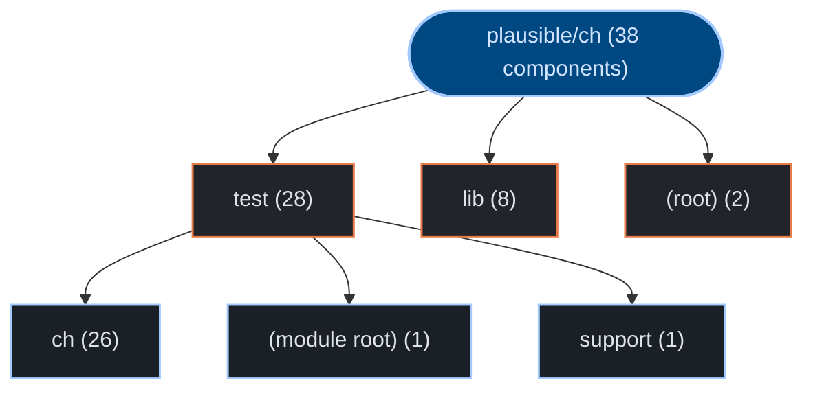
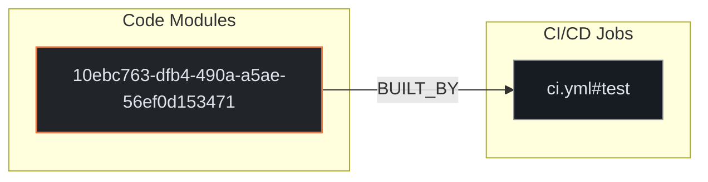
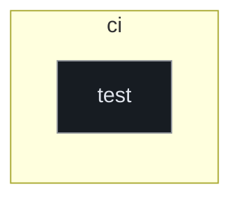

# Repository Architecture Analysis: plausible/ch

## Metadata
- **SHA**: `f673d1b65a71916995ff4ec25c451e94db3435c7`
- **Primary Ecosystem**: Elixir

## Quality Metrics
- **ast_engine**: fallback
- **avg_cognitive_complexity**: 0.0
- **avg_cyclomatic_complexity**: 0.0
- **component_count**: 38
- **dead_code_count**: 0
- **dead_code_symbols**: 0 entry(ies)
- **duplication_pct**: 0.0
- **file_complexities**: 0 entry(ies)
- **files_analyzed**: 38
- **fitness_passed**: True
- **fitness_violation_count**: 0
- **framework**: Elixir Mix
- **import_edges**: 0 entry(ies)
- **loc**: 12504
- **max_cognitive_complexity**: 0
- **max_cyclomatic_complexity**: 0
- **sloc**: 9788
- **test_file_count**: 28

# Architecture: plausible/ch

## Context
- **Repository**: `plausible/ch`
- **SHA**: `f673d1b65a71916995ff4ec25c451e94db3435c7`
- **Ecosystem**: Elixir
- **Framework**: Elixir Mix

## Building Block View

## Component Details
- **.formatter** (`.formatter.exs`): module
- **mix** (`mix.exs`): module
- **ch** (`lib/ch.ex`): module
- **connection** (`lib/ch/connection.ex`): module
- **error** (`lib/ch/error.ex`): module
- **query** (`lib/ch/query.ex`): module
- **result** (`lib/ch/result.ex`): module
- **row_binary** (`lib/ch/row_binary.ex`): module
- **stream** (`lib/ch/stream.ex`): module
- **types** (`lib/ch/types.ex`): module
- **test_helper** (`test/test_helper.exs`): module
- **aggregation_test** (`test/ch/aggregation_test.exs`): module
- **calendar_test** (`test/ch/calendar_test.exs`): module
- **connect_test** (`test/ch/connect_test.exs`): module
- **connection_test** (`test/ch/connection_test.exs`): module
- **decimal_param_test** (`test/ch/decimal_param_test.exs`): module
- **dynamic_test** (`test/ch/dynamic_test.exs`): module
- **ecto_type_test** (`test/ch/ecto_type_test.exs`): module
- **faults_test** (`test/ch/faults_test.exs`): module
- **headers_test** (`test/ch/headers_test.exs`): module
- **http_test** (`test/ch/http_test.exs`): module
- **json_test** (`test/ch/json_test.exs`): module
- **query_string_test** (`test/ch/query_string_test.exs`): module
- **query_test** (`test/ch/query_test.exs`): module
- **row_binary_array_test** (`test/ch/row_binary_array_test.exs`): module
- **row_binary_float_test** (`test/ch/row_binary_float_test.exs`): module
- **row_binary_integer_test** (`test/ch/row_binary_integer_test.exs`): module
- **row_binary_string_test** (`test/ch/row_binary_string_test.exs`): module
- **row_binary_test** (`test/ch/row_binary_test.exs`): module
- **select_test** (`test/ch/select_test.exs`): module
- **settings_test** (`test/ch/settings_test.exs`): module
- **stream_test** (`test/ch/stream_test.exs`): module
- **time_integration_test** (`test/ch/time_integration_test.exs`): module
- **time_row_binary_test** (`test/ch/time_row_binary_test.exs`): module
- **timezone_test** (`test/ch/timezone_test.exs`): module
- **types_test** (`test/ch/types_test.exs`): module
- **variant_test** (`test/ch/variant_test.exs`): module
- **test** (`test/support/test.ex`): module

## 6-Dimension Repository Scorecard

- **Overall Grade**: `B` (87.85/100)
- **Technical Debt Score**: 12.15
- **Estimated Remediation Effort**: 8.04h

| Dimension | Grade | Score | Weight | Details |
| :--- | :---: | :---: | :---: | :--- |
| Code Quality | `A` | 100.00 | 0.20 | avg_cc=0.00, max_cc=0, duplication=0.00%, dead_code=0 |
| Dependency Health | `A` | 100.00 | 0.15 | dependencies=9, outdated=0, vulnerable=0, has_lockfile=False |
| Maintainability | `A` | 100.00 | 0.15 | avg_cognitive=0.00, max_cognitive=0, fitness_violations=0, oversized_files=0 |
| Pipeline Health | `A` | 97.00 | 0.15 | workflows=1, operational_antipatterns=1, parallel_branches=False |
| Security | `D` | 64.00 | 0.20 | vulnerabilities=0, secrets=0, pipeline_security_findings=3 |
| Test Coverage | `C` | 70.00 | 0.15 | coverage=unavailable, ci_test_job=True, test_files_detected=True |

## Supply Chain Dependencies, Vulnerabilities & Secrets

- **Dependencies Parsed**: 9 | **Vulnerabilities**: 0 | **Secrets**: 0

### Inventory Sample
- `db_connection` `2.10.1` (hex, `mix.exs`)
- `decimal` `3.0` (hex, `mix.exs`)
- `dialyxir` `1.0` (hex, `mix.exs`)
- `ecto` `3.14.0` (hex, `mix.exs`)
- `ex_doc` `0.0.0` (hex, `mix.exs`)
- `jason` `1.0` (hex, `mix.exs`)
- `mint` `1.8` (hex, `mix.exs`)
- `stream_data` `1.3` (hex, `mix.exs`)
- `tz` `0.28.1` (hex, `mix.exs`)

## Section 7: Code-to-Cloud Deployment Traceability

- `10ebc763-dfb4-490a-a5ae-56ef0d153471` (code_module) --[BUILT_BY]--> `ci.yml#test` (ci_job)

## CI/CD Pipeline Topology

