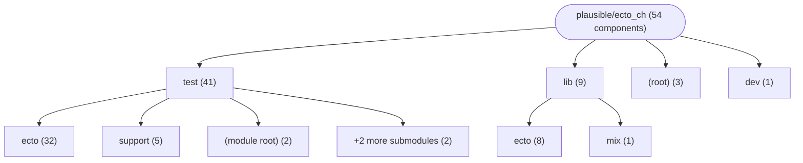
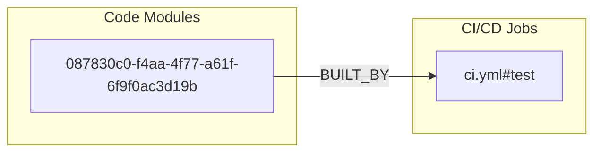
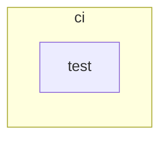

# Repository Architecture Analysis: plausible/ecto_ch

## Metadata
- **SHA**: `c25948eb2b917854c748bd316f038dcbd23d4a43`
- **Primary Ecosystem**: Elixir

## Quality Metrics
- **ast_engine**: fallback
- **avg_cognitive_complexity**: 0.0
- **avg_cyclomatic_complexity**: 0.0
- **component_count**: 54
- **dead_code_count**: 0
- **dead_code_symbols**: 0 entry(ies)
- **duplication_pct**: 0.0
- **file_complexities**: 0 entry(ies)
- **files_analyzed**: 54
- **fitness_passed**: True
- **fitness_violation_count**: 0
- **framework**: Elixir Mix
- **import_edges**: 0 entry(ies)
- **loc**: 16725
- **max_cognitive_complexity**: 0
- **max_cyclomatic_complexity**: 0
- **sloc**: 13022
- **test_file_count**: 42

# Architecture: plausible/ecto_ch

## Context
- **Repository**: `plausible/ecto_ch`
- **SHA**: `c25948eb2b917854c748bd316f038dcbd23d4a43`
- **Ecosystem**: Elixir
- **Framework**: Elixir Mix

## Building Block View

## Component Details
- **.formatter** (`.formatter.exs`): module
- **.iex** (`.iex.exs`): module
- **mix** (`mix.exs`): module
- **repo** (`dev/repo.ex`): module
- **clickhouse** (`lib/ecto/adapters/clickhouse.ex`): module
- **api** (`lib/ecto/adapters/clickhouse/api.ex`): module
- **connection** (`lib/ecto/adapters/clickhouse/connection.ex`): module
- **migration** (`lib/ecto/adapters/clickhouse/migration.ex`): module
- **queryable** (`lib/ecto/adapters/clickhouse/queryable.ex`): module
- **schema** (`lib/ecto/adapters/clickhouse/schema.ex`): module
- **storage** (`lib/ecto/adapters/clickhouse/storage.ex`): module
- **structure** (`lib/ecto/adapters/clickhouse/structure.ex`): module
- **schema** (`lib/mix/tasks/schema.ex`): module
- **ecto_ch_test** (`test/ecto_ch_test.exs`): module
- **test_helper** (`test/test_helper.exs`): module
- **type_test** (`test/ch/type_test.exs`): module
- **clickhouse_test** (`test/ecto/adapters/clickhouse_test.exs`): module
- **aggregate_function_type_test** (`test/ecto/adapters/clickhouse/aggregate_function_type_test.exs`): module
- **alter_update_test** (`test/ecto/adapters/clickhouse/alter_update_test.exs`): module
- **api_test** (`test/ecto/adapters/clickhouse/api_test.exs`): module
- **connection_test** (`test/ecto/adapters/clickhouse/connection_test.exs`): module
- **constant_test** (`test/ecto/adapters/clickhouse/constant_test.exs`): module
- **crud_test** (`test/ecto/adapters/clickhouse/crud_test.exs`): module
- **datetime64_test** (`test/ecto/adapters/clickhouse/datetime64_test.exs`): module
- **delete_all_test** (`test/ecto/adapters/clickhouse/delete_all_test.exs`): module
- **in_params_test** (`test/ecto/adapters/clickhouse/in_params_test.exs`): module
- **inline_test** (`test/ecto/adapters/clickhouse/inline_test.exs`): module
- **insert_stream_test** (`test/ecto/adapters/clickhouse/insert_stream_test.exs`): module
- **joins_test** (`test/ecto/adapters/clickhouse/joins_test.exs`): module
- **json_test** (`test/ecto/adapters/clickhouse/json_test.exs`): module
- **math_test** (`test/ecto/adapters/clickhouse/math_test.exs`): module
- **migration_test** (`test/ecto/adapters/clickhouse/migration_test.exs`): module
- **schemaless_test** (`test/ecto/adapters/clickhouse/schemaless_test.exs`): module
- **splice_test** (`test/ecto/adapters/clickhouse/splice_test.exs`): module
- **structure_test** (`test/ecto/adapters/clickhouse/structure_test.exs`): module
- **timestamps_test** (`test/ecto/adapters/clickhouse/timestamps_test.exs`): module
- **type_test** (`test/ecto/adapters/clickhouse/type_test.exs`): module
- **union_test** (`test/ecto/adapters/clickhouse/union_test.exs`): module
- **uuid_test** (`test/ecto/adapters/clickhouse/uuid_test.exs`): module
- **values_test** (`test/ecto/adapters/clickhouse/values_test.exs`): module
- **assoc_test** (`test/ecto/integration/assoc_test.exs`): module
- **interval_test** (`test/ecto/integration/interval_test.exs`): module
- **joins_test** (`test/ecto/integration/joins_test.exs`): module
- **logging_test** (`test/ecto/integration/logging_test.exs`): module
- **repo_test** (`test/ecto/integration/repo_test.exs`): module
- **sql_test** (`test/ecto/integration/sql_test.exs`): module
- **subquery_test** (`test/ecto/integration/subquery_test.exs`): module
- **type_test** (`test/ecto/integration/type_test.exs`): module
- **schema_test** (`test/mix/tasks/schema_test.exs`): module
- **ecto_schemas** (`test/support/ecto_schemas.exs`): module
- **integration_case** (`test/support/integration_case.ex`): module
- **migrations** (`test/support/migrations.ex`): module
- **repo** (`test/support/repo.ex`): module
- **schemas** (`test/support/schemas.exs`): module

## 6-Dimension Repository Scorecard

- **Overall Grade**: `B` (87.85/100)
- **Technical Debt Score**: 12.15
- **Estimated Remediation Effort**: 8.04h

| Dimension | Grade | Score | Weight | Details |
| :--- | :---: | :---: | :---: | :--- |
| Code Quality | `A` | 100.00 | 0.20 | avg_cc=0.00, max_cc=0, duplication=0.00%, dead_code=0 |
| Dependency Health | `A` | 100.00 | 0.15 | dependencies=7, outdated=0, vulnerable=0, has_lockfile=False |
| Maintainability | `A` | 100.00 | 0.15 | avg_cognitive=0.00, max_cognitive=0, fitness_violations=0, oversized_files=0 |
| Pipeline Health | `A` | 97.00 | 0.15 | workflows=1, operational_antipatterns=1, parallel_branches=False |
| Security | `D` | 64.00 | 0.20 | vulnerabilities=0, secrets=0, pipeline_security_findings=3 |
| Test Coverage | `C` | 70.00 | 0.15 | coverage=unavailable, ci_test_job=True, test_files_detected=True |

## Supply Chain Dependencies, Vulnerabilities & Secrets

- **Dependencies Parsed**: 7 | **Vulnerabilities**: 0 | **Secrets**: 0

### Inventory Sample
- `benchee` `1.1` (hex, `mix.exs`)
- `ch` `0.9.0` (hex, `mix.exs`)
- `dialyxir` `1.2` (hex, `mix.exs`)
- `ecto_sql` `3.14.0` (hex, `mix.exs`)
- `ex_doc` `0.0.0` (hex, `mix.exs`)
- `rexbug` `1.0` (hex, `mix.exs`)
- `tz` `0.28.1` (hex, `mix.exs`)

## Section 7: Code-to-Cloud Deployment Traceability

- `087830c0-f4aa-4f77-a61f-6f9f0ac3d19b` (code_module) --[BUILT_BY]--> `ci.yml#test` (ci_job)

## CI/CD Pipeline Topology

