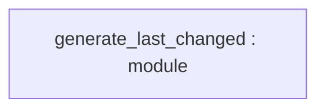
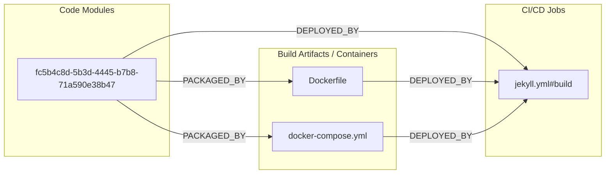
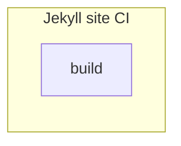

# Repository Architecture Analysis: plausible/website

## Metadata
- **SHA**: `f9eaf9adc468b6369882977021cd9860a1b816d6`
- **Primary Ecosystem**: Ruby

## Quality Metrics
- **ast_engine**: fallback
- **avg_cognitive_complexity**: 0.0
- **avg_cyclomatic_complexity**: 0.0
- **component_count**: 1
- **dead_code_count**: 0
- **dead_code_symbols**: 0 entry(ies)
- **duplication_pct**: 0.0
- **file_complexities**: 0 entry(ies)
- **files_analyzed**: 1
- **fitness_passed**: True
- **fitness_violation_count**: 0
- **framework**: Ruby
- **import_edges**: 0 entry(ies)
- **loc**: 10
- **max_cognitive_complexity**: 0
- **max_cyclomatic_complexity**: 0
- **sloc**: 9

# Architecture: plausible/website

## Context
- **Repository**: `plausible/website`
- **SHA**: `f9eaf9adc468b6369882977021cd9860a1b816d6`
- **Ecosystem**: Ruby
- **Framework**: Ruby

## Building Block View

## Component Details
- **generate_last_changed** (`_plugins/generate_last_changed.rb`): module

## 6-Dimension Repository Scorecard

- **Overall Grade**: `C` (78.55/100)
- **Technical Debt Score**: 21.45
- **Estimated Remediation Effort**: 13.36h

| Dimension | Grade | Score | Weight | Details |
| :--- | :---: | :---: | :---: | :--- |
| Code Quality | `A` | 100.00 | 0.20 | avg_cc=0.00, max_cc=0, duplication=0.00%, dead_code=0 |
| Dependency Health | `A` | 100.00 | 0.15 | dependencies=211, outdated=0, vulnerable=0, has_lockfile=True |
| Maintainability | `A` | 100.00 | 0.15 | avg_cognitive=0.00, max_cognitive=0, fitness_violations=0, oversized_files=0 |
| Pipeline Health | `A` | 97.00 | 0.15 | workflows=1, operational_antipatterns=1, parallel_branches=False |
| Security | `F` | 40.00 | 0.20 | vulnerabilities=0, secrets=0, pipeline_security_findings=5 |
| Test Coverage | `F` | 40.00 | 0.15 | coverage=unavailable, ci_test_job=False, test_files_detected=False |

## Supply Chain Dependencies, Vulnerabilities & Secrets

- **Dependencies Parsed**: 211 | **Vulnerabilities**: 0 | **Secrets**: 0

### Inventory Sample
- `jekyll` `3.5` (gem, `Gemfile`)
- `jekyll-feed` `0.9` (gem, `Gemfile`)
- `jekyll-minifier` `0.1` (gem, `Gemfile`)
- `jekyll-postcss` `*` (gem, `Gemfile`)
- `jekyll-purgecss` `*` (gem, `Gemfile`)
- `jekyll-seo-tag` `*` (gem, `Gemfile`)
- `jekyll-sitemap` `1.4` (gem, `Gemfile`)
- `kramdown-parser-gfm` `*` (gem, `Gemfile`)
- `webrick` `1.7` (gem, `Gemfile`)
- `@tailwindcss/typography` `0.2.0` (npm, `package-lock.json`)
- `@tailwindcss/typography` `0.2.0` (npm, `package.json`)
- `@tailwindcss/ui` `0.7.2` (npm, `package-lock.json`)
- `@tailwindcss/ui` `0.7.2` (npm, `package.json`)
- `autoprefixer` `9.8.8` (npm, `package-lock.json`)
- `autoprefixer` `9.8.8` (npm, `package.json`)
- `postcss-cli` `7.1.0` (npm, `package.json`)
- `postcss-cli` `7.1.2` (npm, `package-lock.json`)
- `postcss-import` `12.0.1` (npm, `package-lock.json`)
- `postcss-import` `12.0.1` (npm, `package.json`)
- `purgecss` `4.1.3` (npm, `package-lock.json`)
- `purgecss` `4.1.3` (npm, `package.json`)
- `tailwindcss` `1.4.0` (npm, `package.json`)
- `tailwindcss` `1.9.6` (npm, `package-lock.json`)
- `@fullhuman/postcss-purgecss` `2.3.0` (npm, `package-lock.json`)
- `@nodelib/fs.scandir` `2.1.4` (npm, `package-lock.json`)
- `@nodelib/fs.stat` `2.0.4` (npm, `package-lock.json`)
- `@nodelib/fs.walk` `1.2.6` (npm, `package-lock.json`)
- `@tailwindcss/custom-forms` `0.2.1` (npm, `package-lock.json`)
- `acorn` `7.4.1` (npm, `package-lock.json`)
- `acorn-node` `1.8.2` (npm, `package-lock.json`)
- ... (+181 more dependencies)

## Section 7: Code-to-Cloud Deployment Traceability

- `fc5b4c8d-5b3d-4445-b7b8-71a590e38b47` (code_module) --[DEPLOYED_BY]--> `jekyll.yml#build` (ci_job)
- `fc5b4c8d-5b3d-4445-b7b8-71a590e38b47` (code_module) --[PACKAGED_BY]--> `Dockerfile` (container)
- `fc5b4c8d-5b3d-4445-b7b8-71a590e38b47` (code_module) --[PACKAGED_BY]--> `docker-compose.yml` (container)
- `Dockerfile` (container) --[DEPLOYED_BY]--> `jekyll.yml#build` (ci_job)
- `docker-compose.yml` (container) --[DEPLOYED_BY]--> `jekyll.yml#build` (ci_job)

## CI/CD Pipeline Topology

