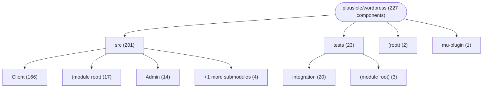
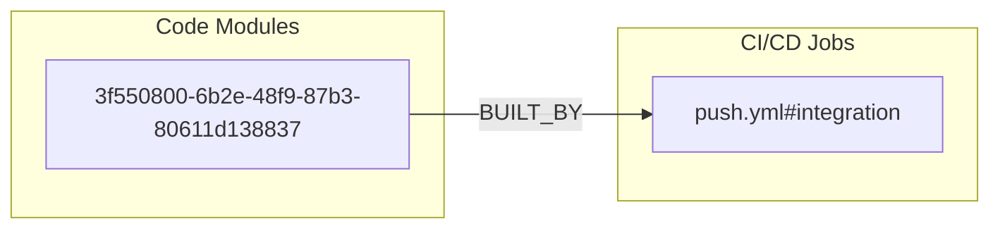
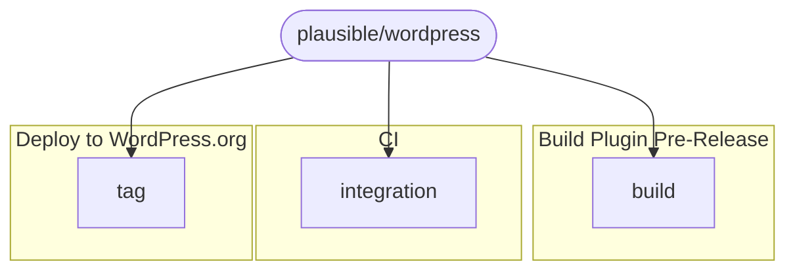

# Repository Architecture Analysis: plausible/wordpress

## Metadata
- **SHA**: `7a2076b30654a90b8b52f156a136d2313a9d827b`
- **Primary Ecosystem**: PHP

## Quality Metrics
- **ast_engine**: fallback
- **avg_cognitive_complexity**: 0.0
- **avg_cyclomatic_complexity**: 0.0
- **component_count**: 227
- **dead_code_count**: 0
- **dead_code_symbols**: 0 entry(ies)
- **duplication_pct**: 0.0
- **file_complexities**: 0 entry(ies)
- **files_analyzed**: 227
- **fitness_passed**: True
- **fitness_violation_count**: 0
- **framework**: PHP Composer
- **import_edges**: 0 entry(ies)
- **loc**: 59928
- **max_cognitive_complexity**: 0
- **max_cyclomatic_complexity**: 0
- **sloc**: 28756
- **test_file_count**: 23

# Architecture: plausible/wordpress

## Context
- **Repository**: `plausible/wordpress`
- **SHA**: `7a2076b30654a90b8b52f156a136d2313a9d827b`
- **Ecosystem**: PHP
- **Framework**: PHP Composer

## Building Block View

## Component Details

Showing top 60 representative components out of 227 across 4 module group(s):

- **Module `src`** (201 components — module: 201)
- **Module `tests`** (23 components — module: 23)
- **Module `(root)`** (2 components — module: 2)
- **Module `mu-plugin`** (1 components — module: 1)

- **.php-cs-fixer.dist** (`src/Client/.php-cs-fixer.dist.php`): module
- **API** (`src/Admin/Settings/API.php`): module
- **Actions** (`src/Admin/Actions.php`): module
- **AdminBar** (`src/AdminBar.php`): module
- **AdminBarTest** (`tests/integration/AdminBarTest.php`): module
- **AggregateException** (`src/Client/lib/Lib/GuzzleHttp/Promise/AggregateException.php`): module
- **Ajax** (`src/Ajax.php`): module
- **AjaxTest** (`tests/integration/AjaxTest.php`): module
- **ApiException** (`src/Client/lib/ApiException.php`): module
- **AppendStream** (`src/Client/lib/Lib/GuzzleHttp/Psr7/AppendStream.php`): module
- **Assets** (`src/Assets.php`): module
- **AssetsTest** (`tests/integration/AssetsTest.php`): module
- **BadResponseException** (`src/Client/lib/Lib/GuzzleHttp/Exception/BadResponseException.php`): module
- **BodySummarizer** (`src/Client/lib/Lib/GuzzleHttp/BodySummarizer.php`): module
- **BodySummarizerInterface** (`src/Client/lib/Lib/GuzzleHttp/BodySummarizerInterface.php`): module
- **BufferStream** (`src/Client/lib/Lib/GuzzleHttp/Psr7/BufferStream.php`): module
- **CachingStream** (`src/Client/lib/Lib/GuzzleHttp/Psr7/CachingStream.php`): module
- **CancellationException** (`src/Client/lib/Lib/GuzzleHttp/Promise/CancellationException.php`): module
- **Capabilities** (`src/Capabilities.php`): module
- **Capabilities** (`src/Client/lib/Model/Capabilities.php`): module
- **CapabilitiesFeatures** (`src/Client/lib/Model/CapabilitiesFeatures.php`): module
- **Client** (`src/Client.php`): module
- **Client** (`src/Client/lib/Lib/GuzzleHttp/Client.php`): module
- **ClientException** (`src/Client/lib/Lib/GuzzleHttp/Exception/ClientException.php`): module
- **ClientExceptionInterface** (`src/Client/lib/Lib/Psr/Http/Client/ClientExceptionInterface.php`): module
- **ClientFactory** (`src/ClientFactory.php`): module
- **ClientFactoryTest** (`tests/integration/ClientFactoryTest.php`): module
- **ClientInterface** (`src/Client/lib/Lib/GuzzleHttp/ClientInterface.php`): module
- **ClientInterface** (`src/Client/lib/Lib/Psr/Http/Client/ClientInterface.php`): module
- **ClientTest** (`tests/integration/ClientTest.php`): module
- **ClientTrait** (`src/Client/lib/Lib/GuzzleHttp/ClientTrait.php`): module
- **Compatibility** (`src/Compatibility.php`): module
- **CompatibilityTest** (`tests/integration/CompatibilityTest.php`): module
- **Configuration** (`src/Client/lib/Configuration.php`): module
- **ConnectException** (`src/Client/lib/Lib/GuzzleHttp/Exception/ConnectException.php`): module
- **CookieJar** (`src/Client/lib/Lib/GuzzleHttp/Cookie/CookieJar.php`): module
- **CookieJarInterface** (`src/Client/lib/Lib/GuzzleHttp/Cookie/CookieJarInterface.php`): module
- **Coroutine** (`src/Client/lib/Lib/GuzzleHttp/Promise/Coroutine.php`): module
- **Create** (`src/Client/lib/Lib/GuzzleHttp/Promise/Create.php`): module
- **Cron** (`src/Cron.php`): module
- **CurlFactory** (`src/Client/lib/Lib/GuzzleHttp/Handler/CurlFactory.php`): module
- **CurlFactoryInterface** (`src/Client/lib/Lib/GuzzleHttp/Handler/CurlFactoryInterface.php`): module
- **CurlHandler** (`src/Client/lib/Lib/GuzzleHttp/Handler/CurlHandler.php`): module
- **CurlMultiHandler** (`src/Client/lib/Lib/GuzzleHttp/Handler/CurlMultiHandler.php`): module
- **CustomProp** (`src/Client/lib/Model/CustomProp.php`): module
- **CustomPropCustomProp** (`src/Client/lib/Model/CustomPropCustomProp.php`): module
- **CustomPropDisableRequest** (`src/Client/lib/Model/CustomPropDisableRequest.php`): module
- **CustomPropDisableRequestBulkDisable** (`src/Client/lib/Model/CustomPropDisableRequestBulkDisable.php`): module
- **CustomPropEnableRequest** (`src/Client/lib/Model/CustomPropEnableRequest.php`): module
- **CustomPropEnableRequestBulkEnable** (`src/Client/lib/Model/CustomPropEnableRequestBulkEnable.php`): module
- **CustomPropListResponse** (`src/Client/lib/Model/CustomPropListResponse.php`): module
- **DefaultApi** (`src/Client/lib/Api/DefaultApi.php`): module
- **DroppingStream** (`src/Client/lib/Lib/GuzzleHttp/Psr7/DroppingStream.php`): module
- **EDD** (`src/Admin/Provisioning/Integrations/EDD.php`): module
- **EDD** (`src/Integrations/EDD.php`): module
- **EDDTest** (`tests/integration/Integrations/EDDTest.php`): module
- **Each** (`src/Client/lib/Lib/GuzzleHttp/Promise/Each.php`): module
- **EachPromise** (`src/Client/lib/Lib/GuzzleHttp/Promise/EachPromise.php`): module
- **EasyHandle** (`src/Client/lib/Lib/GuzzleHttp/Handler/EasyHandle.php`): module
- **EnhancedMeasurements** (`src/EnhancedMeasurements.php`): module

## 6-Dimension Repository Scorecard

- **Overall Grade**: `D` (66.20/100)
- **Technical Debt Score**: 33.80
- **Estimated Remediation Effort**: 29.95h

| Dimension | Grade | Score | Weight | Details |
| :--- | :---: | :---: | :---: | :--- |
| Code Quality | `A` | 100.00 | 0.20 | avg_cc=0.00, max_cc=0, duplication=0.00%, dead_code=0 |
| Dependency Health | `B` | 85.00 | 0.15 | dependencies=54, outdated=0, vulnerable=0, has_lockfile=False |
| Maintainability | `A` | 100.00 | 0.15 | avg_cognitive=0.00, max_cognitive=0, fitness_violations=0, oversized_files=0 |
| Pipeline Health | `F` | 53.00 | 0.15 | workflows=3, operational_antipatterns=7, parallel_branches=False |
| Security | `F` | 0.00 | 0.20 | vulnerabilities=0, secrets=0, pipeline_security_findings=10 |
| Test Coverage | `C` | 70.00 | 0.15 | coverage=unavailable, ci_test_job=True, test_files_detected=True |

## Supply Chain Dependencies, Vulnerabilities & Secrets

- **Dependencies Parsed**: 54 | **Vulnerabilities**: 0 | **Secrets**: 0

### Inventory Sample
- `composer/installers` `*` (composer, `composer.json`)
- `guzzlehttp/guzzle` `7.3` (composer, `src/Client/composer.json`)
- `guzzlehttp/psr7` `1.7` (composer, `src/Client/composer.json`)
- `@babel/core` `7.18.13` (npm, `package.json`)
- `@babel/plugin-syntax-jsx` `7.18.6` (npm, `package.json`)
- `@babel/plugin-transform-react-jsx` `7.18.10` (npm, `package.json`)
- `@babel/plugin-transform-runtime` `7.18.10` (npm, `package.json`)
- `@babel/preset-env` `7.22.20` (npm, `package.json`)
- `@babel/runtime` `7.18.9` (npm, `package.json`)
- `@openapitools/openapi-generator-cli` `*` (npm, `package.json`)
- `@prettier/plugin-php` `0.18.9` (npm, `package.json`)
- `@tailwindcss/forms` `0.5.7` (npm, `package.json`)
- `@wordpress/stylelint-config` `20.0.2` (npm, `package.json`)
- `autoprefixer` `10.4.16` (npm, `package.json`)
- `babel-loader` `8.2.5` (npm, `package.json`)
- `clean-webpack-plugin` `4.0.0` (npm, `package.json`)
- `copy-webpack-plugin` `11.0.0` (npm, `package.json`)
- `cross-env` `7.0.3` (npm, `package.json`)
- `css-loader` `6.7.1` (npm, `package.json`)
- `css-minimizer-webpack-plugin` `4.2.2` (npm, `package.json`)
- `cssnano` `5.1.13` (npm, `package.json`)
- `cssnano-preset-advanced` `5.3.8` (npm, `package.json`)
- `expose-loader` `4.0.0` (npm, `package.json`)
- `file-loader` `6.2.0` (npm, `package.json`)
- `husky` `4.3.5` (npm, `package.json`)
- `imagemin-webpack-plugin` `*` (npm, `package.json`)
- `lint-staged` `9.5.0` (npm, `package.json`)
- `mini-css-extract-plugin` `1.6.2` (npm, `package.json`)
- `postcss` `8.4.31` (npm, `package.json`)
- `postcss-loader` `7.3.3` (npm, `package.json`)
- ... (+24 more dependencies)

## Section 7: Code-to-Cloud Deployment Traceability

- `3f550800-6b2e-48f9-87b3-80611d138837` (code_module) --[BUILT_BY]--> `push.yml#integration` (ci_job)

## CI/CD Pipeline Topology

