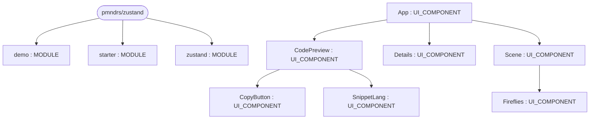
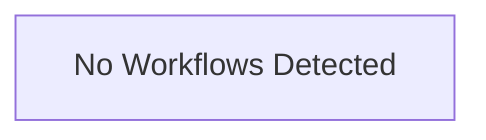

# Repository Architecture Analysis: pmndrs/zustand

## Metadata
- **SHA**: `9fed2eb2f3af672da9f7bf694b996df3831fc207`
- **Primary Ecosystem**: JavaScript/TypeScript

## Quality Metrics
- **avg_cyclomatic_complexity**: 3.2
- **component_count**: 10
- **files_analyzed**: 68
- **framework**: React (Vite)
- **loc**: 11968
- **max_cyclomatic_complexity**: 95
- **sloc**: 10442

# Architecture: pmndrs/zustand

## Context
- **Repository**: `pmndrs/zustand`
- **SHA**: `9fed2eb2f3af672da9f7bf694b996df3831fc207`
- **Ecosystem**: JavaScript/TypeScript
- **Framework**: Unknown

## Building Block View

## Component Details
- **demo** (`examples/demo/package.json`): MODULE
- **starter** (`examples/starter/package.json`): MODULE
- **zustand** (`package.json`): MODULE
- **App** (`examples/demo/src/App.jsx`): UI_COMPONENT (deps: CodePreview, Details, Scene)
- **CodePreview** (`examples/demo/src/components/CodePreview.jsx`): UI_COMPONENT (deps: CopyButton, SnippetLang)
- **CopyButton** (`examples/demo/src/components/CopyButton.jsx`): UI_COMPONENT
- **Details** (`examples/demo/src/components/Details.jsx`): UI_COMPONENT
- **Fireflies** (`examples/demo/src/components/Fireflies.jsx`): UI_COMPONENT
- **Scene** (`examples/demo/src/components/Scene.jsx`): UI_COMPONENT (deps: Fireflies)
- **SnippetLang** (`examples/demo/src/components/SnippetLang.jsx`): UI_COMPONENT

## CI/CD Pipeline Topology

