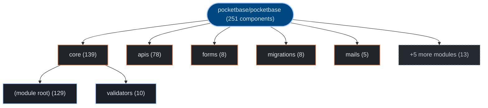
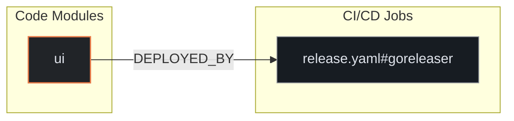
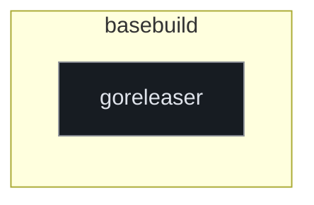

# Repository Architecture Analysis: pocketbase/pocketbase

## Metadata
- **SHA**: `7f2773ec234b62d0b80ca47c508397cb3d0da3ea`
- **Primary Ecosystem**: Go

## Quality Metrics
- **ast_engine**: tree-sitter
- **avg_cognitive_complexity**: 5.23
- **avg_cyclomatic_complexity**: 3.73
- **component_count**: 251
- **dead_code_count**: 128
- **dead_code_symbols**: 50 entry(ies)
- **duplication_pct**: 17.46
- **file_complexities**: 25 entry(ies)
- **files_analyzed**: 667
- **fitness_passed**: False
- **fitness_violation_count**: 3
- **framework**: Go Service
- **import_edges**: 100 entry(ies)
- **loc**: 164165
- **max_cognitive_complexity**: 1760
- **max_cyclomatic_complexity**: 220
- **sloc**: 129904
- **test_file_count**: 257

# Architecture: pocketbase/pocketbase

## Context
- **Repository**: `pocketbase/pocketbase`
- **SHA**: `7f2773ec234b62d0b80ca47c508397cb3d0da3ea`
- **Ecosystem**: Go
- **Framework**: Go Service

## Building Block View

## Component Details

Showing top 60 representative components out of 251 across 10 module group(s):

- **Module `core`** (139 components — module: 139)
- **Module `apis`** (78 components — module: 78)
- **Module `forms`** (8 components — module: 8)
- **Module `migrations`** (8 components — module: 8)
- **Module `mails`** (5 components — module: 5)
- **Module `plugins`** (5 components — module: 5)
- **Module `(root)`** (3 components — module: 3)
- **Module `cmd`** (3 components — module: 3)
- **Module `examples`** (1 components — module: 1)
- **Module `ui`** (1 components — MODULE: 1)

- **1640988000_aux_init** (`migrations/1640988000_aux_init.go`): module
- **1640988000_init** (`migrations/1640988000_init.go`): module
- **1717233556_v0.23_migrate** (`migrations/1717233556_v0.23_migrate.go`): module
- **1717233557_v0.23_migrate2** (`migrations/1717233557_v0.23_migrate2.go`): module
- **1717233558_v0.23_migrate3** (`migrations/1717233558_v0.23_migrate3.go`): module
- **1717233559_v0.23_migrate4** (`migrations/1717233559_v0.23_migrate4.go`): module
- **1763020353_update_default_auth_alert_templates** (`migrations/1763020353_update_default_auth_alert_templates.go`): module
- **1778828400_normalize_indexes** (`migrations/1778828400_normalize_indexes.go`): module
- **PocketBase Superuser UI** (`ui/package.json`): MODULE
- **api_error_aliases** (`apis/api_error_aliases.go`): module
- **app** (`core/app.go`): module
- **apple_client_secret_create** (`forms/apple_client_secret_create.go`): module
- **apple_client_secret_create_test** (`forms/apple_client_secret_create_test.go`): module
- **auth_origin_model** (`core/auth_origin_model.go`): module
- **auth_origin_model_test** (`core/auth_origin_model_test.go`): module
- **auth_origin_query** (`core/auth_origin_query.go`): module
- **auth_origin_query_test** (`core/auth_origin_query_test.go`): module
- **backup** (`apis/backup.go`): module
- **backup** (`core/backup.go`): module
- **backup_create** (`apis/backup_create.go`): module
- **backup_create** (`core/backup_create.go`): module
- **backup_restore** (`core/backup_restore.go`): module
- **backup_test** (`apis/backup_test.go`): module
- **backup_test** (`core/backup_test.go`): module
- **backup_upload** (`apis/backup_upload.go`): module
- **base** (`apis/base.go`): module
- **base** (`core/base.go`): module
- **base** (`mails/base.go`): module
- **base_test** (`apis/base_test.go`): module
- **base_test** (`core/base_test.go`): module
- **batch** (`apis/batch.go`): module
- **batch_test** (`apis/batch_test.go`): module
- **binds** (`plugins/jsvm/binds.go`): module
- **collection** (`apis/collection.go`): module
- **collection_import** (`apis/collection_import.go`): module
- **collection_import** (`core/collection_import.go`): module
- **collection_import_test** (`apis/collection_import_test.go`): module
- **collection_import_test** (`core/collection_import_test.go`): module
- **collection_model** (`core/collection_model.go`): module
- **collection_model_auth_options** (`core/collection_model_auth_options.go`): module
- **collection_model_auth_options_test** (`core/collection_model_auth_options_test.go`): module
- **collection_model_auth_templates** (`core/collection_model_auth_templates.go`): module
- **collection_model_base_options** (`core/collection_model_base_options.go`): module
- **collection_model_test** (`core/collection_model_test.go`): module
- **collection_model_view_options** (`core/collection_model_view_options.go`): module
- **collection_model_view_options_test** (`core/collection_model_view_options_test.go`): module
- **collection_query** (`core/collection_query.go`): module
- **collection_query_test** (`core/collection_query_test.go`): module
- **collection_record_table_sync** (`core/collection_record_table_sync.go`): module
- **collection_record_table_sync_test** (`core/collection_record_table_sync_test.go`): module
- **collection_test** (`apis/collection_test.go`): module
- **collection_validate** (`core/collection_validate.go`): module
- **collection_validate_test** (`core/collection_validate_test.go`): module
- **cron** (`apis/cron.go`): module
- **cron_test** (`apis/cron_test.go`): module
- **db** (`core/db.go`): module
- **db** (`core/validators/db.go`): module
- **db_builder** (`core/db_builder.go`): module
- **db_connect** (`core/db_connect.go`): module
- **db_connect_nodefaultdriver** (`core/db_connect_nodefaultdriver.go`): module

## 6-Dimension Repository Scorecard

- **Overall Grade**: `F` (46.11/100)
- **Technical Debt Score**: 53.89
- **Estimated Remediation Effort**: 828.96h

| Dimension | Grade | Score | Weight | Details |
| :--- | :---: | :---: | :---: | :--- |
| Code Quality | `F` | 27.08 | 0.20 | avg_cc=3.73, max_cc=220, duplication=17.46%, dead_code=128 |
| Dependency Health | `A` | 100.00 | 0.15 | dependencies=99, outdated=0, vulnerable=0, has_lockfile=True |
| Maintainability | `F` | 36.31 | 0.15 | avg_cognitive=5.23, max_cognitive=1760, fitness_violations=3, oversized_files=7 |
| Pipeline Health | `D` | 65.00 | 0.15 | workflows=1, operational_antipatterns=3, parallel_branches=False |
| Security | `F` | 0.00 | 0.20 | vulnerabilities=0, secrets=379, pipeline_security_findings=2 |
| Test Coverage | `C` | 70.00 | 0.15 | coverage=unavailable, ci_test_job=True, test_files_detected=True |

## Architecture Fitness & Workspace Boundaries

- **[MEDIUM] `ATRUSS-ARCH-005` (COMPLEXITY_THRESHOLD)**: Repository duplication_pct (17.46) exceeds policy threshold (15.0).
- **[MEDIUM] `ATRUSS-ARCH-005` (COMPLEXITY_THRESHOLD)**: Repository max_cognitive_complexity (1760.0) exceeds policy threshold (25.0).
- **[MEDIUM] `ATRUSS-ARCH-005` (COMPLEXITY_THRESHOLD)**: Repository max_cyclomatic_complexity (220.0) exceeds policy threshold (20.0).

## Supply Chain Dependencies, Vulnerabilities & Secrets

- **Dependencies Parsed**: 99 | **Vulnerabilities**: 0 | **Secrets**: 379

### Secret Findings (Redacted)
- **[HIGH] `ATRUSS-SEC-005`** at `apis/backup_test.go:41` (`"Authorization": "eyJh***REDACTED***",`)
- **[HIGH] `ATRUSS-SEC-005`** at `apis/backup_test.go:57` (`"Authorization": "eyJh***REDACTED***",`)
- **[HIGH] `ATRUSS-SEC-005`** at `apis/backup_test.go:68` (`"Authorization": "eyJh***REDACTED***",`)
- **[HIGH] `ATRUSS-SEC-005`** at `apis/backup_test.go:110` (`"Authorization": "eyJh***REDACTED***",`)
- **[HIGH] `ATRUSS-SEC-005`** at `apis/backup_test.go:124` (`"Authorization": "eyJh***REDACTED***",`)
- **[HIGH] `ATRUSS-SEC-005`** at `apis/backup_test.go:141` (`"Authorization": "eyJh***REDACTED***",`)
- **[HIGH] `ATRUSS-SEC-005`** at `apis/backup_test.go:170` (`"Authorization": "eyJh***REDACTED***",`)
- **[HIGH] `ATRUSS-SEC-005`** at `apis/backup_test.go:188` (`"Authorization": "eyJh***REDACTED***",`)
- **[HIGH] `ATRUSS-SEC-005`** at `apis/backup_test.go:279` (`"Authorization": "eyJh***REDACTED***",`)
- **[HIGH] `ATRUSS-SEC-005`** at `apis/backup_test.go:293` (`"Authorization": "eyJh***REDACTED***",`)
- **[HIGH] `ATRUSS-SEC-005`** at `apis/backup_test.go:309` (`"Authorization": "eyJh***REDACTED***",`)
- **[HIGH] `ATRUSS-SEC-005`** at `apis/backup_test.go:339` (`"Authorization": "eyJh***REDACTED***",`)
- **[HIGH] `ATRUSS-SEC-005`** at `apis/backup_test.go:356` (`"Authorization": "eyJh***REDACTED***",`)
- **[HIGH] `ATRUSS-SEC-005`** at `apis/backup_test.go:392` (`"Authorization": "eyJh***REDACTED***",`)
- **[HIGH] `ATRUSS-SEC-005`** at `apis/backup_test.go:408` (`"Authorization": "eyJh***REDACTED***",`)
- **[HIGH] `ATRUSS-SEC-005`** at `apis/backup_test.go:627` (`"Authorization": "eyJh***REDACTED***",`)
- **[HIGH] `ATRUSS-SEC-005`** at `apis/backup_test.go:646` (`"Authorization": "eyJh***REDACTED***",`)
- **[HIGH] `ATRUSS-SEC-005`** at `apis/backup_test.go:665` (`"Authorization": "eyJh***REDACTED***",`)
- **[HIGH] `ATRUSS-SEC-005`** at `apis/backup_test.go:687` (`"Authorization": "eyJh***REDACTED***",`)
- **[HIGH] `ATRUSS-SEC-005`** at `apis/backup_test.go:723` (`"Authorization": "eyJh***REDACTED***",`)
- **[HIGH] `ATRUSS-SEC-005`** at `apis/backup_test.go:780` (`"Authorization": "eyJh***REDACTED***",`)
- **[HIGH] `ATRUSS-SEC-005`** at `apis/backup_test.go:796` (`"Authorization": "eyJh***REDACTED***",`)
- **[HIGH] `ATRUSS-SEC-005`** at `apis/backup_test.go:812` (`"Authorization": "eyJh***REDACTED***",`)
- **[HIGH] `ATRUSS-SEC-005`** at `apis/batch_test.go:293` (`"Authorization": "eyJh***REDACTED***",`)
- **[HIGH] `ATRUSS-SEC-005`** at `apis/batch_test.go:357` (`"Authorization": "eyJh***REDACTED***",`)
- **[HIGH] `ATRUSS-SEC-005`** at `apis/batch_test.go:428` (`"Authorization": "eyJh***REDACTED***",`)
- **[HIGH] `ATRUSS-SEC-005`** at `apis/batch_test.go:499` (`"Authorization": "eyJh***REDACTED***",`)
- **[HIGH] `ATRUSS-SEC-005`** at `apis/batch_test.go:562` (`"Authorization": "eyJh***REDACTED***",`)
- **[HIGH] `ATRUSS-SEC-005`** at `apis/batch_test.go:607` (`"Authorization": "eyJh***REDACTED***",`)
- **[HIGH] `ATRUSS-SEC-005`** at `apis/batch_test.go:688` (`"Authorization": "eyJh***REDACTED***",`)
- **[HIGH] `ATRUSS-SEC-005`** at `apis/batch_test.go:735` (`"Authorization": "eyJh***REDACTED***",`)
- **[HIGH] `ATRUSS-SEC-005`** at `apis/collection_import_test.go:32` (`"Authorization": "eyJh***REDACTED***",`)
- **[HIGH] `ATRUSS-SEC-005`** at `apis/collection_import_test.go:44` (`"Authorization": "eyJh***REDACTED***",`)
- **[HIGH] `ATRUSS-SEC-005`** at `apis/collection_import_test.go:83` (`"Authorization": "eyJh***REDACTED***",`)
- **[HIGH] `ATRUSS-SEC-005`** at `apis/collection_import_test.go:146` (`"Authorization": "eyJh***REDACTED***",`)
- **[HIGH] `ATRUSS-SEC-005`** at `apis/collection_import_test.go:215` (`"Authorization": "eyJh***REDACTED***",`)
- **[HIGH] `ATRUSS-SEC-005`** at `apis/collection_import_test.go:269` (`"Authorization": "eyJh***REDACTED***",`)
- **[HIGH] `ATRUSS-SEC-005`** at `apis/collection_import_test.go:343` (`"Authorization": "eyJh***REDACTED***",`)
- **[HIGH] `ATRUSS-SEC-005`** at `apis/collection_test.go:33` (`"Authorization": "eyJh***REDACTED***",`)
- **[HIGH] `ATRUSS-SEC-005`** at `apis/collection_test.go:44` (`"Authorization": "eyJh***REDACTED***",`)

### Inventory Sample
- `github.com/disintegration/imaging` `1.6.2` (golang, `go.mod`)
- `github.com/domodwyer/mailyak/v3` `3.6.2` (golang, `go.mod`)
- `github.com/dop251/goja` `0.0.0-20261021140635-64adc8bb4d51` (golang, `go.mod`)
- `github.com/dop251/goja_nodejs` `0.0.0-20260212111938-1f56ff5bcf14` (golang, `go.mod`)
- `github.com/fatih/color` `1.19.0` (golang, `go.mod`)
- `github.com/fsnotify/fsnotify` `1.10.1` (golang, `go.mod`)
- `github.com/gabriel-vasile/mimetype` `1.4.15` (golang, `go.mod`)
- `github.com/ganigeorgiev/fexpr` `0.6.0` (golang, `go.mod`)
- `github.com/golang-jwt/jwt/v5` `5.3.1` (golang, `go.mod`)
- `github.com/pocketbase/dbx` `1.12.0` (golang, `go.mod`)
- `github.com/pocketbase/ozzo-validation/v4` `4.3.0` (golang, `go.mod`)
- `github.com/pocketbase/tygoja` `0.1.0` (golang, `go.mod`)
- `github.com/spf13/cast` `1.10.0` (golang, `go.mod`)
- `github.com/spf13/cobra` `1.10.2` (golang, `go.mod`)
- `golang.org/x/crypto` `0.58.0` (golang, `go.mod`)
- `golang.org/x/image` `0.47.0` (golang, `go.mod`)
- `golang.org/x/net` `0.61.0` (golang, `go.mod`)
- `golang.org/x/oauth2` `0.37.0` (golang, `go.mod`)
- `golang.org/x/sync` `0.24.0` (golang, `go.mod`)
- `modernc.org/sqlite` `1.60.1` (golang, `go.mod`)
- `dprint` `0.52.0` (npm, `ui/package-lock.json`)
- `dprint` `0.52.0` (npm, `ui/package.json`)
- `leaflet` `1.9.4` (npm, `ui/package-lock.json`)
- `leaflet` `1.9.4` (npm, `ui/package.json`)
- `pocketbase` `0.28.1` (npm, `ui/package-lock.json`)
- `pocketbase` `0.28.1` (npm, `ui/package.json`)
- `vite` `8.0.0` (npm, `ui/package.json`)
- `vite` `8.2.1` (npm, `ui/package-lock.json`)
- `github.com/asaskevich/govalidator` `0.0.0-20230301143203-a9d515a09cc2` (golang, `go.mod`)
- `github.com/dlclark/regexp2/v2` `2.9.1` (golang, `go.mod`)
- ... (+69 more dependencies)

## Section 7: Code-to-Cloud Deployment Traceability

- `ui` (code_module) --[DEPLOYED_BY]--> `release.yaml#goreleaser` (ci_job)

## CI/CD Pipeline Topology

