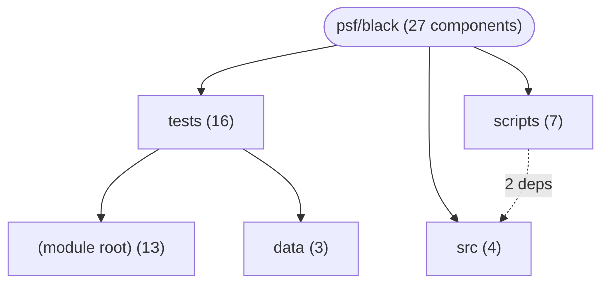

# Repository Architecture Analysis: psf/black

## Metadata
- **SHA**: `cf3e0938971fc5cd0d71e7b696e86a6fb953332a`
- **Primary Ecosystem**: Python

## Quality Metrics
- **avg_cyclomatic_complexity**: 2.59
- **component_count**: 27
- **files_analyzed**: 451
- **framework**: Unknown
- **loc**: 143464
- **max_cyclomatic_complexity**: 121
- **sloc**: 128418

# Architecture: psf/black

## Context
- **Repository**: `psf/black`
- **SHA**: `cf3e0938971fc5cd0d71e7b696e86a6fb953332a`
- **Ecosystem**: Python
- **Framework**: Unknown

## Building Block View

## Component Details
- **config** (`scripts/diff_shades_gha_helper.py`): CLI_COMMAND
- **comment_body** (`scripts/diff_shades_gha_helper.py`): CLI_COMMAND
- **comment_details** (`scripts/diff_shades_gha_helper.py`): CLI_COMMAND
- **main** (`scripts/generate_schema.py`): CLI_COMMAND
- **test_get_current_version** (`scripts/release_tests.py`): API_ROUTE
- **test_get_next_version** (`scripts/release_tests.py`): API_ROUTE
- **test_get_prerelease_version** (`scripts/release_tests.py`): API_ROUTE
- **main** (`src/black/__init__.py`): CLI_COMMAND (deps: Leaf, Node)
- **main** (`src/blackd/__init__.py`): CLI_COMMAND
- **Node** (`src/blib2to3/pytree.py`): DATA_ACCESS_LAYER
- **Leaf** (`src/blib2to3/pytree.py`): DATA_ACCESS_LAYER
- **Service** (`tests/data/cases/fmtskip_header_stub_body.py`): SERVICE
- **D** (`tests/data/cases/fmtskip_type_params.py`): DATA_ACCESS_LAYER
- **foo** (`tests/data/cases/pep604_union_types_line_breaks.py`): API_ROUTE
- **test_one_empty_line** (`tests/test_black.py`): API_ROUTE
- **test_string_quotes** (`tests/test_black.py`): API_ROUTE
- **test_python37** (`tests/test_black.py`): API_ROUTE
- **test_python315** (`tests/test_black.py`): API_ROUTE
- **test_assertFormatEqual_print_full_tree** (`tests/test_black.py`): API_ROUTE
- **test_assertFormatEqual_print_tree_diff** (`tests/test_black.py`): API_ROUTE
- **test_works_in_mono_process_only_environment** (`tests/test_black.py`): API_ROUTE
- **test_find_pyproject_toml_no_common_parent** (`tests/test_black.py`): API_ROUTE
- **test_no_common_parent_warns_and_formats** (`tests/test_black.py`): API_ROUTE
- **test_find_pyproject_toml** (`tests/test_black.py`): API_ROUTE
- **test_find_user_pyproject_toml_linux** (`tests/test_black.py`): API_ROUTE
- **test_exclude_for_issue_1572** (`tests/test_black.py`): API_ROUTE
- **FakeManager** (`tests/test_concurrency_manager_shutdown.py`): SERVICE

## CI/CD Pipeline Topology

