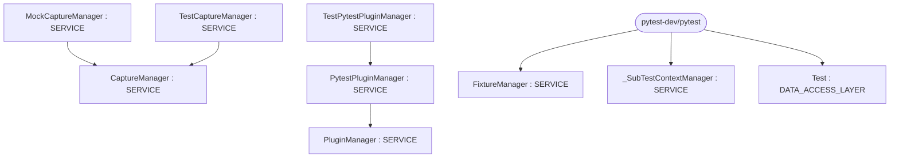

# Repository Architecture Analysis: pytest-dev/pytest

## Metadata
- **SHA**: `fc9a7ef678f64d17f1c03b619f3842ea1d127e74`
- **Primary Ecosystem**: Python

## Quality Metrics
- **avg_cyclomatic_complexity**: 1.92
- **component_count**: 10
- **files_analyzed**: 306
- **framework**: Django
- **loc**: 118889
- **max_cyclomatic_complexity**: 57
- **sloc**: 96285

# Architecture: pytest-dev/pytest

## Context
- **Repository**: `pytest-dev/pytest`
- **SHA**: `fc9a7ef678f64d17f1c03b619f3842ea1d127e74`
- **Ecosystem**: Python
- **Framework**: Unknown

## Building Block View

## Component Details
- **CaptureManager** (`src/_pytest/capture.py`): SERVICE
- **PytestPluginManager** (`src/_pytest/config/__init__.py`): SERVICE (deps: PluginManager)
- **FixtureManager** (`src/_pytest/fixtures.py`): SERVICE
- **_SubTestContextManager** (`src/_pytest/subtests.py`): SERVICE
- **Test** (`testing/example_scripts/unittest/test_setup_skip.py`): DATA_ACCESS_LAYER
- **Test** (`testing/example_scripts/unittest/test_setup_skip_class.py`): DATA_ACCESS_LAYER
- **MockCaptureManager** (`testing/logging/test_reporting.py`): SERVICE (deps: CaptureManager)
- **PluginManager** (`testing/test_assertion.py`): SERVICE
- **TestCaptureManager** (`testing/test_capture.py`): SERVICE (deps: CaptureManager)
- **TestPytestPluginManager** (`testing/test_pluginmanager.py`): SERVICE (deps: PytestPluginManager)

## CI/CD Pipeline Topology

