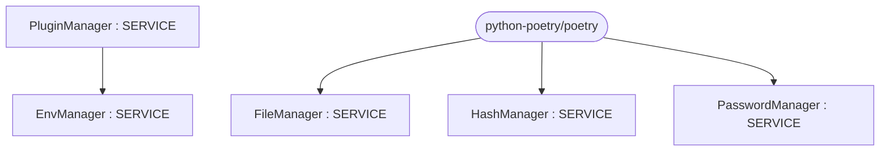

# Repository Architecture Analysis: python-poetry/poetry

## Metadata
- **SHA**: `4acc75e19f128c8340c6f977a35e53b5f7f39071`
- **Primary Ecosystem**: Python

## Quality Metrics
- **avg_cyclomatic_complexity**: 1.98
- **component_count**: 5
- **files_analyzed**: 523
- **framework**: Unknown
- **loc**: 82685
- **max_cyclomatic_complexity**: 72
- **sloc**: 64507

# Architecture: python-poetry/poetry

## Context
- **Repository**: `python-poetry/poetry`
- **SHA**: `4acc75e19f128c8340c6f977a35e53b5f7f39071`
- **Ecosystem**: Python
- **Framework**: Unknown

## Building Block View

## Component Details
- **PluginManager** (`src/poetry/plugins/plugin_manager.py`): SERVICE (deps: EnvManager)
- **HashManager** (`src/poetry/publishing/hash_manager.py`): SERVICE
- **EnvManager** (`src/poetry/utils/env/env_manager.py`): SERVICE
- **PasswordManager** (`src/poetry/utils/password_manager.py`): SERVICE
- **FileManager** (`tests/repositories/fixtures/pypi.org/generate.py`): SERVICE

## CI/CD Pipeline Topology

