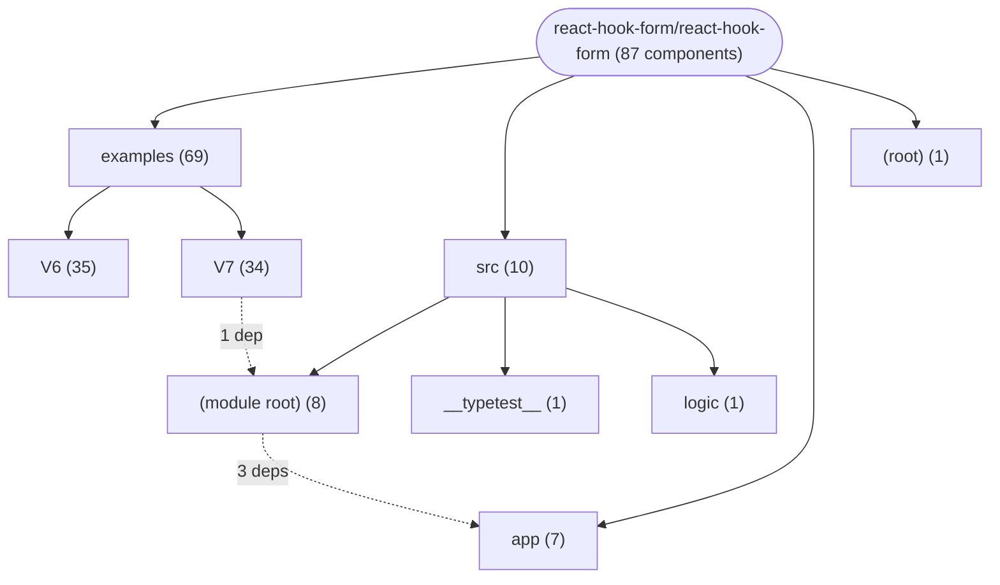
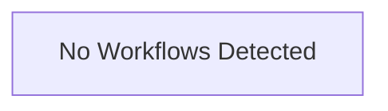

# Repository Architecture Analysis: react-hook-form/react-hook-form

## Metadata
- **SHA**: `77f6435db753c812a5ce09ad0465a673f483eec5`
- **Primary Ecosystem**: JavaScript/TypeScript

## Quality Metrics
- **avg_cyclomatic_complexity**: 3.66
- **component_count**: 87
- **files_analyzed**: 538
- **framework**: React (Vite)
- **loc**: 110360
- **max_cyclomatic_complexity**: 311
- **sloc**: 93009

# Architecture: react-hook-form/react-hook-form

## Context
- **Repository**: `react-hook-form/react-hook-form`
- **SHA**: `77f6435db753c812a5ce09ad0465a673f483eec5`
- **Ecosystem**: JavaScript/TypeScript
- **Framework**: Unknown

## Building Block View

## Component Details

Showing top 60 representative components out of 87 across 4 module group(s):

- **Module `examples`** (69 components — UI_COMPONENT: 69)
- **Module `src`** (10 components — UI_COMPONENT: 9, MODULE: 1)
- **Module `app`** (7 components — UI_COMPONENT: 6, MODULE: 1)
- **Module `(root)`** (1 components — MODULE: 1)

- **ErrorMessage** (`src/errorMessage.tsx`): UI_COMPONENT (deps: UseFormState)
- **Form** (`src/form.tsx`): UI_COMPONENT (deps: HookFormControlContext)
- **FormProvider** (`src/useFormContext.tsx`): UI_COMPONENT (deps: HookFormControlContext)
- **FormState** (`src/formState.tsx`): UI_COMPONENT (deps: UseFormState)
- **FormStateSubscribe** (`src/formState.tsx`): UI_COMPONENT (deps: UseFormState)
- **App** (`examples/V6/FieldArray.tsx`): UI_COMPONENT
- **App** (`examples/V6/asyncFieldValidation.tsx`): UI_COMPONENT
- **App** (`examples/V6/asyncSetFormValues.tsx`): UI_COMPONENT
- **App** (`examples/V6/asyncSubmitValidation.tsx`): UI_COMPONENT
- **App** (`examples/V6/basic.tsx`): UI_COMPONENT
- **App** (`examples/V6/basicValidation.tsx`): UI_COMPONENT
- **App** (`examples/V6/conditionalFields.tsx`): UI_COMPONENT
- **App** (`examples/V6/custom-masked-input.tsx`): UI_COMPONENT
- **App** (`examples/V6/customInput.tsx`): UI_COMPONENT
- **App** (`examples/V6/customMaskedInputWithController.tsx`): UI_COMPONENT
- **App** (`examples/V6/customValidation.tsx`): UI_COMPONENT
- **App** (`examples/V6/defaultValues.tsx`): UI_COMPONENT
- **App** (`examples/V6/dirtyTouchedSubmitted.tsx`): UI_COMPONENT
- **App** (`examples/V6/disableNativeValidation.tsx`): UI_COMPONENT
- **App** (`examples/V6/formProvider.tsx`): UI_COMPONENT
- **App** (`examples/V6/forwardRefToPassRefProp.tsx`): UI_COMPONENT
- **App** (`examples/V6/getValuesCompareFields.tsx`): UI_COMPONENT
- **App** (`examples/V6/nativeMultipleInput.tsx`): UI_COMPONENT
- **App** (`examples/V6/nestedFields.tsx`): UI_COMPONENT
- **App** (`examples/V6/parseFormatInputValues.tsx`): UI_COMPONENT
- **App** (`examples/V6/persistInputOnUnmount.tsx`): UI_COMPONENT
- **App** (`examples/V6/registerWithErrorMessages.tsx`): UI_COMPONENT
- **App** (`examples/V6/remoteTriggerFormSubmit.tsx`): UI_COMPONENT
- **App** (`examples/V6/resetForm.tsx`): UI_COMPONENT
- **App** (`examples/V6/setValue.tsx`): UI_COMPONENT
- **App** (`examples/V6/triggerFieldValidation.tsx`): UI_COMPONENT
- **App** (`examples/V6/typescript/Control.tsx`): UI_COMPONENT
- **App** (`examples/V6/typescript/NestedValue.tsx`): UI_COMPONENT
- **App** (`examples/V6/typescript/Resolver.tsx`): UI_COMPONENT
- **App** (`examples/V6/typescript/SubmitHandler.tsx`): UI_COMPONENT
- **App** (`examples/V6/typescript/UseFormMethods.tsx`): UI_COMPONENT
- **App** (`examples/V6/validationOnFieldBlur.tsx`): UI_COMPONENT
- **App** (`examples/V6/validationOnFieldChange.tsx`): UI_COMPONENT
- **App** (`examples/V6/validationSchema.tsx`): UI_COMPONENT
- **App** (`examples/V7/FieldArray.tsx`): UI_COMPONENT
- **App** (`examples/V7/asyncFieldValidation.tsx`): UI_COMPONENT
- **App** (`examples/V7/asyncSetFormValues.tsx`): UI_COMPONENT
- **App** (`examples/V7/asyncSubmitValidation.tsx`): UI_COMPONENT
- **App** (`examples/V7/basic.tsx`): UI_COMPONENT
- **App** (`examples/V7/conditionalFields.tsx`): UI_COMPONENT
- **App** (`examples/V7/customInput.tsx`): UI_COMPONENT
- **App** (`examples/V7/customMaskedInputWithController.tsx`): UI_COMPONENT
- **App** (`examples/V7/customValidation.tsx`): UI_COMPONENT
- **App** (`examples/V7/defaultValues.tsx`): UI_COMPONENT
- **App** (`examples/V7/dirtyTouchedSubmitted.tsx`): UI_COMPONENT
- **App** (`examples/V7/disableNativeValidation.tsx`): UI_COMPONENT
- **App** (`examples/V7/formProvider.tsx`): UI_COMPONENT
- **App** (`examples/V7/getValuesCompareFields.tsx`): UI_COMPONENT
- **App** (`examples/V7/nativeMultipleInput.tsx`): UI_COMPONENT
- **App** (`examples/V7/nestedFields.tsx`): UI_COMPONENT
- **App** (`examples/V7/parseFormatInputValues.tsx`): UI_COMPONENT
- **App** (`examples/V7/registerWithErrorMessages.tsx`): UI_COMPONENT
- **App** (`examples/V7/remoteTriggerFormSubmit.tsx`): UI_COMPONENT
- **App** (`examples/V7/resetForm.tsx`): UI_COMPONENT
- **App** (`examples/V7/setValue.tsx`): UI_COMPONENT

## CI/CD Pipeline Topology

