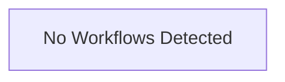

# Repository Architecture Analysis: reduxjs/redux

## Metadata
- **SHA**: `0139377fc8eef33e28afc6e3e939df3f41f939a6`
- **Primary Ecosystem**: JavaScript/TypeScript

## Quality Metrics
- **avg_cyclomatic_complexity**: 2.85
- **component_count**: 22
- **files_analyzed**: 222
- **framework**: React (Vite)
- **loc**: 15302
- **max_cyclomatic_complexity**: 43
- **sloc**: 12479

# Architecture: reduxjs/redux

## Context
- **Repository**: `reduxjs/redux`
- **SHA**: `0139377fc8eef33e28afc6e3e939df3f41f939a6`
- **Ecosystem**: JavaScript/TypeScript
- **Framework**: Unknown

## Building Block View

```mermaid
graph TD;
    docs["docs : MODULE"]
    counter["counter : MODULE"]
    counter_ts["counter-ts : MODULE"]
    counter_vanilla["counter-vanilla : MODULE"]
    shopping_cart["shopping-cart : MODULE"]
    todos["todos : MODULE"]
    tree_view["tree-view : MODULE"]
    redux["redux : MODULE"]
    website["website : MODULE"]
    DetailedExplanation["DetailedExplanation : UI_COMPONENT"]
    Counter["Counter : UI_COMPONENT"]
    ErrorCodesPage["ErrorCodesPage : UI_COMPONENT"]
    LibraryDropdownNavbarItem["LibraryDropdownNavbarItem : UI_COMPONENT"]
    LibraryLanding["LibraryLanding : UI_COMPONENT"]
    LibraryLinksNavbarItem["LibraryLinksNavbarItem : UI_COMPONENT"]
    LiveExample["LiveExample : UI_COMPONENT"]
    VideoEmbed["VideoEmbed : UI_COMPONENT"]
    ReactReduxHome["ReactReduxHome : UI_COMPONENT"]
    ReselectHome["ReselectHome : UI_COMPONENT"]
    ToolkitHome["ToolkitHome : UI_COMPONENT"]
    SecondaryMenuWrapper["SecondaryMenuWrapper : UI_COMPONENT"]
    repo_root(["reduxjs/redux"])
    repo_root --> Counter
    repo_root --> DetailedExplanation
    repo_root --> ErrorCodesPage
    repo_root --> LibraryDropdownNavbarItem
    repo_root --> LibraryLanding
    repo_root --> LibraryLinksNavbarItem
    repo_root --> LiveExample
    repo_root --> ReactReduxHome
    repo_root --> ReselectHome
    repo_root --> SecondaryMenuWrapper
    repo_root --> ToolkitHome
    repo_root --> VideoEmbed
    repo_root --> counter
    repo_root --> counter_ts
    repo_root --> counter_vanilla
    repo_root --> docs
    repo_root --> redux
    repo_root --> shopping_cart
    repo_root --> todos
    repo_root --> tree_view
    repo_root --> website
```

## Component Details
- **docs** (`docs/package.json`): MODULE
- **counter** (`examples/counter/package.json`): MODULE
- **counter-ts** (`examples/counter-ts/package.json`): MODULE
- **counter-vanilla** (`examples/counter-vanilla/package.json`): MODULE
- **shopping-cart** (`examples/shopping-cart/package.json`): MODULE
- **todos** (`examples/todos/package.json`): MODULE
- **tree-view** (`examples/tree-view/package.json`): MODULE
- **redux** (`package.json`): MODULE
- **website** (`website/package.json`): MODULE
- **DetailedExplanation** (`docs/components/DetailedExplanation.jsx`): UI_COMPONENT
- **Counter** (`examples/counter-ts/src/features/counter/Counter.tsx`): UI_COMPONENT
- **Counter** (`examples/counter/src/features/counter/Counter.js`): UI_COMPONENT
- **ErrorCodesPage** (`website/src/components/ErrorCodesPage.tsx`): UI_COMPONENT
- **LibraryDropdownNavbarItem** (`website/src/components/LibraryDropdownNavbarItem.tsx`): UI_COMPONENT
- **LibraryLanding** (`website/src/components/LibraryLanding.tsx`): UI_COMPONENT
- **LibraryLinksNavbarItem** (`website/src/components/LibraryLinksNavbarItem.tsx`): UI_COMPONENT
- **LiveExample** (`website/src/components/LiveExample.tsx`): UI_COMPONENT
- **VideoEmbed** (`website/src/components/VideoEmbed.tsx`): UI_COMPONENT
- **ReactReduxHome** (`website/src/pages/react-redux/index.tsx`): UI_COMPONENT
- **ReselectHome** (`website/src/pages/reselect/index.tsx`): UI_COMPONENT
- **ToolkitHome** (`website/src/pages/toolkit/index.tsx`): UI_COMPONENT
- **SecondaryMenuWrapper** (`website/src/theme/Navbar/MobileSidebar/SecondaryMenu/index.tsx`): UI_COMPONENT

## CI/CD Pipeline Topology

