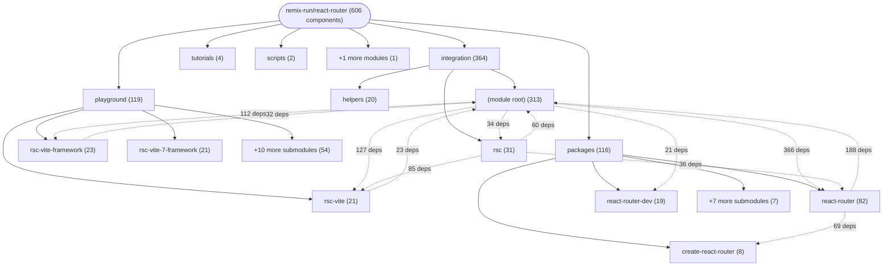

# Repository Architecture Analysis: remix-run/react-router

## Metadata
- **SHA**: `b830e2e7ac73b7d153ceedb27f12163b11ca7eda`
- **Primary Ecosystem**: JavaScript/TypeScript

## Quality Metrics
- **avg_cyclomatic_complexity**: 5.76
- **component_count**: 606
- **files_analyzed**: 1726
- **framework**: React (Vite)
- **loc**: 519573
- **max_cyclomatic_complexity**: 847
- **sloc**: 439974

# Architecture: remix-run/react-router

## Context
- **Repository**: `remix-run/react-router`
- **SHA**: `b830e2e7ac73b7d153ceedb27f12163b11ca7eda`
- **Ecosystem**: JavaScript/TypeScript
- **Framework**: Unknown

## Building Block View

## Component Details

Showing top 60 representative components out of 606 across 6 module group(s):

- **Module `integration`** (364 components — UI_COMPONENT: 354, MODULE: 6, API_ROUTE: 4)
- **Module `playground`** (119 components — UI_COMPONENT: 103, MODULE: 13, API_ROUTE: 3)
- **Module `packages`** (116 components — UI_COMPONENT: 102, MODULE: 14)
- **Module `tutorials`** (4 components — UI_COMPONENT: 3, MODULE: 1)
- **Module `scripts`** (2 components — MODULE: 1, UI_COMPONENT: 1)
- **Module `(root)`** (1 components — MODULE: 1)

- **RSCStaticRouter** (`packages/react-router/lib/rsc/server.ssr.tsx`): UI_COMPONENT (deps: Await, AwaitContext, AwaitContextProvider, Book, BoundaryShell, CLIENT_NON_COMPONENT_EXPORTS (+53 more))
- **RSCHydratedRouter** (`packages/react-router/lib/rsc/browser.tsx`): UI_COMPONENT (deps: Await, AwaitContext, AwaitContextProvider, Book, BoundaryShell, CLIENT_NON_COMPONENT_EXPORTS (+50 more))
- **BrowserRouter** (`packages/react-router/lib/dom/lib.tsx`): UI_COMPONENT (deps: Await, AwaitContext, AwaitContextProvider, Book, CRITICAL_CSS_DATA_ATTRIBUTE, Dashboard (+44 more))
- **Form** (`packages/react-router/lib/dom/lib.tsx`): UI_COMPONENT (deps: Await, AwaitContext, AwaitContextProvider, Book, CRITICAL_CSS_DATA_ATTRIBUTE, Dashboard (+44 more))
- **Gallery** (`packages/react-router/lib/dom/lib.tsx`): UI_COMPONENT (deps: Await, AwaitContext, AwaitContextProvider, Book, CRITICAL_CSS_DATA_ATTRIBUTE, Dashboard (+44 more))
- **HashRouter** (`packages/react-router/lib/dom/lib.tsx`): UI_COMPONENT (deps: Await, AwaitContext, AwaitContextProvider, Book, CRITICAL_CSS_DATA_ATTRIBUTE, Dashboard (+44 more))
- **HistoryRouter** (`packages/react-router/lib/dom/lib.tsx`): UI_COMPONENT (deps: Await, AwaitContext, AwaitContextProvider, Book, CRITICAL_CSS_DATA_ATTRIBUTE, Dashboard (+44 more))
- **Link** (`packages/react-router/lib/dom/lib.tsx`): UI_COMPONENT (deps: Await, AwaitContext, AwaitContextProvider, Book, CRITICAL_CSS_DATA_ATTRIBUTE, Dashboard (+44 more))
- **NavLink** (`packages/react-router/lib/dom/lib.tsx`): UI_COMPONENT (deps: Await, AwaitContext, AwaitContextProvider, Book, CRITICAL_CSS_DATA_ATTRIBUTE, Dashboard (+44 more))
- **ScrollRestoration** (`packages/react-router/lib/dom/lib.tsx`): UI_COMPONENT (deps: Await, AwaitContext, AwaitContextProvider, Book, CRITICAL_CSS_DATA_ATTRIBUTE, Dashboard (+44 more))
- **SomeComponent** (`packages/react-router/lib/dom/lib.tsx`): UI_COMPONENT (deps: Await, AwaitContext, AwaitContextProvider, Book, CRITICAL_CSS_DATA_ATTRIBUTE, Dashboard (+44 more))
- **Root** (`packages/react-router/lib/dom/lib.tsx`): UI_COMPONENT (deps: Await, AwaitContext, AwaitContextProvider, Book, CRITICAL_CSS_DATA_ATTRIBUTE, Dashboard (+43 more))
- **Dashboard** (`packages/react-router/lib/hooks.tsx`): UI_COMPONENT (deps: Await, AwaitContext, AwaitContextProvider, Book, CRITICAL_CSS_DATA_ATTRIBUTE, DataRouterContext (+38 more))
- **DashboardMessages** (`packages/react-router/lib/hooks.tsx`): UI_COMPONENT (deps: Await, AwaitContext, AwaitContextProvider, Book, CRITICAL_CSS_DATA_ATTRIBUTE, DataRouterContext (+38 more))
- **File** (`packages/react-router/lib/hooks.tsx`): UI_COMPONENT (deps: Await, AwaitContext, AwaitContextProvider, Book, CRITICAL_CSS_DATA_ATTRIBUTE, DataRouterContext (+38 more))
- **ImportantForm** (`packages/react-router/lib/hooks.tsx`): UI_COMPONENT (deps: Await, AwaitContext, AwaitContextProvider, Book, CRITICAL_CSS_DATA_ATTRIBUTE, DataRouterContext (+38 more))
- **Invoices** (`packages/react-router/lib/hooks.tsx`): UI_COMPONENT (deps: Await, AwaitContext, AwaitContextProvider, Book, CRITICAL_CSS_DATA_ATTRIBUTE, DataRouterContext (+38 more))
- **Post** (`packages/react-router/lib/hooks.tsx`): UI_COMPONENT (deps: Await, AwaitContext, AwaitContextProvider, Book, CRITICAL_CSS_DATA_ATTRIBUTE, DataRouterContext (+38 more))
- **StaticRouter** (`packages/react-router/lib/dom/server.tsx`): UI_COMPONENT (deps: Await, AwaitContext, AwaitContextProvider, Book, CRITICAL_CSS_DATA_ATTRIBUTE, DataRouterContext (+38 more))
- **StaticRouterProvider** (`packages/react-router/lib/dom/server.tsx`): UI_COMPONENT (deps: Await, AwaitContext, AwaitContextProvider, Book, CRITICAL_CSS_DATA_ATTRIBUTE, DataRouterContext (+38 more))
- **ErrorBoundary** (`packages/react-router/lib/hooks.tsx`): UI_COMPONENT (deps: Await, AwaitContext, AwaitContextProvider, Book, CRITICAL_CSS_DATA_ATTRIBUTE, DataRouterContext (+37 more))
- **Await** (`packages/react-router/lib/components.tsx`): UI_COMPONENT (deps: AwaitContext, AwaitContextProvider, CRITICAL_CSS_DATA_ATTRIBUTE, Dashboard, DashboardMessages, DataRouterContext (+30 more))
- **Book** (`packages/react-router/lib/components.tsx`): UI_COMPONENT (deps: AwaitContext, AwaitContextProvider, CRITICAL_CSS_DATA_ATTRIBUTE, Dashboard, DashboardMessages, DataRouterContext (+30 more))
- **DataRoutes** (`packages/react-router/lib/components.tsx`): UI_COMPONENT (deps: AwaitContext, AwaitContextProvider, CRITICAL_CSS_DATA_ATTRIBUTE, Dashboard, DashboardMessages, DataRouterContext (+30 more))
- **MemoryRouter** (`packages/react-router/lib/components.tsx`): UI_COMPONENT (deps: AwaitContext, AwaitContextProvider, CRITICAL_CSS_DATA_ATTRIBUTE, Dashboard, DashboardMessages, DataRouterContext (+30 more))
- **Navigate** (`packages/react-router/lib/components.tsx`): UI_COMPONENT (deps: AwaitContext, AwaitContextProvider, CRITICAL_CSS_DATA_ATTRIBUTE, Dashboard, DashboardMessages, DataRouterContext (+30 more))
- **Outlet** (`packages/react-router/lib/components.tsx`): UI_COMPONENT (deps: AwaitContext, AwaitContextProvider, CRITICAL_CSS_DATA_ATTRIBUTE, Dashboard, DashboardMessages, DataRouterContext (+30 more))
- **Route** (`packages/react-router/lib/components.tsx`): UI_COMPONENT (deps: AwaitContext, AwaitContextProvider, CRITICAL_CSS_DATA_ATTRIBUTE, Dashboard, DashboardMessages, DataRouterContext (+30 more))
- **Router** (`packages/react-router/lib/components.tsx`): UI_COMPONENT (deps: AwaitContext, AwaitContextProvider, CRITICAL_CSS_DATA_ATTRIBUTE, Dashboard, DashboardMessages, DataRouterContext (+30 more))
- **RouterProvider** (`packages/react-router/lib/components.tsx`): UI_COMPONENT (deps: AwaitContext, AwaitContextProvider, CRITICAL_CSS_DATA_ATTRIBUTE, Dashboard, DashboardMessages, DataRouterContext (+30 more))
- **Routes** (`packages/react-router/lib/components.tsx`): UI_COMPONENT (deps: AwaitContext, AwaitContextProvider, CRITICAL_CSS_DATA_ATTRIBUTE, Dashboard, DashboardMessages, DataRouterContext (+30 more))
- **SomeParent** (`packages/react-router/lib/components.tsx`): UI_COMPONENT (deps: AwaitContext, AwaitContextProvider, CRITICAL_CSS_DATA_ATTRIBUTE, Dashboard, DashboardMessages, DataRouterContext (+30 more))
- **WithComponentProps** (`packages/react-router/lib/components.tsx`): UI_COMPONENT (deps: AwaitContext, AwaitContextProvider, CRITICAL_CSS_DATA_ATTRIBUTE, Dashboard, DashboardMessages, DataRouterContext (+30 more))
- **WithErrorBoundaryProps** (`packages/react-router/lib/components.tsx`): UI_COMPONENT (deps: AwaitContext, AwaitContextProvider, CRITICAL_CSS_DATA_ATTRIBUTE, Dashboard, DashboardMessages, DataRouterContext (+30 more))
- **WithHydrateFallbackProps** (`packages/react-router/lib/components.tsx`): UI_COMPONENT (deps: AwaitContext, AwaitContextProvider, CRITICAL_CSS_DATA_ATTRIBUTE, Dashboard, DashboardMessages, DataRouterContext (+30 more))
- **CRITICAL_CSS_DATA_ATTRIBUTE** (`packages/react-router/lib/dom/ssr/components.tsx`): UI_COMPONENT (deps: AwaitContext, AwaitContextProvider, Dashboard, DashboardMessages, DataRouterContext, DataRouterDataContext (+29 more))
- **FrameworkContext** (`packages/react-router/lib/dom/ssr/components.tsx`): UI_COMPONENT (deps: AwaitContext, AwaitContextProvider, Dashboard, DashboardMessages, DataRouterContext, DataRouterDataContext (+29 more))
- **Links** (`packages/react-router/lib/dom/ssr/components.tsx`): UI_COMPONENT (deps: AwaitContext, AwaitContextProvider, Dashboard, DashboardMessages, DataRouterContext, DataRouterDataContext (+29 more))
- **Meta** (`packages/react-router/lib/dom/ssr/components.tsx`): UI_COMPONENT (deps: AwaitContext, AwaitContextProvider, Dashboard, DashboardMessages, DataRouterContext, DataRouterDataContext (+29 more))
- **PrefetchPageLinks** (`packages/react-router/lib/dom/ssr/components.tsx`): UI_COMPONENT (deps: AwaitContext, AwaitContextProvider, Dashboard, DashboardMessages, DataRouterContext, DataRouterDataContext (+29 more))
- **Root** (`packages/react-router/lib/dom/ssr/components.tsx`): UI_COMPONENT (deps: AwaitContext, AwaitContextProvider, Dashboard, DashboardMessages, DataRouterContext, DataRouterDataContext (+29 more))
- **Scripts** (`packages/react-router/lib/dom/ssr/components.tsx`): UI_COMPONENT (deps: AwaitContext, AwaitContextProvider, Dashboard, DashboardMessages, DataRouterContext, DataRouterDataContext (+29 more))
- **Await** (`packages/react-router/lib/rsc/server.rsc.ts`): UI_COMPONENT (deps: Book, CRITICAL_CSS_DATA_ATTRIBUTE, DataRoutes, ENABLE_DEV_WARNINGS, ErrorBoundary, FrameworkContext (+28 more))
- **ServerRouter** (`packages/react-router/lib/dom/ssr/server.tsx`): UI_COMPONENT (deps: Await, Book, BoundaryShell, CRITICAL_CSS_DATA_ATTRIBUTE, DataRoutes, FrameworkContext (+26 more))
- **AwaitContext** (`packages/react-router/lib/context.ts`): UI_COMPONENT (deps: Await, Book, CRITICAL_CSS_DATA_ATTRIBUTE, DataRoutes, ENABLE_DEV_WARNINGS, ErrorBoundary (+23 more))
- **AwaitContextProvider** (`packages/react-router/lib/context.ts`): UI_COMPONENT (deps: Await, Book, CRITICAL_CSS_DATA_ATTRIBUTE, DataRoutes, ENABLE_DEV_WARNINGS, ErrorBoundary (+23 more))
- **DataRouterContext** (`packages/react-router/lib/context.ts`): UI_COMPONENT (deps: Await, Book, CRITICAL_CSS_DATA_ATTRIBUTE, DataRoutes, ENABLE_DEV_WARNINGS, ErrorBoundary (+23 more))
- **DataRouterDataContext** (`packages/react-router/lib/context.ts`): UI_COMPONENT (deps: Await, Book, CRITICAL_CSS_DATA_ATTRIBUTE, DataRoutes, ENABLE_DEV_WARNINGS, ErrorBoundary (+23 more))
- **DataRouterNavigationContext** (`packages/react-router/lib/context.ts`): UI_COMPONENT (deps: Await, Book, CRITICAL_CSS_DATA_ATTRIBUTE, DataRoutes, ENABLE_DEV_WARNINGS, ErrorBoundary (+23 more))
- **DataRouterStateContext** (`packages/react-router/lib/context.ts`): UI_COMPONENT (deps: Await, Book, CRITICAL_CSS_DATA_ATTRIBUTE, DataRoutes, ENABLE_DEV_WARNINGS, ErrorBoundary (+23 more))
- **FetchersContext** (`packages/react-router/lib/context.ts`): UI_COMPONENT (deps: Await, Book, CRITICAL_CSS_DATA_ATTRIBUTE, DataRoutes, ENABLE_DEV_WARNINGS, ErrorBoundary (+23 more))
- **IsDataRouteContext** (`packages/react-router/lib/context.ts`): UI_COMPONENT (deps: Await, Book, CRITICAL_CSS_DATA_ATTRIBUTE, DataRoutes, ENABLE_DEV_WARNINGS, ErrorBoundary (+23 more))
- **LocationContext** (`packages/react-router/lib/context.ts`): UI_COMPONENT (deps: Await, Book, CRITICAL_CSS_DATA_ATTRIBUTE, DataRoutes, ENABLE_DEV_WARNINGS, ErrorBoundary (+23 more))
- **NavigationContext** (`packages/react-router/lib/context.ts`): UI_COMPONENT (deps: Await, Book, CRITICAL_CSS_DATA_ATTRIBUTE, DataRoutes, ENABLE_DEV_WARNINGS, ErrorBoundary (+23 more))
- **RSCRouterContext** (`packages/react-router/lib/context.ts`): UI_COMPONENT (deps: Await, Book, CRITICAL_CSS_DATA_ATTRIBUTE, DataRoutes, ENABLE_DEV_WARNINGS, ErrorBoundary (+23 more))
- **RouteContext** (`packages/react-router/lib/context.ts`): UI_COMPONENT (deps: Await, Book, CRITICAL_CSS_DATA_ATTRIBUTE, DataRoutes, ENABLE_DEV_WARNINGS, ErrorBoundary (+23 more))
- **RouteErrorContext** (`packages/react-router/lib/context.ts`): UI_COMPONENT (deps: Await, Book, CRITICAL_CSS_DATA_ATTRIBUTE, DataRoutes, ENABLE_DEV_WARNINGS, ErrorBoundary (+23 more))
- **RouteIdContext** (`packages/react-router/lib/context.ts`): UI_COMPONENT (deps: Await, Book, CRITICAL_CSS_DATA_ATTRIBUTE, DataRoutes, ENABLE_DEV_WARNINGS, ErrorBoundary (+23 more))
- **ViewTransitionContext** (`packages/react-router/lib/context.ts`): UI_COMPONENT (deps: Await, Book, CRITICAL_CSS_DATA_ATTRIBUTE, DataRoutes, ENABLE_DEV_WARNINGS, ErrorBoundary (+23 more))
- **RemixRootDefaultHydrateFallback** (`packages/react-router/lib/dom/ssr/fallback.tsx`): UI_COMPONENT (deps: Await, Book, BoundaryShell, CRITICAL_CSS_DATA_ATTRIBUTE, DataRoutes, ENABLE_DEV_WARNINGS (+22 more))

## CI/CD Pipeline Topology

