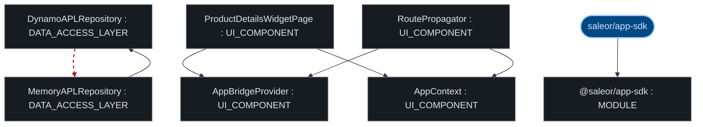
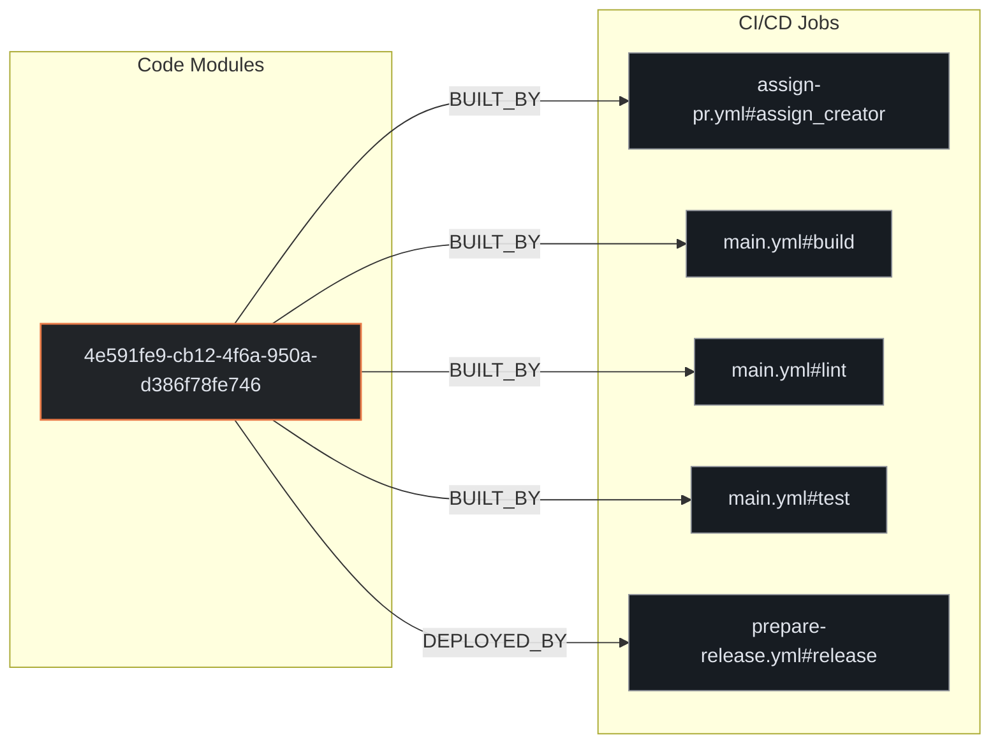
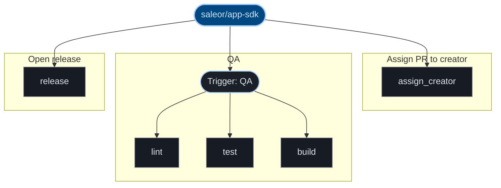

# Repository Architecture Analysis: saleor/app-sdk

## Metadata
- **SHA**: `1db77f862352aa95aa807f00d83921c06051b5ba`
- **Primary Ecosystem**: JavaScript/TypeScript

## Quality Metrics
- **ast_engine**: tree-sitter
- **avg_cognitive_complexity**: 1.07
- **avg_cyclomatic_complexity**: 1.96
- **component_count**: 7
- **dead_code_count**: 6
- **dead_code_symbols**: 6 entry(ies)
- **duplication_pct**: 80.96
- **file_complexities**: 25 entry(ies)
- **files_analyzed**: 187
- **fitness_passed**: False
- **fitness_violation_count**: 3
- **framework**: Next.js
- **import_edges**: 100 entry(ies)
- **loc**: 17702
- **max_cognitive_complexity**: 29
- **max_cyclomatic_complexity**: 16
- **sloc**: 13588
- **test_file_count**: 66

# Architecture: saleor/app-sdk

## Context
- **Repository**: `saleor/app-sdk`
- **SHA**: `1db77f862352aa95aa807f00d83921c06051b5ba`
- **Ecosystem**: JavaScript/TypeScript
- **Framework**: Next.js

## Building Block View

## Component Details
- **@saleor/app-sdk** (`package.json`): MODULE
- **DynamoAPLRepository** (`src/APL/dynamodb/dynamo-apl-repository.ts`): DATA_ACCESS_LAYER (deps: MemoryAPLRepository)
- **MemoryAPLRepository** (`src/APL/dynamodb/memory-apl-repository.ts`): DATA_ACCESS_LAYER (deps: DynamoAPLRepository)
- **AppContext** (`src/app-bridge/app-bridge-provider.tsx`): UI_COMPONENT
- **AppBridgeProvider** (`src/app-bridge/app-bridge-provider.tsx`): UI_COMPONENT
- **ProductDetailsWidgetPage** (`src/app-bridge/use-widget-auto-resize.ts`): UI_COMPONENT (deps: AppBridgeProvider, AppContext)
- **RoutePropagator** (`src/app-bridge/next/route-propagator.tsx`): UI_COMPONENT (deps: AppBridgeProvider, AppContext)

## 6-Dimension Repository Scorecard

- **Overall Grade**: `D` (65.97/100)
- **Technical Debt Score**: 34.03
- **Estimated Remediation Effort**: 43.70h

| Dimension | Grade | Score | Weight | Details |
| :--- | :---: | :---: | :---: | :--- |
| Code Quality | `D` | 61.50 | 0.20 | avg_cc=1.96, max_cc=16, duplication=80.96%, dead_code=6 |
| Dependency Health | `A` | 100.00 | 0.15 | dependencies=904, outdated=0, vulnerable=0, has_lockfile=True |
| Maintainability | `D` | 62.50 | 0.15 | avg_cognitive=1.07, max_cognitive=29, fitness_violations=3, oversized_files=0 |
| Pipeline Health | `D` | 64.00 | 0.15 | workflows=3, operational_antipatterns=7, parallel_branches=True |
| Security | `F` | 46.00 | 0.20 | vulnerabilities=0, secrets=1, pipeline_security_findings=3 |
| Test Coverage | `C` | 70.00 | 0.15 | coverage=unavailable, ci_test_job=True, test_files_detected=True |

## Architecture Fitness & Workspace Boundaries

- **[HIGH] `ATRUSS-ARCH-004` (CIRCULAR_DEPENDENCY)**: Circular dependency detected between architectural components. (DynamoAPLRepository -> MemoryAPLRepository -> DynamoAPLRepository)
- **[MEDIUM] `ATRUSS-ARCH-005` (COMPLEXITY_THRESHOLD)**: Repository duplication_pct (80.96) exceeds policy threshold (15.0).
- **[MEDIUM] `ATRUSS-ARCH-005` (COMPLEXITY_THRESHOLD)**: Repository max_cognitive_complexity (29.0) exceeds policy threshold (25.0).

## Supply Chain Dependencies, Vulnerabilities & Secrets

- **Dependencies Parsed**: 904 | **Vulnerabilities**: 0 | **Secrets**: 1

### Secret Findings (Redacted)
- **[HIGH] `ATRUSS-SEC-005`** at `src/app-bridge/use-dashboard-token.test.ts:12` (`const VALID_TOKEN = "eyJh***REDACTED***";`)

### Inventory Sample
- `@aws-sdk/client-dynamodb` `3.848.0` (npm, `package.json`)
- `@aws-sdk/client-dynamodb` `3.848.0` (npm, `pnpm-lock.yaml`)
- `@aws-sdk/lib-dynamodb` `3.850.0` (npm, `package.json`)
- `@aws-sdk/lib-dynamodb` `3.850.0` (npm, `pnpm-lock.yaml`)
- `@aws-sdk/util-dynamodb` `3.848.0` (npm, `package.json`)
- `@aws-sdk/util-dynamodb` `3.848.0` (npm, `pnpm-lock.yaml`)
- `@changesets/cli` `2.28.1` (npm, `package.json`)
- `@changesets/cli` `2.28.1` (npm, `pnpm-lock.yaml`)
- `@opentelemetry/api` `1.9.0` (npm, `package.json`)
- `@opentelemetry/api` `1.9.0` (npm, `pnpm-lock.yaml`)
- `@opentelemetry/semantic-conventions` `1.30.0` (npm, `package.json`)
- `@opentelemetry/semantic-conventions` `1.30.0` (npm, `pnpm-lock.yaml`)
- `@testing-library/dom` `10.4.0` (npm, `package.json`)
- `@testing-library/dom` `10.4.0` (npm, `pnpm-lock.yaml`)
- `@testing-library/react` `16.2.0` (npm, `package.json`)
- `@testing-library/react` `16.2.0` (npm, `pnpm-lock.yaml`)
- `@types/aws-lambda` `8.10.147` (npm, `package.json`)
- `@types/aws-lambda` `8.10.147` (npm, `pnpm-lock.yaml`)
- `@types/debug` `4.1.12` (npm, `package.json`)
- `@types/debug` `4.1.12` (npm, `pnpm-lock.yaml`)
- `@types/node` `12.20.55` (npm, `pnpm-lock.yaml`)
- `@types/node` `22.19.6` (npm, `package.json`)
- `@types/node` `22.19.6` (npm, `pnpm-lock.yaml`)
- `@types/react` `19.0.10` (npm, `package.json`)
- `@types/react` `19.0.10` (npm, `pnpm-lock.yaml`)
- `@types/react-dom` `19.0.4` (npm, `package.json`)
- `@types/react-dom` `19.0.4` (npm, `pnpm-lock.yaml`)
- `@typescript-eslint/eslint-plugin` `5.36.1` (npm, `package.json`)
- `@typescript-eslint/eslint-plugin` `5.36.1` (npm, `pnpm-lock.yaml`)
- `@typescript-eslint/parser` `5.36.1` (npm, `package.json`)
- ... (+874 more dependencies)

## Section 7: Code-to-Cloud Deployment Traceability

- `4e591fe9-cb12-4f6a-950a-d386f78fe746` (code_module) --[BUILT_BY]--> `assign-pr.yml#assign_creator` (ci_job)
- `4e591fe9-cb12-4f6a-950a-d386f78fe746` (code_module) --[BUILT_BY]--> `main.yml#build` (ci_job)
- `4e591fe9-cb12-4f6a-950a-d386f78fe746` (code_module) --[BUILT_BY]--> `main.yml#lint` (ci_job)
- `4e591fe9-cb12-4f6a-950a-d386f78fe746` (code_module) --[BUILT_BY]--> `main.yml#test` (ci_job)
- `4e591fe9-cb12-4f6a-950a-d386f78fe746` (code_module) --[DEPLOYED_BY]--> `prepare-release.yml#release` (ci_job)

## CI/CD Pipeline Topology

