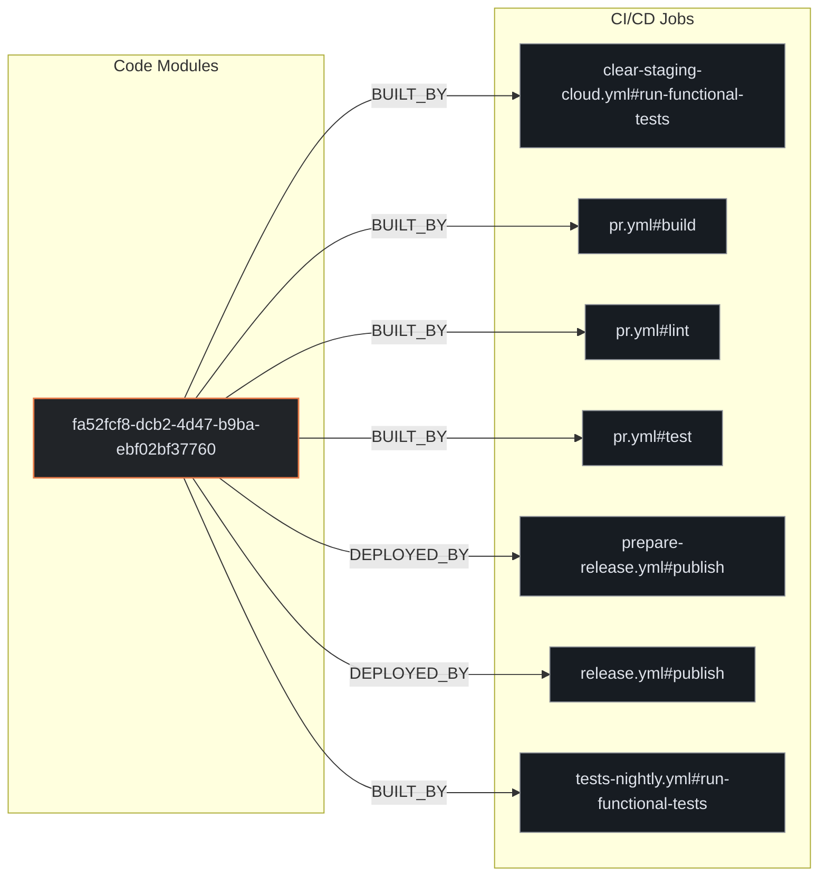

# Repository Architecture Analysis: saleor/cli

## Metadata
- **SHA**: `a25dd27f5de94b756d532585eca993e189f1b0f6`
- **Primary Ecosystem**: JavaScript/TypeScript

## Quality Metrics
- **ast_engine**: tree-sitter
- **avg_cognitive_complexity**: 1.52
- **avg_cyclomatic_complexity**: 2.13
- **component_count**: 2
- **dead_code_count**: 0
- **dead_code_symbols**: 0 entry(ies)
- **duplication_pct**: 74.94
- **file_complexities**: 25 entry(ies)
- **files_analyzed**: 115
- **fitness_passed**: False
- **fitness_violation_count**: 2
- **framework**: TypeScript
- **import_edges**: 100 entry(ies)
- **loc**: 11222
- **max_cognitive_complexity**: 29
- **max_cyclomatic_complexity**: 19
- **sloc**: 9540
- **test_file_count**: 20

# Architecture: saleor/cli

## Context
- **Repository**: `saleor/cli`
- **SHA**: `a25dd27f5de94b756d532585eca993e189f1b0f6`
- **Ecosystem**: JavaScript/TypeScript
- **Framework**: TypeScript

## Building Block View

## Component Details
- **@saleor/cli** (`package.json`): MODULE
- **ClientErrorCollection** (`src/lib/util.ts`): UI_COMPONENT

## 6-Dimension Repository Scorecard

- **Overall Grade**: `D` (62.08/100)
- **Technical Debt Score**: 37.92
- **Estimated Remediation Effort**: 45.97h

| Dimension | Grade | Score | Weight | Details |
| :--- | :---: | :---: | :---: | :--- |
| Code Quality | `D` | 69.00 | 0.20 | avg_cc=2.13, max_cc=19, duplication=74.94%, dead_code=0 |
| Dependency Health | `A` | 100.00 | 0.15 | dependencies=1222, outdated=0, vulnerable=0, has_lockfile=True |
| Maintainability | `D` | 64.50 | 0.15 | avg_cognitive=1.52, max_cognitive=29, fitness_violations=2, oversized_files=2 |
| Pipeline Health | `F` | 50.00 | 0.15 | workflows=5, operational_antipatterns=7, parallel_branches=True |
| Security | `F` | 28.00 | 0.20 | vulnerabilities=0, secrets=0, pipeline_security_findings=6 |
| Test Coverage | `C` | 70.00 | 0.15 | coverage=unavailable, ci_test_job=True, test_files_detected=True |

## Architecture Fitness & Workspace Boundaries

- **[MEDIUM] `ATRUSS-ARCH-005` (COMPLEXITY_THRESHOLD)**: Repository duplication_pct (74.94) exceeds policy threshold (15.0).
- **[MEDIUM] `ATRUSS-ARCH-005` (COMPLEXITY_THRESHOLD)**: Repository max_cognitive_complexity (29.0) exceeds policy threshold (25.0).

## Supply Chain Dependencies, Vulnerabilities & Secrets

- **Dependencies Parsed**: 1222 | **Vulnerabilities**: 0 | **Secrets**: 0

### Inventory Sample
- `@graphql-codegen/cli` `5.0.0` (npm, `package.json`)
- `@graphql-codegen/cli` `5.0.0` (npm, `pnpm-lock.yaml`)
- `@graphql-codegen/typescript-document-nodes` `4.0.1` (npm, `package.json`)
- `@graphql-codegen/typescript-document-nodes` `4.0.1` (npm, `pnpm-lock.yaml`)
- `@mobily/ts-belt` `3.13.1` (npm, `package.json`)
- `@mobily/ts-belt` `3.13.1` (npm, `pnpm-lock.yaml`)
- `@oclif/core` `1.26.2` (npm, `package.json`)
- `@oclif/core` `1.26.2` (npm, `pnpm-lock.yaml`)
- `@sentry/cli` `2.21.2` (npm, `package.json`)
- `@sentry/cli` `2.21.2` (npm, `pnpm-lock.yaml`)
- `@sentry/node` `7.77.0` (npm, `package.json`)
- `@sentry/node` `7.77.0` (npm, `pnpm-lock.yaml`)
- `@types/cli-progress` `3.11.5` (npm, `package.json`)
- `@types/cli-progress` `3.11.5` (npm, `pnpm-lock.yaml`)
- `@types/debug` `4.1.11` (npm, `package.json`)
- `@types/debug` `4.1.11` (npm, `pnpm-lock.yaml`)
- `@types/detect-port` `1.3.5` (npm, `package.json`)
- `@types/detect-port` `1.3.5` (npm, `pnpm-lock.yaml`)
- `@types/fs-extra` `11.0.4` (npm, `package.json`)
- `@types/fs-extra` `11.0.4` (npm, `pnpm-lock.yaml`)
- `@types/git-url-parse` `9.0.3` (npm, `package.json`)
- `@types/git-url-parse` `9.0.3` (npm, `pnpm-lock.yaml`)
- `@types/lodash.isempty` `4.4.9` (npm, `package.json`)
- `@types/lodash.isempty` `4.4.9` (npm, `pnpm-lock.yaml`)
- `@types/lodash.kebabcase` `4.1.9` (npm, `package.json`)
- `@types/lodash.kebabcase` `4.1.9` (npm, `pnpm-lock.yaml`)
- `@types/node` `20.9.0` (npm, `package.json`)
- `@types/node` `20.9.0` (npm, `pnpm-lock.yaml`)
- `@types/prompt` `1.1.8` (npm, `package.json`)
- `@types/prompt` `1.1.8` (npm, `pnpm-lock.yaml`)
- ... (+1192 more dependencies)

## Section 7: Code-to-Cloud Deployment Traceability

- `fa52fcf8-dcb2-4d47-b9ba-ebf02bf37760` (code_module) --[BUILT_BY]--> `clear-staging-cloud.yml#run-functional-tests` (ci_job)
- `fa52fcf8-dcb2-4d47-b9ba-ebf02bf37760` (code_module) --[BUILT_BY]--> `pr.yml#build` (ci_job)
- `fa52fcf8-dcb2-4d47-b9ba-ebf02bf37760` (code_module) --[BUILT_BY]--> `pr.yml#lint` (ci_job)
- `fa52fcf8-dcb2-4d47-b9ba-ebf02bf37760` (code_module) --[BUILT_BY]--> `pr.yml#test` (ci_job)
- `fa52fcf8-dcb2-4d47-b9ba-ebf02bf37760` (code_module) --[BUILT_BY]--> `tests-nightly.yml#run-functional-tests` (ci_job)
- `fa52fcf8-dcb2-4d47-b9ba-ebf02bf37760` (code_module) --[DEPLOYED_BY]--> `prepare-release.yml#publish` (ci_job)
- `fa52fcf8-dcb2-4d47-b9ba-ebf02bf37760` (code_module) --[DEPLOYED_BY]--> `release.yml#publish` (ci_job)

## CI/CD Pipeline Topology

```mermaid
graph TD;
  classDef atlasRoot fill:#004882,stroke:#a3c9ff,stroke-width:2px,color:#d3e4ff
  classDef atlasCategory fill:#212428,stroke:#E87A48,stroke-width:1.5px,color:#dfe3eb
  classDef atlasWorkflow fill:#1b2026,stroke:#a3c9ff,stroke-width:1.5px,color:#dfe3eb
  classDef atlasJob fill:#171c22,stroke:#8d9199,stroke-width:1px,color:#dfe3eb
  classDef atlasTarget fill:#005227,stroke:#8bd99b,stroke-width:1.5px,color:#a7f6b6
  classDef atlasAlert fill:#93000a,stroke:#ffb4ab,stroke-width:1.5px,color:#ffdad6
  classDef atlasMore fill:#252a31,stroke:#8d9199,stroke-dasharray:4 4,color:#c3c6cf
  pipeline_root(["saleor/cli (5 workflows)"]):::atlasRoot
  subgraph sg_grp_0_Release___Deploy["Release & Deploy (3 workflows · 3 jobs)"]
    direction TB
    subgraph sg_wf_0_Clear_staging_cloud_projects["Clear staging cloud projects (1 jobs)"]
      direction TB
      wf_0_Clear_staging_cloud_projects(["Trigger: Clear staging cloud projects"]):::atlasWorkflow
      job_0_run_functional_tests["run-functional-tests"]:::atlasJob
      wf_0_Clear_staging_cloud_projects --> job_0_run_functional_tests
    end
    pipeline_root --> wf_0_Clear_staging_cloud_projects
    subgraph sg_wf_2_Prepare_a_Release_on_GitHub["Prepare a Release on GitHub (1 jobs)"]
      direction TB
      wf_2_Prepare_a_Release_on_GitHub(["Trigger: Prepare a Release on GitHub"]):::atlasWorkflow
      job_2_publish["publish"]:::atlasJob
      wf_2_Prepare_a_Release_on_GitHub --> job_2_publish
    end
    pipeline_root --> wf_2_Prepare_a_Release_on_GitHub
    subgraph sg_wf_3_Release["Release (1 jobs)"]
      direction TB
      wf_3_Release(["Trigger: Release"]):::atlasWorkflow
      job_3_publish["publish"]:::atlasJob
      wf_3_Release --> job_3_publish
    end
    pipeline_root --> wf_3_Release
  end
  subgraph sg_grp_1_CI___Verification["CI & Verification (1 workflows · 3 jobs)"]
    direction TB
    subgraph sg_wf_1_Test_PR["Test PR (3 jobs)"]
      direction TB
      wf_1_Test_PR(["Trigger: Test PR"]):::atlasWorkflow
      job_1_lint["lint"]:::atlasJob
      job_1_test["test"]:::atlasJob
      job_1_build["build"]:::atlasJob
      wf_1_Test_PR --> job_1_lint
      wf_1_Test_PR --> job_1_test
      wf_1_Test_PR --> job_1_build
    end
    pipeline_root --> wf_1_Test_PR
  end
  subgraph sg_grp_2_Scheduled___Manual["Scheduled & Manual (1 workflows · 1 jobs)"]
    direction TB
    subgraph sg_wf_4_Execute_nightly_tests["Execute nightly tests (1 jobs)"]
      direction TB
      wf_4_Execute_nightly_tests(["Trigger: Execute nightly tests"]):::atlasWorkflow
      job_4_run_functional_tests["run-functional-tests"]:::atlasJob
      wf_4_Execute_nightly_tests --> job_4_run_functional_tests
    end
    pipeline_root --> wf_4_Execute_nightly_tests
  end
```

