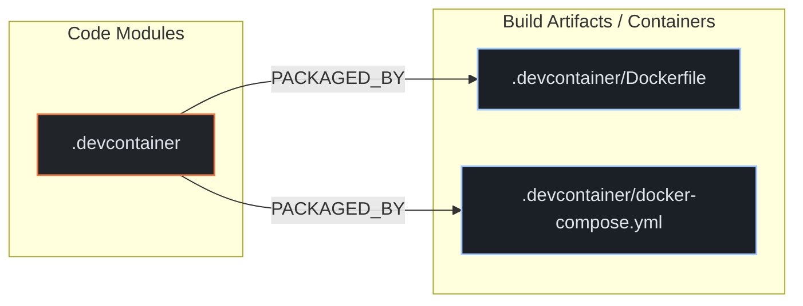
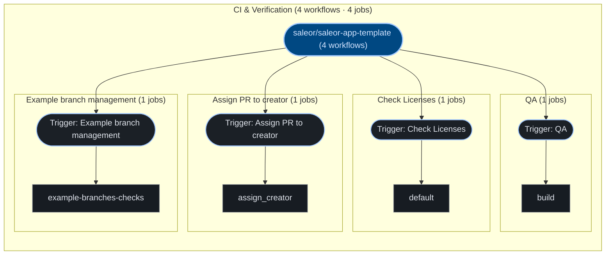

# Repository Architecture Analysis: saleor/saleor-app-template

## Metadata
- **SHA**: `9c5a2a52c4b392ec3ecfac371331a819e8bb27ed`
- **Primary Ecosystem**: JavaScript/TypeScript

## Quality Metrics
- **ast_engine**: tree-sitter
- **avg_cognitive_complexity**: 2.24
- **avg_cyclomatic_complexity**: 3.0
- **component_count**: 12
- **dead_code_count**: 0
- **dead_code_symbols**: 0 entry(ies)
- **duplication_pct**: 98.95
- **file_complexities**: 25 entry(ies)
- **files_analyzed**: 28
- **fitness_passed**: False
- **fitness_violation_count**: 1
- **framework**: Next.js
- **import_edges**: 100 entry(ies)
- **loc**: 106280
- **max_cognitive_complexity**: 18
- **max_cyclomatic_complexity**: 17
- **sloc**: 88311

# Architecture: saleor/saleor-app-template

## Context
- **Repository**: `saleor/saleor-app-template`
- **SHA**: `9c5a2a52c4b392ec3ecfac371331a819e8bb27ed`
- **Ecosystem**: JavaScript/TypeScript
- **Framework**: Next.js

## Building Block View

```mermaid
graph TD;
  classDef atlasRoot fill:#004882,stroke:#a3c9ff,stroke-width:2px,color:#d3e4ff
  classDef atlasCategory fill:#212428,stroke:#E87A48,stroke-width:1.5px,color:#dfe3eb
  classDef atlasWorkflow fill:#1b2026,stroke:#a3c9ff,stroke-width:1.5px,color:#dfe3eb
  classDef atlasJob fill:#171c22,stroke:#8d9199,stroke-width:1px,color:#dfe3eb
  classDef atlasTarget fill:#005227,stroke:#8bd99b,stroke-width:1.5px,color:#a7f6b6
  classDef atlasAlert fill:#93000a,stroke:#ffb4ab,stroke-width:1.5px,color:#ffdad6
  classDef atlasMore fill:#252a31,stroke:#8d9199,stroke-dasharray:4 4,color:#c3c6cf
    saleor_app_template["saleor-app-template : MODULE"]:::atlasJob
    OrderExample["OrderExample : UI_COMPONENT"]:::atlasJob
    NoSSRWrapper["NoSSRWrapper : UI_COMPONENT"]:::atlasJob
    ThemeSynchronizer["ThemeSynchronizer : UI_COMPONENT"]:::atlasJob
    API_api_manifest["API_api_manifest : API_ROUTE"]:::atlasJob
    API_api_protected["API_api_protected : API_ROUTE"]:::atlasJob
    API_api_register["API_api_register : API_ROUTE"]:::atlasJob
    API_api_server_widget["API_api_server-widget : API_ROUTE"]:::atlasJob
    API_webhooks_order_created["API_webhooks_order-created : API_ROUTE"]:::atlasJob
    API_webhooks_order_filter_shipping_methods["API_webhooks_order-filter-shipping-methods : API_ROUTE"]:::atlasJob
    GraphQLProvider["GraphQLProvider : UI_COMPONENT"]:::atlasJob
    docker_compose["docker-compose : module"]:::atlasJob
    repo_root(["saleor/saleor-app-template"]):::atlasRoot
    repo_root --> API_api_protected
    repo_root --> API_api_register
    repo_root --> API_api_server_widget
    repo_root --> GraphQLProvider
    repo_root --> NoSSRWrapper
    repo_root --> OrderExample
    repo_root --> ThemeSynchronizer
    repo_root --> docker_compose
    repo_root --> saleor_app_template
    API_api_manifest --> API_webhooks_order_created
    API_api_manifest --> API_webhooks_order_filter_shipping_methods
```

## Component Details
- **saleor-app-template** (`package.json`): MODULE
- **OrderExample** (`src/order-example.tsx`): UI_COMPONENT
- **NoSSRWrapper** (`src/lib/no-ssr-wrapper.tsx`): UI_COMPONENT
- **ThemeSynchronizer** (`src/lib/theme-synchronizer.tsx`): UI_COMPONENT
- **API_api_manifest** (`src/pages/api/manifest.ts`): API_ROUTE (deps: API_webhooks_order-created, API_webhooks_order-filter-shipping-methods)
- **API_api_protected** (`src/pages/api/protected.ts`): API_ROUTE
- **API_api_register** (`src/pages/api/register.ts`): API_ROUTE
- **API_api_server-widget** (`src/pages/api/server-widget.ts`): API_ROUTE
- **API_webhooks_order-created** (`src/pages/api/webhooks/order-created.ts`): API_ROUTE
- **API_webhooks_order-filter-shipping-methods** (`src/pages/api/webhooks/order-filter-shipping-methods.ts`): API_ROUTE
- **GraphQLProvider** (`src/providers/GraphQLProvider.tsx`): UI_COMPONENT
- **docker-compose** (`.devcontainer/docker-compose.yml`): module

## 6-Dimension Repository Scorecard

- **Overall Grade**: `B` (84.05/100)
- **Technical Debt Score**: 15.95
- **Estimated Remediation Effort**: 30.28h

| Dimension | Grade | Score | Weight | Details |
| :--- | :---: | :---: | :---: | :--- |
| Code Quality | `C` | 72.00 | 0.20 | avg_cc=3.00, max_cc=17, duplication=98.95%, dead_code=0 |
| Dependency Health | `A` | 100.00 | 0.15 | dependencies=1049, outdated=0, vulnerable=0, has_lockfile=True |
| Maintainability | `B` | 89.00 | 0.15 | avg_cognitive=2.24, max_cognitive=18, fitness_violations=1, oversized_files=1 |
| Pipeline Health | `B` | 88.00 | 0.15 | workflows=4, operational_antipatterns=4, parallel_branches=False |
| Security | `B` | 88.00 | 0.20 | vulnerabilities=0, secrets=0, pipeline_security_findings=1 |
| Test Coverage | `C` | 70.00 | 0.15 | coverage=unavailable, ci_test_job=True, test_files_detected=False |

## Architecture Fitness & Workspace Boundaries

- **[MEDIUM] `ATRUSS-ARCH-005` (COMPLEXITY_THRESHOLD)**: Repository duplication_pct (98.95) exceeds policy threshold (15.0).

## Supply Chain Dependencies, Vulnerabilities & Secrets

- **Dependencies Parsed**: 1049 | **Vulnerabilities**: 0 | **Secrets**: 0

### Inventory Sample
- `@graphql-codegen/add` `3.2.0` (npm, `package.json`)
- `@graphql-codegen/add` `3.2.0` (npm, `pnpm-lock.yaml`)
- `@graphql-codegen/cli` `3.3.1` (npm, `package.json`)
- `@graphql-codegen/cli` `3.3.1` (npm, `pnpm-lock.yaml`)
- `@graphql-codegen/introspection` `3.0.1` (npm, `package.json`)
- `@graphql-codegen/introspection` `3.0.1` (npm, `pnpm-lock.yaml`)
- `@graphql-codegen/schema-ast` `3.0.1` (npm, `package.json`)
- `@graphql-codegen/schema-ast` `3.0.1` (npm, `pnpm-lock.yaml`)
- `@graphql-codegen/typed-document-node` `4.0.1` (npm, `package.json`)
- `@graphql-codegen/typed-document-node` `4.0.1` (npm, `pnpm-lock.yaml`)
- `@graphql-codegen/typescript` `3.0.4` (npm, `package.json`)
- `@graphql-codegen/typescript` `3.0.4` (npm, `pnpm-lock.yaml`)
- `@graphql-codegen/typescript-operations` `3.0.4` (npm, `package.json`)
- `@graphql-codegen/typescript-operations` `3.0.4` (npm, `pnpm-lock.yaml`)
- `@graphql-codegen/typescript-urql` `3.7.3` (npm, `package.json`)
- `@graphql-codegen/typescript-urql` `3.7.3` (npm, `pnpm-lock.yaml`)
- `@graphql-codegen/urql-introspection` `2.2.1` (npm, `package.json`)
- `@graphql-codegen/urql-introspection` `2.2.1` (npm, `pnpm-lock.yaml`)
- `@graphql-typed-document-node/core` `3.2.0` (npm, `package.json`)
- `@graphql-typed-document-node/core` `3.2.0` (npm, `pnpm-lock.yaml`)
- `@saleor/app-sdk` `1.12.0` (npm, `package.json`)
- `@saleor/app-sdk` `1.12.0` (npm, `pnpm-lock.yaml`)
- `@saleor/eslint-plugin-saleor-app` `0.1.2` (npm, `package.json`)
- `@saleor/eslint-plugin-saleor-app` `0.1.2` (npm, `pnpm-lock.yaml`)
- `@saleor/macaw-ui` `2.0.0` (npm, `package.json`)
- `@saleor/macaw-ui` `2.0.0` (npm, `pnpm-lock.yaml`)
- `@types/node` `12.20.55` (npm, `pnpm-lock.yaml`)
- `@types/node` `18.11.18` (npm, `package.json`)
- `@types/node` `18.18.3` (npm, `pnpm-lock.yaml`)
- `@types/react` `18.2.25` (npm, `pnpm-lock.yaml`)
- ... (+1019 more dependencies)

## Section 7: Code-to-Cloud Deployment Traceability

- `.devcontainer` (code_module) --[PACKAGED_BY]--> `.devcontainer/Dockerfile` (container)
- `.devcontainer` (code_module) --[PACKAGED_BY]--> `.devcontainer/docker-compose.yml` (container)

## CI/CD Pipeline Topology

