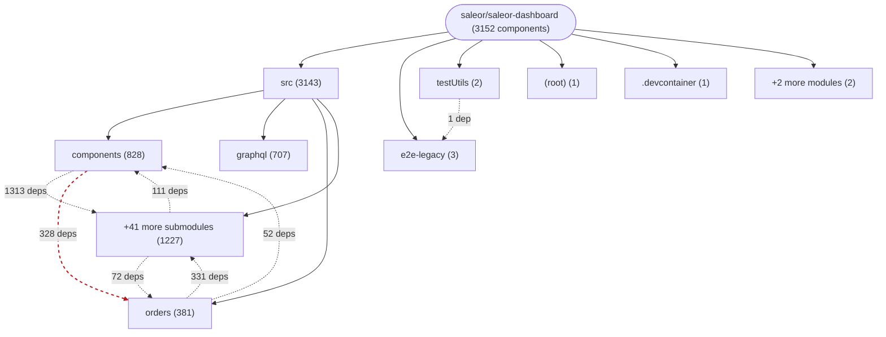
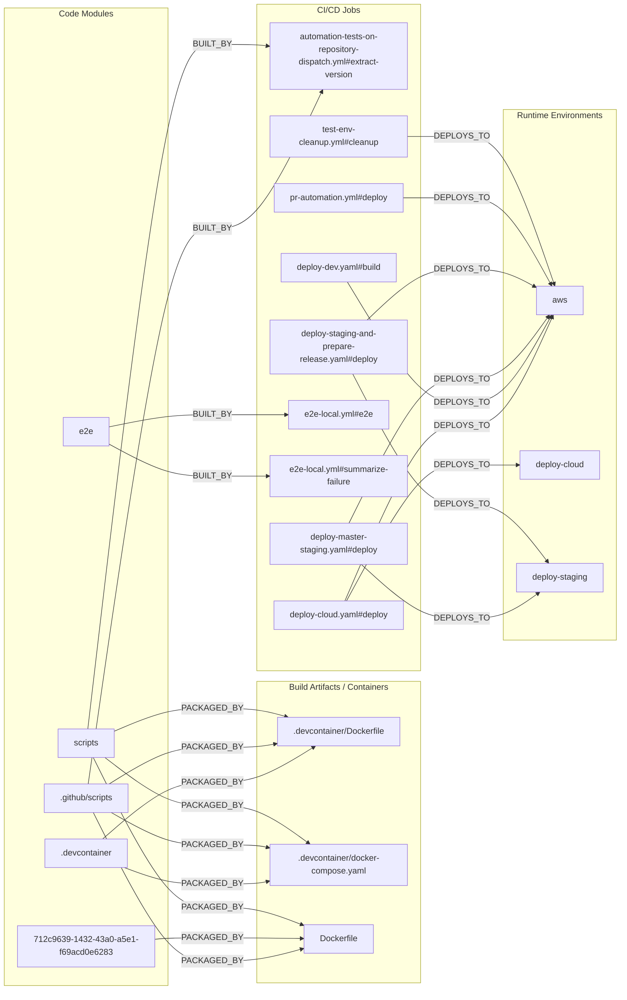
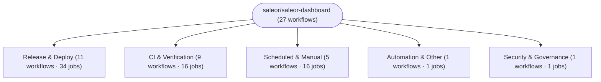

# Repository Architecture Analysis: saleor/saleor-dashboard

## Metadata
- **SHA**: `513686a75a0de29c4a6e01f8f518ef1251b5177b`
- **Primary Ecosystem**: JavaScript/TypeScript

## Quality Metrics
- **ast_engine**: tree-sitter
- **avg_cognitive_complexity**: 1.95
- **avg_cyclomatic_complexity**: 2.65
- **component_count**: 3152
- **dead_code_count**: 29
- **dead_code_symbols**: 29 entry(ies)
- **duplication_pct**: 87.77
- **file_complexities**: 25 entry(ies)
- **files_analyzed**: 5041
- **fitness_passed**: False
- **fitness_violation_count**: 49
- **framework**: React (Vite)
- **import_edges**: 100 entry(ies)
- **loc**: 689529
- **max_cognitive_complexity**: 163
- **max_cyclomatic_complexity**: 98
- **sloc**: 542292
- **test_file_count**: 1095

# Architecture: saleor/saleor-dashboard

## Context
- **Repository**: `saleor/saleor-dashboard`
- **SHA**: `513686a75a0de29c4a6e01f8f518ef1251b5177b`
- **Ecosystem**: JavaScript/TypeScript
- **Framework**: React (Vite)

## Building Block View

## Component Details

Showing top 60 representative components out of 3152 across 7 module group(s):

- **Module `src`** (3143 components — UI_COMPONENT: 3141, DATA_ACCESS_LAYER: 2)
- **Module `e2e-legacy`** (3 components — SERVICE: 3)
- **Module `testUtils`** (2 components — UI_COMPONENT: 2)
- **Module `(root)`** (1 components — MODULE: 1)
- **Module `.devcontainer`** (1 components — module: 1)
- **Module `.featureFlags`** (1 components — UI_COMPONENT: 1)
- **Module `.github`** (1 components — MODULE: 1)

- **Datagrid** (`src/components/Datagrid/Datagrid.tsx`): UI_COMPONENT (deps: AboutCard, AppWidgetCard, AssignListCard, AssignListRequiredMeta, AssignableListCard, AssignedAttributesCard (+77 more))
- **Attributes** (`src/components/Attributes/Attributes.tsx`): UI_COMPONENT (deps: AboutCard, AppWidgetCard, AssignListCard, AssignListRequiredMeta, AssignableListCard, AssignedAttributesCard (+66 more))
- **MetadataCard** (`src/components/Metadata/MetadataCard.tsx`): UI_COMPONENT (deps: AboutCard, AppWidgetCard, AssignListCard, AssignListRequiredMeta, AssignableListCard, AssignedAttributesCard (+64 more))
- **MetadataLoadingCard** (`src/components/Metadata/MetadataLoadingCard.tsx`): UI_COMPONENT (deps: AboutCard, AppWidgetCard, AssignListCard, AssignListRequiredMeta, AssignableListCard, AssignedAttributesCard (+63 more))
- **All** (`src/icons/IconShowcase.stories.tsx`): UI_COMPONENT (deps: AlertExclamationIcon, Attributes, CategoryProducts, Channels, ConfigurationIcon, ConfigurationModelingIcon (+37 more))
- **Collapsed** (`src/components/Sidebar/menu/RailMenuItem.stories.tsx`): UI_COMPONENT (deps: AppWidgetExtensionItem, AttributeListItem, AvailabilityChannelItem, CategoryItem, ChannelAvailabilityItem, ChannelAvailabilityListItem (+34 more))
- **CollapsedWithDeprecationBanner** (`src/components/Sidebar/menu/RailMenuItem.stories.tsx`): UI_COMPONENT (deps: AppWidgetExtensionItem, AttributeListItem, AvailabilityChannelItem, CategoryItem, ChannelAvailabilityItem, ChannelAvailabilityListItem (+34 more))
- **Expanded** (`src/components/Sidebar/menu/RailMenuItem.stories.tsx`): UI_COMPONENT (deps: AppWidgetExtensionItem, AttributeListItem, AvailabilityChannelItem, CategoryItem, ChannelAvailabilityItem, ChannelAvailabilityListItem (+34 more))
- **ExpandedWithDeprecationBanner** (`src/components/Sidebar/menu/RailMenuItem.stories.tsx`): UI_COMPONENT (deps: AppWidgetExtensionItem, AttributeListItem, AvailabilityChannelItem, CategoryItem, ChannelAvailabilityItem, ChannelAvailabilityListItem (+34 more))
- **GroupWithOwnPage** (`src/components/Sidebar/menu/RailMenuItem.stories.tsx`): UI_COMPONENT (deps: AppWidgetExtensionItem, AttributeListItem, AvailabilityChannelItem, CategoryItem, ChannelAvailabilityItem, ChannelAvailabilityListItem (+34 more))
- **Menu** (`src/components/Sidebar/menu/Menu.tsx`): UI_COMPONENT (deps: AppWidgetExtensionItem, AttributeListItem, AvailabilityChannelItem, CategoryItem, ChannelAvailabilityItem, ChannelAvailabilityListItem (+28 more))
- **FeatureFlagsModal** (`src/components/Sidebar/user/FeatureFlagsModal/index.tsx`): UI_COMPONENT (deps: AttributeCreateFormContent, AttributeHeader, CommandContent, Content, ContextHeader, DeprecationBannerContent (+27 more))
- **Default** (`src/components/Sidebar/SidebarAppBar.stories.tsx`): UI_COMPONENT (deps: AppWidgetExtensionItem, AttributeListItem, AvailabilityChannelItem, CategoryItem, ChannelAvailabilityItem, ChannelAvailabilityListItem (+26 more))
- **WithoutSearchPermission** (`src/components/Sidebar/SidebarAppBar.stories.tsx`): UI_COMPONENT (deps: AppWidgetExtensionItem, AttributeListItem, AvailabilityChannelItem, CategoryItem, ChannelAvailabilityItem, ChannelAvailabilityListItem (+26 more))
- **SubmenuItems** (`src/components/Sidebar/menu/SubmenuItems.tsx`): UI_COMPONENT (deps: AppWidgetExtensionItem, AttributeListItem, AvailabilityChannelItem, CategoryItem, ChannelAvailabilityItem, ChannelAvailabilityListItem (+24 more))
- **ShippingZoneDetailsPage** (`src/shipping/components/ShippingZoneDetailsPage/ShippingZoneDetailsPage.tsx`): UI_COMPONENT (deps: AppPermissionsDialogMessages, AttributeDetailsTitle, CLOUD_PLUGIN_ID, CardTitle, ChannelDetailsTitle, CustomerDetailsTitle (+20 more))
- **Filters** (`src/components/ConditionalFilter/UI/Filters.tsx`): UI_COMPONENT (deps: ASSIGN_LIST_PREVIEW_COUNT, AssignListShowAllRow, AssignVariantLoadMoreRow, BasicAttributeRow, BulkPublishReviewRow, ChannelInventoryWarehouseRow (+18 more))
- **DiscountDetailsPage** (`src/discounts/components/DiscountDetailsPage/DiscountDetailsPage.tsx`): UI_COMPONENT (deps: AttributeDetailsTitle, CardTitle, ChannelDetailsTitle, CustomerDetailsTitle, CustomerTypeDetailsTitle, DiscountDatesWithController (+16 more))
- **DiscountRules** (`src/discounts/components/DiscountRules/DiscountRules.tsx`): UI_COMPONENT (deps: AddButton, AppPermissionsDialogMessages, ConditionalAttributesFilterProvider, ConditionalCollectionFilterProvider, ConditionalCustomerFilterProvider, ConditionalDiscountFilterProvider (+16 more))
- **AvailabilityChannelItem** (`src/products/components/ProductDoctor/AvailabilityChannelItem.tsx`): UI_COMPONENT (deps: AppPermissionsDialogMessages, AvailabilityCard, AvailableForPurchaseSection, ChannelAvailabilityCard, ChannelIcon, CollectionChannelAvailabilityCard (+15 more))
- **CommandContent** (`src/components/NavigatorSearch/CommandContent.tsx`): UI_COMPONENT (deps: Actions, AppActions, CLOUD_PLUGIN_ID, DETAIL_SETTINGS_CARD_HEADER_ACTION_SIZE, ExploreExtensionsActions, FailedInstallationActions (+15 more))
- **ContextHeader** (`src/components/Modal/ContextHeader.tsx`): UI_COMPONENT (deps: AttributeDetailsTitle, CardTitle, ChannelDetailsTitle, Close, CustomerDetailsTitle, CustomerTypeDetailsTitle (+15 more))
- **Default** (`src/components/Datagrid/Datagrid.stories.tsx`): UI_COMPONENT (deps: AttributeListDatagrid, CategoryListDatagrid, CollectionListDatagrid, CustomerListDatagrid, Datagrid, DatagridChangeStateContext (+15 more))
- **Empty** (`src/components/Datagrid/Datagrid.stories.tsx`): UI_COMPONENT (deps: AttributeListDatagrid, CategoryListDatagrid, CollectionListDatagrid, CustomerListDatagrid, Datagrid, DatagridChangeStateContext (+15 more))
- **Header** (`src/components/Modal/Header.tsx`): UI_COMPONENT (deps: AttributeDetailsTitle, CardTitle, ChannelDetailsTitle, Close, ContextHeader, CustomerDetailsTitle (+15 more))
- **Loading** (`src/components/Datagrid/Datagrid.stories.tsx`): UI_COMPONENT (deps: AttributeListDatagrid, CategoryListDatagrid, CollectionListDatagrid, CustomerListDatagrid, Datagrid, DatagridChangeStateContext (+15 more))
- **Readonly** (`src/components/Datagrid/Datagrid.stories.tsx`): UI_COMPONENT (deps: AttributeListDatagrid, CategoryListDatagrid, CollectionListDatagrid, CustomerListDatagrid, Datagrid, DatagridChangeStateContext (+15 more))
- **ShowEmptyDatagrid** (`src/components/Datagrid/Datagrid.stories.tsx`): UI_COMPONENT (deps: AttributeListDatagrid, CategoryListDatagrid, CollectionListDatagrid, CustomerListDatagrid, Datagrid, DatagridChangeStateContext (+15 more))
- **Sidebar** (`src/components/Sidebar/Sidebar.tsx`): UI_COMPONENT (deps: AttributeCreateFormContent, CommandContent, Content, DeprecationBannerContent, DeprecationBannerIcon, DetailPageContent (+15 more))
- **WithColumnGroups** (`src/components/Datagrid/Datagrid.stories.tsx`): UI_COMPONENT (deps: AttributeListDatagrid, CategoryListDatagrid, CollectionListDatagrid, CustomerListDatagrid, Datagrid, DatagridChangeStateContext (+15 more))
- **WithRowClick** (`src/components/Datagrid/Datagrid.stories.tsx`): UI_COMPONENT (deps: AttributeListDatagrid, CategoryListDatagrid, CollectionListDatagrid, CustomerListDatagrid, Datagrid, DatagridChangeStateContext (+15 more))
- **WithoutMenuItems** (`src/components/Datagrid/Datagrid.stories.tsx`): UI_COMPONENT (deps: AttributeListDatagrid, CategoryListDatagrid, CollectionListDatagrid, CustomerListDatagrid, Datagrid, DatagridChangeStateContext (+15 more))
- **WithoutRowMarkers** (`src/components/Datagrid/Datagrid.stories.tsx`): UI_COMPONENT (deps: AttributeListDatagrid, CategoryListDatagrid, CollectionListDatagrid, CustomerListDatagrid, Datagrid, DatagridChangeStateContext (+15 more))
- **WithoutTopBorder** (`src/components/Datagrid/Datagrid.stories.tsx`): UI_COMPONENT (deps: AttributeListDatagrid, CategoryListDatagrid, CollectionListDatagrid, CustomerListDatagrid, Datagrid, DatagridChangeStateContext (+15 more))
- **AssignVariantDialogMulti** (`src/components/AssignVariantDialog/AssignVariantDialogMulti.tsx`): UI_COMPONENT (deps: AppPermissionsDialogMessages, AssignPickerListEmptyState, AssignPickerListEmptyStateRow, AssignPickerListLoading, AssignPickerListLoadingRow, AssignVariantLoadMoreRow (+14 more))
- **CustomerDetailsPageLoading** (`src/customers/components/CustomerDetailsPage/CustomerDetailsPageLoading.tsx`): UI_COMPONENT (deps: AppPermissionsDialogMessages, AttributeDetailsTitle, CardTitle, ChannelDetailsTitle, CustomerDetailsTitle, CustomerOrders (+14 more))
- **OrderManualTransactionForm** (`src/orders/components/OrderManualTransactionForm/index.ts`): UI_COMPONENT (deps: CategoryDetailsForm, ChannelForm, CompanyAddressForm, CustomerEditForm, DescriptionField, DiscountCreateForm (+14 more))
- **PickerHeader** (`src/components/Modal/PickerHeader.tsx`): UI_COMPONENT (deps: AttributeDetailsTitle, CardTitle, ChannelDetailsTitle, Close, CustomerDetailsTitle, CustomerTypeDetailsTitle (+14 more))
- **AppDetailsPage** (`src/extensions/views/EditManifestExtension/components/AppDetailsPage/AppDetailsPage.tsx`): UI_COMPONENT (deps: AboutCard, AppWebhooksDisplay, AttributeHeader, ContextHeader, DataPrivacyCard, Header (+13 more))
- **CustomerTypeDetailsPage** (`src/customerTypes/components/CustomerTypeDetailsPage/CustomerTypeDetailsPage.tsx`): UI_COMPONENT (deps: AppPermissionsDialogMessages, AttributeDetailsTitle, CardTitle, ChannelDetailsTitle, CustomerDetailsTitle, CustomerTypeDetailsPageLoading (+13 more))
- **MountingPoint** (`src/components/Sidebar/MountingPoint.tsx`): UI_COMPONENT (deps: AttributeCreateFormContent, CommandContent, Content, DeprecationBannerContent, DeprecationBannerIcon, DetailPageContent (+13 more))
- **ProductTypeDetailsPageLoading** (`src/productTypes/components/ProductTypeDetailsPage/ProductTypeDetailsPageLoading.tsx`): UI_COMPONENT (deps: AppPermissionsDialogMessages, AttributeDetailsTitle, CardTitle, ChannelDetailsTitle, CustomerDetailsTitle, CustomerTypeDetailsTitle (+13 more))
- **SidebarContent** (`src/components/Sidebar/Content.tsx`): UI_COMPONENT (deps: AppDisabledInfo, DeprecationBanner, DiscountGeneralInfo, FailedInstallationInfo, InstallationPendingInfo, LimitsInfo (+13 more))
- **AttributePageLoading** (`src/attributes/components/AttributePage/AttributePageLoading.tsx`): UI_COMPONENT (deps: AppPermissionsDialogMessages, AttributeDetailsTitle, CardTitle, ChannelDetailsTitle, CustomerDetailsTitle, CustomerTypeDetailsTitle (+12 more))
- **CustomerTypeDetailsPageLoading** (`src/customerTypes/components/CustomerTypeDetailsPage/CustomerTypeDetailsPageLoading.tsx`): UI_COMPONENT (deps: AppPermissionsDialogMessages, AttributeDetailsTitle, CardTitle, ChannelDetailsTitle, CustomerDetailsTitle, CustomerTypeDetailsTitle (+12 more))
- **Default** (`src/components/AppLayout/TopNav/TopNav.stories.tsx`): UI_COMPONENT (deps: CustomerSection, EmptyImage, EnvironmentSwitcher, ExtensionsSection, FeatureFlagsModal, OrderDraftDetails (+12 more))
- **Default** (`src/components/Table/Table.stories.tsx`): UI_COMPONENT (deps: AssignableListCell, AssignableListLinkCell, AssignableListTable, MetadataCardTable, OrderDetailsRefundTable, OrderTransactionRefundTable (+12 more))
- **InsideResponsiveTable** (`src/components/Table/Table.stories.tsx`): UI_COMPONENT (deps: AssignableListCell, AssignableListLinkCell, AssignableListTable, MetadataCardTable, OrderDetailsRefundTable, OrderTransactionRefundTable (+12 more))
- **LeftAligned** (`src/components/AppLayout/TopNav/TopNav.stories.tsx`): UI_COMPONENT (deps: CustomerSection, EmptyImage, EnvironmentSwitcher, ExtensionsSection, FeatureFlagsModal, OrderDraftDetails (+12 more))
- **PageTypeDetailsPageLoading** (`src/modelTypes/components/PageTypeDetailsPage/PageTypeDetailsPageLoading.tsx`): UI_COMPONENT (deps: AppPermissionsDialogMessages, AttributeDetailsTitle, CardTitle, ChannelDetailsTitle, CustomerDetailsTitle, CustomerTypeDetailsTitle (+12 more))
- **SelectedRow** (`src/components/Table/Table.stories.tsx`): UI_COMPONENT (deps: AssignableListCell, AssignableListLinkCell, AssignableListTable, MetadataCardTable, OrderDetailsRefundTable, OrderTransactionRefundTable (+12 more))
- **WithBackLink** (`src/components/AppLayout/TopNav/TopNav.stories.tsx`): UI_COMPONENT (deps: CustomerSection, EmptyImage, EnvironmentSwitcher, ExtensionsSection, FeatureFlagsModal, OrderDraftDetails (+12 more))
- **WithChildren** (`src/components/AppLayout/TopNav/TopNav.stories.tsx`): UI_COMPONENT (deps: CustomerSection, EmptyImage, EnvironmentSwitcher, ExtensionsSection, FeatureFlagsModal, OrderDraftDetails (+12 more))
- **WithDetailPageActions** (`src/components/AppLayout/TopNav/TopNav.stories.tsx`): UI_COMPONENT (deps: CustomerSection, EmptyImage, EnvironmentSwitcher, ExtensionsSection, FeatureFlagsModal, OrderDraftDetails (+12 more))
- **WithMenu** (`src/components/AppLayout/TopNav/TopNav.stories.tsx`): UI_COMPONENT (deps: CustomerSection, EmptyImage, EnvironmentSwitcher, ExtensionsSection, FeatureFlagsModal, OrderDraftDetails (+12 more))
- **WithSubtitle** (`src/components/AppLayout/TopNav/TopNav.stories.tsx`): UI_COMPONENT (deps: CustomerSection, EmptyImage, EnvironmentSwitcher, ExtensionsSection, FeatureFlagsModal, OrderDraftDetails (+12 more))
- **WithSubtitleTop** (`src/components/AppLayout/TopNav/TopNav.stories.tsx`): UI_COMPONENT (deps: CustomerSection, EmptyImage, EnvironmentSwitcher, ExtensionsSection, FeatureFlagsModal, OrderDraftDetails (+12 more))
- **WithoutBorder** (`src/components/AppLayout/TopNav/TopNav.stories.tsx`): UI_COMPONENT (deps: CustomerSection, EmptyImage, EnvironmentSwitcher, ExtensionsSection, FeatureFlagsModal, OrderDraftDetails (+12 more))
- **RulesList** (`src/discounts/components/DiscountRules/componenets/RulesList/RulesList.tsx`): UI_COMPONENT (deps: AppPermissionsDialogMessages, CLOUD_PLUGIN_ID, ImagePlaceholder, InputWithPlaceholder, IntrospectionQuery, MS_PER_DAY (+11 more))
- **DiscountCreate** (`src/discounts/views/DiscountCreate/DiscountCreate.tsx`): UI_COMPONENT (deps: ConditionalAttributesFilterProvider, ConditionalCollectionFilterProvider, ConditionalCustomerFilterProvider, ConditionalDiscountFilterProvider, ConditionalDraftOrderFilterProvider, ConditionalGiftCardsFilterProver (+9 more))

## 6-Dimension Repository Scorecard

- **Overall Grade**: `F` (31.50/100)
- **Technical Debt Score**: 68.50
- **Estimated Remediation Effort**: 269.93h

| Dimension | Grade | Score | Weight | Details |
| :--- | :---: | :---: | :---: | :--- |
| Code Quality | `F` | 30.00 | 0.20 | avg_cc=2.65, max_cc=98, duplication=87.77%, dead_code=29 |
| Dependency Health | `A` | 100.00 | 0.15 | dependencies=2097, outdated=0, vulnerable=0, has_lockfile=True |
| Maintainability | `F` | 0.00 | 0.15 | avg_cognitive=1.95, max_cognitive=163, fitness_violations=49, oversized_files=11 |
| Pipeline Health | `F` | 0.00 | 0.15 | workflows=27, operational_antipatterns=81, parallel_branches=True |
| Security | `F` | 0.00 | 0.20 | vulnerabilities=0, secrets=0, pipeline_security_findings=17 |
| Test Coverage | `C` | 70.00 | 0.15 | coverage=unavailable, ci_test_job=True, test_files_detected=True |

## Architecture Fitness & Workspace Boundaries

- **[HIGH] `ATRUSS-ARCH-004` (CIRCULAR_DEPENDENCY)**: Circular dependency detected between architectural components. (AddCustomExtension -> PermissionCheckbox -> AddCustomExtension)
- **[HIGH] `ATRUSS-ARCH-004` (CIRCULAR_DEPENDENCY)**: Circular dependency detected between architectural components. (Attributes -> MetadataCard -> MetadataLoadingCard -> OrderFulfillmentCard -> CancelButton -> ConfirmButton -> Root -> Filters -> DropdownRow -> Attributes)
- **[HIGH] `ATRUSS-ARCH-004` (CIRCULAR_DEPENDENCY)**: Circular dependency detected between architectural components. (Attributes -> MetadataCard -> MetadataLoadingCard -> OrderFulfillmentCard -> ConfirmButton -> Root -> Filters -> DropdownRow -> Attributes)
- **[HIGH] `ATRUSS-ARCH-004` (CIRCULAR_DEPENDENCY)**: Circular dependency detected between architectural components. (Attributes -> MetadataCard -> MetadataLoadingCard -> OrderFulfillmentCard -> DeleteButton -> ConfirmButton -> Root -> Filters -> DropdownRow -> Attributes)
- **[HIGH] `ATRUSS-ARCH-004` (CIRCULAR_DEPENDENCY)**: Circular dependency detected between architectural components. (Attributes -> MetadataCard -> OrderFulfillmentCard -> CancelButton -> ConfirmButton -> Root -> Filters -> DropdownRow -> Attributes)
- **[HIGH] `ATRUSS-ARCH-004` (CIRCULAR_DEPENDENCY)**: Circular dependency detected between architectural components. (Attributes -> MetadataCard -> OrderFulfillmentCard -> ConfirmButton -> Root -> Filters -> DropdownRow -> Attributes)
- **[HIGH] `ATRUSS-ARCH-004` (CIRCULAR_DEPENDENCY)**: Circular dependency detected between architectural components. (Attributes -> MetadataCard -> OrderFulfillmentCard -> DeleteButton -> ConfirmButton -> Root -> Filters -> DropdownRow -> Attributes)
- **[HIGH] `ATRUSS-ARCH-004` (CIRCULAR_DEPENDENCY)**: Circular dependency detected between architectural components. (Attributes -> MetadataLoadingCard -> MetadataCard -> OrderFulfillmentCard -> CancelButton -> ConfirmButton -> Root -> Filters -> DropdownRow -> Attributes)
- **[HIGH] `ATRUSS-ARCH-004` (CIRCULAR_DEPENDENCY)**: Circular dependency detected between architectural components. (Attributes -> MetadataLoadingCard -> MetadataCard -> OrderFulfillmentCard -> ConfirmButton -> Root -> Filters -> DropdownRow -> Attributes)
- **[HIGH] `ATRUSS-ARCH-004` (CIRCULAR_DEPENDENCY)**: Circular dependency detected between architectural components. (Attributes -> MetadataLoadingCard -> MetadataCard -> OrderFulfillmentCard -> DeleteButton -> ConfirmButton -> Root -> Filters -> DropdownRow -> Attributes)
- **[HIGH] `ATRUSS-ARCH-004` (CIRCULAR_DEPENDENCY)**: Circular dependency detected between architectural components. (Attributes -> MetadataLoadingCard -> OrderFulfillmentCard -> CancelButton -> ConfirmButton -> Root -> Filters -> DropdownRow -> Attributes)
- **[HIGH] `ATRUSS-ARCH-004` (CIRCULAR_DEPENDENCY)**: Circular dependency detected between architectural components. (Attributes -> MetadataLoadingCard -> OrderFulfillmentCard -> ConfirmButton -> Root -> Filters -> DropdownRow -> Attributes)
- **[HIGH] `ATRUSS-ARCH-004` (CIRCULAR_DEPENDENCY)**: Circular dependency detected between architectural components. (Attributes -> MetadataLoadingCard -> OrderFulfillmentCard -> DeleteButton -> ConfirmButton -> Root -> Filters -> DropdownRow -> Attributes)
- **[HIGH] `ATRUSS-ARCH-004` (CIRCULAR_DEPENDENCY)**: Circular dependency detected between architectural components. (Attributes -> OrderFulfillmentCard -> CancelButton -> ConfirmButton -> Root -> Filters -> DropdownRow -> Attributes)
- **[HIGH] `ATRUSS-ARCH-004` (CIRCULAR_DEPENDENCY)**: Circular dependency detected between architectural components. (Attributes -> OrderFulfillmentCard -> ConfirmButton -> Root -> Filters -> DropdownRow -> Attributes)
- **[HIGH] `ATRUSS-ARCH-004` (CIRCULAR_DEPENDENCY)**: Circular dependency detected between architectural components. (Attributes -> OrderFulfillmentCard -> DeleteButton -> ConfirmButton -> Root -> Filters -> DropdownRow -> Attributes)
- **[HIGH] `ATRUSS-ARCH-004` (CIRCULAR_DEPENDENCY)**: Circular dependency detected between architectural components. (AvailabilityCard -> AvailabilityChannelItem -> AvailabilityCard)
- **[HIGH] `ATRUSS-ARCH-004` (CIRCULAR_DEPENDENCY)**: Circular dependency detected between architectural components. (AvailabilityChannelItem -> PublicApiVerificationBadge -> AvailabilityChannelItem)
- **[HIGH] `ATRUSS-ARCH-004` (CIRCULAR_DEPENDENCY)**: Circular dependency detected between architectural components. (ChannelForm -> ChannelOrdersSection -> ChannelForm)
- **[HIGH] `ATRUSS-ARCH-004` (CIRCULAR_DEPENDENCY)**: Circular dependency detected between architectural components. (ChannelForm -> ChannelPaymentsCheckoutSection -> ChannelForm)
- **[HIGH] `ATRUSS-ARCH-004` (CIRCULAR_DEPENDENCY)**: Circular dependency detected between architectural components. (DescriptionField -> ManualTransactionContext -> OrderManualTransactionForm -> DescriptionField)
- **[HIGH] `ATRUSS-ARCH-004` (CIRCULAR_DEPENDENCY)**: Circular dependency detected between architectural components. (ErrorText -> ManualTransactionContext -> OrderManualTransactionForm -> ErrorText)
- **[HIGH] `ATRUSS-ARCH-004` (CIRCULAR_DEPENDENCY)**: Circular dependency detected between architectural components. (Filters -> Root -> Filters)
- **[HIGH] `ATRUSS-ARCH-004` (CIRCULAR_DEPENDENCY)**: Circular dependency detected between architectural components. (Filters -> RowComponent -> RightOperator -> ProductReferenceMultiselect -> Root -> Filters)
- **[HIGH] `ATRUSS-ARCH-004` (CIRCULAR_DEPENDENCY)**: Circular dependency detected between architectural components. (Filters -> RowComponent -> RightOperator -> Root -> Filters)
- **[HIGH] `ATRUSS-ARCH-004` (CIRCULAR_DEPENDENCY)**: Circular dependency detected between architectural components. (Filters -> RowComponent -> RightOperator -> SwatchAttributeMultiselect -> Root -> Filters)
- **[HIGH] `ATRUSS-ARCH-004` (CIRCULAR_DEPENDENCY)**: Circular dependency detected between architectural components. (Filters -> RowComponent -> RightOperator -> VariantReferenceMultiselect -> Root -> Filters)
- **[HIGH] `ATRUSS-ARCH-004` (CIRCULAR_DEPENDENCY)**: Circular dependency detected between architectural components. (Filters -> RowComponent -> Root -> Filters)
- **[HIGH] `ATRUSS-ARCH-004` (CIRCULAR_DEPENDENCY)**: Circular dependency detected between architectural components. (Form -> ManualTransactionContext -> OrderManualTransactionForm -> Form)
- **[HIGH] `ATRUSS-ARCH-004` (CIRCULAR_DEPENDENCY)**: Circular dependency detected between architectural components. (ItemGroup -> SubmenuItems -> MenuItem -> ItemGroup)
- **[HIGH] `ATRUSS-ARCH-004` (CIRCULAR_DEPENDENCY)**: Circular dependency detected between architectural components. (ManualTransactionContext -> OrderManualTransactionForm -> ManualTransactionContext)
- **[HIGH] `ATRUSS-ARCH-004` (CIRCULAR_DEPENDENCY)**: Circular dependency detected between architectural components. (ManualTransactionContext -> OrderManualTransactionForm -> PriceInputField -> ManualTransactionContext)
- **[HIGH] `ATRUSS-ARCH-004` (CIRCULAR_DEPENDENCY)**: Circular dependency detected between architectural components. (ManualTransactionContext -> OrderManualTransactionForm -> PspReferenceField -> ManualTransactionContext)
- **[HIGH] `ATRUSS-ARCH-004` (CIRCULAR_DEPENDENCY)**: Circular dependency detected between architectural components. (ManualTransactionContext -> OrderManualTransactionForm -> SubmitButton -> ManualTransactionContext)
- **[HIGH] `ATRUSS-ARCH-004` (CIRCULAR_DEPENDENCY)**: Circular dependency detected between architectural components. (MetadataCard -> MetadataLoadingCard -> MetadataCard)
- **[HIGH] `ATRUSS-ARCH-004` (CIRCULAR_DEPENDENCY)**: Circular dependency detected between architectural components. (MountingPoint -> SidebarContent -> MountingPoint)
- **[HIGH] `ATRUSS-ARCH-004` (CIRCULAR_DEPENDENCY)**: Circular dependency detected between architectural components. (OrderCardTitle -> StatusIndicator -> OrderCardTitle)
- **[HIGH] `ATRUSS-ARCH-004` (CIRCULAR_DEPENDENCY)**: Circular dependency detected between architectural components. (PluginSettings -> PluginsDetailsPage -> PluginSettings)
- **[HIGH] `ATRUSS-ARCH-004` (CIRCULAR_DEPENDENCY)**: Circular dependency detected between architectural components. (RailGroup -> SubmenuItems -> RailMenuItem -> RailGroup)
- **[HIGH] `ATRUSS-ARCH-004` (CIRCULAR_DEPENDENCY)**: Circular dependency detected between architectural components. (SavebarRoot -> Spacer -> SavebarRoot)
- ... (+9 more fitness violations)

## Supply Chain Dependencies, Vulnerabilities & Secrets

- **Dependencies Parsed**: 2097 | **Vulnerabilities**: 0 | **Secrets**: 0

### Inventory Sample
- `@actions/core` `1.11.1` (npm, `.github/scripts/pnpm-lock.yaml`)
- `@actions/core` `1.9.1` (npm, `.github/scripts/package.json`)
- `@apollo/client` `3.14.0` (npm, `pnpm-lock.yaml`)
- `@apollo/client` `3.4.17` (npm, `package.json`)
- `@apollo/client` `3.4.17` (npm, `pnpm-lock.yaml`)
- `@changesets/changelog-github` `0.6.0` (npm, `package.json`)
- `@changesets/changelog-github` `0.6.0` (npm, `pnpm-lock.yaml`)
- `@changesets/cli` `2.31.0` (npm, `package.json`)
- `@changesets/cli` `2.31.0` (npm, `pnpm-lock.yaml`)
- `@dnd-kit/core` `6.3.1` (npm, `package.json`)
- `@dnd-kit/core` `6.3.1` (npm, `pnpm-lock.yaml`)
- `@dnd-kit/modifiers` `9.0.0` (npm, `package.json`)
- `@dnd-kit/modifiers` `9.0.0` (npm, `pnpm-lock.yaml`)
- `@dnd-kit/sortable` `10.0.0` (npm, `package.json`)
- `@dnd-kit/sortable` `10.0.0` (npm, `pnpm-lock.yaml`)
- `@dnd-kit/utilities` `3.2.2` (npm, `package.json`)
- `@dnd-kit/utilities` `3.2.2` (npm, `pnpm-lock.yaml`)
- `@editorjs/editorjs` `2.30.7` (npm, `package.json`)
- `@editorjs/editorjs` `2.30.7` (npm, `pnpm-lock.yaml`)
- `@editorjs/embed` `2.7.6` (npm, `package.json`)
- `@editorjs/embed` `2.7.6` (npm, `pnpm-lock.yaml`)
- `@editorjs/header` `2.8.8` (npm, `package.json`)
- `@editorjs/header` `2.8.8` (npm, `pnpm-lock.yaml`)
- `@editorjs/image` `2.10.3` (npm, `package.json`)
- `@editorjs/image` `2.10.3` (npm, `pnpm-lock.yaml`)
- `@editorjs/list` `2.0.8` (npm, `package.json`)
- `@editorjs/list` `2.0.8` (npm, `pnpm-lock.yaml`)
- `@editorjs/paragraph` `2.11.7` (npm, `package.json`)
- `@editorjs/paragraph` `2.11.7` (npm, `pnpm-lock.yaml`)
- `@editorjs/quote` `2.7.6` (npm, `package.json`)
- ... (+2067 more dependencies)

## Section 7: Code-to-Cloud Deployment Traceability

- `deploy-cloud.yaml#deploy` (ci_job) --[DEPLOYS_TO]--> `aws` (environment)
- `deploy-cloud.yaml#deploy` (ci_job) --[DEPLOYS_TO]--> `deploy-cloud` (environment)
- `deploy-dev.yaml#build` (ci_job) --[DEPLOYS_TO]--> `aws` (environment)
- `deploy-master-staging.yaml#deploy` (ci_job) --[DEPLOYS_TO]--> `aws` (environment)
- `deploy-master-staging.yaml#deploy` (ci_job) --[DEPLOYS_TO]--> `deploy-staging` (environment)
- `deploy-staging-and-prepare-release.yaml#deploy` (ci_job) --[DEPLOYS_TO]--> `aws` (environment)
- `deploy-staging-and-prepare-release.yaml#deploy` (ci_job) --[DEPLOYS_TO]--> `deploy-staging` (environment)
- `pr-automation.yml#deploy` (ci_job) --[DEPLOYS_TO]--> `aws` (environment)
- `test-env-cleanup.yml#cleanup` (ci_job) --[DEPLOYS_TO]--> `aws` (environment)
- `.devcontainer` (code_module) --[PACKAGED_BY]--> `.devcontainer/Dockerfile` (container)
- `.devcontainer` (code_module) --[PACKAGED_BY]--> `.devcontainer/docker-compose.yaml` (container)
- `.github/scripts` (code_module) --[BUILT_BY]--> `automation-tests-on-repository-dispatch.yml#extract-version` (ci_job)
- `.github/scripts` (code_module) --[PACKAGED_BY]--> `.devcontainer/Dockerfile` (container)
- `.github/scripts` (code_module) --[PACKAGED_BY]--> `.devcontainer/docker-compose.yaml` (container)
- `.github/scripts` (code_module) --[PACKAGED_BY]--> `Dockerfile` (container)
- `712c9639-1432-43a0-a5e1-f69acd0e6283` (code_module) --[PACKAGED_BY]--> `Dockerfile` (container)
- `e2e` (code_module) --[BUILT_BY]--> `e2e-local.yml#e2e` (ci_job)
- `e2e` (code_module) --[BUILT_BY]--> `e2e-local.yml#summarize-failure` (ci_job)
- `scripts` (code_module) --[BUILT_BY]--> `automation-tests-on-repository-dispatch.yml#extract-version` (ci_job)
- `scripts` (code_module) --[PACKAGED_BY]--> `.devcontainer/Dockerfile` (container)
- `scripts` (code_module) --[PACKAGED_BY]--> `.devcontainer/docker-compose.yaml` (container)
- `scripts` (code_module) --[PACKAGED_BY]--> `Dockerfile` (container)

## CI/CD Pipeline Topology

