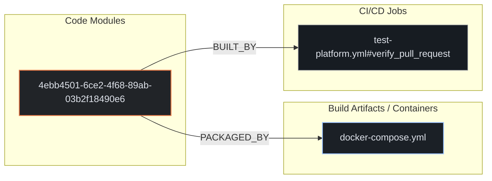
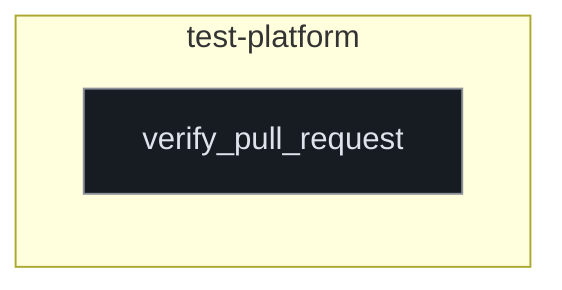

# Repository Architecture Analysis: saleor/saleor-platform

## Metadata
- **SHA**: `ab6315bd59c58b4815175df4c679107ff9695be4`
- **Primary Ecosystem**: Container / Helm / IaC

## Quality Metrics
- **ast_engine**: fallback
- **avg_cognitive_complexity**: 0.0
- **avg_cyclomatic_complexity**: 0.0
- **component_count**: 2
- **dead_code_count**: 0
- **dead_code_symbols**: 0 entry(ies)
- **duplication_pct**: 0.0
- **file_complexities**: 0 entry(ies)
- **files_analyzed**: 2
- **fitness_passed**: True
- **fitness_violation_count**: 0
- **framework**: Docker Compose
- **import_edges**: 0 entry(ies)
- **loc**: 115
- **max_cognitive_complexity**: 0
- **max_cyclomatic_complexity**: 0
- **sloc**: 103

# Architecture: saleor/saleor-platform

## Context
- **Repository**: `saleor/saleor-platform`
- **SHA**: `ab6315bd59c58b4815175df4c679107ff9695be4`
- **Ecosystem**: Container / Helm / IaC
- **Framework**: Docker Compose

## Building Block View

## Component Details
- **docker-compose** (`docker-compose.yml`): module
- **test-platform** (`.github/workflows/test-platform.yml`): module

## 6-Dimension Repository Scorecard

- **Overall Grade**: `A` (91.15/100)
- **Technical Debt Score**: 8.85
- **Estimated Remediation Effort**: 4.21h

| Dimension | Grade | Score | Weight | Details |
| :--- | :---: | :---: | :---: | :--- |
| Code Quality | `A` | 100.00 | 0.20 | avg_cc=0.00, max_cc=0, duplication=0.00%, dead_code=0 |
| Dependency Health | `A` | 90.00 | 0.15 | dependencies=0 (no manifests parsed) |
| Maintainability | `A` | 100.00 | 0.15 | avg_cognitive=0.00, max_cognitive=0, fitness_violations=0, oversized_files=0 |
| Pipeline Health | `A` | 97.00 | 0.15 | workflows=1, operational_antipatterns=1, parallel_branches=False |
| Security | `B` | 88.00 | 0.20 | vulnerabilities=0, secrets=0, pipeline_security_findings=1 |
| Test Coverage | `C` | 70.00 | 0.15 | coverage=unavailable, ci_test_job=True, test_files_detected=True |

## Section 7: Code-to-Cloud Deployment Traceability

- `4ebb4501-6ce2-4f68-89ab-03b2f18490e6` (code_module) --[BUILT_BY]--> `test-platform.yml#verify_pull_request` (ci_job)
- `4ebb4501-6ce2-4f68-89ab-03b2f18490e6` (code_module) --[PACKAGED_BY]--> `docker-compose.yml` (container)

## CI/CD Pipeline Topology

