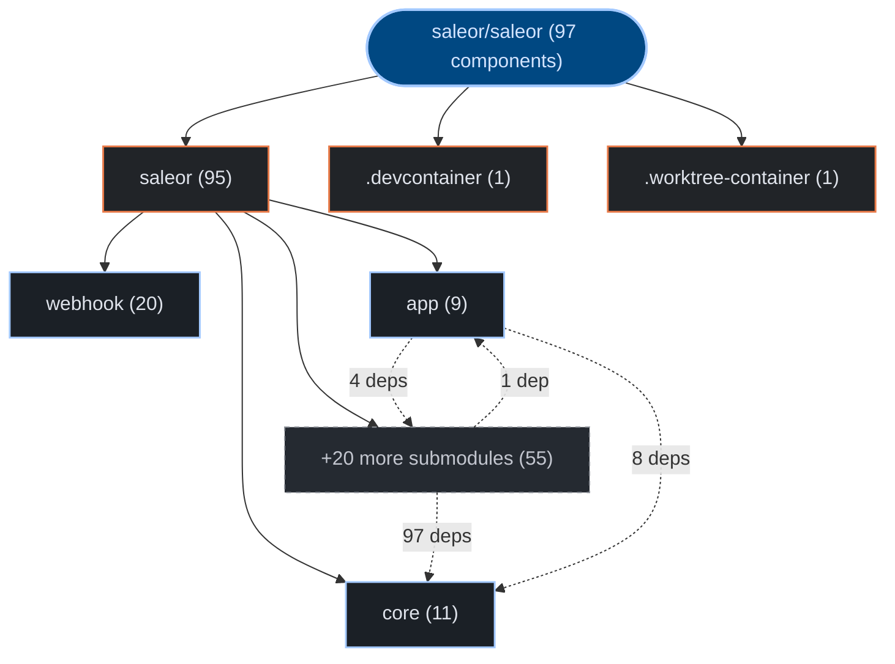

# Repository Architecture Analysis: saleor/saleor

## Metadata
- **SHA**: `5e1679b1e91f76ac9fd553a62adeffb6e9acf5c3`
- **Primary Ecosystem**: Python

## Quality Metrics
- **ast_engine**: tree-sitter
- **avg_cognitive_complexity**: 0.95
- **avg_cyclomatic_complexity**: 1.7
- **component_count**: 97
- **dead_code_count**: 85
- **dead_code_symbols**: 50 entry(ies)
- **duplication_pct**: 93.17
- **file_complexities**: 25 entry(ies)
- **files_analyzed**: 4387
- **fitness_passed**: False
- **fitness_violation_count**: 3
- **framework**: Django
- **import_edges**: 100 entry(ies)
- **loc**: 862854
- **max_cognitive_complexity**: 84
- **max_cyclomatic_complexity**: 37
- **sloc**: 706454
- **test_file_count**: 1872

# Architecture: saleor/saleor

## Context
- **Repository**: `saleor/saleor`
- **SHA**: `5e1679b1e91f76ac9fd553a62adeffb6e9acf5c3`
- **Ecosystem**: Python
- **Framework**: Django

## Building Block View

## Component Details

Showing top 60 representative components out of 97 across 3 module group(s):

- **Module `saleor`** (95 components — DATA_ACCESS_LAYER: 86, SERVICE: 9)
- **Module `.devcontainer`** (1 components — module: 1)
- **Module `.worktree-container`** (1 components — module: 1)

- **PluginsManager** (`saleor/plugins/manager.py`): SERVICE (deps: Checkout, EventDelivery, Group, PluginConfiguration, PromotionRule, Thumbnail (+2 more))
- **ProductVariantChannelListing** (`saleor/product/models.py`): DATA_ACCESS_LAYER (deps: ModelWithExternalReference, ModelWithMetadata, PromotionRule, PublishableModel, SeoModel, SortableModel (+1 more))
- **VariantChannelListingPromotionRule** (`saleor/product/models.py`): DATA_ACCESS_LAYER (deps: ModelWithExternalReference, ModelWithMetadata, PromotionRule, PublishableModel, SeoModel, SortableModel (+1 more))
- **VariantMedia** (`saleor/product/models.py`): DATA_ACCESS_LAYER (deps: ModelWithExternalReference, ModelWithMetadata, PromotionRule, PublishableModel, SeoModel, SortableModel (+1 more))
- **Allocation** (`saleor/warehouse/models.py`): DATA_ACCESS_LAYER (deps: ModelWithExternalReference, ModelWithMetadata, ProductVariantChannelListing, SortableModel)
- **AttributeValueManager** (`saleor/attribute/models/base.py`): SERVICE (deps: ModelWithExternalReference, ModelWithMetadata, SortableModel, Translation)
- **BaseAssignedAttribute** (`saleor/attribute/models/base.py`): DATA_ACCESS_LAYER (deps: ModelWithExternalReference, ModelWithMetadata, SortableModel, Translation)
- **CustomerEvent** (`saleor/account/models.py`): DATA_ACCESS_LAYER (deps: ModelWithExternalReference, ModelWithMetadata, Permission, PermissionsMixin)
- **CustomerNote** (`saleor/account/models.py`): DATA_ACCESS_LAYER (deps: ModelWithExternalReference, ModelWithMetadata, Permission, PermissionsMixin)
- **Group** (`saleor/account/models.py`): DATA_ACCESS_LAYER (deps: ModelWithExternalReference, ModelWithMetadata, Permission, PermissionsMixin)
- **GroupManager** (`saleor/account/models.py`): SERVICE (deps: ModelWithExternalReference, ModelWithMetadata, Permission, PermissionsMixin)
- **PreorderAllocation** (`saleor/warehouse/models.py`): DATA_ACCESS_LAYER (deps: ModelWithExternalReference, ModelWithMetadata, ProductVariantChannelListing, SortableModel)
- **PreorderReservation** (`saleor/warehouse/models.py`): DATA_ACCESS_LAYER (deps: ModelWithExternalReference, ModelWithMetadata, ProductVariantChannelListing, SortableModel)
- **Reservation** (`saleor/warehouse/models.py`): DATA_ACCESS_LAYER (deps: ModelWithExternalReference, ModelWithMetadata, ProductVariantChannelListing, SortableModel)
- **StaffNotificationRecipient** (`saleor/account/models.py`): DATA_ACCESS_LAYER (deps: ModelWithExternalReference, ModelWithMetadata, Permission, PermissionsMixin)
- **Stock** (`saleor/warehouse/models.py`): DATA_ACCESS_LAYER (deps: ModelWithExternalReference, ModelWithMetadata, ProductVariantChannelListing, SortableModel)
- **UserManager** (`saleor/account/models.py`): SERVICE (deps: ModelWithExternalReference, ModelWithMetadata, Permission, PermissionsMixin)
- **AppExtension** (`saleor/app/models.py`): DATA_ACCESS_LAYER (deps: Job, ModelWithMetadata, Permission)
- **AppProblem** (`saleor/app/models.py`): DATA_ACCESS_LAYER (deps: Job, ModelWithMetadata, Permission)
- **AppToken** (`saleor/app/models.py`): DATA_ACCESS_LAYER (deps: Job, ModelWithMetadata, Permission)
- **AppTokenManager** (`saleor/app/models.py`): SERVICE (deps: Job, ModelWithMetadata, Permission)
- **BaseDiscount** (`saleor/discount/models.py`): DATA_ACCESS_LAYER (deps: ModelWithExternalReference, ModelWithMetadata, Translation)
- **PromotionEvent** (`saleor/discount/models.py`): DATA_ACCESS_LAYER (deps: ModelWithExternalReference, ModelWithMetadata, Translation)
- **PromotionRule** (`saleor/discount/models.py`): DATA_ACCESS_LAYER (deps: ModelWithExternalReference, ModelWithMetadata, Translation)
- **PromotionRule_Variants** (`saleor/discount/models.py`): DATA_ACCESS_LAYER (deps: ModelWithExternalReference, ModelWithMetadata, Translation)
- **ShippingMethodChannelListing** (`saleor/shipping/models.py`): DATA_ACCESS_LAYER (deps: Checkout, ModelWithMetadata, Translation)
- **ShippingMethodPostalCodeRule** (`saleor/shipping/models.py`): DATA_ACCESS_LAYER (deps: Checkout, ModelWithMetadata, Translation)
- **VoucherChannelListing** (`saleor/discount/models.py`): DATA_ACCESS_LAYER (deps: ModelWithExternalReference, ModelWithMetadata, Translation)
- **VoucherCode** (`saleor/discount/models.py`): DATA_ACCESS_LAYER (deps: ModelWithExternalReference, ModelWithMetadata, Translation)
- **VoucherCustomer** (`saleor/discount/models.py`): DATA_ACCESS_LAYER (deps: ModelWithExternalReference, ModelWithMetadata, Translation)
- **FulfillmentLine** (`saleor/order/models.py`): DATA_ACCESS_LAYER (deps: ModelWithExternalReference, ModelWithMetadata)
- **GiftCardPaymentGatewayDataSchema** (`saleor/giftcard/gateway.py`): DATA_ACCESS_LAYER (deps: Checkout, TransactionEvent)
- **InvoiceEvent** (`saleor/invoice/models.py`): DATA_ACCESS_LAYER (deps: Job, ModelWithMetadata)
- **OrderEvent** (`saleor/order/models.py`): DATA_ACCESS_LAYER (deps: ModelWithExternalReference, ModelWithMetadata)
- **OrderGrantedRefund** (`saleor/order/models.py`): DATA_ACCESS_LAYER (deps: ModelWithExternalReference, ModelWithMetadata)
- **OrderGrantedRefundLine** (`saleor/order/models.py`): DATA_ACCESS_LAYER (deps: ModelWithExternalReference, ModelWithMetadata)
- **Transaction** (`saleor/payment/models.py`): DATA_ACCESS_LAYER (deps: Checkout, ModelWithMetadata)
- **TransactionEvent** (`saleor/payment/models.py`): DATA_ACCESS_LAYER (deps: Checkout, ModelWithMetadata)
- **AppProblemCreateValidatedInput** (`saleor/graphql/app/mutations/app_problem_create.py`): DATA_ACCESS_LAYER (deps: AppProblem)
- **Checkout** (`saleor/checkout/models.py`): DATA_ACCESS_LAYER (deps: ModelWithMetadata)
- **CheckoutDelivery** (`saleor/checkout/models.py`): DATA_ACCESS_LAYER (deps: ModelWithMetadata)
- **ExportEvent** (`saleor/csv/models.py`): DATA_ACCESS_LAYER (deps: Job)
- **GiftCardEvent** (`saleor/giftcard/models.py`): DATA_ACCESS_LAYER (deps: ModelWithMetadata)
- **GiftCardTag** (`saleor/giftcard/models.py`): DATA_ACCESS_LAYER (deps: ModelWithMetadata)
- **SeoModel** (`saleor/seo/models.py`): DATA_ACCESS_LAYER (deps: Translation)
- **TaxClassCountryRate** (`saleor/tax/models.py`): DATA_ACCESS_LAYER (deps: ModelWithMetadata)
- **TaxConfigurationPerCountry** (`saleor/tax/models.py`): DATA_ACCESS_LAYER (deps: ModelWithMetadata)
- **Book** (`saleor/tests/models.py`): DATA_ACCESS_LAYER
- **CalculateTaxesSchema** (`saleor/webhook/response_schemas/taxes.py`): DATA_ACCESS_LAYER
- **CreditCardInfoSchema** (`saleor/webhook/response_schemas/payment.py`): DATA_ACCESS_LAYER
- **CustomSchedule** (`saleor/schedulers/models.py`): DATA_ACCESS_LAYER
- **EmailTemplate** (`saleor/plugins/models.py`): DATA_ACCESS_LAYER
- **EventDelivery** (`saleor/core/models.py`): DATA_ACCESS_LAYER
- **EventDeliveryAttempt** (`saleor/core/models.py`): DATA_ACCESS_LAYER
- **EventPayload** (`saleor/core/models.py`): DATA_ACCESS_LAYER
- **EventPayloadManager** (`saleor/core/models.py`): SERVICE
- **ExampleSchema** (`saleor/webhook/tests/response_schemas/test_helpers.py`): DATA_ACCESS_LAYER
- **ExcludedShippingMethodSchema** (`saleor/webhook/response_schemas/shipping.py`): DATA_ACCESS_LAYER
- **FilterShippingMethodsSchema** (`saleor/webhook/response_schemas/shipping.py`): DATA_ACCESS_LAYER
- **GiftCardPaymentMethodDetailsValidatedInput** (`saleor/graphql/payment/mutations/transaction/shared.py`): DATA_ACCESS_LAYER

## 6-Dimension Repository Scorecard

- **Overall Grade**: `F` (45.45/100)
- **Technical Debt Score**: 54.55
- **Estimated Remediation Effort**: 151.02h

| Dimension | Grade | Score | Weight | Details |
| :--- | :---: | :---: | :---: | :--- |
| Code Quality | `F` | 30.00 | 0.20 | avg_cc=1.70, max_cc=37, duplication=93.17%, dead_code=85 |
| Dependency Health | `A` | 100.00 | 0.15 | dependencies=564, outdated=0, vulnerable=0, has_lockfile=True |
| Maintainability | `F` | 37.00 | 0.15 | avg_cognitive=0.95, max_cognitive=84, fitness_violations=3, oversized_files=21 |
| Pipeline Health | `F` | 0.00 | 0.15 | workflows=22, operational_antipatterns=61, parallel_branches=True |
| Security | `F` | 42.00 | 0.20 | vulnerabilities=0, secrets=1, pipeline_security_findings=2 |
| Test Coverage | `C` | 70.00 | 0.15 | coverage=unavailable, ci_test_job=True, test_files_detected=True |

## Architecture Fitness & Workspace Boundaries

- **[MEDIUM] `ATRUSS-ARCH-005` (COMPLEXITY_THRESHOLD)**: Repository duplication_pct (93.17) exceeds policy threshold (15.0).
- **[MEDIUM] `ATRUSS-ARCH-005` (COMPLEXITY_THRESHOLD)**: Repository max_cognitive_complexity (84.0) exceeds policy threshold (25.0).
- **[MEDIUM] `ATRUSS-ARCH-005` (COMPLEXITY_THRESHOLD)**: Repository max_cyclomatic_complexity (37.0) exceeds policy threshold (20.0).

## Supply Chain Dependencies, Vulnerabilities & Secrets

- **Dependencies Parsed**: 564 | **Vulnerabilities**: 0 | **Secrets**: 1

### Secret Findings (Redacted)
- **[HIGH] `ATRUSS-SEC-005`** at `saleor/app/tests/cassettes/test_app_commands/test_creates_app_from_manifest_app_has_all_required_permissions.yaml:105` (`body: '{"auth_token": "woTs***REDACTED***"}'`)

### Inventory Sample
- `Rx` `1.6.3` (PyPI, `pyproject.toml`)
- `asgiref` `3.11.1` (PyPI, `pyproject.toml`)
- `asgiref` `3.11.1` (PyPI, `uv.lock`)
- `authlib` `1.9.2` (PyPI, `pyproject.toml`)
- `authlib` `1.9.2` (PyPI, `uv.lock`)
- `azure-common` `1.1.28` (PyPI, `pyproject.toml`)
- `azure-common` `1.1.28` (PyPI, `uv.lock`)
- `azure-storage-blob` `12.29.0` (PyPI, `pyproject.toml`)
- `azure-storage-blob` `12.29.0` (PyPI, `uv.lock`)
- `azure-storage-common` `2.1.0` (PyPI, `pyproject.toml`)
- `azure-storage-common` `2.1.0` (PyPI, `uv.lock`)
- `babel` `2.18.0` (PyPI, `pyproject.toml`)
- `babel` `2.18.0` (PyPI, `uv.lock`)
- `boto3` `1.43` (PyPI, `pyproject.toml`)
- `boto3` `1.43.14` (PyPI, `uv.lock`)
- `botocore` `1.43` (PyPI, `pyproject.toml`)
- `botocore` `1.43.52` (PyPI, `uv.lock`)
- `celery` `5.6.3` (PyPI, `pyproject.toml`)
- `celery` `5.6.3` (PyPI, `uv.lock`)
- `coverage` `7.14` (PyPI, `pyproject.toml`)
- `coverage` `7.14.0` (PyPI, `uv.lock`)
- `cryptography` `50.0.2` (PyPI, `pyproject.toml`)
- `cryptography` `50.0.2` (PyPI, `uv.lock`)
- `deptry` `0.23.0` (PyPI, `pyproject.toml`)
- `deptry` `0.23.1` (PyPI, `uv.lock`)
- `dj-database-url` `3.1.2` (PyPI, `pyproject.toml`)
- `dj-database-url` `3.1.2` (PyPI, `uv.lock`)
- `dj-email-url` `1` (PyPI, `pyproject.toml`)
- `dj-email-url` `1.0.6` (PyPI, `uv.lock`)
- `django` `5.2.19` (PyPI, `pyproject.toml`)
- ... (+534 more dependencies)

## Section 7: Code-to-Cloud Deployment Traceability

```mermaid
flowchart LR
    classDef atlasCategory fill:#212428,stroke:#E87A48,stroke-width:1.5px,color:#dfe3eb
    classDef atlasWorkflow fill:#1b2026,stroke:#a3c9ff,stroke-width:1.5px,color:#dfe3eb
    classDef atlasJob fill:#171c22,stroke:#8d9199,stroke-width:1px,color:#dfe3eb
    classDef atlasTarget fill:#005227,stroke:#8bd99b,stroke-width:1.5px,color:#a7f6b6
    subgraph code_modules["Code Modules"]
        mod__devcontainer[".devcontainer"]:::atlasCategory
        mod__worktree_container[".worktree-container"]:::atlasCategory
        mod_b0ff3d9a_881c_4fd6_8d65_1e5d7de6eaa0["b0ff3d9a-881c-4fd6-8d65-1e5d7de6eaa0"]:::atlasCategory
    end
    subgraph build_artifacts["Build Artifacts / Containers"]
        art__devcontainer_Dockerfile[".devcontainer/Dockerfile"]:::atlasWorkflow
        art__devcontainer_docker_compose_yml[".devcontainer/docker-compose.yml"]:::atlasWorkflow
        art__worktree_container_docker_compose_yml[".worktree-container/docker-compose.yml"]:::atlasWorkflow
        art_Dockerfile["Dockerfile"]:::atlasWorkflow
    end
    subgraph ci_jobs["CI/CD Jobs"]
        job_create_tag_with_release_pr_yml_deploy["create-tag-with-release-pr.yml#deploy"]:::atlasJob
        job_dispatch_release_pr_manually_yml_deploy["dispatch-release-pr-manually.yml#deploy"]:::atlasJob
        job_github_releases_to_discord_yml_github_releases_to_discord["github-releases-to-discord.yml#github-releases-to-discord"]:::atlasJob
        job_help_wanted_issues_to_discord_yml_notify["help-wanted-issues-to-discord.yml#notify"]:::atlasJob
        job_migrations_perf_test_yml_cleanup["migrations-perf-test.yml#cleanup"]:::atlasJob
        job_migrations_perf_test_yml_run["migrations-perf-test.yml#run"]:::atlasJob
        job_publish_load_test_yml_deploy["publish-load-test.yml#deploy"]:::atlasJob
        job_test_env_cleanup_cron_yml_cleanup["test-env-cleanup-cron.yml#cleanup"]:::atlasJob
        job_test_env_cleanup_yml_cleanup_aws["test-env-cleanup.yml#cleanup-aws"]:::atlasJob
        job_test_env_deploy_yml_build_deploy["test-env-deploy.yml#build-deploy"]:::atlasJob
        job_tests_yaml_upload_query_count_base_branch["tests.yaml#upload-query-count-base-branch"]:::atlasJob
    end
    subgraph runtime_envs["Runtime Environments"]
        env_discord_notifier["discord-notifier"]:::atlasTarget
        env_load_test_deploy["load-test-deploy"]:::atlasTarget
        env_migrations_perf_test["migrations-perf-test"]:::atlasTarget
        env_pytest_upload_django_db_queries["pytest-upload-django-db-queries"]:::atlasTarget
        env_release_deploy["release-deploy"]:::atlasTarget
        env_release_deploy_workflow_dispatch["release-deploy-workflow-dispatch"]:::atlasTarget
        env_testenvs_cleanup["testenvs-cleanup"]:::atlasTarget
        env_testenvs_deploy["testenvs-deploy"]:::atlasTarget
    end
    job_create_tag_with_release_pr_yml_deploy -->|DEPLOYS_TO| env_release_deploy
    job_dispatch_release_pr_manually_yml_deploy -->|DEPLOYS_TO| env_release_deploy_workflow_dispatch
    job_github_releases_to_discord_yml_github_releases_to_discord -->|DEPLOYS_TO| env_discord_notifier
    job_help_wanted_issues_to_discord_yml_notify -->|DEPLOYS_TO| env_discord_notifier
    job_migrations_perf_test_yml_cleanup -->|DEPLOYS_TO| env_migrations_perf_test
    job_migrations_perf_test_yml_run -->|DEPLOYS_TO| env_migrations_perf_test
    job_publish_load_test_yml_deploy -->|DEPLOYS_TO| env_load_test_deploy
    job_test_env_cleanup_cron_yml_cleanup -->|DEPLOYS_TO| env_testenvs_cleanup
    job_test_env_cleanup_yml_cleanup_aws -->|DEPLOYS_TO| env_testenvs_cleanup
    job_test_env_deploy_yml_build_deploy -->|DEPLOYS_TO| env_testenvs_deploy
    job_tests_yaml_upload_query_count_base_branch -->|DEPLOYS_TO| env_pytest_upload_django_db_queries
    mod__devcontainer -->|PACKAGED_BY| art__devcontainer_Dockerfile
    mod__devcontainer -->|PACKAGED_BY| art__devcontainer_docker_compose_yml
    mod__devcontainer -->|PACKAGED_BY| art__worktree_container_docker_compose_yml
    mod__worktree_container -->|PACKAGED_BY| art__worktree_container_docker_compose_yml
    mod_b0ff3d9a_881c_4fd6_8d65_1e5d7de6eaa0 -->|PACKAGED_BY| art_Dockerfile
```

- `create-tag-with-release-pr.yml#deploy` (ci_job) --[DEPLOYS_TO]--> `release-deploy` (environment)
- `dispatch-release-pr-manually.yml#deploy` (ci_job) --[DEPLOYS_TO]--> `release-deploy-workflow-dispatch` (environment)
- `github-releases-to-discord.yml#github-releases-to-discord` (ci_job) --[DEPLOYS_TO]--> `discord-notifier` (environment)
- `help-wanted-issues-to-discord.yml#notify` (ci_job) --[DEPLOYS_TO]--> `discord-notifier` (environment)
- `migrations-perf-test.yml#cleanup` (ci_job) --[DEPLOYS_TO]--> `migrations-perf-test` (environment)
- `migrations-perf-test.yml#run` (ci_job) --[DEPLOYS_TO]--> `migrations-perf-test` (environment)
- `publish-load-test.yml#deploy` (ci_job) --[DEPLOYS_TO]--> `load-test-deploy` (environment)
- `test-env-cleanup-cron.yml#cleanup` (ci_job) --[DEPLOYS_TO]--> `testenvs-cleanup` (environment)
- `test-env-cleanup.yml#cleanup-aws` (ci_job) --[DEPLOYS_TO]--> `testenvs-cleanup` (environment)
- `test-env-deploy.yml#build-deploy` (ci_job) --[DEPLOYS_TO]--> `testenvs-deploy` (environment)
- `tests.yaml#upload-query-count-base-branch` (ci_job) --[DEPLOYS_TO]--> `pytest-upload-django-db-queries` (environment)
- `.devcontainer` (code_module) --[PACKAGED_BY]--> `.devcontainer/Dockerfile` (container)
- `.devcontainer` (code_module) --[PACKAGED_BY]--> `.devcontainer/docker-compose.yml` (container)
- `.devcontainer` (code_module) --[PACKAGED_BY]--> `.worktree-container/docker-compose.yml` (container)
- `.worktree-container` (code_module) --[PACKAGED_BY]--> `.worktree-container/docker-compose.yml` (container)
- `b0ff3d9a-881c-4fd6-8d65-1e5d7de6eaa0` (code_module) --[PACKAGED_BY]--> `Dockerfile` (container)

## CI/CD Pipeline Topology

```mermaid
graph TD;
  classDef atlasRoot fill:#004882,stroke:#a3c9ff,stroke-width:2px,color:#d3e4ff
  classDef atlasCategory fill:#212428,stroke:#E87A48,stroke-width:1.5px,color:#dfe3eb
  classDef atlasWorkflow fill:#1b2026,stroke:#a3c9ff,stroke-width:1.5px,color:#dfe3eb
  classDef atlasJob fill:#171c22,stroke:#8d9199,stroke-width:1px,color:#dfe3eb
  classDef atlasTarget fill:#005227,stroke:#8bd99b,stroke-width:1.5px,color:#a7f6b6
  classDef atlasAlert fill:#93000a,stroke:#ffb4ab,stroke-width:1.5px,color:#ffdad6
  classDef atlasMore fill:#252a31,stroke:#8d9199,stroke-dasharray:4 4,color:#c3c6cf
  pipeline_root(["saleor/saleor (22 workflows)"]):::atlasRoot
  subgraph sg_grp_0_CI___Verification["CI & Verification (11 workflows · 14 jobs)"]
    direction TB
    subgraph sg_wf_12_Migrations_performance_test["Migrations performance test (2 jobs)"]
      direction TB
      wf_12_Migrations_performance_test(["Trigger: Migrations performance test"]):::atlasWorkflow
      job_12_run["run"]:::atlasJob
      job_12_cleanup["cleanup"]:::atlasJob
      wf_12_Migrations_performance_test --> job_12_run
      wf_12_Migrations_performance_test --> job_12_cleanup
    end
    pipeline_root --> wf_12_Migrations_performance_test
    subgraph sg_wf_17_TEST_ENV_CLEANUP["TEST-ENV-CLEANUP (2 jobs)"]
      direction TB
      wf_17_TEST_ENV_CLEANUP(["Trigger: TEST-ENV-CLEANUP"]):::atlasWorkflow
      job_17_cleanup_aws["cleanup-aws"]:::atlasJob
      job_17_cleanup_github["cleanup-github"]:::atlasJob
      wf_17_TEST_ENV_CLEANUP --> job_17_cleanup_aws
      job_17_cleanup_aws --> job_17_cleanup_github
    end
    pipeline_root --> wf_17_TEST_ENV_CLEANUP
    subgraph sg_wf_21_Tests["Tests (2 jobs)"]
      direction TB
      wf_21_Tests(["Trigger: Tests"]):::atlasWorkflow
      job_21_unit_tests["unit_tests"]:::atlasJob
      job_21_upload_query_count_base_branch["upload-query-count-base-branch"]:::atlasJob
      wf_21_Tests --> job_21_unit_tests
      job_21_unit_tests --> job_21_upload_query_count_base_branch
    end
    pipeline_root --> wf_21_Tests
  end
  subgraph sg_grp_1_Release___Deploy["Release & Deploy (7 workflows · 16 jobs)"]
    direction TB
    subgraph sg_wf_4_Create_release_tag_on_release_PR_merge["Create release tag on release PR merge (3 jobs)"]
      direction TB
      wf_4_Create_release_tag_on_release_PR_merge(["Trigger: Create release tag on release PR merge"]):::atlasWorkflow
      job_4_create_release_tag["create-release-tag"]:::atlasJob
      job_4_publish["publish"]:::atlasJob
      job_4_deploy["deploy"]:::atlasJob
      wf_4_Create_release_tag_on_release_PR_merge --> job_4_create_release_tag
      job_4_create_release_tag --> job_4_publish
      job_4_publish --> job_4_deploy
    end
    pipeline_root --> wf_4_Create_release_tag_on_release_PR_merge
    subgraph sg_wf_13_Publish["Publish (3 jobs)"]
      direction TB
      wf_13_Publish(["Trigger: Publish"]):::atlasWorkflow
      job_13_prepare_variables["prepare-variables"]:::atlasJob
      job_13_build_push["build-push"]:::atlasJob
      job_13_notify["notify"]:::atlasJob
      wf_13_Publish --> job_13_prepare_variables
      job_13_prepare_variables --> job_13_build_push
      job_13_prepare_variables --> job_13_notify
      job_13_build_push --> job_13_notify
    end
    pipeline_root --> wf_13_Publish
    subgraph sg_wf_14_Publish_for_load_test["Publish for load test (3 jobs)"]
      direction TB
      wf_14_Publish_for_load_test(["Trigger: Publish for load test"]):::atlasWorkflow
      job_14_init["init"]:::atlasJob
      job_14_publish["publish"]:::atlasJob
      job_14_deploy["deploy"]:::atlasJob
      wf_14_Publish_for_load_test --> job_14_init
      job_14_init --> job_14_publish
      job_14_publish --> job_14_deploy
    end
    pipeline_root --> wf_14_Publish_for_load_test
  end
  subgraph sg_grp_2_Scheduled___Manual["Scheduled & Manual (3 workflows · 3 jobs)"]
    direction TB
    subgraph sg_wf_0_Bump_dependencies["Bump dependencies (1 jobs)"]
      direction TB
      wf_0_Bump_dependencies(["Trigger: Bump dependencies"]):::atlasWorkflow
      job_0_bump_dependencies["bump-dependencies"]:::atlasJob
      wf_0_Bump_dependencies --> job_0_bump_dependencies
    end
    pipeline_root --> wf_0_Bump_dependencies
    wf_6_e2e_suite["e2e suite (1 jobs)"]:::atlasWorkflow
    pipeline_root --> wf_6_e2e_suite
    wf_16_TEST_ENV_CLEANUP_CRON["TEST-ENV-CLEANUP-CRON (1 jobs)"]:::atlasWorkflow
    pipeline_root --> wf_16_TEST_ENV_CLEANUP_CRON
  end
  subgraph sg_grp_3_Automation___Other["Automation & Other (1 workflows · 1 jobs)"]
    direction TB
    wf_9_Notify_Discord_on_Help_Wanted_Issue["Notify Discord on Help Wanted Issue (1 jobs)"]:::atlasWorkflow
    pipeline_root --> wf_9_Notify_Discord_on_Help_Wanted_Issue
  end
  wf_more["+12 more workflows"]:::atlasMore
  pipeline_root --> wf_more
```

