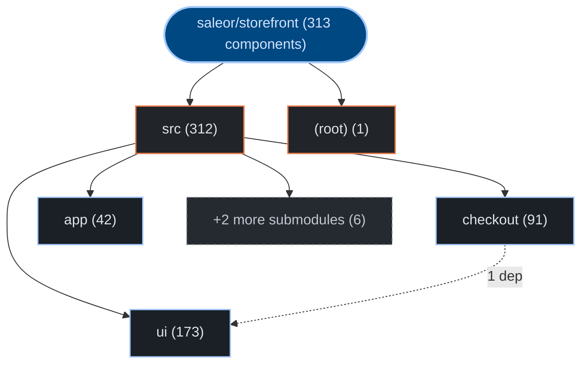
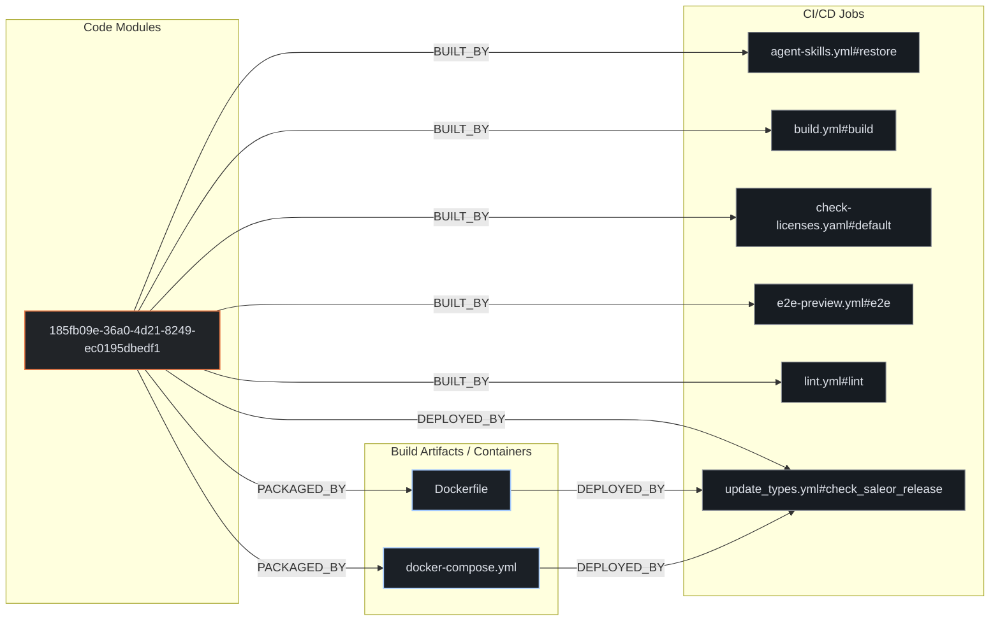
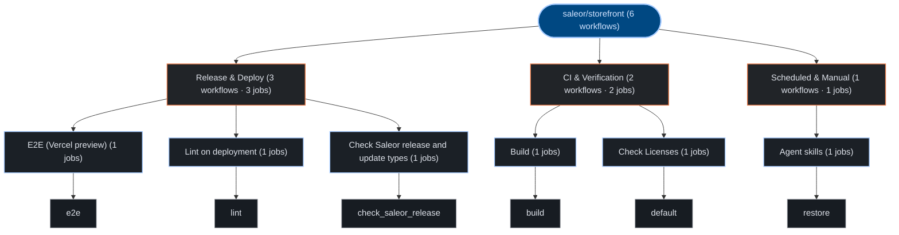

# Repository Architecture Analysis: saleor/storefront

## Metadata
- **SHA**: `f854bf2781fbabd782f37306fe28c791ec4fd708`
- **Primary Ecosystem**: JavaScript/TypeScript

## Quality Metrics
- **ast_engine**: tree-sitter
- **avg_cognitive_complexity**: 3.58
- **avg_cyclomatic_complexity**: 3.94
- **component_count**: 313
- **dead_code_count**: 27
- **dead_code_symbols**: 27 entry(ies)
- **duplication_pct**: 80.07
- **file_complexities**: 25 entry(ies)
- **files_analyzed**: 832
- **fitness_passed**: False
- **fitness_violation_count**: 3
- **framework**: Next.js
- **import_edges**: 100 entry(ies)
- **loc**: 68394
- **max_cognitive_complexity**: 186
- **max_cyclomatic_complexity**: 99
- **sloc**: 55254
- **test_file_count**: 135

# Architecture: saleor/storefront

## Context
- **Repository**: `saleor/storefront`
- **SHA**: `f854bf2781fbabd782f37306fe28c791ec4fd708`
- **Ecosystem**: JavaScript/TypeScript
- **Framework**: Next.js

## Building Block View

## Component Details

Showing top 60 representative components out of 313 across 2 module group(s):

- **Module `src`** (312 components — UI_COMPONENT: 302, API_ROUTE: 10)
- **Module `(root)`** (1 components — MODULE: 1)

- **GALLERY_REGISTRY** (`src/ui/components/pdp/gallery-registry.tsx`): UI_COMPONENT (deps: ColumnsGalleryFallback, ColumnsGallerySkeleton, ImmersiveGalleryFallback, ImmersiveGallerySkeleton, MosaicGalleryFallback, MosaicGallerySkeleton (+2 more))
- **GalleryImageThumbTrigger** (`src/ui/components/shared/gallery-image-zoom-trigger.tsx`): UI_COMPONENT (deps: GalleryImageFrame, PDP_GALLERY_EMPTY_IMAGE_FRAME_CLASS, PDP_GALLERY_IMAGE_CLIP_CLASS, PDP_GALLERY_IMAGE_FOCUS_CLASS, PDP_GALLERY_IMAGE_FOCUS_OVERLAY_CLASS, PDP_GALLERY_IMAGE_FRAME_CLASS (+1 more))
- **GalleryImageZoomTrigger** (`src/ui/components/shared/gallery-image-zoom-trigger.tsx`): UI_COMPONENT (deps: GalleryImageFrame, PDP_GALLERY_EMPTY_IMAGE_FRAME_CLASS, PDP_GALLERY_IMAGE_CLIP_CLASS, PDP_GALLERY_IMAGE_FOCUS_CLASS, PDP_GALLERY_IMAGE_FOCUS_OVERLAY_CLASS, PDP_GALLERY_IMAGE_FRAME_CLASS (+1 more))
- **SaleorCheckout** (`src/checkout/views/saleor-checkout/saleor-checkout.tsx`): UI_COMPONENT (deps: CheckoutPageShell, CheckoutSkeleton, InformationStep, OrderSummary, PaymentCompletingScreen, PaymentStep (+1 more))
- **HybridAddressSelector** (`src/checkout/components/shipping-address/hybrid-address-selector.tsx`): UI_COMPONENT (deps: AccountAddressCard, AddressCard, AddressPickerSheet, AddressSelector)
- **PlpListingClient** (`src/ui/components/plp/plp-listing-client.tsx`): UI_COMPONENT (deps: FilterBar, PlpEmptyFilterResults, ProductGrid, ProductsGridSkeleton)
- **ShippingAddressSection** (`src/checkout/views/saleor-checkout/sections/shipping-address-section.tsx`): UI_COMPONENT (deps: AddressFields, FieldError, FormInput, FormSelect)
- **VariantSelectionSection** (`src/ui/components/pdp/variant-selection/variant-selection-section.tsx`): UI_COMPONENT (deps: OptionalAttributes, VariantAttributeBadges, VariantNameSelector, VariantSelector)
- **IntegratedPaymentUi** (`src/checkout/components/payment/integrated-payment-ui.tsx`): UI_COMPONENT (deps: BillingAddressSection, DummyPaymentPlaceholder, StripePayment)
- **ProductRouteSkeleton** (`src/ui/components/pdp/product-route-skeleton.tsx`): UI_COMPONENT (deps: GallerySkeleton, VariantSectionFallback, VariantSectionSkeleton)
- **CheckoutLoadingFallback** (`src/checkout/views/saleor-checkout/checkout-loading-fallback.tsx`): UI_COMPONENT (deps: CheckoutSkeleton, PaymentCompletingScreen)
- **CheckoutRouteFallback** (`src/checkout/views/saleor-checkout/checkout-route-fallback.tsx`): UI_COMPONENT (deps: CheckoutSkeleton, PaymentCompletingScreen)
- **LoginForm** (`src/ui/components/login-form.tsx`): UI_COMPONENT (deps: LoginMode, SetPasswordMode)
- **MegaMenuDesktop** (`src/ui/components/nav/components/mega-menu-desktop.tsx`): UI_COMPONENT (deps: MegaMenuColumnHeader, MegaMenuLeafLink)
- **OrderConfirmation** (`src/checkout/views/order-confirmation/order-confirmation.tsx`): UI_COMPONENT (deps: OrderConfirmationPageShell, OrderEmailGate)
- **OrderConfirmationRouteFallback** (`src/checkout/views/order-confirmation/order-confirmation-route-fallback.tsx`): UI_COMPONENT (deps: OrderConfirmationBodySkeleton, OrderConfirmationHeaderSkeleton)
- **OrderConfirmationSkeleton** (`src/checkout/views/order-confirmation/order-confirmation-skeleton.tsx`): UI_COMPONENT (deps: OrderConfirmationBodySkeleton, OrderConfirmationPageShell)
- **Page** (`src/app/(storefront)/[locale]/[channel]/(main)/cart/page.tsx`): UI_COMPONENT (deps: CheckoutLink, DeleteLineButton)
- **PaymentMethodArea** (`src/checkout/components/payment/payment-method-area.tsx`): UI_COMPONENT (deps: BillingAddressSection, IntegratedPaymentUi)
- **PaymentStep** (`src/checkout/views/saleor-checkout/payment-step.tsx`): UI_COMPONENT (deps: CheckoutSummaryContext, MobileStickyAction)
- **ProductCardWithQuickAdd** (`src/ui/components/plp/product-card-with-quick-add.tsx`): UI_COMPONENT (deps: ProductCardBase, QuickAddOverlay)
- **ShippingStep** (`src/checkout/views/saleor-checkout/shipping-step.tsx`): UI_COMPONENT (deps: CheckoutSummaryContext, MobileStickyAction)
- **StripePayment** (`src/checkout/components/payment/stripe/stripe-payment.tsx`): UI_COMPONENT (deps: FreeOrderCheckout, StripePaymentForm)
- **StripePaymentForm** (`src/checkout/components/payment/stripe/stripe-payment-form.tsx`): UI_COMPONENT (deps: StripeExpressCheckout, StripePaymentProcessingOverlay)
- **UserMenu** (`src/ui/components/nav/components/user-menu/user-menu.tsx`): UI_COMPONENT (deps: UserAvatar, UserInfo)
- **AnnouncementBar** (`src/ui/sections/announcement-bar/announcement-bar.tsx`): UI_COMPONENT (deps: AnnouncementDismissButton)
- **AnnouncementBarSkeleton** (`src/ui/sections/announcement-bar/announcement-bar.tsx`): UI_COMPONENT (deps: AnnouncementDismissButton)
- **CartButton** (`src/ui/components/cart/cart-button.tsx`): UI_COMPONENT (deps: CartProvider)
- **CartDrawer** (`src/ui/components/cart/cart-drawer.tsx`): UI_COMPONENT (deps: CartProvider)
- **CategoryHero** (`src/ui/components/plp/category-hero.tsx`): UI_COMPONENT (deps: WavePattern)
- **CheckIcon** (`src/checkout/ui-kit/icons/check-icon.tsx`): UI_COMPONENT (deps: SvgContainer)
- **CheckoutApp** (`src/checkout/checkout-app.tsx`): UI_COMPONENT (deps: RootViews)
- **CheckoutPageShell** (`src/checkout/views/saleor-checkout/checkout-page-shell.tsx`): UI_COMPONENT (deps: CheckoutHeader)
- **CheckoutSkeleton** (`src/checkout/views/saleor-checkout/checkout-skeleton.tsx`): UI_COMPONENT (deps: CheckoutHeaderSkeleton)
- **ChevronDownIcon** (`src/checkout/ui-kit/icons/chevron-down-icon.tsx`): UI_COMPONENT (deps: SvgContainer)
- **ColumnsGallery** (`src/ui/components/pdp/columns-gallery.tsx`): UI_COMPONENT (deps: ProductGallery)
- **ColumnsGalleryFallback** (`src/ui/components/pdp/columns-gallery-fallback.tsx`): UI_COMPONENT (deps: ProductGalleryShell)
- **ColumnsGallerySkeleton** (`src/ui/components/pdp/columns-gallery-fallback.tsx`): UI_COMPONENT (deps: ProductGalleryShell)
- **EyeHiddenIcon** (`src/checkout/ui-kit/icons/eye-hidden-icon.tsx`): UI_COMPONENT (deps: SvgContainer)
- **EyeIcon** (`src/checkout/ui-kit/icons/eye-icon.tsx`): UI_COMPONENT (deps: SvgContainer)
- **FindOrderPage** (`src/app/(checkout)/order/find/page.tsx`): UI_COMPONENT (deps: FindOrderCopy)
- **FreeOrderCheckout** (`src/checkout/components/payment/stripe/free-order-checkout.tsx`): UI_COMPONENT (deps: StripePaymentForm)
- **GallerySkeleton** (`src/ui/components/pdp/variant-gallery-dynamic.tsx`): UI_COMPONENT (deps: GALLERY_REGISTRY)
- **ImmersiveGallery** (`src/ui/components/pdp/immersive-gallery.tsx`): UI_COMPONENT (deps: GalleryZoomLayer)
- **InformationStep** (`src/checkout/views/saleor-checkout/information-step.tsx`): UI_COMPONENT (deps: MobileStickyAction)
- **MainChrome** (`src/app/(storefront)/[locale]/[channel]/(main)/main-chrome.tsx`): UI_COMPONENT (deps: BrowseHeaderFrame)
- **MobileMenu** (`src/ui/components/nav/components/mobile-menu.tsx`): UI_COMPONENT (deps: Logo)
- **MosaicGallery** (`src/ui/components/pdp/mosaic-gallery.tsx`): UI_COMPONENT (deps: GalleryZoomLayer)
- **PaymentCompletingScreen** (`src/checkout/views/saleor-checkout/payment-completing-screen.tsx`): UI_COMPONENT (deps: CheckoutPageShell)
- **PhotoIcon** (`src/checkout/ui-kit/icons/photo-icon.tsx`): UI_COMPONENT (deps: SvgContainer)
- **PlpPageLoading** (`src/ui/components/plp/plp-page-loading.tsx`): UI_COMPONENT (deps: ProductsGridSkeleton)
- **ProductCard** (`src/ui/components/plp/product-card.tsx`): UI_COMPONENT (deps: ProductCardBase)
- **ProductCardBase** (`src/ui/components/plp/product-card-base.tsx`): UI_COMPONENT (deps: ProductCardLink)
- **ProductGallery** (`src/ui/components/pdp/product-gallery.tsx`): UI_COMPONENT (deps: GalleryZoomLayer)
- **ProductGalleryFallback** (`src/ui/components/pdp/product-gallery-fallback.tsx`): UI_COMPONENT (deps: ProductGalleryShell)
- **ProductGrid** (`src/ui/components/plp/product-grid.tsx`): UI_COMPONENT (deps: ProductCard)
- **ProductsGridSkeleton** (`src/ui/components/plp/products-grid-skeleton.tsx`): UI_COMPONENT (deps: ProductGrid)
- **RemoveIcon** (`src/checkout/ui-kit/icons/remove-icon.tsx`): UI_COMPONENT (deps: SvgContainer)
- **RootLayout** (`src/app/(storefront)/[locale]/[channel]/(main)/layout.tsx`): UI_COMPONENT (deps: MainChrome)
- **StripeCheckoutCompletionHost** (`src/checkout/components/payment/stripe/stripe-checkout-completion-host.tsx`): UI_COMPONENT (deps: StripeCheckoutReturnHandler)

## 6-Dimension Repository Scorecard

- **Overall Grade**: `F` (50.45/100)
- **Technical Debt Score**: 49.55
- **Estimated Remediation Effort**: 68.15h

| Dimension | Grade | Score | Weight | Details |
| :--- | :---: | :---: | :---: | :--- |
| Code Quality | `F` | 26.24 | 0.20 | avg_cc=3.94, max_cc=99, duplication=80.07%, dead_code=27 |
| Dependency Health | `A` | 100.00 | 0.15 | dependencies=1122, outdated=0, vulnerable=0, has_lockfile=True |
| Maintainability | `F` | 37.00 | 0.15 | avg_cognitive=3.58, max_cognitive=186, fitness_violations=3, oversized_files=10 |
| Pipeline Health | `D` | 65.00 | 0.15 | workflows=6, operational_antipatterns=6, parallel_branches=False |
| Security | `F` | 22.00 | 0.20 | vulnerabilities=0, secrets=3, pipeline_security_findings=2 |
| Test Coverage | `C` | 70.00 | 0.15 | coverage=unavailable, ci_test_job=True, test_files_detected=True |

## Architecture Fitness & Workspace Boundaries

- **[MEDIUM] `ATRUSS-ARCH-005` (COMPLEXITY_THRESHOLD)**: Repository duplication_pct (80.07) exceeds policy threshold (15.0).
- **[MEDIUM] `ATRUSS-ARCH-005` (COMPLEXITY_THRESHOLD)**: Repository max_cognitive_complexity (186.0) exceeds policy threshold (25.0).
- **[MEDIUM] `ATRUSS-ARCH-005` (COMPLEXITY_THRESHOLD)**: Repository max_cyclomatic_complexity (99.0) exceeds policy threshold (20.0).

## Supply Chain Dependencies, Vulnerabilities & Secrets

- **Dependencies Parsed**: 1122 | **Vulnerabilities**: 0 | **Secrets**: 3

### Secret Findings (Redacted)
- **[HIGH] `ATRUSS-SEC-005`** at `messages/ja.json:236` (`"invalidResetToken": "このパス***REDACTED***",`)
- **[HIGH] `ATRUSS-SEC-005`** at `messages/ja.json:238` (`"invalidConfirmToken": "この確認***REDACTED***",`)
- **[HIGH] `ATRUSS-SEC-005`** at `messages/ja.json:553` (`"stripeKeyMissing": "Stri***REDACTED***",`)

### Inventory Sample
- `@graphql-codegen/cli` `6.1.1` (npm, `package.json`)
- `@graphql-codegen/cli` `6.1.1` (npm, `pnpm-lock.yaml`)
- `@graphql-codegen/client-preset` `5.2.2` (npm, `package.json`)
- `@graphql-codegen/client-preset` `5.2.2` (npm, `pnpm-lock.yaml`)
- `@graphql-codegen/typescript` `5.0.7` (npm, `package.json`)
- `@graphql-codegen/typescript` `5.0.7` (npm, `pnpm-lock.yaml`)
- `@graphql-codegen/typescript-operations` `5.0.7` (npm, `package.json`)
- `@graphql-codegen/typescript-operations` `5.0.7` (npm, `pnpm-lock.yaml`)
- `@graphql-codegen/typescript-urql` `4.0.1` (npm, `package.json`)
- `@graphql-codegen/typescript-urql` `4.0.1` (npm, `pnpm-lock.yaml`)
- `@graphql-eslint/eslint-plugin` `4.4.0` (npm, `package.json`)
- `@graphql-eslint/eslint-plugin` `4.4.0` (npm, `pnpm-lock.yaml`)
- `@graphql-typed-document-node/core` `3.2.0` (npm, `package.json`)
- `@graphql-typed-document-node/core` `3.2.0` (npm, `pnpm-lock.yaml`)
- `@next/env` `16.4.5` (npm, `package.json`)
- `@next/env` `16.4.5` (npm, `pnpm-lock.yaml`)
- `@next/playwright` `16.4.5` (npm, `package.json`)
- `@next/playwright` `16.4.5` (npm, `pnpm-lock.yaml`)
- `@parcel/watcher` `2.5.6` (npm, `package.json`)
- `@parcel/watcher` `2.5.6` (npm, `pnpm-lock.yaml`)
- `@playwright/test` `1.55.0` (npm, `package.json`)
- `@playwright/test` `1.55.0` (npm, `pnpm-lock.yaml`)
- `@radix-ui/react-dialog` `1.1.17` (npm, `package.json`)
- `@radix-ui/react-dialog` `1.1.17` (npm, `pnpm-lock.yaml`)
- `@radix-ui/react-dropdown-menu` `2.1.18` (npm, `package.json`)
- `@radix-ui/react-dropdown-menu` `2.1.18` (npm, `pnpm-lock.yaml`)
- `@radix-ui/react-navigation-menu` `1.2.16` (npm, `package.json`)
- `@radix-ui/react-navigation-menu` `1.2.16` (npm, `pnpm-lock.yaml`)
- `@radix-ui/react-popover` `1.1.15` (npm, `package.json`)
- `@radix-ui/react-popover` `1.1.15` (npm, `pnpm-lock.yaml`)
- ... (+1092 more dependencies)

## Section 7: Code-to-Cloud Deployment Traceability

- `185fb09e-36a0-4d21-8249-ec0195dbedf1` (code_module) --[BUILT_BY]--> `agent-skills.yml#restore` (ci_job)
- `185fb09e-36a0-4d21-8249-ec0195dbedf1` (code_module) --[BUILT_BY]--> `build.yml#build` (ci_job)
- `185fb09e-36a0-4d21-8249-ec0195dbedf1` (code_module) --[BUILT_BY]--> `check-licenses.yaml#default` (ci_job)
- `185fb09e-36a0-4d21-8249-ec0195dbedf1` (code_module) --[BUILT_BY]--> `e2e-preview.yml#e2e` (ci_job)
- `185fb09e-36a0-4d21-8249-ec0195dbedf1` (code_module) --[BUILT_BY]--> `lint.yml#lint` (ci_job)
- `185fb09e-36a0-4d21-8249-ec0195dbedf1` (code_module) --[DEPLOYED_BY]--> `update_types.yml#check_saleor_release` (ci_job)
- `185fb09e-36a0-4d21-8249-ec0195dbedf1` (code_module) --[PACKAGED_BY]--> `Dockerfile` (container)
- `185fb09e-36a0-4d21-8249-ec0195dbedf1` (code_module) --[PACKAGED_BY]--> `docker-compose.yml` (container)
- `Dockerfile` (container) --[DEPLOYED_BY]--> `update_types.yml#check_saleor_release` (ci_job)
- `docker-compose.yml` (container) --[DEPLOYED_BY]--> `update_types.yml#check_saleor_release` (ci_job)

## CI/CD Pipeline Topology

