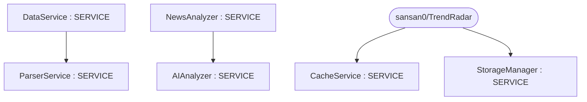
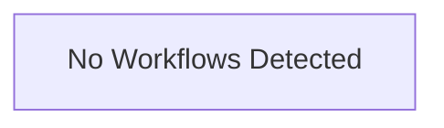

# Repository Architecture Analysis: sansan0/TrendRadar

## Metadata
- **SHA**: `8a316628215c53ad34b7200ecb0fba76de3ef6c7`
- **Primary Ecosystem**: Python

## Quality Metrics
- **avg_cyclomatic_complexity**: 6.08
- **component_count**: 6
- **files_analyzed**: 79
- **framework**: Django
- **loc**: 35308
- **max_cyclomatic_complexity**: 107
- **sloc**: 28000

# Architecture: sansan0/TrendRadar

## Context
- **Repository**: `sansan0/TrendRadar`
- **SHA**: `8a316628215c53ad34b7200ecb0fba76de3ef6c7`
- **Ecosystem**: Python
- **Framework**: Unknown

## Building Block View

## Component Details
- **CacheService** (`mcp_server/services/cache_service.py`): SERVICE
- **DataService** (`mcp_server/services/data_service.py`): SERVICE (deps: ParserService)
- **ParserService** (`mcp_server/services/parser_service.py`): SERVICE
- **NewsAnalyzer** (`trendradar/__main__.py`): SERVICE (deps: AIAnalyzer)
- **AIAnalyzer** (`trendradar/ai/analyzer.py`): SERVICE
- **StorageManager** (`trendradar/storage/manager.py`): SERVICE

## CI/CD Pipeline Topology

