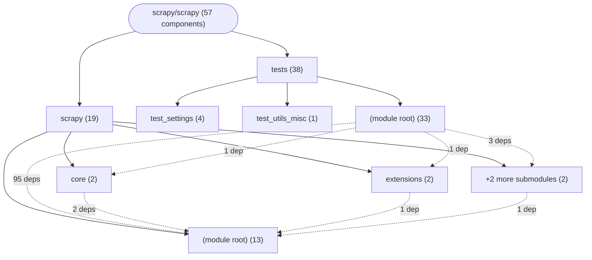

# Repository Architecture Analysis: scrapy/scrapy

## Metadata
- **SHA**: `f1e29c3822468f03f090d22714020f86b3d6e9a2`
- **Primary Ecosystem**: Python

## Quality Metrics
- **avg_cyclomatic_complexity**: 2.65
- **component_count**: 57
- **files_analyzed**: 546
- **framework**: Django
- **loc**: 113274
- **max_cyclomatic_complexity**: 36
- **sloc**: 91810

# Architecture: scrapy/scrapy

## Context
- **Repository**: `scrapy/scrapy`
- **SHA**: `f1e29c3822468f03f090d22714020f86b3d6e9a2`
- **Ecosystem**: Python
- **Framework**: Unknown

## Building Block View

## Component Details
- **AddonManager** (`scrapy/addons.py`): SERVICE
- **ContractsManager** (`scrapy/contracts/__init__.py`): SERVICE
- **DownloaderMiddlewareManager** (`scrapy/core/downloader/middleware.py`): SERVICE (deps: MiddlewareManager)
- **SpiderMiddlewareManager** (`scrapy/core/spidermw.py`): SERVICE (deps: MiddlewareManager)
- **BaseItemExporter** (`scrapy/exporters.py`): SERVICE
- **JsonLinesItemExporter** (`scrapy/exporters.py`): SERVICE
- **JsonItemExporter** (`scrapy/exporters.py`): SERVICE
- **XmlItemExporter** (`scrapy/exporters.py`): SERVICE
- **CsvItemExporter** (`scrapy/exporters.py`): SERVICE
- **PickleItemExporter** (`scrapy/exporters.py`): SERVICE
- **MarshalItemExporter** (`scrapy/exporters.py`): SERVICE
- **PprintItemExporter** (`scrapy/exporters.py`): SERVICE
- **PythonItemExporter** (`scrapy/exporters.py`): SERVICE
- **ExtensionManager** (`scrapy/extension.py`): SERVICE (deps: MiddlewareManager)
- **FeedExporter** (`scrapy/extensions/feedexport.py`): SERVICE (deps: BaseItemExporter, PostProcessingManager)
- **PostProcessingManager** (`scrapy/extensions/postprocessing.py`): SERVICE
- **MiddlewareManager** (`scrapy/middleware.py`): SERVICE
- **ItemPipelineManager** (`scrapy/pipelines/__init__.py`): SERVICE (deps: MiddlewareManager)
- **SignalManager** (`scrapy/signalmanager.py`): SERVICE
- **TestAddonManager** (`tests/test_addons.py`): SERVICE
- **test_run_with_opts_list_prints_spider** (`tests/test_command_check.py`): API_ROUTE
- **test_run_without_opts_list_does_not_crawl_spider_with_no_tested_methods** (`tests/test_command_check.py`): API_ROUTE
- **test_inspect_response** (`tests/test_command_shell.py`): API_ROUTE
- **test_inspect_response_no_reactor** (`tests/test_command_shell.py`): API_ROUTE
- **TestContractsManager** (`tests/test_contracts.py`): SERVICE (deps: ContractsManager)
- **TestBaseItemExporter** (`tests/test_exporters.py`): SERVICE (deps: BaseItemExporter, CsvItemExporter, JsonItemExporter, JsonLinesItemExporter, MarshalItemExporter, PickleItemExporter, PprintItemExporter, PythonItemExporter, XmlItemExporter)
- **TestPythonItemExporter** (`tests/test_exporters.py`): SERVICE (deps: BaseItemExporter, CsvItemExporter, JsonItemExporter, JsonLinesItemExporter, MarshalItemExporter, PickleItemExporter, PprintItemExporter, PythonItemExporter, XmlItemExporter)
- **TestPprintItemExporter** (`tests/test_exporters.py`): SERVICE (deps: BaseItemExporter, CsvItemExporter, JsonItemExporter, JsonLinesItemExporter, MarshalItemExporter, PickleItemExporter, PprintItemExporter, PythonItemExporter, XmlItemExporter)
- **TestPickleItemExporter** (`tests/test_exporters.py`): SERVICE (deps: BaseItemExporter, CsvItemExporter, JsonItemExporter, JsonLinesItemExporter, MarshalItemExporter, PickleItemExporter, PprintItemExporter, PythonItemExporter, XmlItemExporter)
- **TestMarshalItemExporter** (`tests/test_exporters.py`): SERVICE (deps: BaseItemExporter, CsvItemExporter, JsonItemExporter, JsonLinesItemExporter, MarshalItemExporter, PickleItemExporter, PprintItemExporter, PythonItemExporter, XmlItemExporter)
- **TestCsvItemExporter** (`tests/test_exporters.py`): SERVICE (deps: BaseItemExporter, CsvItemExporter, JsonItemExporter, JsonLinesItemExporter, MarshalItemExporter, PickleItemExporter, PprintItemExporter, PythonItemExporter, XmlItemExporter)
- **TestXmlItemExporter** (`tests/test_exporters.py`): SERVICE (deps: BaseItemExporter, CsvItemExporter, JsonItemExporter, JsonLinesItemExporter, MarshalItemExporter, PickleItemExporter, PprintItemExporter, PythonItemExporter, XmlItemExporter)
- **TestJsonLinesItemExporter** (`tests/test_exporters.py`): SERVICE (deps: BaseItemExporter, CsvItemExporter, JsonItemExporter, JsonLinesItemExporter, MarshalItemExporter, PickleItemExporter, PprintItemExporter, PythonItemExporter, XmlItemExporter)
- **TestJsonItemExporter** (`tests/test_exporters.py`): SERVICE (deps: BaseItemExporter, CsvItemExporter, JsonItemExporter, JsonLinesItemExporter, MarshalItemExporter, PickleItemExporter, PprintItemExporter, PythonItemExporter, XmlItemExporter)
- **CustomItemExporter** (`tests/test_exporters.py`): SERVICE (deps: BaseItemExporter, CsvItemExporter, JsonItemExporter, JsonLinesItemExporter, MarshalItemExporter, PickleItemExporter, PprintItemExporter, PythonItemExporter, XmlItemExporter)
- **FromCrawlerCsvItemExporter** (`tests/test_feedexport.py`): SERVICE (deps: CsvItemExporter, FeedExporter)
- **AsyncJsonLinesItemExporter** (`tests/test_feedexport_async.py`): SERVICE (deps: JsonLinesItemExporter)
- **DeferredJsonLinesItemExporter** (`tests/test_feedexport_async.py`): SERVICE (deps: JsonLinesItemExporter)
- **ExceptionJsonItemExporter** (`tests/test_feedexport_lifecycle.py`): SERVICE (deps: JsonItemExporter)
- **MyMiddlewareManager** (`tests/test_middleware.py`): SERVICE (deps: MiddlewareManager)
- **TestCustomPipelineManager** (`tests/test_pipelines.py`): SERVICE (deps: ItemPipelineManager)
- **CustomPipelineManager** (`tests/test_pipelines.py`): SERVICE (deps: ItemPipelineManager)
- **test_initial_defaults** (`tests/test_settings/__init__.py`): API_ROUTE
- **test_initial_values** (`tests/test_settings/__init__.py`): API_ROUTE
- **test_autopromote_dicts** (`tests/test_settings/__init__.py`): API_ROUTE
- **test_getdict_autodegrade_basesettings** (`tests/test_settings/__init__.py`): API_ROUTE
- **TestUniversalMiddlewareManager** (`tests/test_spidermiddleware.py`): SERVICE (deps: SpiderMiddlewareManager)
- **test_core_stats_default_stats_collector** (`tests/test_stats.py`): API_ROUTE
- **test_pformat** (`tests/test_utils_display.py`): API_ROUTE
- **test_pformat_dont_colorize** (`tests/test_utils_display.py`): API_ROUTE
- **test_pformat_old_windows** (`tests/test_utils_display.py`): API_ROUTE
- **test_pformat_windows_no_terminal_processing** (`tests/test_utils_display.py`): API_ROUTE
- **test_pformat_windows** (`tests/test_utils_display.py`): API_ROUTE
- **test_pformat_no_pygments** (`tests/test_utils_display.py`): API_ROUTE
- **test_indentation_error** (`tests/test_utils_misc/test_return_with_argument_inside_generator.py`): API_ROUTE
- **test_print_live_refs_empty** (`tests/test_utils_trackref.py`): API_ROUTE
- **test_print_live_refs_with_objects** (`tests/test_utils_trackref.py`): API_ROUTE

## CI/CD Pipeline Topology

