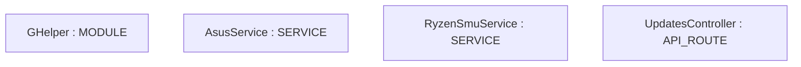
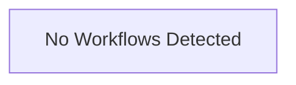

# Repository Architecture Analysis: seerge/g-helper

## Metadata
- **SHA**: `a4efd01c8ba10d103da04c4c895ef849a96f6437`
- **Primary Ecosystem**: .NET

## Quality Metrics
- **avg_cyclomatic_complexity**: 25.65
- **component_count**: 4
- **files_analyzed**: 170
- **framework**: ASP.NET Core
- **loc**: 67792
- **max_cyclomatic_complexity**: 298
- **sloc**: 54160

# Architecture: seerge/g-helper

## Context
- **Repository**: `seerge/g-helper`
- **SHA**: `a4efd01c8ba10d103da04c4c895ef849a96f6437`
- **Ecosystem**: .NET
- **Framework**: Unknown

## Building Block View

## Component Details
- **GHelper** (`app/GHelper.csproj`): MODULE
- **AsusService** (`app/Helpers/AsusService.cs`): SERVICE
- **RyzenSmuService** (`app/Pawn/RyzenSmu.cs`): SERVICE
- **UpdatesController** (`app/UpdatesController.cs`): API_ROUTE

## CI/CD Pipeline Topology

