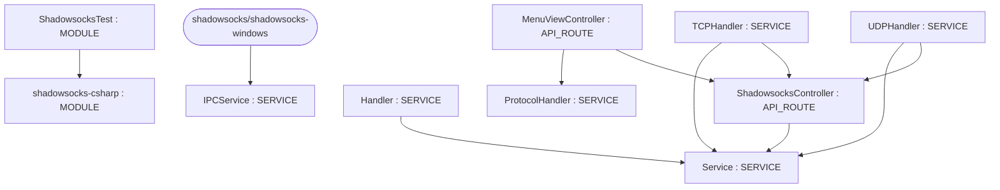
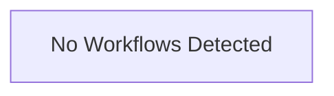

# Repository Architecture Analysis: shadowsocks/shadowsocks-windows

## Metadata
- **SHA**: `891d971682eefcaa2e640258d3b352a3ad3b2233`
- **Primary Ecosystem**: .NET

## Quality Metrics
- **avg_cyclomatic_complexity**: 13.64
- **component_count**: 10
- **files_analyzed**: 178
- **framework**: ASP.NET Core
- **loc**: 35464
- **max_cyclomatic_complexity**: 95
- **sloc**: 28422

# Architecture: shadowsocks/shadowsocks-windows

## Context
- **Repository**: `shadowsocks/shadowsocks-windows`
- **SHA**: `891d971682eefcaa2e640258d3b352a3ad3b2233`
- **Ecosystem**: .NET
- **Framework**: Unknown

## Building Block View

## Component Details
- **shadowsocks-csharp** (`shadowsocks-csharp/shadowsocks-csharp.csproj`): MODULE
- **ShadowsocksTest** (`test/ShadowsocksTest.csproj`): MODULE (deps: shadowsocks-csharp)
- **IPCService** (`shadowsocks-csharp/Controller/Service/IPCService.cs`): SERVICE
- **Service** (`shadowsocks-csharp/Controller/Service/Listener.cs`): SERVICE
- **Handler** (`shadowsocks-csharp/Controller/Service/PortForwarder.cs`): SERVICE (deps: Service)
- **TCPHandler** (`shadowsocks-csharp/Controller/Service/TCPRelay.cs`): SERVICE (deps: Service, ShadowsocksController)
- **UDPHandler** (`shadowsocks-csharp/Controller/Service/UDPRelay.cs`): SERVICE (deps: Service, ShadowsocksController)
- **ShadowsocksController** (`shadowsocks-csharp/Controller/ShadowsocksController.cs`): API_ROUTE (deps: Service)
- **ProtocolHandler** (`shadowsocks-csharp/Controller/System/ProtocolHandler.cs`): SERVICE
- **MenuViewController** (`shadowsocks-csharp/View/MenuViewController.cs`): API_ROUTE (deps: ProtocolHandler, ShadowsocksController)

## CI/CD Pipeline Topology

