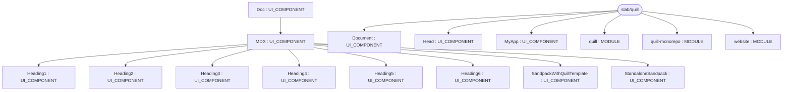
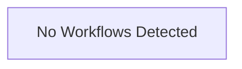

# Repository Architecture Analysis: slab/quill

## Metadata
- **SHA**: `539cbffd0a13b18e9c65eb84dd35e6596e403158`
- **Primary Ecosystem**: JavaScript/TypeScript

## Quality Metrics
- **avg_cyclomatic_complexity**: 6.42
- **component_count**: 16
- **files_analyzed**: 315
- **framework**: Next.js
- **loc**: 43670
- **max_cyclomatic_complexity**: 92
- **sloc**: 38904

# Architecture: slab/quill

## Context
- **Repository**: `slab/quill`
- **SHA**: `539cbffd0a13b18e9c65eb84dd35e6596e403158`
- **Ecosystem**: JavaScript/TypeScript
- **Framework**: Unknown

## Building Block View

## Component Details
- **quill-monorepo** (`package.json`): MODULE
- **quill** (`packages/quill/package.json`): MODULE
- **website** (`packages/website/package.json`): MODULE
- **Heading1** (`packages/website/src/components/Heading.jsx`): UI_COMPONENT
- **Heading2** (`packages/website/src/components/Heading.jsx`): UI_COMPONENT
- **Heading3** (`packages/website/src/components/Heading.jsx`): UI_COMPONENT
- **Heading4** (`packages/website/src/components/Heading.jsx`): UI_COMPONENT
- **Heading5** (`packages/website/src/components/Heading.jsx`): UI_COMPONENT
- **Heading6** (`packages/website/src/components/Heading.jsx`): UI_COMPONENT
- **MDX** (`packages/website/src/components/MDX.jsx`): UI_COMPONENT (deps: Heading1, Heading2, Heading3, Heading4, Heading5, Heading6, SandpackWithQuillTemplate, StandaloneSandpack)
- **StandaloneSandpack** (`packages/website/src/components/Sandpack.jsx`): UI_COMPONENT
- **SandpackWithQuillTemplate** (`packages/website/src/components/Sandpack.jsx`): UI_COMPONENT
- **Head** (`packages/website/src/pages/404.jsx`): UI_COMPONENT
- **MyApp** (`packages/website/src/pages/_app.jsx`): UI_COMPONENT
- **Document** (`packages/website/src/pages/_document.jsx`): UI_COMPONENT
- **Doc** (`packages/website/src/pages/docs/[...id].jsx`): UI_COMPONENT (deps: MDX)

## CI/CD Pipeline Topology

