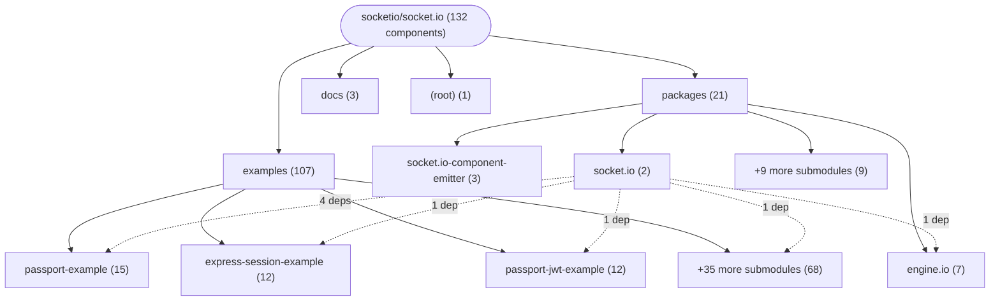
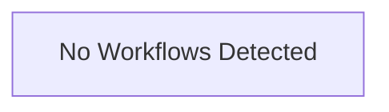

# Repository Architecture Analysis: socketio/socket.io

## Metadata
- **SHA**: `545e9848500d6133c9a1cdb6fee87009d0150f9c`
- **Primary Ecosystem**: JavaScript/TypeScript

## Quality Metrics
- **avg_cyclomatic_complexity**: 5.89
- **component_count**: 132
- **files_analyzed**: 773
- **framework**: Next.js
- **loc**: 115189
- **max_cyclomatic_complexity**: 663
- **sloc**: 83553

# Architecture: socketio/socket.io

## Context
- **Repository**: `socketio/socket.io`
- **SHA**: `545e9848500d6133c9a1cdb6fee87009d0150f9c`
- **Ecosystem**: JavaScript/TypeScript
- **Framework**: Unknown

## Building Block View

## Component Details

Showing top 60 representative components out of 132 across 4 module group(s):

- **Module `examples`** (107 components — MODULE: 55, API_ROUTE: 33, SERVICE: 10)
- **Module `packages`** (21 components — MODULE: 18, API_ROUTE: 2, SERVICE: 1)
- **Module `docs`** (3 components — MODULE: 3)
- **Module `(root)`** (1 components — MODULE: 1)

- **Client** (`packages/socket.io/lib/client.ts`): SERVICE (deps: GET_engine.io.min.js, GET_login, GET_root, GET_self, Home, POST_incr (+2 more))
- **AppController** (`examples/nestjs-example/src/app.controller.ts`): API_ROUTE (deps: AppService)
- **@socket.io/cluster-adapter** (`packages/socket.io-cluster-adapter/package.json`): MODULE
- **@socket.io/cluster-engine** (`packages/socket.io-cluster-engine/package.json`): MODULE
- **@socket.io/component-emitter** (`packages/socket.io-component-emitter/lib/cjs/package.json`): MODULE
- **@socket.io/component-emitter** (`packages/socket.io-component-emitter/lib/esm/package.json`): MODULE
- **@socket.io/component-emitter** (`packages/socket.io-component-emitter/package.json`): MODULE
- **@socket.io/postgres-emitter** (`packages/socket.io-postgres-emitter/package.json`): MODULE
- **@socket.io/redis-streams-emitter** (`packages/socket.io-redis-streams-emitter/package.json`): MODULE
- **API_api_hello** (`examples/nextjs-pages-router/src/pages/api/hello.js`): API_ROUTE
- **App** (`examples/expo-example/App.js`): UI_COMPONENT
- **AppService** (`examples/nestjs-example/src/app.service.ts`): SERVICE
- **CrudRepository** (`examples/basic-crud-application/server-postgres-cluster/lib/todo-management/todo.repository.js`): DATA_ACCESS_LAYER
- **CrudRepository** (`examples/basic-crud-application/server/lib/todo-management/todo.repository.ts`): DATA_ACCESS_LAYER
- **GET_engine.io.min.js** (`packages/engine.io/examples/latency/index.js`): API_ROUTE
- **GET_login** (`examples/passport-example/cjs/index.js`): API_ROUTE
- **GET_login** (`examples/passport-example/esm/index.js`): API_ROUTE
- **GET_login** (`examples/passport-example/ts/index.ts`): API_ROUTE
- **GET_root** (`examples/express-session-example/cjs/index.js`): API_ROUTE
- **GET_root** (`examples/express-session-example/esm/index.js`): API_ROUTE
- **GET_root** (`examples/express-session-example/ts/index.ts`): API_ROUTE
- **GET_root** (`examples/passport-example/cjs/index.js`): API_ROUTE
- **GET_root** (`examples/passport-example/esm/index.js`): API_ROUTE
- **GET_root** (`examples/passport-example/ts/index.ts`): API_ROUTE
- **GET_root** (`examples/passport-jwt-example/cjs/index.js`): API_ROUTE
- **GET_root** (`examples/passport-jwt-example/esm/index.js`): API_ROUTE
- **GET_root** (`examples/passport-jwt-example/ts/index.ts`): API_ROUTE
- **GET_root** (`examples/pm2-example/fastify-entrypoint.js`): API_ROUTE
- **GET_root** (`packages/engine.io/examples/latency/index.js`): API_ROUTE
- **GET_self** (`examples/passport-jwt-example/cjs/index.js`): API_ROUTE
- **GET_self** (`examples/passport-jwt-example/esm/index.js`): API_ROUTE
- **GET_self** (`examples/passport-jwt-example/ts/index.ts`): API_ROUTE
- **Home** (`examples/nextjs-app-router/src/app/page.js`): UI_COMPONENT
- **Home** (`examples/nextjs-pages-router/src/pages/index.js`): UI_COMPONENT
- **InMemoryMessageStore** (`examples/private-messaging/server/messageStore.js`): SERVICE
- **InMemorySessionStore** (`examples/private-messaging/server/sessionStore.js`): SERVICE
- **InMemoryTodoRepository** (`examples/basic-crud-application/server/lib/todo-management/todo.repository.ts`): DATA_ACCESS_LAYER
- **MessageStore** (`examples/private-messaging/server/messageStore.js`): SERVICE
- **POST_incr** (`examples/express-session-example/cjs/index.js`): API_ROUTE
- **POST_incr** (`examples/express-session-example/esm/index.js`): API_ROUTE
- **POST_incr** (`examples/express-session-example/ts/index.ts`): API_ROUTE
- **POST_login** (`examples/passport-example/cjs/index.js`): API_ROUTE
- **POST_login** (`examples/passport-example/esm/index.js`): API_ROUTE
- **POST_login** (`examples/passport-example/ts/index.ts`): API_ROUTE
- **POST_login** (`examples/passport-jwt-example/cjs/index.js`): API_ROUTE
- **POST_login** (`examples/passport-jwt-example/esm/index.js`): API_ROUTE
- **POST_login** (`examples/passport-jwt-example/ts/index.ts`): API_ROUTE
- **POST_logout** (`examples/express-session-example/cjs/index.js`): API_ROUTE
- **POST_logout** (`examples/express-session-example/esm/index.js`): API_ROUTE
- **POST_logout** (`examples/express-session-example/ts/index.ts`): API_ROUTE
- **POST_logout** (`examples/passport-example/cjs/index.js`): API_ROUTE
- **POST_logout** (`examples/passport-example/esm/index.js`): API_ROUTE
- **POST_logout** (`examples/passport-example/ts/index.ts`): API_ROUTE
- **PostgresTodoRepository** (`examples/basic-crud-application/server-postgres-cluster/lib/todo-management/todo.repository.js`): DATA_ACCESS_LAYER
- **ReactNativeExample** (`examples/ReactNativeExample/package.json`): MODULE
- **RedisMessageStore** (`examples/private-messaging/server/messageStore.js`): SERVICE
- **RedisSessionStore** (`examples/private-messaging/server/sessionStore.js`): SERVICE
- **RemoteTodoStore** (`examples/angular-todomvc/src/app/store.ts`): SERVICE
- **SessionStore** (`examples/private-messaging/server/sessionStore.js`): SERVICE
- **TodoRepository** (`examples/basic-crud-application/server-postgres-cluster/lib/todo-management/todo.repository.js`): DATA_ACCESS_LAYER

## CI/CD Pipeline Topology

