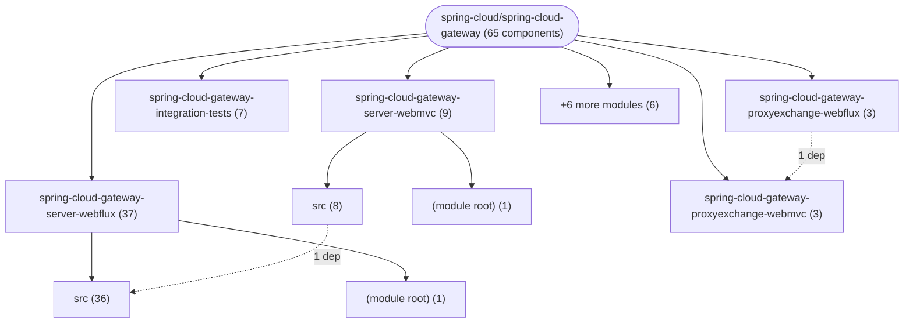
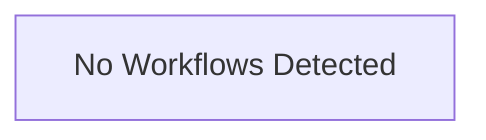

# Repository Architecture Analysis: spring-cloud/spring-cloud-gateway

## Metadata
- **SHA**: `1bea0a27858780ff62032901b686a1f0e5e19988`
- **Primary Ecosystem**: Java

## Quality Metrics
- **avg_cyclomatic_complexity**: 5.02
- **component_count**: 65
- **files_analyzed**: 1400
- **framework**: Spring Boot
- **loc**: 182648
- **max_cyclomatic_complexity**: 62
- **sloc**: 119148

# Architecture: spring-cloud/spring-cloud-gateway

## Context
- **Repository**: `spring-cloud/spring-cloud-gateway`
- **SHA**: `1bea0a27858780ff62032901b686a1f0e5e19988`
- **Ecosystem**: Java
- **Framework**: Unknown

## Building Block View

## Component Details

Showing top 60 representative components out of 65 across 11 module group(s):

- **Module `spring-cloud-gateway-server-webflux`** (37 components — CONFIG: 30, API_ROUTE: 5, MODULE: 1)
- **Module `spring-cloud-gateway-server-webmvc`** (9 components — CONFIG: 6, API_ROUTE: 2, MODULE: 1)
- **Module `spring-cloud-gateway-integration-tests`** (7 components — MODULE: 5, API_ROUTE: 2)
- **Module `spring-cloud-gateway-proxyexchange-webflux`** (3 components — CONFIG: 2, MODULE: 1)
- **Module `spring-cloud-gateway-proxyexchange-webmvc`** (3 components — CONFIG: 2, MODULE: 1)
- **Module `(root)`** (1 components — MODULE: 1)
- **Module `docs`** (1 components — MODULE: 1)
- **Module `spring-cloud-gateway-dependencies`** (1 components — MODULE: 1)
- **Module `spring-cloud-gateway-sample`** (1 components — MODULE: 1)
- **Module `spring-cloud-starter-gateway-server-webflux`** (1 components — MODULE: 1)
- **Module `spring-cloud-starter-gateway-server-webmvc`** (1 components — MODULE: 1)

- **GatewayAutoConfiguration** (`spring-cloud-gateway-server-webflux/src/main/java/org/springframework/cloud/gateway/config/GatewayAutoConfiguration.java`): CONFIG (deps: GatewayClassPathWarningAutoConfiguration, GatewayControllerEndpoint, GatewayLegacyControllerEndpoint, GatewayProperties, GatewayReactiveLoadBalancerClientAutoConfiguration, GlobalCorsProperties (+8 more))
- **GatewayRedisAutoConfiguration** (`spring-cloud-gateway-server-webflux/src/main/java/org/springframework/cloud/gateway/config/GatewayRedisAutoConfiguration.java`): CONFIG (deps: GatewayAutoConfiguration, GatewayProperties, RedisRateLimiter, RedisRouteDefinitionRepository)
- **GatewayClassPathWarningAutoConfiguration** (`spring-cloud-gateway-server-webflux/src/main/java/org/springframework/cloud/gateway/config/GatewayClassPathWarningAutoConfiguration.java`): CONFIG (deps: GatewayAutoConfiguration, GatewayProperties)
- **GatewayDiscoveryClientAutoConfiguration** (`spring-cloud-gateway-server-webflux/src/main/java/org/springframework/cloud/gateway/discovery/GatewayDiscoveryClientAutoConfiguration.java`): CONFIG (deps: DiscoveryLocatorProperties, GatewayAutoConfiguration)
- **GatewayFunctionAutoConfiguration** (`spring-cloud-gateway-server-webflux/src/main/java/org/springframework/cloud/gateway/config/GatewayFunctionAutoConfiguration.java`): CONFIG (deps: GatewayAutoConfiguration, GatewayProperties)
- **GatewayMetricsAutoConfiguration** (`spring-cloud-gateway-server-webflux/src/main/java/org/springframework/cloud/gateway/config/GatewayMetricsAutoConfiguration.java`): CONFIG (deps: GatewayMetricsProperties, GatewayProperties)
- **GatewayNoLoadBalancerClientAutoConfiguration** (`spring-cloud-gateway-server-webflux/src/main/java/org/springframework/cloud/gateway/config/GatewayNoLoadBalancerClientAutoConfiguration.java`): CONFIG (deps: GatewayLoadBalancerProperties, GatewayReactiveLoadBalancerClientAutoConfiguration)
- **GatewayStreamAutoConfiguration** (`spring-cloud-gateway-server-webflux/src/main/java/org/springframework/cloud/gateway/config/GatewayStreamAutoConfiguration.java`): CONFIG (deps: GatewayAutoConfiguration, GatewayProperties)
- **GatewayTracingAutoConfiguration** (`spring-cloud-gateway-server-webflux/src/main/java/org/springframework/cloud/gateway/config/GatewayTracingAutoConfiguration.java`): CONFIG (deps: GatewayMetricsAutoConfiguration, GatewayProperties)
- **LocalResponseCacheAutoConfiguration** (`spring-cloud-gateway-server-webflux/src/main/java/org/springframework/cloud/gateway/config/LocalResponseCacheAutoConfiguration.java`): CONFIG (deps: GatewayProperties, LocalResponseCacheProperties)
- **SimpleUrlHandlerMappingGlobalCorsAutoConfiguration** (`spring-cloud-gateway-server-webflux/src/main/java/org/springframework/cloud/gateway/config/SimpleUrlHandlerMappingGlobalCorsAutoConfiguration.java`): CONFIG (deps: GatewayProperties, GlobalCorsProperties)
- **XForwardedRequestHeadersFilterProperties** (`spring-cloud-gateway-server-webmvc/src/main/java/org/springframework/cloud/gateway/server/mvc/filter/XForwardedRequestHeadersFilterProperties.java`): CONFIG (deps: GatewayMvcProperties, XForwardedHeadersFilter)
- **DefaultFunctionConfiguration** (`spring-cloud-gateway-server-webmvc/src/main/java/org/springframework/cloud/gateway/server/mvc/config/DefaultFunctionConfiguration.java`): CONFIG (deps: GatewayMvcProperties)
- **GatewayLoadBalancerProperties** (`spring-cloud-gateway-server-webflux/src/main/java/org/springframework/cloud/gateway/config/GatewayLoadBalancerProperties.java`): CONFIG (deps: GatewayProperties)
- **GatewayMetricsProperties** (`spring-cloud-gateway-server-webflux/src/main/java/org/springframework/cloud/gateway/config/GatewayMetricsProperties.java`): CONFIG (deps: GatewayProperties)
- **GatewayMvcClassPathWarningAutoConfiguration** (`spring-cloud-gateway-server-webmvc/src/main/java/org/springframework/cloud/gateway/server/mvc/GatewayMvcClassPathWarningAutoConfiguration.java`): CONFIG (deps: GatewayMvcProperties)
- **GatewayReactiveLoadBalancerClientAutoConfiguration** (`spring-cloud-gateway-server-webflux/src/main/java/org/springframework/cloud/gateway/config/GatewayReactiveLoadBalancerClientAutoConfiguration.java`): CONFIG (deps: GatewayLoadBalancerProperties)
- **GatewayResilience4JCircuitBreakerAutoConfiguration** (`spring-cloud-gateway-server-webflux/src/main/java/org/springframework/cloud/gateway/config/GatewayResilience4JCircuitBreakerAutoConfiguration.java`): CONFIG (deps: GatewayProperties)
- **GlobalCorsProperties** (`spring-cloud-gateway-server-webflux/src/main/java/org/springframework/cloud/gateway/config/GlobalCorsProperties.java`): CONFIG (deps: GatewayProperties)
- **GlobalExceptionHandler** (`spring-cloud-gateway-server-webmvc/src/test/java/org/springframework/cloud/gateway/server/mvc/filter/AfterFilterFunctionsTests.java`): API_ROUTE (deps: PermitAllSecurityConfiguration)
- **HttpClientProperties** (`spring-cloud-gateway-server-webflux/src/main/java/org/springframework/cloud/gateway/config/HttpClientProperties.java`): CONFIG (deps: GatewayProperties)
- **HttpServerProperties** (`spring-cloud-gateway-server-webflux/src/main/java/org/springframework/cloud/gateway/config/HttpServerProperties.java`): CONFIG (deps: GatewayProperties)
- **ProxyResponseAutoConfiguration** (`spring-cloud-gateway-proxyexchange-webflux/src/main/java/org/springframework/cloud/gateway/webflux/config/ProxyResponseAutoConfiguration.java`): CONFIG (deps: ProxyExchangeWebfluxProperties)
- **ProxyResponseAutoConfiguration** (`spring-cloud-gateway-proxyexchange-webmvc/src/main/java/org/springframework/cloud/gateway/mvc/config/ProxyResponseAutoConfiguration.java`): CONFIG (deps: ProxyExchangeWebMvcProperties)
- **RedisRateLimiter** (`spring-cloud-gateway-server-webflux/src/main/java/org/springframework/cloud/gateway/filter/ratelimit/RedisRateLimiter.java`): CONFIG (deps: GatewayProperties)
- **VersionProperties** (`spring-cloud-gateway-server-webflux/src/main/java/org/springframework/cloud/gateway/config/VersionProperties.java`): CONFIG (deps: GatewayProperties)
- **WebSocketProxyProperties** (`spring-cloud-gateway-server-webmvc/src/main/java/org/springframework/cloud/gateway/server/mvc/websocket/WebSocketProxyProperties.java`): CONFIG (deps: GatewayMvcProperties)
- **XForwardedHeadersFilter** (`spring-cloud-gateway-server-webflux/src/main/java/org/springframework/cloud/gateway/filter/headers/XForwardedHeadersFilter.java`): CONFIG (deps: GatewayProperties)
- **DiscoveryLocatorProperties** (`spring-cloud-gateway-server-webflux/src/main/java/org/springframework/cloud/gateway/discovery/DiscoveryLocatorProperties.java`): CONFIG
- **GatewayControllerEndpoint** (`spring-cloud-gateway-server-webflux/src/main/java/org/springframework/cloud/gateway/actuate/GatewayControllerEndpoint.java`): API_ROUTE
- **GatewayLegacyControllerEndpoint** (`spring-cloud-gateway-server-webflux/src/main/java/org/springframework/cloud/gateway/actuate/GatewayLegacyControllerEndpoint.java`): API_ROUTE
- **GatewayMvcProperties** (`spring-cloud-gateway-server-webmvc/src/main/java/org/springframework/cloud/gateway/server/mvc/config/GatewayMvcProperties.java`): CONFIG
- **GatewayProperties** (`spring-cloud-gateway-server-webflux/src/main/java/org/springframework/cloud/gateway/config/GatewayProperties.java`): CONFIG
- **GlobalExceptionHandler** (`spring-cloud-gateway-server-webflux/src/test/java/org/springframework/cloud/gateway/filter/factory/RemoveJsonAttributesResponseBodyGatewayFilterFactoryTests.java`): API_ROUTE
- **HttpBinCompatibleController** (`spring-cloud-gateway-server-webflux/src/test/java/org/springframework/cloud/gateway/test/HttpBinCompatibleController.java`): API_ROUTE
- **LocalResponseCacheProperties** (`spring-cloud-gateway-server-webflux/src/main/java/org/springframework/cloud/gateway/filter/factory/cache/LocalResponseCacheProperties.java`): CONFIG
- **MvcFailureAnalyzerApplication** (`spring-cloud-gateway-integration-tests/mvc-failure-analyzer/src/main/java/org/springframework/cloud/gateway/sample/MvcFailureAnalyzerApplication.java`): API_ROUTE
- **NosslConfiguration** (`spring-cloud-gateway-integration-tests/http2/src/test/java/org/springframework/cloud/gateway/tests/http2/nossl/NosslConfiguration.java`): API_ROUTE
- **PermitAllSecurityConfiguration** (`spring-cloud-gateway-server-webflux/src/test/java/org/springframework/cloud/gateway/test/PermitAllSecurityConfiguration.java`): CONFIG
- **PermitAllSecurityConfiguration** (`spring-cloud-gateway-server-webmvc/src/test/java/org/springframework/cloud/gateway/server/mvc/test/PermitAllSecurityConfiguration.java`): CONFIG
- **ProxyExchangeWebMvcProperties** (`spring-cloud-gateway-proxyexchange-webmvc/src/main/java/org/springframework/cloud/gateway/mvc/config/ProxyExchangeWebMvcProperties.java`): CONFIG
- **ProxyExchangeWebfluxProperties** (`spring-cloud-gateway-proxyexchange-webflux/src/main/java/org/springframework/cloud/gateway/webflux/config/ProxyExchangeWebfluxProperties.java`): CONFIG
- **RedisRouteDefinitionRepository** (`spring-cloud-gateway-server-webflux/src/main/java/org/springframework/cloud/gateway/route/RedisRouteDefinitionRepository.java`): DATA_ACCESS_LAYER
- **RemoveHopByHopHeadersFilter** (`spring-cloud-gateway-server-webflux/src/main/java/org/springframework/cloud/gateway/filter/headers/RemoveHopByHopHeadersFilter.java`): CONFIG
- **RequestRateLimiterGatewayFilterFactory** (`spring-cloud-gateway-server-webflux/src/main/java/org/springframework/cloud/gateway/filter/factory/RequestRateLimiterGatewayFilterFactory.java`): CONFIG
- **SecureHeadersProperties** (`spring-cloud-gateway-server-webflux/src/main/java/org/springframework/cloud/gateway/filter/factory/SecureHeadersProperties.java`): CONFIG
- **SetStatusGatewayFilterFactory** (`spring-cloud-gateway-server-webflux/src/main/java/org/springframework/cloud/gateway/filter/factory/SetStatusGatewayFilterFactory.java`): CONFIG
- **SpringCloudCircuitBreakerTestConfig** (`spring-cloud-gateway-server-webflux/src/test/java/org/springframework/cloud/gateway/filter/factory/SpringCloudCircuitBreakerTestConfig.java`): API_ROUTE
- **TestCodecCustomizerConfiguration** (`spring-cloud-gateway-server-webflux/src/test/java/org/springframework/cloud/gateway/test/TestCodecCustomizerConfiguration.java`): CONFIG
- **TestController** (`spring-cloud-gateway-server-webmvc/src/test/java/org/springframework/cloud/gateway/server/mvc/test/TestController.java`): API_ROUTE
- **grpc** (`spring-cloud-gateway-integration-tests/grpc/pom.xml`): MODULE
- **http2** (`spring-cloud-gateway-integration-tests/http2/pom.xml`): MODULE
- **httpclient** (`spring-cloud-gateway-integration-tests/httpclient/pom.xml`): MODULE
- **mvc-failure-analyzer** (`spring-cloud-gateway-integration-tests/mvc-failure-analyzer/pom.xml`): MODULE
- **spring-cloud-gateway** (`pom.xml`): MODULE
- **spring-cloud-gateway-dependencies** (`spring-cloud-gateway-dependencies/pom.xml`): MODULE
- **spring-cloud-gateway-docs** (`docs/pom.xml`): MODULE
- **spring-cloud-gateway-integration-tests** (`spring-cloud-gateway-integration-tests/pom.xml`): MODULE
- **spring-cloud-gateway-proxyexchange-webflux** (`spring-cloud-gateway-proxyexchange-webflux/pom.xml`): MODULE
- **spring-cloud-gateway-proxyexchange-webmvc** (`spring-cloud-gateway-proxyexchange-webmvc/pom.xml`): MODULE

## CI/CD Pipeline Topology

