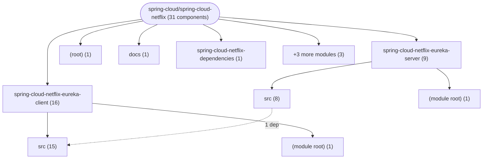
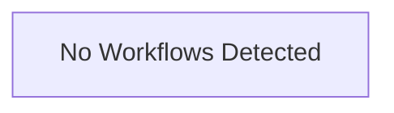

# Repository Architecture Analysis: spring-cloud/spring-cloud-netflix

## Metadata
- **SHA**: `897afeab091445961239013981a1828c343549a5`
- **Primary Ecosystem**: Java

## Quality Metrics
- **avg_cyclomatic_complexity**: 4.69
- **component_count**: 31
- **files_analyzed**: 284
- **framework**: Spring Boot
- **loc**: 39138
- **max_cyclomatic_complexity**: 48
- **sloc**: 25422

# Architecture: spring-cloud/spring-cloud-netflix

## Context
- **Repository**: `spring-cloud/spring-cloud-netflix`
- **SHA**: `897afeab091445961239013981a1828c343549a5`
- **Ecosystem**: Java
- **Framework**: Unknown

## Building Block View

## Component Details
- **spring-cloud-netflix-docs** (`docs/pom.xml`): MODULE
- **spring-cloud-netflix** (`pom.xml`): MODULE
- **spring-cloud-netflix-dependencies** (`spring-cloud-netflix-dependencies/pom.xml`): MODULE
- **spring-cloud-netflix-eureka-client** (`spring-cloud-netflix-eureka-client/pom.xml`): MODULE
- **spring-cloud-netflix-eureka-client-tls-tests** (`spring-cloud-netflix-eureka-client-tls-tests/pom.xml`): MODULE
- **spring-cloud-netflix-eureka-server** (`spring-cloud-netflix-eureka-server/pom.xml`): MODULE
- **spring-cloud-starter-netflix-eureka-client** (`spring-cloud-starter-netflix-eureka-client/pom.xml`): MODULE
- **spring-cloud-starter-netflix-eureka-server** (`spring-cloud-starter-netflix-eureka-server/pom.xml`): MODULE
- **EurekaClientAutoConfiguration** (`spring-cloud-netflix-eureka-client/src/main/java/org/springframework/cloud/netflix/eureka/EurekaClientAutoConfiguration.java`): CONFIG (deps: DiscoveryClientOptionalArgsConfiguration, EurekaClientConfigBean, EurekaDiscoveryClientConfiguration, EurekaInstanceConfigBean)
- **EurekaClientConfigBean** (`spring-cloud-netflix-eureka-client/src/main/java/org/springframework/cloud/netflix/eureka/EurekaClientConfigBean.java`): CONFIG
- **EurekaDiscoveryClientConfiguration** (`spring-cloud-netflix-eureka-client/src/main/java/org/springframework/cloud/netflix/eureka/EurekaDiscoveryClientConfiguration.java`): CONFIG (deps: EurekaClientConfigBean)
- **EurekaInstanceConfigBean** (`spring-cloud-netflix-eureka-client/src/main/java/org/springframework/cloud/netflix/eureka/EurekaInstanceConfigBean.java`): CONFIG
- **TimeoutProperties** (`spring-cloud-netflix-eureka-client/src/main/java/org/springframework/cloud/netflix/eureka/TimeoutProperties.java`): CONFIG
- **DiscoveryClientOptionalArgsConfiguration** (`spring-cloud-netflix-eureka-client/src/main/java/org/springframework/cloud/netflix/eureka/config/DiscoveryClientOptionalArgsConfiguration.java`): CONFIG (deps: TimeoutProperties)
- **EurekaClientConfigServerAutoConfiguration** (`spring-cloud-netflix-eureka-client/src/main/java/org/springframework/cloud/netflix/eureka/config/EurekaClientConfigServerAutoConfiguration.java`): CONFIG (deps: EurekaInstanceConfigBean)
- **EurekaConfigServerBootstrapConfiguration** (`spring-cloud-netflix-eureka-client/src/main/java/org/springframework/cloud/netflix/eureka/config/EurekaConfigServerBootstrapConfiguration.java`): CONFIG (deps: EurekaClientConfigBean, TimeoutProperties)
- **EurekaLoadBalancerClientConfiguration** (`spring-cloud-netflix-eureka-client/src/main/java/org/springframework/cloud/netflix/eureka/loadbalancer/EurekaLoadBalancerClientConfiguration.java`): CONFIG (deps: EurekaLoadBalancerProperties, LoadBalancerEurekaAutoConfiguration)
- **EurekaLoadBalancerProperties** (`spring-cloud-netflix-eureka-client/src/main/java/org/springframework/cloud/netflix/eureka/loadbalancer/EurekaLoadBalancerProperties.java`): CONFIG
- **LoadBalancerEurekaAutoConfiguration** (`spring-cloud-netflix-eureka-client/src/main/java/org/springframework/cloud/netflix/eureka/loadbalancer/LoadBalancerEurekaAutoConfiguration.java`): CONFIG (deps: EurekaLoadBalancerClientConfiguration, EurekaLoadBalancerProperties)
- **EurekaReactiveDiscoveryClientConfiguration** (`spring-cloud-netflix-eureka-client/src/main/java/org/springframework/cloud/netflix/eureka/reactive/EurekaReactiveDiscoveryClientConfiguration.java`): CONFIG (deps: EurekaClientAutoConfiguration)
- **EurekaServerMockApplication** (`spring-cloud-netflix-eureka-client/src/test/java/org/springframework/cloud/netflix/eureka/http/EurekaServerMockApplication.java`): API_ROUTE
- **EurekaSampleApplication** (`spring-cloud-netflix-eureka-client/src/test/java/org/springframework/cloud/netflix/eureka/sample/EurekaSampleApplication.java`): API_ROUTE (deps: EurekaClientConfigBean, EurekaInstanceConfigBean)
- **RefreshEurekaSampleApplication** (`spring-cloud-netflix-eureka-client/src/test/java/org/springframework/cloud/netflix/eureka/sample/RefreshEurekaSampleApplication.java`): API_ROUTE
- **EurekaController** (`spring-cloud-netflix-eureka-server/src/main/java/org/springframework/cloud/netflix/eureka/server/EurekaController.java`): API_ROUTE (deps: EurekaProperties)
- **EurekaDashboardProperties** (`spring-cloud-netflix-eureka-server/src/main/java/org/springframework/cloud/netflix/eureka/server/EurekaDashboardProperties.java`): CONFIG
- **EurekaProperties** (`spring-cloud-netflix-eureka-server/src/main/java/org/springframework/cloud/netflix/eureka/server/EurekaProperties.java`): CONFIG
- **EurekaServerAutoConfiguration** (`spring-cloud-netflix-eureka-server/src/main/java/org/springframework/cloud/netflix/eureka/server/EurekaServerAutoConfiguration.java`): CONFIG (deps: EurekaController, EurekaDashboardProperties, EurekaInstanceConfigBean, EurekaProperties, EurekaServerConfigBean, EurekaServerInitializerConfiguration, EurekaServerMarkerConfiguration, InstanceRegistryProperties)
- **EurekaServerConfigBean** (`spring-cloud-netflix-eureka-server/src/main/java/org/springframework/cloud/netflix/eureka/server/EurekaServerConfigBean.java`): CONFIG
- **EurekaServerInitializerConfiguration** (`spring-cloud-netflix-eureka-server/src/main/java/org/springframework/cloud/netflix/eureka/server/EurekaServerInitializerConfiguration.java`): CONFIG
- **EurekaServerMarkerConfiguration** (`spring-cloud-netflix-eureka-server/src/main/java/org/springframework/cloud/netflix/eureka/server/EurekaServerMarkerConfiguration.java`): CONFIG (deps: EurekaServerAutoConfiguration)
- **InstanceRegistryProperties** (`spring-cloud-netflix-eureka-server/src/main/java/org/springframework/cloud/netflix/eureka/server/InstanceRegistryProperties.java`): CONFIG

## CI/CD Pipeline Topology

