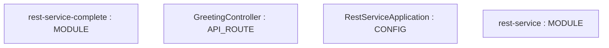
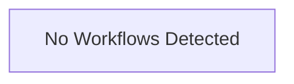

# Repository Architecture Analysis: spring-guides/gs-rest-service

## Metadata
- **SHA**: `e15fec6773dc1eb6028055630e3e68cbd8653240`
- **Primary Ecosystem**: Java

## Quality Metrics
- **avg_cyclomatic_complexity**: 1.0
- **component_count**: 8
- **files_analyzed**: 12
- **framework**: Spring Boot
- **loc**: 190
- **max_cyclomatic_complexity**: 1
- **sloc**: 139

# Architecture: spring-guides/gs-rest-service

## Context
- **Repository**: `spring-guides/gs-rest-service`
- **SHA**: `e15fec6773dc1eb6028055630e3e68cbd8653240`
- **Ecosystem**: Java
- **Framework**: Unknown

## Building Block View

## Component Details
- **rest-service-complete** (`complete/pom.xml`): MODULE
- **GreetingController** (`complete/src/main/java/com/example/restservice/GreetingController.java`): API_ROUTE
- **RestServiceApplication** (`complete/src/main/java/com/example/restservice/RestServiceApplication.java`): CONFIG
- **GreetingController** (`complete-kotlin/src/main/kotlin/com/example/restservice/GreetingController.kt`): API_ROUTE
- **RestServiceApplication** (`complete-kotlin/src/main/kotlin/com/example/restservice/RestServiceApplication.kt`): CONFIG
- **rest-service** (`initial/pom.xml`): MODULE
- **RestServiceApplication** (`initial/src/main/java/com/example/restservice/RestServiceApplication.java`): CONFIG
- **RestServiceApplication** (`initial-kotlin/src/main/kotlin/com/example/restservice/RestServiceApplication.kt`): CONFIG

## CI/CD Pipeline Topology

