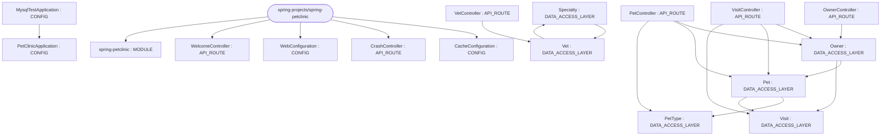

# Repository Architecture Analysis: spring-projects/spring-petclinic

## Metadata
- **SHA**: `500158f732419217507c7656904b8e6aa1bcc0d6`
- **Primary Ecosystem**: Java

## Quality Metrics
- **avg_cyclomatic_complexity**: 4.6
- **component_count**: 17
- **files_analyzed**: 50
- **framework**: Spring Boot
- **loc**: 4297
- **max_cyclomatic_complexity**: 24
- **sloc**: 2542

# Architecture: spring-projects/spring-petclinic

## Context
- **Repository**: `spring-projects/spring-petclinic`
- **SHA**: `500158f732419217507c7656904b8e6aa1bcc0d6`
- **Ecosystem**: Java
- **Framework**: Unknown

## Building Block View

## Component Details
- **spring-petclinic** (`pom.xml`): MODULE
- **PetClinicApplication** (`src/main/java/org/springframework/samples/petclinic/PetClinicApplication.java`): CONFIG
- **Owner** (`src/main/java/org/springframework/samples/petclinic/owner/Owner.java`): DATA_ACCESS_LAYER (deps: Pet, Visit)
- **OwnerController** (`src/main/java/org/springframework/samples/petclinic/owner/OwnerController.java`): API_ROUTE (deps: Owner)
- **Pet** (`src/main/java/org/springframework/samples/petclinic/owner/Pet.java`): DATA_ACCESS_LAYER (deps: PetType, Visit)
- **PetController** (`src/main/java/org/springframework/samples/petclinic/owner/PetController.java`): API_ROUTE (deps: Owner, Pet, PetType)
- **PetType** (`src/main/java/org/springframework/samples/petclinic/owner/PetType.java`): DATA_ACCESS_LAYER
- **Visit** (`src/main/java/org/springframework/samples/petclinic/owner/Visit.java`): DATA_ACCESS_LAYER
- **VisitController** (`src/main/java/org/springframework/samples/petclinic/owner/VisitController.java`): API_ROUTE (deps: Owner, Pet, Visit)
- **CacheConfiguration** (`src/main/java/org/springframework/samples/petclinic/system/CacheConfiguration.java`): CONFIG
- **CrashController** (`src/main/java/org/springframework/samples/petclinic/system/CrashController.java`): API_ROUTE
- **WebConfiguration** (`src/main/java/org/springframework/samples/petclinic/system/WebConfiguration.java`): CONFIG
- **WelcomeController** (`src/main/java/org/springframework/samples/petclinic/system/WelcomeController.java`): API_ROUTE
- **Specialty** (`src/main/java/org/springframework/samples/petclinic/vet/Specialty.java`): DATA_ACCESS_LAYER (deps: Vet)
- **Vet** (`src/main/java/org/springframework/samples/petclinic/vet/Vet.java`): DATA_ACCESS_LAYER (deps: Specialty)
- **VetController** (`src/main/java/org/springframework/samples/petclinic/vet/VetController.java`): API_ROUTE (deps: Vet)
- **MysqlTestApplication** (`src/test/java/org/springframework/samples/petclinic/MysqlTestApplication.java`): CONFIG (deps: PetClinicApplication)

## CI/CD Pipeline Topology

