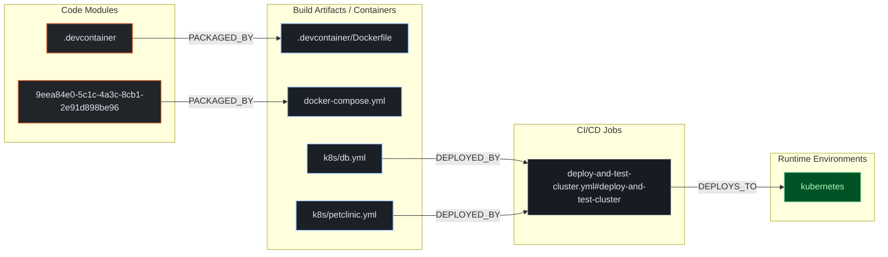
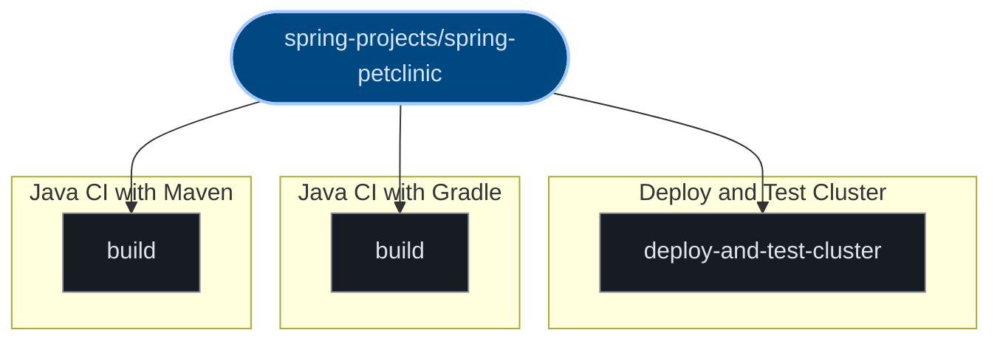

# Repository Architecture Analysis: spring-projects/spring-petclinic

## Metadata
- **SHA**: `3aae6ccdd35535054dc972439a461243d41655e2`
- **Primary Ecosystem**: Java

## Quality Metrics
- **ast_engine**: tree-sitter
- **avg_cognitive_complexity**: 0.63
- **avg_cyclomatic_complexity**: 1.49
- **component_count**: 17
- **dead_code_count**: 10
- **dead_code_symbols**: 10 entry(ies)
- **duplication_pct**: 78.44
- **file_complexities**: 25 entry(ies)
- **files_analyzed**: 50
- **fitness_passed**: False
- **fitness_violation_count**: 2
- **framework**: Spring Boot
- **import_edges**: 100 entry(ies)
- **loc**: 4281
- **max_cognitive_complexity**: 17
- **max_cyclomatic_complexity**: 14
- **sloc**: 2532
- **test_file_count**: 21

# Architecture: spring-projects/spring-petclinic

## Context
- **Repository**: `spring-projects/spring-petclinic`
- **SHA**: `3aae6ccdd35535054dc972439a461243d41655e2`
- **Ecosystem**: Java
- **Framework**: Spring Boot

## Building Block View

```mermaid
graph TD;
    %% title: Building Block View — spring-projects/spring-petclinic
  classDef atlasRoot fill:#004882,stroke:#a3c9ff,stroke-width:2px,color:#d3e4ff
  classDef atlasCategory fill:#212428,stroke:#E87A48,stroke-width:1.5px,color:#dfe3eb
  classDef atlasWorkflow fill:#1b2026,stroke:#a3c9ff,stroke-width:1.5px,color:#dfe3eb
  classDef atlasJob fill:#171c22,stroke:#8d9199,stroke-width:1px,color:#dfe3eb
  classDef atlasTarget fill:#005227,stroke:#8bd99b,stroke-width:1.5px,color:#a7f6b6
  classDef atlasAlert fill:#93000a,stroke:#ffb4ab,stroke-width:1.5px,color:#ffdad6
  classDef atlasMore fill:#252a31,stroke:#8d9199,stroke-dasharray:4 4,color:#c3c6cf
    spring_petclinic["spring-petclinic : MODULE"]:::atlasJob
    PetClinicApplication["PetClinicApplication : CONFIG"]:::atlasJob
    Owner["Owner : DATA_ACCESS_LAYER"]:::atlasJob
    OwnerController["OwnerController : API_ROUTE"]:::atlasJob
    Pet["Pet : DATA_ACCESS_LAYER"]:::atlasJob
    PetController["PetController : API_ROUTE"]:::atlasJob
    PetType["PetType : DATA_ACCESS_LAYER"]:::atlasJob
    Visit["Visit : DATA_ACCESS_LAYER"]:::atlasJob
    VisitController["VisitController : API_ROUTE"]:::atlasJob
    CacheConfiguration["CacheConfiguration : CONFIG"]:::atlasJob
    CrashController["CrashController : API_ROUTE"]:::atlasJob
    WebConfiguration["WebConfiguration : CONFIG"]:::atlasJob
    WelcomeController["WelcomeController : API_ROUTE"]:::atlasJob
    Specialty["Specialty : DATA_ACCESS_LAYER"]:::atlasJob
    Vet["Vet : DATA_ACCESS_LAYER"]:::atlasJob
    VetController["VetController : API_ROUTE"]:::atlasJob
    MysqlTestApplication["MysqlTestApplication : CONFIG"]:::atlasJob
    repo_root(["spring-projects/spring-petclinic"]):::atlasRoot
    repo_root --> CacheConfiguration
    repo_root --> CrashController
    repo_root --> WebConfiguration
    repo_root --> WelcomeController
    repo_root --> spring_petclinic
    MysqlTestApplication --> PetClinicApplication
    Owner --> Pet
    Owner --> Visit
    OwnerController --> Owner
    Pet --> PetType
    Pet --> Visit
    PetController --> Owner
    PetController --> Pet
    PetController --> PetType
    Specialty --> Vet
    Vet --> Specialty
    VetController --> Vet
    VisitController --> Owner
    VisitController --> Pet
    VisitController --> Visit
    linkStyle 14 stroke:#ba1a1a,stroke-width:2px,stroke-dasharray: 5 5
```

## Component Details
- **spring-petclinic** (`pom.xml`): MODULE
- **PetClinicApplication** (`src/main/java/org/springframework/samples/petclinic/PetClinicApplication.java`): CONFIG
- **Owner** (`src/main/java/org/springframework/samples/petclinic/owner/Owner.java`): DATA_ACCESS_LAYER (deps: Pet, Visit)
- **OwnerController** (`src/main/java/org/springframework/samples/petclinic/owner/OwnerController.java`): API_ROUTE (deps: Owner)
- **Pet** (`src/main/java/org/springframework/samples/petclinic/owner/Pet.java`): DATA_ACCESS_LAYER (deps: PetType, Visit)
- **PetController** (`src/main/java/org/springframework/samples/petclinic/owner/PetController.java`): API_ROUTE (deps: Owner, Pet, PetType)
- **PetType** (`src/main/java/org/springframework/samples/petclinic/owner/PetType.java`): DATA_ACCESS_LAYER
- **Visit** (`src/main/java/org/springframework/samples/petclinic/owner/Visit.java`): DATA_ACCESS_LAYER
- **VisitController** (`src/main/java/org/springframework/samples/petclinic/owner/VisitController.java`): API_ROUTE (deps: Owner, Pet, Visit)
- **CacheConfiguration** (`src/main/java/org/springframework/samples/petclinic/system/CacheConfiguration.java`): CONFIG
- **CrashController** (`src/main/java/org/springframework/samples/petclinic/system/CrashController.java`): API_ROUTE
- **WebConfiguration** (`src/main/java/org/springframework/samples/petclinic/system/WebConfiguration.java`): CONFIG
- **WelcomeController** (`src/main/java/org/springframework/samples/petclinic/system/WelcomeController.java`): API_ROUTE
- **Specialty** (`src/main/java/org/springframework/samples/petclinic/vet/Specialty.java`): DATA_ACCESS_LAYER (deps: Vet)
- **Vet** (`src/main/java/org/springframework/samples/petclinic/vet/Vet.java`): DATA_ACCESS_LAYER (deps: Specialty)
- **VetController** (`src/main/java/org/springframework/samples/petclinic/vet/VetController.java`): API_ROUTE (deps: Vet)
- **MysqlTestApplication** (`src/test/java/org/springframework/samples/petclinic/MysqlTestApplication.java`): CONFIG (deps: PetClinicApplication)

## 6-Dimension Repository Scorecard

- **Overall Grade**: `F` (55.85/100)
- **Technical Debt Score**: 44.15
- **Estimated Remediation Effort**: 81.23h

| Dimension | Grade | Score | Weight | Details |
| :--- | :---: | :---: | :---: | :--- |
| Code Quality | `F` | 55.00 | 0.20 | avg_cc=1.49, max_cc=14, duplication=78.44%, dead_code=10 |
| Dependency Health | `C` | 76.00 | 0.15 | dependencies=50, outdated=0, vulnerable=9, has_lockfile=False |
| Maintainability | `B` | 82.00 | 0.15 | avg_cognitive=0.63, max_cognitive=17, fitness_violations=2, oversized_files=0 |
| Pipeline Health | `C` | 71.00 | 0.15 | workflows=3, operational_antipatterns=4, parallel_branches=False |
| Security | `F` | 0.00 | 0.20 | vulnerabilities=37, secrets=0, pipeline_security_findings=5 |
| Test Coverage | `C` | 70.00 | 0.15 | coverage=unavailable, ci_test_job=True, test_files_detected=True |

## Architecture Fitness & Workspace Boundaries

- **[HIGH] `ATRUSS-ARCH-004` (CIRCULAR_DEPENDENCY)**: Circular dependency detected between architectural components. (Specialty -> Vet -> Specialty)
- **[MEDIUM] `ATRUSS-ARCH-005` (COMPLEXITY_THRESHOLD)**: Repository duplication_pct (78.44) exceeds policy threshold (15.0).

## Supply Chain Dependencies, Vulnerabilities & Secrets

- **Dependencies Parsed**: 50 | **Vulnerabilities**: 37 | **Secrets**: 0

### Known Vulnerabilities (OSV)
- **[MEDIUM] `GHSA-22wj-vf5f-wrvj`** `com.h2database:h2` `` (fixed: `none`, UNREACHABLE_DORMANT)
- **[MEDIUM] `GHSA-22wj-vf5f-wrvj`** `com.h2database:h2` `` (fixed: `none`, UNREACHABLE_DORMANT)
- **[MEDIUM] `GHSA-24rp-q3w6-vc56`** `org.postgresql:postgresql` `` (fixed: `none`, UNREACHABLE_DORMANT)
- **[MEDIUM] `GHSA-24rp-q3w6-vc56`** `org.postgresql:postgresql` `` (fixed: `none`, UNREACHABLE_DORMANT)
- **[MEDIUM] `GHSA-45hx-wfhj-473x`** `com.h2database:h2` `` (fixed: `none`, UNREACHABLE_DORMANT)
- **[MEDIUM] `GHSA-45hx-wfhj-473x`** `com.h2database:h2` `` (fixed: `none`, UNREACHABLE_DORMANT)
- **[MEDIUM] `GHSA-562r-vg33-8x8h`** `org.postgresql:postgresql` `` (fixed: `none`, UNREACHABLE_DORMANT)
- **[MEDIUM] `GHSA-562r-vg33-8x8h`** `org.postgresql:postgresql` `` (fixed: `none`, UNREACHABLE_DORMANT)
- **[MEDIUM] `GHSA-56v8-86gj-66jp`** `org.springframework.boot:spring-boot-devtools` `` (fixed: `none`, REACHABLE_FROM_RUNTIME)
- **[MEDIUM] `GHSA-673j-qm5f-xpv8`** `org.postgresql:postgresql` `` (fixed: `none`, UNREACHABLE_DORMANT)
- **[MEDIUM] `GHSA-673j-qm5f-xpv8`** `org.postgresql:postgresql` `` (fixed: `none`, UNREACHABLE_DORMANT)
- **[MEDIUM] `GHSA-727h-hrw8-jg8q`** `org.postgresql:postgresql` `` (fixed: `none`, UNREACHABLE_DORMANT)
- **[MEDIUM] `GHSA-727h-hrw8-jg8q`** `org.postgresql:postgresql` `` (fixed: `none`, UNREACHABLE_DORMANT)
- **[MEDIUM] `GHSA-7rpj-hg47-cx62`** `com.h2database:h2` `` (fixed: `none`, UNREACHABLE_DORMANT)
- **[MEDIUM] `GHSA-7rpj-hg47-cx62`** `com.h2database:h2` `` (fixed: `none`, UNREACHABLE_DORMANT)
- **[MEDIUM] `GHSA-88cc-g835-76rp`** `org.postgresql:postgresql` `` (fixed: `none`, UNREACHABLE_DORMANT)
- **[MEDIUM] `GHSA-88cc-g835-76rp`** `org.postgresql:postgresql` `` (fixed: `none`, UNREACHABLE_DORMANT)
- **[MEDIUM] `GHSA-8hfc-fq58-r658`** `org.springframework.boot:spring-boot-starter-actuator` `` (fixed: `none`, REACHABLE_FROM_RUNTIME)
- **[MEDIUM] `GHSA-8hfc-fq58-r658`** `org.springframework.boot:spring-boot-starter-actuator` `` (fixed: `none`, REACHABLE_FROM_RUNTIME)
- **[MEDIUM] `GHSA-98qh-xjc8-98pq`** `org.postgresql:postgresql` `` (fixed: `none`, UNREACHABLE_DORMANT)
- **[MEDIUM] `GHSA-98qh-xjc8-98pq`** `org.postgresql:postgresql` `` (fixed: `none`, UNREACHABLE_DORMANT)
- **[MEDIUM] `GHSA-h376-j262-vhq6`** `com.h2database:h2` `` (fixed: `none`, UNREACHABLE_DORMANT)
- **[MEDIUM] `GHSA-h376-j262-vhq6`** `com.h2database:h2` `` (fixed: `none`, UNREACHABLE_DORMANT)
- **[MEDIUM] `GHSA-h86w-m5rm-xr33`** `org.postgresql:postgresql` `` (fixed: `none`, UNREACHABLE_DORMANT)
- **[MEDIUM] `GHSA-h86w-m5rm-xr33`** `org.postgresql:postgresql` `` (fixed: `none`, UNREACHABLE_DORMANT)
- **[MEDIUM] `GHSA-hq9p-pm7w-8p54`** `org.postgresql:postgresql` `` (fixed: `none`, UNREACHABLE_DORMANT)
- **[MEDIUM] `GHSA-hq9p-pm7w-8p54`** `org.postgresql:postgresql` `` (fixed: `none`, UNREACHABLE_DORMANT)
- **[MEDIUM] `GHSA-j92g-9f8w-j867`** `org.postgresql:postgresql` `` (fixed: `none`, UNREACHABLE_DORMANT)
- **[MEDIUM] `GHSA-j92g-9f8w-j867`** `org.postgresql:postgresql` `` (fixed: `none`, UNREACHABLE_DORMANT)
- **[MEDIUM] `GHSA-m6vm-37g8-gqvh`** `com.mysql:mysql-connector-j` `` (fixed: `none`, UNREACHABLE_DORMANT)
- **[MEDIUM] `GHSA-m6vm-37g8-gqvh`** `com.mysql:mysql-connector-j` `` (fixed: `none`, UNREACHABLE_DORMANT)
- **[MEDIUM] `GHSA-mgvc-8q2h-5pgc`** `org.springframework.boot:spring-boot-starter-actuator` `` (fixed: `none`, REACHABLE_FROM_RUNTIME)
- **[MEDIUM] `GHSA-mgvc-8q2h-5pgc`** `org.springframework.boot:spring-boot-starter-actuator` `` (fixed: `none`, REACHABLE_FROM_RUNTIME)
- **[MEDIUM] `GHSA-r38f-c4h4-hqq2`** `org.postgresql:postgresql` `` (fixed: `none`, UNREACHABLE_DORMANT)
- **[MEDIUM] `GHSA-r38f-c4h4-hqq2`** `org.postgresql:postgresql` `` (fixed: `none`, UNREACHABLE_DORMANT)
- **[MEDIUM] `GHSA-v7wg-cpwc-24m4`** `org.postgresql:postgresql` `` (fixed: `none`, UNREACHABLE_DORMANT)
- **[MEDIUM] `GHSA-v7wg-cpwc-24m4`** `org.postgresql:postgresql` `` (fixed: `none`, UNREACHABLE_DORMANT)

### Inventory Sample
- `com.github.ben-manes.caffeine:caffeine` `*` (Maven, `build.gradle`)
- `com.github.ben-manes.caffeine:caffeine` `*` (Maven, `pom.xml`)
- `com.h2database:h2` `*` (Maven, `build.gradle`)
- `com.h2database:h2` `*` (Maven, `pom.xml`)
- `com.mysql:mysql-connector-j` `*` (Maven, `build.gradle`)
- `com.mysql:mysql-connector-j` `*` (Maven, `pom.xml`)
- `jakarta.xml.bind:jakarta.xml.bind-api` `*` (Maven, `build.gradle`)
- `jakarta.xml.bind:jakarta.xml.bind-api` `*` (Maven, `pom.xml`)
- `javax.cache:cache-api` `*` (Maven, `build.gradle`)
- `javax.cache:cache-api` `*` (Maven, `pom.xml`)
- `org.postgresql:postgresql` `*` (Maven, `build.gradle`)
- `org.postgresql:postgresql` `*` (Maven, `pom.xml`)
- `org.springframework.boot:spring-boot-devtools` `*` (Maven, `pom.xml`)
- `org.springframework.boot:spring-boot-docker-compose` `*` (Maven, `build.gradle`)
- `org.springframework.boot:spring-boot-docker-compose` `*` (Maven, `pom.xml`)
- `org.springframework.boot:spring-boot-starter-actuator` `*` (Maven, `build.gradle`)
- `org.springframework.boot:spring-boot-starter-actuator` `*` (Maven, `pom.xml`)
- `org.springframework.boot:spring-boot-starter-actuator-test` `*` (Maven, `pom.xml`)
- `org.springframework.boot:spring-boot-starter-cache` `*` (Maven, `build.gradle`)
- `org.springframework.boot:spring-boot-starter-cache` `*` (Maven, `pom.xml`)
- `org.springframework.boot:spring-boot-starter-cache-test` `*` (Maven, `pom.xml`)
- `org.springframework.boot:spring-boot-starter-data-jpa` `*` (Maven, `build.gradle`)
- `org.springframework.boot:spring-boot-starter-data-jpa` `*` (Maven, `pom.xml`)
- `org.springframework.boot:spring-boot-starter-data-jpa-test` `*` (Maven, `build.gradle`)
- `org.springframework.boot:spring-boot-starter-data-jpa-test` `*` (Maven, `pom.xml`)
- `org.springframework.boot:spring-boot-starter-restclient` `*` (Maven, `pom.xml`)
- `org.springframework.boot:spring-boot-starter-restclient-test` `*` (Maven, `build.gradle`)
- `org.springframework.boot:spring-boot-starter-restclient-test` `*` (Maven, `pom.xml`)
- `org.springframework.boot:spring-boot-starter-thymeleaf` `*` (Maven, `build.gradle`)
- `org.springframework.boot:spring-boot-starter-thymeleaf` `*` (Maven, `pom.xml`)
- ... (+20 more dependencies)

## Section 7: Code-to-Cloud Deployment Traceability

- `deploy-and-test-cluster.yml#deploy-and-test-cluster` (ci_job) --[DEPLOYS_TO]--> `kubernetes` (environment)
- `.devcontainer` (code_module) --[PACKAGED_BY]--> `.devcontainer/Dockerfile` (container)
- `9eea84e0-5c1c-4a3c-8cb1-2e91d898be96` (code_module) --[PACKAGED_BY]--> `docker-compose.yml` (container)
- `k8s/db.yml` (iac) --[DEPLOYED_BY]--> `deploy-and-test-cluster.yml#deploy-and-test-cluster` (ci_job)
- `k8s/petclinic.yml` (iac) --[DEPLOYED_BY]--> `deploy-and-test-cluster.yml#deploy-and-test-cluster` (ci_job)

## CI/CD Pipeline Topology

