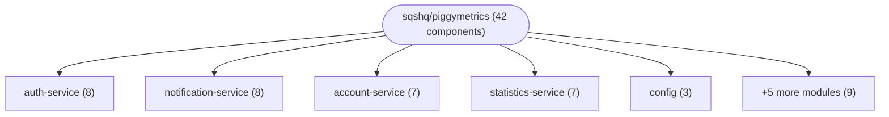
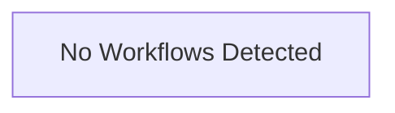

# Repository Architecture Analysis: sqshq/piggymetrics

## Metadata
- **SHA**: `6bb2cf9ddbca980b664d3edbb6ff775d75369278`
- **Primary Ecosystem**: Java

## Quality Metrics
- **avg_cyclomatic_complexity**: 1.16
- **component_count**: 42
- **files_analyzed**: 194
- **framework**: Spring Boot
- **loc**: 8966
- **max_cyclomatic_complexity**: 7
- **sloc**: 6584

# Architecture: sqshq/piggymetrics

## Context
- **Repository**: `sqshq/piggymetrics`
- **SHA**: `6bb2cf9ddbca980b664d3edbb6ff775d75369278`
- **Ecosystem**: Java
- **Framework**: Unknown

## Building Block View

## Component Details
- **account-service** (`account-service/pom.xml`): MODULE
- **auth-service** (`auth-service/pom.xml`): MODULE
- **config** (`config/pom.xml`): MODULE
- **gateway** (`gateway/pom.xml`): MODULE
- **monitoring** (`monitoring/pom.xml`): MODULE
- **notification-service** (`notification-service/pom.xml`): MODULE
- **piggymetrics** (`pom.xml`): MODULE
- **registry** (`registry/pom.xml`): MODULE
- **statistics-service** (`statistics-service/pom.xml`): MODULE
- **turbine-stream-service** (`turbine-stream-service/pom.xml`): MODULE
- **AccountApplication** (`account-service/src/main/java/com/piggymetrics/account/AccountApplication.java`): CONFIG
- **ResourceServerConfig** (`account-service/src/main/java/com/piggymetrics/account/config/ResourceServerConfig.java`): CONFIG
- **AccountController** (`account-service/src/main/java/com/piggymetrics/account/controller/AccountController.java`): API_ROUTE
- **ErrorHandler** (`account-service/src/main/java/com/piggymetrics/account/controller/ErrorHandler.java`): API_ROUTE
- **AccountRepository** (`account-service/src/main/java/com/piggymetrics/account/repository/AccountRepository.java`): DATA_ACCESS_LAYER
- **AccountServiceImpl** (`account-service/src/main/java/com/piggymetrics/account/service/AccountServiceImpl.java`): SERVICE (deps: AccountRepository)
- **AuthApplication** (`auth-service/src/main/java/com/piggymetrics/auth/AuthApplication.java`): CONFIG
- **OAuth2AuthorizationConfig** (`auth-service/src/main/java/com/piggymetrics/auth/config/OAuth2AuthorizationConfig.java`): CONFIG (deps: MongoUserDetailsService)
- **WebSecurityConfig** (`auth-service/src/main/java/com/piggymetrics/auth/config/WebSecurityConfig.java`): CONFIG (deps: MongoUserDetailsService)
- **UserController** (`auth-service/src/main/java/com/piggymetrics/auth/controller/UserController.java`): API_ROUTE
- **UserRepository** (`auth-service/src/main/java/com/piggymetrics/auth/repository/UserRepository.java`): DATA_ACCESS_LAYER
- **UserServiceImpl** (`auth-service/src/main/java/com/piggymetrics/auth/service/UserServiceImpl.java`): SERVICE (deps: UserRepository)
- **MongoUserDetailsService** (`auth-service/src/main/java/com/piggymetrics/auth/service/security/MongoUserDetailsService.java`): SERVICE (deps: UserRepository)
- **ConfigApplication** (`config/src/main/java/com/piggymetrics/config/ConfigApplication.java`): CONFIG
- **SecurityConfig** (`config/src/main/java/com/piggymetrics/config/SecurityConfig.java`): CONFIG
- **GatewayApplication** (`gateway/src/main/java/com/piggymetrics/gateway/GatewayApplication.java`): CONFIG
- **MonitoringApplication** (`monitoring/src/main/java/com/piggymetrics/monitoring/MonitoringApplication.java`): CONFIG
- **NotificationServiceApplication** (`notification-service/src/main/java/com/piggymetrics/notification/NotificationServiceApplication.java`): CONFIG
- **ResourceServerConfig** (`notification-service/src/main/java/com/piggymetrics/notification/config/ResourceServerConfig.java`): CONFIG
- **RecipientController** (`notification-service/src/main/java/com/piggymetrics/notification/controller/RecipientController.java`): API_ROUTE
- **RecipientRepository** (`notification-service/src/main/java/com/piggymetrics/notification/repository/RecipientRepository.java`): DATA_ACCESS_LAYER
- **EmailServiceImpl** (`notification-service/src/main/java/com/piggymetrics/notification/service/EmailServiceImpl.java`): SERVICE
- **NotificationServiceImpl** (`notification-service/src/main/java/com/piggymetrics/notification/service/NotificationServiceImpl.java`): SERVICE
- **RecipientServiceImpl** (`notification-service/src/main/java/com/piggymetrics/notification/service/RecipientServiceImpl.java`): SERVICE (deps: RecipientRepository)
- **RegistryApplication** (`registry/src/main/java/com/piggymetrics/registry/RegistryApplication.java`): CONFIG
- **StatisticsApplication** (`statistics-service/src/main/java/com/piggymetrics/statistics/StatisticsApplication.java`): CONFIG
- **ResourceServerConfig** (`statistics-service/src/main/java/com/piggymetrics/statistics/config/ResourceServerConfig.java`): CONFIG
- **StatisticsController** (`statistics-service/src/main/java/com/piggymetrics/statistics/controller/StatisticsController.java`): API_ROUTE
- **DataPointRepository** (`statistics-service/src/main/java/com/piggymetrics/statistics/repository/DataPointRepository.java`): DATA_ACCESS_LAYER
- **ExchangeRatesServiceImpl** (`statistics-service/src/main/java/com/piggymetrics/statistics/service/ExchangeRatesServiceImpl.java`): SERVICE
- **StatisticsServiceImpl** (`statistics-service/src/main/java/com/piggymetrics/statistics/service/StatisticsServiceImpl.java`): SERVICE (deps: DataPointRepository)
- **TurbineStreamServiceApplication** (`turbine-stream-service/src/main/java/com/piggymetrics/turbine/TurbineStreamServiceApplication.java`): CONFIG

## CI/CD Pipeline Topology

