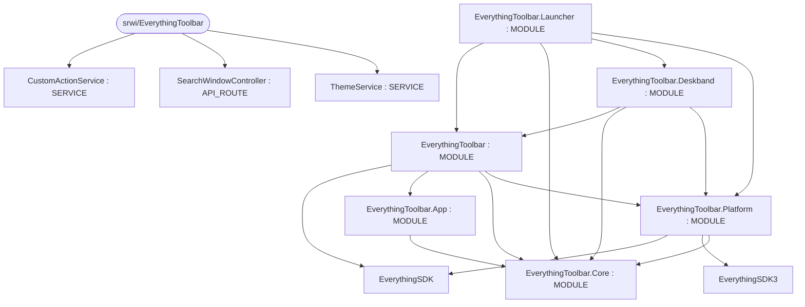
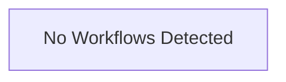

# Repository Architecture Analysis: srwi/EverythingToolbar

## Metadata
- **SHA**: `1260a08231602ece727ee265ad584b6610b15737`
- **Primary Ecosystem**: .NET

## Quality Metrics
- **avg_cyclomatic_complexity**: 14.87
- **component_count**: 9
- **files_analyzed**: 260
- **framework**: Unknown
- **loc**: 42832
- **max_cyclomatic_complexity**: 129
- **sloc**: 33118

# Architecture: srwi/EverythingToolbar

## Context
- **Repository**: `srwi/EverythingToolbar`
- **SHA**: `1260a08231602ece727ee265ad584b6610b15737`
- **Ecosystem**: .NET
- **Framework**: Unknown

## Building Block View

## Component Details
- **EverythingToolbar** (`EverythingToolbar/EverythingToolbar.csproj`): MODULE (deps: EverythingSDK, EverythingToolbar.App, EverythingToolbar.Core, EverythingToolbar.Platform)
- **EverythingToolbar.App** (`EverythingToolbar.App/EverythingToolbar.App.csproj`): MODULE (deps: EverythingToolbar.Core)
- **EverythingToolbar.Core** (`EverythingToolbar.Core/EverythingToolbar.Core.csproj`): MODULE
- **EverythingToolbar.Deskband** (`EverythingToolbar.Deskband/EverythingToolbar.Deskband.csproj`): MODULE (deps: EverythingToolbar, EverythingToolbar.Core, EverythingToolbar.Platform)
- **EverythingToolbar.Launcher** (`EverythingToolbar.Launcher/EverythingToolbar.Launcher.csproj`): MODULE (deps: EverythingToolbar, EverythingToolbar.Core, EverythingToolbar.Deskband, EverythingToolbar.Platform)
- **EverythingToolbar.Platform** (`EverythingToolbar.Platform/EverythingToolbar.Platform.csproj`): MODULE (deps: EverythingSDK, EverythingSDK3, EverythingToolbar.Core)
- **CustomActionService** (`EverythingToolbar.App/Services/CustomActionService.cs`): SERVICE
- **SearchWindowController** (`EverythingToolbar/Services/SearchWindowController.cs`): API_ROUTE
- **ThemeService** (`EverythingToolbar/Services/ThemeService.cs`): SERVICE

## CI/CD Pipeline Topology

