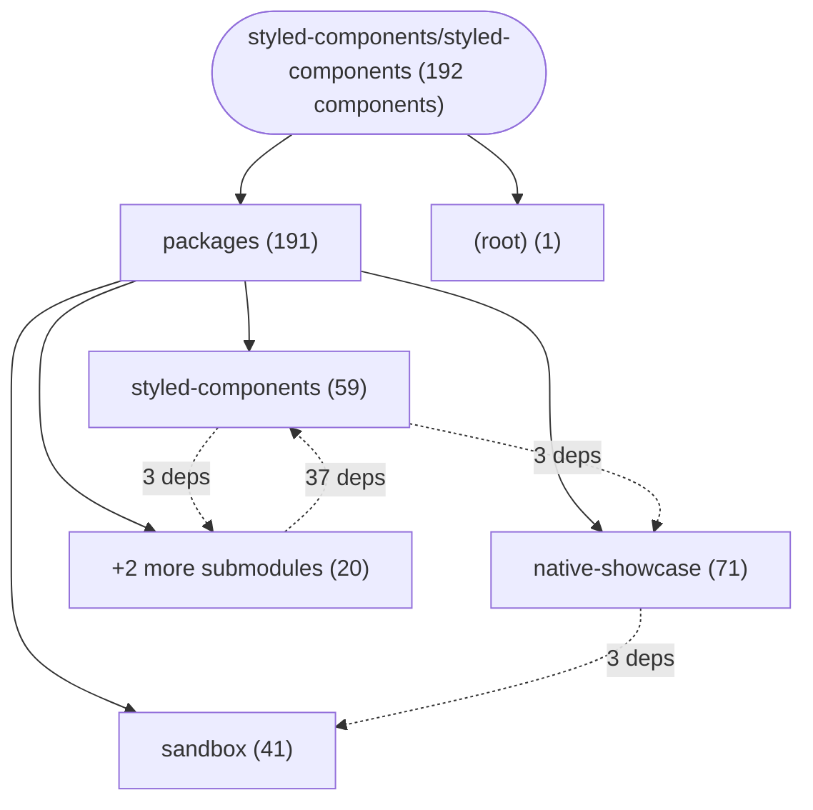
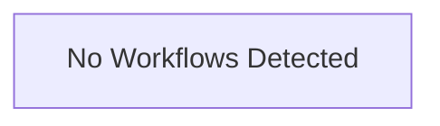

# Repository Architecture Analysis: styled-components/styled-components

## Metadata
- **SHA**: `3afd1b06ca0e60d868363aa0039cbeeaed0937c3`
- **Primary Ecosystem**: JavaScript/TypeScript

## Quality Metrics
- **avg_cyclomatic_complexity**: 10.63
- **component_count**: 192
- **files_analyzed**: 1135
- **framework**: Next.js
- **loc**: 326767
- **max_cyclomatic_complexity**: 544
- **sloc**: 255491

# Architecture: styled-components/styled-components

## Context
- **Repository**: `styled-components/styled-components`
- **SHA**: `3afd1b06ca0e60d868363aa0039cbeeaed0937c3`
- **Ecosystem**: JavaScript/TypeScript
- **Framework**: Unknown

## Building Block View

## Component Details

Showing top 60 representative components out of 192 across 2 module group(s):

- **Module `packages`** (191 components — UI_COMPONENT: 182, MODULE: 9)
- **Module `(root)`** (1 components — MODULE: 1)

- **STATELESS_PSEUDO_MASKS** (`packages/styled-components/src/native/pseudoState.ts`): UI_COMPONENT (deps: AUTO_TIMELINE, Card, CloseButton, DEFAULT_CASCADE, DEFAULT_NATIVE_STYLE, DEFAULT_PARENT_CONTEXT (+12 more))
- **StyleSheetConsumer** (`packages/styled-components/src/models/StyleSheetManager.tsx`): UI_COMPONENT (deps: AUTO_TIMELINE, Card, CloseButton, IS_BROWSER, IS_RSC, KEYFRAMES_ID_PREFIX (+11 more))
- **StyleSheetContext** (`packages/styled-components/src/models/StyleSheetManager.tsx`): UI_COMPONENT (deps: AUTO_TIMELINE, Card, CloseButton, IS_BROWSER, IS_RSC, KEYFRAMES_ID_PREFIX (+11 more))
- **StyleSheetManager** (`packages/styled-components/src/models/StyleSheetManager.tsx`): UI_COMPONENT (deps: AUTO_TIMELINE, Card, CloseButton, IS_BROWSER, IS_RSC, KEYFRAMES_ID_PREFIX (+11 more))
- **EMPTY_MATCHED** (`packages/styled-components/src/native/conditionMatching.ts`): UI_COMPONENT (deps: AUTO_TIMELINE, Card, CloseButton, DEFAULT_CASCADE, DEFAULT_NATIVE_STYLE, DEFAULT_PARENT_CONTEXT (+9 more))
- **RN_UNSUPPORTED_VALUES** (`packages/styled-components/src/models/compileNative.ts`): UI_COMPONENT (deps: AUTO_TIMELINE, BORDER_RADIUS_KEYS, CORNER_SQUARE_SENTINEL_KEY, Card, CloseButton, DEFAULT_PARENT_CONTEXT (+8 more))
- **SPECIAL_CASE_PROPS** (`packages/styled-components/src/models/compileNative.ts`): UI_COMPONENT (deps: AUTO_TIMELINE, BORDER_RADIUS_KEYS, CORNER_SQUARE_SENTINEL_KEY, Card, CloseButton, DEFAULT_PARENT_CONTEXT (+8 more))
- **SafeAreaInsetsProvider** (`packages/styled-components/src/native/web-bridge/index.tsx`): UI_COMPONENT (deps: AUTO_TIMELINE, Card, CloseButton, EMPTY_SAFE_AREA_INSETS, NOOP_ADAPTER, ScCard (+8 more))
- **RSCTestPage** (`packages/sandbox/app/rsc/page.tsx`): UI_COMPONENT (deps: Code, Column, ColumnLabel, CountBadge, Demo, HintText (+6 more))
- **ClientTestingHarness** (`packages/sandbox/app/client-example/testing-harness.tsx`): UI_COMPONENT (deps: Code, Column, ColumnLabel, Demo, HintText, Row (+5 more))
- **DEFAULT_SCROLL_TIMELINES** (`packages/styled-components/src/native/scrollTimeline.ts`): UI_COMPONENT (deps: AUTO_TIMELINE, Card, CloseButton, DEFAULT_CASCADE, DEFAULT_NATIVE_STYLE, NOOP_ADAPTER (+4 more))
- **GlobalStyleTestPage** (`packages/sandbox/app/global-style-test/page.tsx`): UI_COMPONENT (deps: ClientDedupSection, Code, Column, ColumnLabel, Demo, HintText (+4 more))
- **PRESSABLE_TARGET** (`packages/styled-components/src/native/publishCascade.ts`): UI_COMPONENT (deps: AUTO_TIMELINE, Card, CloseButton, DEFAULT_CASCADE, DEFAULT_NATIVE_STYLE, NOOP_ADAPTER (+4 more))
- **REST_STATE** (`packages/styled-components/src/native/publishCascade.ts`): UI_COMPONENT (deps: AUTO_TIMELINE, Card, CloseButton, DEFAULT_CASCADE, DEFAULT_NATIVE_STYLE, NOOP_ADAPTER (+4 more))
- **ScrollTimelineContext** (`packages/styled-components/src/native/scrollTimeline.ts`): UI_COMPONENT (deps: AUTO_TIMELINE, Card, CloseButton, DEFAULT_CASCADE, DEFAULT_NATIVE_STYLE, NOOP_ADAPTER (+4 more))
- **Button** (`packages/benchmarks/src/app/Button.js`): UI_COMPONENT (deps: IS_BROWSER, KEYFRAMES_ID_PREFIX, RSC_REDUNDANT_EMIT_WARN_THRESHOLD, SC_ATTR, SC_ATTR_ACTIVE, SC_ATTR_VERSION (+3 more))
- **PageA** (`packages/sandbox/app/global-style-test/page-a/page.tsx`): UI_COMPONENT (deps: Code, Column, ColumnLabel, Demo, HintText, Row (+3 more))
- **PageB** (`packages/sandbox/app/global-style-test/page-b/page.tsx`): UI_COMPONENT (deps: Code, Column, ColumnLabel, Demo, HintText, Row (+3 more))
- **Suspense5808Page** (`packages/sandbox/app/suspense-5808/page.tsx`): UI_COMPONENT (deps: Code, Column, ColumnLabel, Demo, HintText, Row (+3 more))
- **AUTO_TIMELINE** (`packages/styled-components/src/native/animation/types.ts`): UI_COMPONENT (deps: Card, CloseButton, RN_UNSUPPORTED_VALUES, SPECIAL_CASE_PROPS, ScCard, ScCloseButton (+1 more))
- **BORDER_RADIUS_KEYS** (`packages/styled-components/src/native/transform/handlers/spacing.ts`): UI_COMPONENT (deps: AUTO_TIMELINE, Card, CloseButton, NOOP_ADAPTER, ScCard, ScCloseButton (+1 more))
- **CORNER_SQUARE_SENTINEL_KEY** (`packages/styled-components/src/native/transform/polyfills/cornerShape.ts`): UI_COMPONENT (deps: AUTO_TIMELINE, Card, CloseButton, NOOP_ADAPTER, ScCard, ScCloseButton (+1 more))
- **DEFAULT_PARENT_CONTEXT** (`packages/styled-components/src/native/ParentContext.ts`): UI_COMPONENT (deps: AUTO_TIMELINE, Card, CloseButton, NOOP_ADAPTER, ScCard, ScCloseButton (+1 more))
- **NOOP_ADAPTER** (`packages/styled-components/src/native/animation/types.ts`): UI_COMPONENT (deps: Card, CloseButton, RN_UNSUPPORTED_VALUES, SPECIAL_CASE_PROPS, ScCard, ScCloseButton (+1 more))
- **PARENT_SLOT_PROP** (`packages/styled-components/src/native/ParentContext.ts`): UI_COMPONENT (deps: AUTO_TIMELINE, Card, CloseButton, NOOP_ADAPTER, ScCard, ScCloseButton (+1 more))
- **PERSPECTIVE_SENTINEL_KEY** (`packages/styled-components/src/native/transform/polyfills/standaloneTransform.ts`): UI_COMPONENT (deps: AUTO_TIMELINE, Card, CloseButton, NOOP_ADAPTER, ScCard, ScCloseButton (+1 more))
- **ParentContext** (`packages/styled-components/src/native/ParentContext.ts`): UI_COMPONENT (deps: AUTO_TIMELINE, Card, CloseButton, NOOP_ADAPTER, ScCard, ScCloseButton (+1 more))
- **ParentRerender** (`packages/ios-benchmark/src/cases/ParentRerender.tsx`): UI_COMPONENT (deps: AUTO_TIMELINE, Card, CloseButton, NOOP_ADAPTER, ScCard, ScCloseButton (+1 more))
- **ParentRerenderStatic** (`packages/ios-benchmark/src/cases/ParentRerenderStatic.tsx`): UI_COMPONENT (deps: AUTO_TIMELINE, Card, CloseButton, NOOP_ADAPTER, ScCard, ScCloseButton (+1 more))
- **ScCard** (`packages/styled-components/src/test/types.tsx`): UI_COMPONENT (deps: AUTO_TIMELINE, BenchmarkType, Card, Catalog, CloseButton, NOOP_ADAPTER (+1 more))
- **ScCloseButton** (`packages/styled-components/src/test/types.tsx`): UI_COMPONENT (deps: AUTO_TIMELINE, BenchmarkType, Card, Catalog, CloseButton, NOOP_ADAPTER (+1 more))
- **ScFactoryExport** (`packages/styled-components/src/test/types.tsx`): UI_COMPONENT (deps: AUTO_TIMELINE, BenchmarkType, Card, Catalog, CloseButton, NOOP_ADAPTER (+1 more))
- **Tree** (`packages/ios-benchmark/src/cases/Tree.tsx`): UI_COMPONENT (deps: AUTO_TIMELINE, Card, CloseButton, NOOP_ADAPTER, ScCard, ScCloseButton (+1 more))
- **TreeStatic** (`packages/ios-benchmark/src/cases/TreeStatic.tsx`): UI_COMPONENT (deps: AUTO_TIMELINE, Card, CloseButton, NOOP_ADAPTER, ScCard, ScCloseButton (+1 more))
- **Card** (`packages/styled-components/src/types.ts`): UI_COMPONENT (deps: ThemeConsumer, ThemeContext, ThemeProvider)
- **CloseButton** (`packages/styled-components/src/types.ts`): UI_COMPONENT (deps: ThemeConsumer, ThemeContext, ThemeProvider)
- **ContainerQueriesPage** (`packages/sandbox/app/container-queries/page.tsx`): UI_COMPONENT (deps: ClientTestingHarness, ContainerQueriesHarness, ViewTransitionsHarness)
- **GlobalStyleTestLayout** (`packages/sandbox/app/global-style-test/layout.tsx`): UI_COMPONENT (deps: AutopilotClient, GlobalStyleChecks, NavClient)
- **RootLayout** (`packages/sandbox/app/layout.tsx`): UI_COMPONENT (deps: CustomThemeProvider, Sidebar, StyledComponentsRegistry)
- **ViewTransitionsPage** (`packages/sandbox/app/view-transitions/page.tsx`): UI_COMPONENT (deps: ClientTestingHarness, ContainerQueriesHarness, ViewTransitionsHarness)
- **AccentColorBoard** (`packages/native-showcase/src/widgets/AccentColorBoard.tsx`): UI_COMPONENT (deps: InlineMarkdown, Markdown)
- **BackgroundShorthandBoard** (`packages/native-showcase/src/widgets/BackgroundShorthandBoard.tsx`): UI_COMPONENT (deps: InlineMarkdown, Markdown)
- **BoxSizingHyphensBoard** (`packages/native-showcase/src/widgets/BoxSizingHyphensBoard.tsx`): UI_COMPONENT (deps: InlineMarkdown, Markdown)
- **CaretColorBoard** (`packages/native-showcase/src/widgets/CaretColorBoard.tsx`): UI_COMPONENT (deps: InlineMarkdown, Markdown)
- **ColorFunctionsLab** (`packages/native-showcase/src/widgets/ColorFunctionsLab.tsx`): UI_COMPONENT (deps: PlatonicLogo, RING_PALETTE)
- **CornerShapeBoard** (`packages/native-showcase/src/widgets/CornerShapeBoard.tsx`): UI_COMPONENT (deps: InlineMarkdown, Markdown)
- **CssVariablesBoard** (`packages/native-showcase/src/widgets/CssVariablesBoard.tsx`): UI_COMPONENT (deps: InlineMarkdown, Markdown)
- **DirectionBoard** (`packages/native-showcase/src/widgets/DirectionBoard.tsx`): UI_COMPONENT (deps: InlineMarkdown, Markdown)
- **EmLhCascadeBoard** (`packages/native-showcase/src/widgets/EmLhCascadeBoard.tsx`): UI_COMPONENT (deps: InlineMarkdown, Markdown)
- **FieldSizingBoard** (`packages/native-showcase/src/widgets/FieldSizingBoard.tsx`): UI_COMPONENT (deps: InlineMarkdown, Markdown)
- **ImportantBoard** (`packages/native-showcase/src/widgets/ImportantBoard.tsx`): UI_COMPONENT (deps: InlineMarkdown, Markdown)
- **InteractivityBoard** (`packages/native-showcase/src/widgets/InteractivityBoard.tsx`): UI_COMPONENT (deps: InlineMarkdown, Markdown)
- **ObjectFitBoard** (`packages/native-showcase/src/widgets/ObjectFitBoard.tsx`): UI_COMPONENT (deps: InlineMarkdown, Markdown)
- **PlaceShelf** (`packages/native-showcase/src/widgets/PlaceShelf.tsx`): UI_COMPONENT (deps: InlineMarkdown, Markdown)
- **RelativeUnitsScale** (`packages/native-showcase/src/widgets/RelativeUnitsScale.tsx`): UI_COMPONENT (deps: InlineMarkdown, Markdown)
- **ScrollSurfacesBoard** (`packages/native-showcase/src/widgets/ScrollSurfacesBoard.tsx`): UI_COMPONENT (deps: InlineMarkdown, Markdown)
- **SnapCarousel** (`packages/native-showcase/src/widgets/SnapCarousel.tsx`): UI_COMPONENT (deps: InlineMarkdown, Markdown)
- **TextDecorationAlignment** (`packages/native-showcase/src/widgets/TextDecorationAlignment.tsx`): UI_COMPONENT (deps: InlineMarkdown, Markdown)
- **TextInputStates** (`packages/native-showcase/src/widgets/TextInputStates.tsx`): UI_COMPONENT (deps: InlineMarkdown, Markdown)
- **TextOverflowBoard** (`packages/native-showcase/src/widgets/TextOverflowBoard.tsx`): UI_COMPONENT (deps: InlineMarkdown, Markdown)

## CI/CD Pipeline Topology

