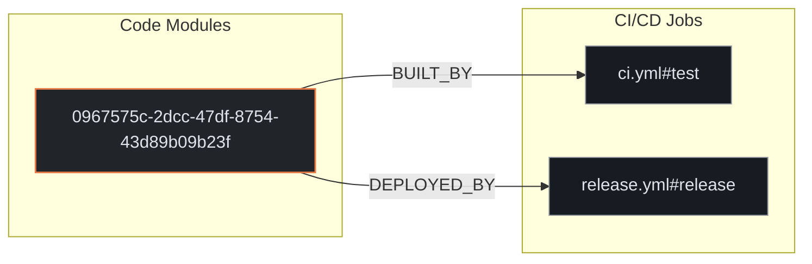
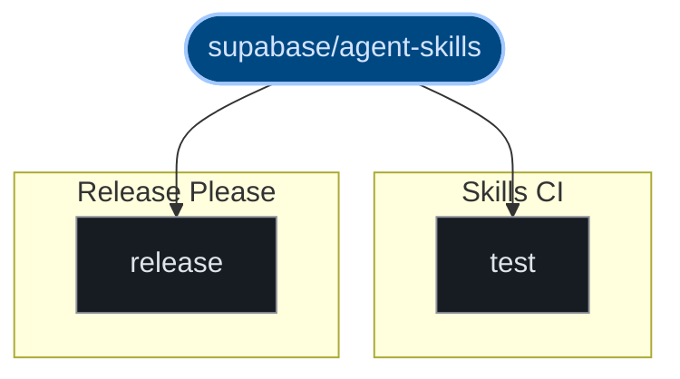

# Repository Architecture Analysis: supabase/agent-skills

## Metadata
- **SHA**: `c9be0e931b7930f7d02126d04774d904c381e7d7`
- **Primary Ecosystem**: JavaScript/TypeScript

## Quality Metrics
- **ast_engine**: tree-sitter
- **avg_cognitive_complexity**: 1.43
- **avg_cyclomatic_complexity**: 2.43
- **component_count**: 1
- **dead_code_count**: 0
- **dead_code_symbols**: 0 entry(ies)
- **duplication_pct**: 22.21
- **file_complexities**: 3 entry(ies)
- **files_analyzed**: 3
- **fitness_passed**: False
- **fitness_violation_count**: 1
- **framework**: Unknown
- **import_edges**: 22 entry(ies)
- **loc**: 262
- **max_cognitive_complexity**: 6
- **max_cyclomatic_complexity**: 7
- **sloc**: 221
- **test_file_count**: 1

# Architecture: supabase/agent-skills

## Context
- **Repository**: `supabase/agent-skills`
- **SHA**: `c9be0e931b7930f7d02126d04774d904c381e7d7`
- **Ecosystem**: JavaScript/TypeScript
- **Framework**: Unknown

## Building Block View

## Component Details
- **supabase-agent-skills** (`package.json`): MODULE

## 6-Dimension Repository Scorecard

- **Overall Grade**: `C` (76.70/100)
- **Technical Debt Score**: 23.30
- **Estimated Remediation Effort**: 21.27h

| Dimension | Grade | Score | Weight | Details |
| :--- | :---: | :---: | :---: | :--- |
| Code Quality | `C` | 75.00 | 0.20 | avg_cc=2.43, max_cc=7, duplication=22.21%, dead_code=0 |
| Dependency Health | `A` | 100.00 | 0.15 | dependencies=119, outdated=0, vulnerable=0, has_lockfile=True |
| Maintainability | `A` | 94.00 | 0.15 | avg_cognitive=1.43, max_cognitive=6, fitness_violations=1, oversized_files=0 |
| Pipeline Health | `D` | 62.00 | 0.15 | workflows=2, operational_antipatterns=5, parallel_branches=False |
| Security | `D` | 64.00 | 0.20 | vulnerabilities=0, secrets=0, pipeline_security_findings=3 |
| Test Coverage | `C` | 70.00 | 0.15 | coverage=unavailable, ci_test_job=True, test_files_detected=True |

## Architecture Fitness & Workspace Boundaries

- **[MEDIUM] `ATRUSS-ARCH-005` (COMPLEXITY_THRESHOLD)**: Repository duplication_pct (22.21) exceeds policy threshold (15.0).

## Supply Chain Dependencies, Vulnerabilities & Secrets

- **Dependencies Parsed**: 119 | **Vulnerabilities**: 0 | **Secrets**: 0

### Inventory Sample
- `@types/node` `22.0.0` (npm, `package.json`)
- `@types/node` `22.19.17` (npm, `pnpm-lock.yaml`)
- `gray-matter` `4.0.3` (npm, `package.json`)
- `gray-matter` `4.0.3` (npm, `pnpm-lock.yaml`)
- `tar` `7.5.15` (npm, `package.json`)
- `tar` `7.5.15` (npm, `pnpm-lock.yaml`)
- `tsx` `4.21.0` (npm, `package.json`)
- `tsx` `4.21.0` (npm, `pnpm-lock.yaml`)
- `typescript` `6.0.0` (npm, `package.json`)
- `typescript` `6.0.3` (npm, `pnpm-lock.yaml`)
- `vitest` `4.1.4` (npm, `package.json`)
- `vitest` `4.1.4` (npm, `pnpm-lock.yaml`)
- `@esbuild/aix-ppc64` `0.27.4` (npm, `pnpm-lock.yaml`)
- `@esbuild/android-arm` `0.27.4` (npm, `pnpm-lock.yaml`)
- `@esbuild/android-arm64` `0.27.4` (npm, `pnpm-lock.yaml`)
- `@esbuild/android-x64` `0.27.4` (npm, `pnpm-lock.yaml`)
- `@esbuild/darwin-arm64` `0.27.4` (npm, `pnpm-lock.yaml`)
- `@esbuild/darwin-x64` `0.27.4` (npm, `pnpm-lock.yaml`)
- `@esbuild/freebsd-arm64` `0.27.4` (npm, `pnpm-lock.yaml`)
- `@esbuild/freebsd-x64` `0.27.4` (npm, `pnpm-lock.yaml`)
- `@esbuild/linux-arm` `0.27.4` (npm, `pnpm-lock.yaml`)
- `@esbuild/linux-arm64` `0.27.4` (npm, `pnpm-lock.yaml`)
- `@esbuild/linux-ia32` `0.27.4` (npm, `pnpm-lock.yaml`)
- `@esbuild/linux-loong64` `0.27.4` (npm, `pnpm-lock.yaml`)
- `@esbuild/linux-mips64el` `0.27.4` (npm, `pnpm-lock.yaml`)
- `@esbuild/linux-ppc64` `0.27.4` (npm, `pnpm-lock.yaml`)
- `@esbuild/linux-riscv64` `0.27.4` (npm, `pnpm-lock.yaml`)
- `@esbuild/linux-s390x` `0.27.4` (npm, `pnpm-lock.yaml`)
- `@esbuild/linux-x64` `0.27.4` (npm, `pnpm-lock.yaml`)
- `@esbuild/netbsd-arm64` `0.27.4` (npm, `pnpm-lock.yaml`)
- ... (+89 more dependencies)

## Section 7: Code-to-Cloud Deployment Traceability

- `0967575c-2dcc-47df-8754-43d89b09b23f` (code_module) --[BUILT_BY]--> `ci.yml#test` (ci_job)
- `0967575c-2dcc-47df-8754-43d89b09b23f` (code_module) --[DEPLOYED_BY]--> `release.yml#release` (ci_job)

## CI/CD Pipeline Topology

