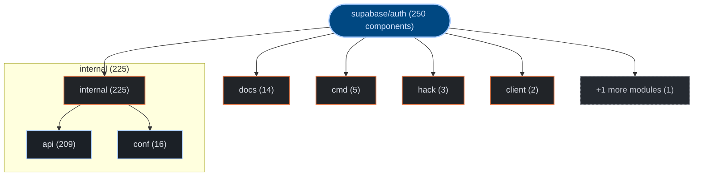
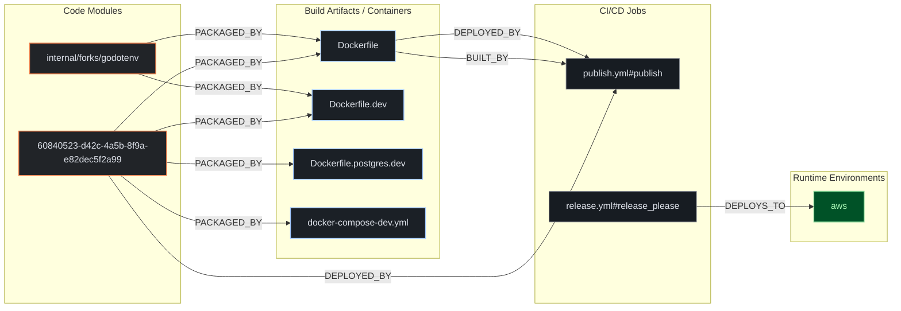
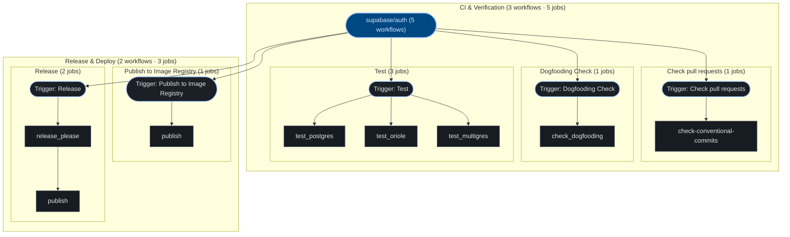

# Repository Architecture Analysis: supabase/auth

## Metadata
- **SHA**: `3e79d8513b67d7dc3f234153aacc074daf82db5f`
- **Primary Ecosystem**: Go

## Quality Metrics
- **ast_engine**: fallback
- **avg_cognitive_complexity**: 0.0
- **avg_cyclomatic_complexity**: 0.0
- **component_count**: 250
- **dead_code_count**: 0
- **dead_code_symbols**: 0 entry(ies)
- **duplication_pct**: 0.0
- **file_complexities**: 0 entry(ies)
- **files_analyzed**: 408
- **fitness_passed**: True
- **fitness_violation_count**: 0
- **framework**: Go Service
- **import_edges**: 0 entry(ies)
- **loc**: 104180
- **max_cognitive_complexity**: 0
- **max_cyclomatic_complexity**: 0
- **sloc**: 81130
- **test_file_count**: 168

# Architecture: supabase/auth

## Context
- **Repository**: `supabase/auth`
- **SHA**: `3e79d8513b67d7dc3f234153aacc074daf82db5f`
- **Ecosystem**: Go
- **Framework**: Go Service

## Building Block View

## Component Details

Showing top 60 representative components out of 250 across 6 module group(s):

- **Module `internal`** (225 components — module: 225)
- **Module `docs`** (14 components — module: 14)
- **Module `cmd`** (5 components — module: 5)
- **Module `hack`** (3 components — module: 3)
- **Module `client`** (2 components — module: 2)
- **Module `(root)`** (1 components — module: 1)

- **admin** (`docs/admin.go`): module
- **admin** (`internal/api/admin.go`): module
- **admin_cmd** (`cmd/admin_cmd.go`): module
- **admin_test** (`internal/api/admin_test.go`): module
- **anonymous** (`internal/api/anonymous.go`): module
- **anonymous_test** (`internal/api/anonymous_test.go`): module
- **api** (`internal/api/api.go`): module
- **api_test** (`internal/api/api_test.go`): module
- **apierrors** (`internal/api/apierrors/apierrors.go`): module
- **apierrors_test** (`internal/api/apierrors/apierrors_test.go`): module
- **apilimiter** (`internal/api/apilimiter/apilimiter.go`): module
- **apilimiter_test** (`internal/api/apilimiter/apilimiter_test.go`): module
- **apitask** (`internal/api/apitask/apitask.go`): module
- **apitask_test** (`internal/api/apitask/apitask_test.go`): module
- **apiversions** (`internal/api/apiversions.go`): module
- **apiversions_test** (`internal/api/apiversions_test.go`): module
- **apiworker** (`internal/api/apiworker/apiworker.go`): module
- **apple** (`internal/api/provider/apple.go`): module
- **audit** (`internal/api/audit.go`): module
- **audit_test** (`internal/api/audit_test.go`): module
- **auth** (`internal/api/auth.go`): module
- **auth** (`internal/api/oauthserver/auth.go`): module
- **auth_test** (`internal/api/auth_test.go`): module
- **authorize** (`internal/api/oauthserver/authorize.go`): module
- **authorize_test** (`internal/api/oauthserver/authorize_test.go`): module
- **azure** (`internal/api/provider/azure.go`): module
- **azure_test** (`internal/api/provider/azure_test.go`): module
- **bitbucket** (`internal/api/provider/bitbucket.go`): module
- **captcha_mock_test** (`internal/api/captcha_mock_test.go`): module
- **client** (`client/admin/client.go`): module
- **client_auth** (`internal/api/oauthserver/client_auth.go`): module
- **client_auth_test** (`internal/api/oauthserver/client_auth_test.go`): module
- **configuration** (`internal/conf/configuration.go`): module
- **configuration_test** (`internal/conf/configuration_test.go`): module
- **confload** (`internal/conf/confload/confload.go`): module
- **confload_test** (`internal/conf/confload/confload_test.go`): module
- **context** (`internal/api/context.go`): module
- **context** (`internal/api/shared/context.go`): module
- **core** (`internal/api/scim/core/core.go`): module
- **custom_oauth** (`internal/api/provider/custom_oauth.go`): module
- **custom_oauth_admin** (`internal/api/custom_oauth_admin.go`): module
- **custom_oauth_admin_test** (`internal/api/custom_oauth_admin_test.go`): module
- **custom_oauth_claims_test** (`internal/api/provider/custom_oauth_claims_test.go`): module
- **custom_oauth_test** (`internal/api/provider/custom_oauth_test.go`): module
- **discord** (`internal/api/provider/discord.go`): module
- **doc** (`docs/doc.go`): module
- **e2e_test** (`internal/api/e2e_test.go`): module
- **email_identity_on_password_test** (`internal/api/email_identity_on_password_test.go`): module
- **endpoints** (`internal/api/scim/core/endpoints.go`): module
- **error** (`internal/api/scim/protocol/error.go`): module
- **error_test** (`internal/api/scim/protocol/error_test.go`): module
- **errorcode** (`internal/api/apierrors/errorcode.go`): module
- **errors** (`docs/errors.go`): module
- **errors** (`internal/api/errors.go`): module
- **errors** (`internal/api/provider/errors.go`): module
- **errors_test** (`internal/api/errors_test.go`): module
- **external** (`internal/api/external.go`): module
- **external_apple_test** (`internal/api/external_apple_test.go`): module
- **external_azure_test** (`internal/api/external_azure_test.go`): module
- **external_bitbucket_test** (`internal/api/external_bitbucket_test.go`): module

## 6-Dimension Repository Scorecard

- **Overall Grade**: `D` (62.15/100)
- **Technical Debt Score**: 37.85
- **Estimated Remediation Effort**: 81.46h

| Dimension | Grade | Score | Weight | Details |
| :--- | :---: | :---: | :---: | :--- |
| Code Quality | `A` | 100.00 | 0.20 | avg_cc=0.00, max_cc=0, duplication=0.00%, dead_code=0 |
| Dependency Health | `B` | 85.00 | 0.15 | dependencies=254, outdated=0, vulnerable=0, has_lockfile=False |
| Maintainability | `A` | 100.00 | 0.15 | avg_cognitive=0.00, max_cognitive=0, fitness_violations=0, oversized_files=0 |
| Pipeline Health | `F` | 26.00 | 0.15 | workflows=5, operational_antipatterns=11, parallel_branches=True |
| Security | `F` | 0.00 | 0.20 | vulnerabilities=0, secrets=29, pipeline_security_findings=2 |
| Test Coverage | `C` | 70.00 | 0.15 | coverage=unavailable, ci_test_job=True, test_files_detected=True |

## Supply Chain Dependencies, Vulnerabilities & Secrets

- **Dependencies Parsed**: 254 | **Vulnerabilities**: 0 | **Secrets**: 29

### Secret Findings (Redacted)
- **[HIGH] `ATRUSS-SEC-005`** at `hack/test.env:132` (`GOTRUE_SAML_PRIVATE_KEY="MIIE***REDACTED***"`)
- **[HIGH] `ATRUSS-SEC-005`** at `hack/test.env:138` (`GOTRUE_SECURITY_DB_ENCRYPTION_ENCRYPTION_KEY=pwFo***REDACTED***`)
- **[HIGH] `ATRUSS-SEC-005`** at `hack/test.env:139` (`GOTRUE_SECURITY_DB_ENCRYPTION_DECRYPTION_KEYS=abc:***REDACTED***`)
- **[HIGH] `ATRUSS-SEC-005`** at `hack/test_asymmetric.env:1` (`GOTRUE_JWT_SECRET=X4dN***REDACTED***`)
- **[HIGH] `ATRUSS-SEC-005`** at `hack/test_asymmetric.env:129` (`GOTRUE_SAML_PRIVATE_KEY="MIIE***REDACTED***"`)
- **[HIGH] `ATRUSS-SEC-005`** at `hack/test_asymmetric.env:134` (`GOTRUE_SECURITY_DB_ENCRYPTION_ENCRYPTION_KEY=pwFo***REDACTED***`)
- **[HIGH] `ATRUSS-SEC-005`** at `hack/test_asymmetric.env:135` (`GOTRUE_SECURITY_DB_ENCRYPTION_DECRYPTION_KEYS=abc:***REDACTED***`)
- **[HIGH] `ATRUSS-SEC-005`** at `internal/api/admin_test.go:459` (`"password_hash": "$2y$***REDACTED***",`)
- **[HIGH] `ATRUSS-SEC-005`** at `internal/api/admin_test.go:725` (`"password_hash": "$2y$***REDACTED***",`)
- **[HIGH] `ATRUSS-SEC-005`** at `internal/api/admin_test.go:1145` (`"password_hash": "$2y$***REDACTED***",`)
- **[HIGH] `ATRUSS-SEC-005`** at `internal/api/auth_test.go:69` (`token := "eyJh***REDACTED***"`)
- **[HIGH] `ATRUSS-SEC-005`** at `internal/api/password_test.go:117` (`Password:           "zZgX***REDACTED***",`)
- **[HIGH] `ATRUSS-SEC-005`** at `internal/api/provider/oidc_test.go:73` (`AccessToken: "ya29***REDACTED***",`)
- **[HIGH] `ATRUSS-SEC-005`** at `internal/api/provider/oidc_test.go:74` (`IDToken:     "eyJh***REDACTED***",`)
- **[HIGH] `ATRUSS-SEC-005`** at `internal/api/provider/oidc_test.go:81` (`IDToken:     "eyJ0***REDACTED***",`)
- **[HIGH] `ATRUSS-SEC-005`** at `internal/api/provider/oidc_test.go:87` (`IDToken:     "eyJh***REDACTED***",`)
- **[HIGH] `ATRUSS-SEC-005`** at `internal/api/saml_test.go:17` (`const samlTestPrimaryKey = "MIIE***REDACTED***"`)
- **[HIGH] `ATRUSS-SEC-005`** at `internal/api/saml_test.go:20` (`const samlTestNextKey = "MIIE***REDACTED***"`)
- **[HIGH] `ATRUSS-SEC-005`** at `internal/conf/saml_test.go:155` (`PrivateKey: "MIIC***REDACTED***",`)
- **[HIGH] `ATRUSS-SEC-005`** at `internal/conf/saml_test.go:160` (`PrivateKey: "MIIE***REDACTED***",`)
- **[HIGH] `ATRUSS-SEC-005`** at `internal/conf/saml_test.go:181` (`PrivateKey: "MIIG***REDACTED***",`)
- **[HIGH] `ATRUSS-SEC-005`** at `internal/conf/saml_test.go:186` (`PrivateKey: "MIIJ***REDACTED***",`)
- **[HIGH] `ATRUSS-SEC-005`** at `internal/conf/saml_test.go:268` (`PrivateKey: "MIIE***REDACTED***",`)
- **[HIGH] `ATRUSS-SEC-005`** at `internal/conf/saml_test.go:286` (`validPrivateKey = "MIIE***REDACTED***"`)
- **[HIGH] `ATRUSS-SEC-005`** at `internal/conf/saml_test.go:290` (`validPrivateKeyNext = "MIIE***REDACTED***"`)
- **[HIGH] `ATRUSS-SEC-005`** at `internal/conf/saml_test.go:293` (`invalidRSA1024Key = "MIIC***REDACTED***"`)
- **[HIGH] `ATRUSS-SEC-005`** at `internal/conf/saml_test.go:296` (`invalidWrongExponentKey = "MIIE***REDACTED***"`)
- **[HIGH] `ATRUSS-SEC-005`** at `internal/crypto/crypto_test.go:99` (`"key-id": "pwFo***REDACTED***",`)
- **[HIGH] `ATRUSS-SEC-005`** at `internal/crypto/crypto_test.go:171` (`"key-id": "pwFo***REDACTED***",`)

### Inventory Sample
- `github.com/Masterminds/semver/v3` `3.1.1` (golang, `go.mod`)
- `github.com/XSAM/otelsql` `0.26.0` (golang, `go.mod`)
- `github.com/aaronarduino/goqrsvg` `0.0.0-20220419053939-17e843f1dd40` (golang, `go.mod`)
- `github.com/ajstarks/svgo` `0.0.0-20211024235047-1546f124cd8b` (golang, `go.mod`)
- `github.com/aws/aws-sdk-go-v2/config` `1.32.18` (golang, `go.mod`)
- `github.com/aws/aws-sdk-go-v2/service/kms` `1.52.0` (golang, `go.mod`)
- `github.com/badoux/checkmail` `0.0.0-20170203135005-d0a759655d62` (golang, `go.mod`)
- `github.com/bits-and-blooms/bloom/v3` `3.6.0` (golang, `go.mod`)
- `github.com/bombsimon/logrusr/v3` `3.0.0` (golang, `go.mod`)
- `github.com/boombuler/barcode` `1.0.1-0.20190219062509-6c824513bacc` (golang, `go.mod`)
- `github.com/btcsuite/btcutil` `1.0.2` (golang, `go.mod`)
- `github.com/coreos/go-oidc/v3` `3.20.0` (golang, `go.mod`)
- `github.com/crewjam/saml` `0.4.14` (golang, `go.mod`)
- `github.com/didip/tollbooth/v5` `5.1.1` (golang, `go.mod`)
- `github.com/ethereum/go-ethereum` `1.17.0` (golang, `go.mod`)
- `github.com/fatih/structs` `1.1.0` (golang, `go.mod`)
- `github.com/fsnotify/fsnotify` `1.7.0` (golang, `go.mod`)
- `github.com/fxamacker/cbor/v2` `2.9.1` (golang, `go.mod`)
- `github.com/go-chi/chi/v5` `5.3.2` (golang, `go.mod`)
- `github.com/go-webauthn/webauthn` `0.16.5` (golang, `go.mod`)
- `github.com/gobuffalo/pop/v6` `6.1.1` (golang, `go.mod`)
- `github.com/gobwas/glob` `0.2.3` (golang, `go.mod`)
- `github.com/gofrs/uuid` `4.3.1+incompatible` (golang, `go.mod`)
- `github.com/golang-jwt/jwt/v5` `5.3.1` (golang, `go.mod`)
- `github.com/jackc/pgconn` `1.14.3` (golang, `go.mod`)
- `github.com/jackc/pgerrcode` `0.0.0-20201024163028-a0d42d470451` (golang, `go.mod`)
- `github.com/jmoiron/sqlx` `1.3.5` (golang, `go.mod`)
- `github.com/joho/godotenv` `1.5.1` (golang, `go.mod`)
- `github.com/kelseyhightower/envconfig` `1.4.0` (golang, `go.mod`)
- `github.com/lestrrat-go/jwx/v2` `2.1.0` (golang, `go.mod`)
- ... (+224 more dependencies)

## Section 7: Code-to-Cloud Deployment Traceability

- `release.yml#release_please` (ci_job) --[DEPLOYS_TO]--> `aws` (environment)
- `60840523-d42c-4a5b-8f9a-e82dec5f2a99` (code_module) --[DEPLOYED_BY]--> `publish.yml#publish` (ci_job)
- `60840523-d42c-4a5b-8f9a-e82dec5f2a99` (code_module) --[PACKAGED_BY]--> `Dockerfile` (container)
- `60840523-d42c-4a5b-8f9a-e82dec5f2a99` (code_module) --[PACKAGED_BY]--> `Dockerfile.dev` (container)
- `60840523-d42c-4a5b-8f9a-e82dec5f2a99` (code_module) --[PACKAGED_BY]--> `Dockerfile.postgres.dev` (container)
- `60840523-d42c-4a5b-8f9a-e82dec5f2a99` (code_module) --[PACKAGED_BY]--> `docker-compose-dev.yml` (container)
- `internal/forks/godotenv` (code_module) --[PACKAGED_BY]--> `Dockerfile` (container)
- `internal/forks/godotenv` (code_module) --[PACKAGED_BY]--> `Dockerfile.dev` (container)
- `Dockerfile` (container) --[BUILT_BY]--> `publish.yml#publish` (ci_job)
- `Dockerfile` (container) --[DEPLOYED_BY]--> `publish.yml#publish` (ci_job)

## CI/CD Pipeline Topology

