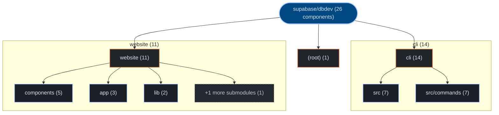
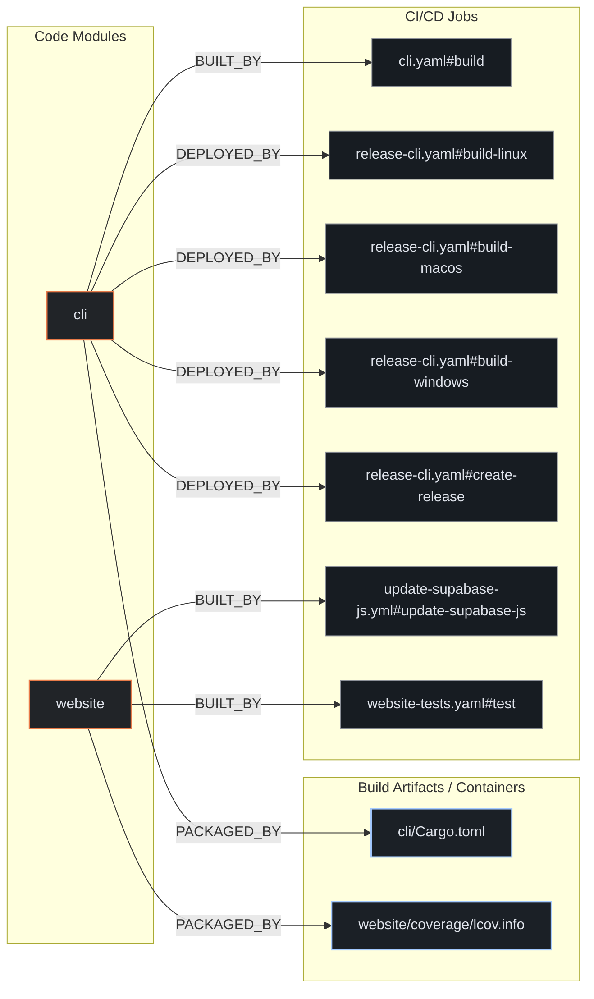

# Repository Architecture Analysis: supabase/dbdev

## Metadata
- **SHA**: `4528188cdbdf4f7715eb2912caa9f0e3eb040687`
- **Primary Ecosystem**: JavaScript/TypeScript

## Quality Metrics
- **ast_engine**: tree-sitter
- **avg_cognitive_complexity**: 1.41
- **avg_cyclomatic_complexity**: 2.26
- **component_count**: 26
- **dead_code_count**: 10
- **dead_code_symbols**: 10 entry(ies)
- **duplication_pct**: 59.16
- **file_complexities**: 25 entry(ies)
- **files_analyzed**: 119
- **fitness_passed**: False
- **fitness_violation_count**: 2
- **framework**: Next.js
- **import_edges**: 100 entry(ies)
- **loc**: 9753
- **max_cognitive_complexity**: 21
- **max_cyclomatic_complexity**: 27
- **sloc**: 8400
- **test_file_count**: 9

# Architecture: supabase/dbdev

## Context
- **Repository**: `supabase/dbdev`
- **SHA**: `4528188cdbdf4f7715eb2912caa9f0e3eb040687`
- **Ecosystem**: JavaScript/TypeScript
- **Framework**: Next.js

## Building Block View

## Component Details
- **dbdev** (`package.json`): MODULE
- **dbdev-website** (`website/package.json`): MODULE
- **RootLayout** (`website/app/layout.tsx`): UI_COMPONENT
- **API_search_route** (`website/app/api/search/route.ts`): API_ROUTE
- **Layout** (`website/app/docs/layout.tsx`): UI_COMPONENT
- **FORM_ERROR** (`website/components/forms/Form.tsx`): UI_COMPONENT
- **LOCAL_STORAGE_KEY** (`website/components/themes/ThemeContext.tsx`): UI_COMPONENT
- **DEFAULT_THEME** (`website/components/themes/ThemeContext.tsx`): UI_COMPONENT
- **ThemeContextProvider** (`website/components/themes/ThemeContext.tsx`): UI_COMPONENT
- **Toaster** (`website/components/ui/toaster.tsx`): UI_COMPONENT
- **AuthContext** (`website/lib/auth.tsx`): UI_COMPONENT
- **AuthProvider** (`website/lib/auth.tsx`): UI_COMPONENT
- **client** (`cli/src/client.rs`): module
- **config** (`cli/src/config.rs`): module
- **credential_store** (`cli/src/credential_store.rs`): module
- **main** (`cli/src/main.rs`): module
- **models** (`cli/src/models.rs`): module
- **secret** (`cli/src/secret.rs`): module
- **util** (`cli/src/util.rs`): module
- **add** (`cli/src/commands/add.rs`): module
- **install** (`cli/src/commands/install.rs`): module
- **list** (`cli/src/commands/list.rs`): module
- **login** (`cli/src/commands/login.rs`): module
- **mod** (`cli/src/commands/mod.rs`): module
- **publish** (`cli/src/commands/publish.rs`): module
- **uninstall** (`cli/src/commands/uninstall.rs`): module

## 6-Dimension Repository Scorecard

- **Overall Grade**: `F` (54.68/100)
- **Technical Debt Score**: 45.32
- **Estimated Remediation Effort**: 61.66h

| Dimension | Grade | Score | Weight | Details |
| :--- | :---: | :---: | :---: | :--- |
| Code Quality | `F` | 37.00 | 0.20 | avg_cc=2.26, max_cc=27, duplication=59.16%, dead_code=10 |
| Dependency Health | `A` | 100.00 | 0.15 | dependencies=1326, outdated=0, vulnerable=0, has_lockfile=True |
| Maintainability | `B` | 86.50 | 0.15 | avg_cognitive=1.41, max_cognitive=21, fitness_violations=2, oversized_files=0 |
| Pipeline Health | `F` | 0.00 | 0.15 | workflows=10, operational_antipatterns=26, parallel_branches=True |
| Security | `F` | 44.00 | 0.20 | vulnerabilities=0, secrets=2, pipeline_security_findings=1 |
| Test Coverage | `C` | 70.00 | 0.15 | coverage=unavailable, ci_test_job=True, test_files_detected=True |

## Architecture Fitness & Workspace Boundaries

- **[MEDIUM] `ATRUSS-ARCH-005` (COMPLEXITY_THRESHOLD)**: Repository duplication_pct (59.16) exceeds policy threshold (15.0).
- **[MEDIUM] `ATRUSS-ARCH-005` (COMPLEXITY_THRESHOLD)**: Repository max_cyclomatic_complexity (27.0) exceeds policy threshold (20.0).

## Supply Chain Dependencies, Vulnerabilities & Secrets

- **Dependencies Parsed**: 1326 | **Vulnerabilities**: 0 | **Secrets**: 2

### Secret Findings (Redacted)
- **[HIGH] `ATRUSS-SEC-005`** at `cli/src/config.rs:44` (`api_key: "eyJh***REDACTED***".to_string(),`)
- **[HIGH] `ATRUSS-SEC-005`** at `cli/src/config.rs:67` (`api_key: "eyJh***REDACTED***".to_string(),`)

### Inventory Sample
- `anyhow` `1.0.102` (cargo, `cli/Cargo.toml`)
- `clap` `4.6.1` (cargo, `cli/Cargo.toml`)
- `dirs` `7.0.0` (cargo, `cli/Cargo.toml`)
- `futures` `0.3.32` (cargo, `cli/Cargo.toml`)
- `postgrest` `1.6.0` (cargo, `cli/Cargo.toml`)
- `rand` `0.10.1` (cargo, `cli/Cargo.toml`)
- `regex` `1.12.3` (cargo, `cli/Cargo.toml`)
- `reqwest` `0.13.4` (cargo, `cli/Cargo.toml`)
- `rpassword` `7.5.4` (cargo, `cli/Cargo.toml`)
- `serde` `1.0.228` (cargo, `cli/Cargo.toml`)
- `serde_json` `1.0.150` (cargo, `cli/Cargo.toml`)
- `sqlx` `0.8.6` (cargo, `cli/Cargo.toml`)
- `tempfile` `3.27.0` (cargo, `cli/Cargo.toml`)
- `thiserror` `2.0.18` (cargo, `cli/Cargo.toml`)
- `tokio` `1.52.3` (cargo, `cli/Cargo.toml`)
- `toml` `1.1.2` (cargo, `cli/Cargo.toml`)
- `url` `2.5.8` (cargo, `cli/Cargo.toml`)
- `uuid` `1.23.2` (cargo, `cli/Cargo.toml`)
- `@heroicons/react` `2.2.0` (npm, `website/package.json`)
- `@heroicons/react` `2.2.0` (npm, `website/pnpm-lock.yaml`)
- `@hookform/resolvers` `5.2.2` (npm, `website/package.json`)
- `@hookform/resolvers` `5.2.2` (npm, `website/pnpm-lock.yaml`)
- `@radix-ui/react-avatar` `1.1.11` (npm, `website/package.json`)
- `@radix-ui/react-avatar` `1.1.11` (npm, `website/pnpm-lock.yaml`)
- `@radix-ui/react-dialog` `1.1.15` (npm, `website/package.json`)
- `@radix-ui/react-dialog` `1.1.15` (npm, `website/pnpm-lock.yaml`)
- `@radix-ui/react-dropdown-menu` `2.1.16` (npm, `website/package.json`)
- `@radix-ui/react-dropdown-menu` `2.1.16` (npm, `website/pnpm-lock.yaml`)
- `@radix-ui/react-label` `2.1.8` (npm, `website/package.json`)
- `@radix-ui/react-label` `2.1.8` (npm, `website/pnpm-lock.yaml`)
- ... (+1296 more dependencies)

## Section 7: Code-to-Cloud Deployment Traceability

- `cli` (code_module) --[BUILT_BY]--> `cli.yaml#build` (ci_job)
- `cli` (code_module) --[DEPLOYED_BY]--> `release-cli.yaml#build-linux` (ci_job)
- `cli` (code_module) --[DEPLOYED_BY]--> `release-cli.yaml#build-macos` (ci_job)
- `cli` (code_module) --[DEPLOYED_BY]--> `release-cli.yaml#build-windows` (ci_job)
- `cli` (code_module) --[DEPLOYED_BY]--> `release-cli.yaml#create-release` (ci_job)
- `cli` (code_module) --[PACKAGED_BY]--> `cli/Cargo.toml` (container)
- `website` (code_module) --[BUILT_BY]--> `update-supabase-js.yml#update-supabase-js` (ci_job)
- `website` (code_module) --[BUILT_BY]--> `website-tests.yaml#test` (ci_job)
- `website` (code_module) --[PACKAGED_BY]--> `website/coverage/lcov.info` (container)

## CI/CD Pipeline Topology

```mermaid
graph TD;
  classDef atlasRoot fill:#004882,stroke:#a3c9ff,stroke-width:2px,color:#d3e4ff
  classDef atlasCategory fill:#212428,stroke:#E87A48,stroke-width:1.5px,color:#dfe3eb
  classDef atlasWorkflow fill:#1b2026,stroke:#a3c9ff,stroke-width:1.5px,color:#dfe3eb
  classDef atlasJob fill:#171c22,stroke:#8d9199,stroke-width:1px,color:#dfe3eb
  classDef atlasTarget fill:#005227,stroke:#8bd99b,stroke-width:1.5px,color:#a7f6b6
  classDef atlasAlert fill:#93000a,stroke:#ffb4ab,stroke-width:1.5px,color:#ffdad6
  classDef atlasMore fill:#252a31,stroke:#8d9199,stroke-dasharray:4 4,color:#c3c6cf
  pipeline_root(["supabase/dbdev (10 workflows)"]):::atlasRoot
  subgraph sg_grp_0_CI___Verification["CI & Verification (5 workflows · 5 jobs)"]
    direction TB
    subgraph sg_wf_0_CLI["CLI (1 jobs)"]
      direction TB
      wf_0_CLI(["Trigger: CLI"]):::atlasWorkflow
      job_0_build["build"]:::atlasJob
      wf_0_CLI --> job_0_build
    end
    pipeline_root --> wf_0_CLI
    subgraph sg_wf_2_pgTAP_Tests["pgTAP Tests (1 jobs)"]
      direction TB
      wf_2_pgTAP_Tests(["Trigger: pgTAP Tests"]):::atlasWorkflow
      job_2_build["build"]:::atlasJob
      wf_2_pgTAP_Tests --> job_2_build
    end
    pipeline_root --> wf_2_pgTAP_Tests
    subgraph sg_wf_3_pre_commit_hooks["pre-commit hooks (1 jobs)"]
      direction TB
      wf_3_pre_commit_hooks(["Trigger: pre-commit hooks"]):::atlasWorkflow
      job_3_build["build"]:::atlasJob
      wf_3_pre_commit_hooks --> job_3_build
    end
    pipeline_root --> wf_3_pre_commit_hooks
    subgraph sg_wf_4_Check_Website_Code_Formatting_with_Prettier["Check Website Code Formatting with Prettier (1 jobs)"]
      direction TB
      wf_4_Check_Website_Code_Formatting_with_Prettier(["Trigger: Check Website Code Formatting with Prettier"]):::atlasWorkflow
      job_4_check_prettier["check-prettier"]:::atlasJob
      wf_4_Check_Website_Code_Formatting_with_Prettier --> job_4_check_prettier
    end
    pipeline_root --> wf_4_Check_Website_Code_Formatting_with_Prettier
    subgraph sg_wf_9_Website_Tests["Website Tests (1 jobs)"]
      direction TB
      wf_9_Website_Tests(["Trigger: Website Tests"]):::atlasWorkflow
      job_9_test["test"]:::atlasJob
      wf_9_Website_Tests --> job_9_test
    end
    pipeline_root --> wf_9_Website_Tests
  end
  subgraph sg_grp_1_Release___Deploy["Release & Deploy (4 workflows · 10 jobs)"]
    direction TB
    subgraph sg_wf_1_Release_CLI_on_Homebrew_and_Scoop["Release CLI on Homebrew and Scoop (2 jobs)"]
      direction TB
      wf_1_Release_CLI_on_Homebrew_and_Scoop(["Trigger: Release CLI on Homebrew and Scoop"]):::atlasWorkflow
      job_1_call_release_homebrew_tap["call-release-homebrew-tap"]:::atlasJob
      job_1_call_release_scoop_bucket["call-release-scoop-bucket"]:::atlasJob
      wf_1_Release_CLI_on_Homebrew_and_Scoop --> job_1_call_release_homebrew_tap
      wf_1_Release_CLI_on_Homebrew_and_Scoop --> job_1_call_release_scoop_bucket
    end
    pipeline_root --> wf_1_Release_CLI_on_Homebrew_and_Scoop
    subgraph sg_wf_5_Release_CLI["Release CLI (6 jobs)"]
      direction TB
      wf_5_Release_CLI(["Trigger: Release CLI"]):::atlasWorkflow
      job_5_create_release["create-release"]:::atlasJob
      job_5_build_linux["build-linux"]:::atlasJob
      job_5_build_macos["build-macos"]:::atlasJob
      wf_5_Release_CLI --> job_5_create_release
      job_5_create_release --> job_5_build_linux
      job_5_create_release --> job_5_build_macos
    end
    pipeline_root --> wf_5_Release_CLI
    subgraph sg_wf_6_Release_Homebrew_Tap["Release Homebrew Tap (1 jobs)"]
      direction TB
      wf_6_Release_Homebrew_Tap(["Trigger: Release Homebrew Tap"]):::atlasWorkflow
      job_6_release["release"]:::atlasJob
      wf_6_Release_Homebrew_Tap --> job_6_release
    end
    pipeline_root --> wf_6_Release_Homebrew_Tap
    subgraph sg_wf_7_Release_Scoop_Bucket["Release Scoop Bucket (1 jobs)"]
      direction TB
      wf_7_Release_Scoop_Bucket(["Trigger: Release Scoop Bucket"]):::atlasWorkflow
      job_7_release["release"]:::atlasJob
      wf_7_Release_Scoop_Bucket --> job_7_release
    end
    pipeline_root --> wf_7_Release_Scoop_Bucket
  end
  subgraph sg_grp_2_Scheduled___Manual["Scheduled & Manual (1 workflows · 1 jobs)"]
    direction TB
    subgraph sg_wf_8_Update__supabase_supabase_js["Update @supabase/supabase-js (1 jobs)"]
      direction TB
      wf_8_Update__supabase_supabase_js(["Trigger: Update @supabase/supabase-js"]):::atlasWorkflow
      job_8_update_supabase_js["update-supabase-js"]:::atlasJob
      wf_8_Update__supabase_supabase_js --> job_8_update_supabase_js
    end
    pipeline_root --> wf_8_Update__supabase_supabase_js
  end
```

