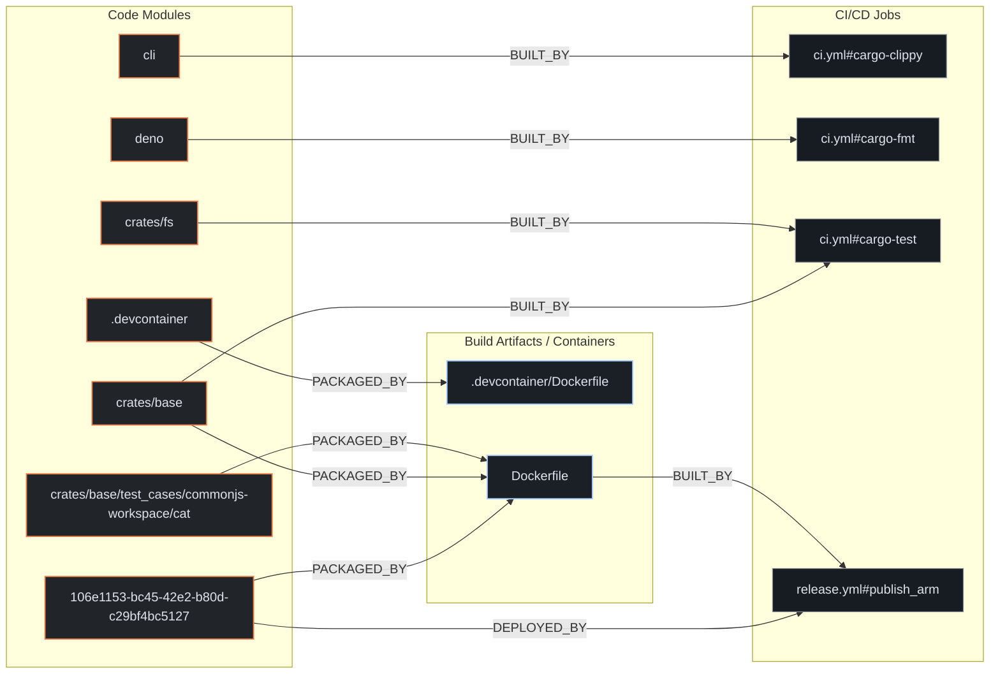

# Repository Architecture Analysis: supabase/edge-runtime

## Metadata
- **SHA**: `ccb19667180acc15f4aab69980822cf077ab4422`
- **Primary Ecosystem**: JavaScript/TypeScript

## Quality Metrics
- **ast_engine**: tree-sitter
- **avg_cognitive_complexity**: 3.87
- **avg_cyclomatic_complexity**: 3.32
- **component_count**: 131
- **dead_code_count**: 200
- **dead_code_symbols**: 50 entry(ies)
- **duplication_pct**: 54.7
- **file_complexities**: 25 entry(ies)
- **files_analyzed**: 649
- **fitness_passed**: False
- **fitness_violation_count**: 3
- **framework**: React (Vite)
- **import_edges**: 100 entry(ies)
- **loc**: 121891
- **max_cognitive_complexity**: 462
- **max_cyclomatic_complexity**: 117
- **sloc**: 93897
- **test_file_count**: 810

# Architecture: supabase/edge-runtime

## Context
- **Repository**: `supabase/edge-runtime`
- **SHA**: `ccb19667180acc15f4aab69980822cf077ab4422`
- **Ecosystem**: JavaScript/TypeScript
- **Framework**: React (Vite)

## Building Block View

```mermaid
graph TD;
  classDef atlasRoot fill:#004882,stroke:#a3c9ff,stroke-width:2px,color:#d3e4ff
  classDef atlasCategory fill:#212428,stroke:#E87A48,stroke-width:1.5px,color:#dfe3eb
  classDef atlasWorkflow fill:#1b2026,stroke:#a3c9ff,stroke-width:1.5px,color:#dfe3eb
  classDef atlasJob fill:#171c22,stroke:#8d9199,stroke-width:1px,color:#dfe3eb
  classDef atlasTarget fill:#005227,stroke:#8bd99b,stroke-width:1.5px,color:#a7f6b6
  classDef atlasAlert fill:#93000a,stroke:#ffb4ab,stroke-width:1.5px,color:#ffdad6
  classDef atlasMore fill:#252a31,stroke:#8d9199,stroke-dasharray:4 4,color:#c3c6cf
    repo_root(["supabase/edge-runtime (131 components)"]):::atlasRoot
    subgraph sg_dir_0_deno["deno (59)"]
      direction TB
      dir_0_deno["deno (59)"]:::atlasCategory
      sub_0_0_cache["cache (13)"]:::atlasWorkflow
      dir_0_deno --> sub_0_0_cache
      sub_0_1__module_root_["(module root) (12)"]:::atlasWorkflow
      dir_0_deno --> sub_0_1__module_root_
      sub_0_2_util["util (12)"]:::atlasWorkflow
      dir_0_deno --> sub_0_2_util
      sub_0_more["+5 more submodules (22)"]:::atlasMore
      dir_0_deno --> sub_0_more
    end
    repo_root --> dir_0_deno
    subgraph sg_dir_1_crates["crates (58)"]
      direction TB
      dir_1_crates["crates (58)"]:::atlasCategory
      sub_1_0_base["base (19)"]:::atlasWorkflow
      dir_1_crates --> sub_1_0_base
      sub_1_1_deno_facade["deno_facade (16)"]:::atlasWorkflow
      dir_1_crates --> sub_1_1_deno_facade
      sub_1_2_fs["fs (11)"]:::atlasWorkflow
      dir_1_crates --> sub_1_2_fs
      sub_1_more["+5 more submodules (12)"]:::atlasMore
      dir_1_crates --> sub_1_more
    end
    repo_root --> dir_1_crates
    dir_2_examples["examples (7)"]:::atlasCategory
    repo_root --> dir_2_examples
    dir_3_cli["cli (5)"]:::atlasCategory
    repo_root --> dir_3_cli
    dir_4_ext["ext (1)"]:::atlasCategory
    repo_root --> dir_4_ext
    dir_other_modules["+1 more modules (1)"]:::atlasMore
    repo_root --> dir_other_modules
```

## Component Details

Showing top 60 representative components out of 131 across 6 module group(s):

- **Module `deno`** (59 components — module: 59)
- **Module `crates`** (58 components — module: 39, MODULE: 16, API_ROUTE: 3)
- **Module `examples`** (7 components — MODULE: 3, API_ROUTE: 3, module: 1)
- **Module `cli`** (5 components — module: 5)
- **Module `ext`** (1 components — SERVICE: 1)
- **Module `k6`** (1 components — MODULE: 1)

- **GET_commonjs-express** (`crates/base/test_cases/commonjs-express/index.js`): API_ROUTE
- **GET_commonjs-hono** (`crates/base/test_cases/commonjs-hono/index.js`): API_ROUTE
- **GET_commonjs-hono** (`examples/commonjs-hono/index.js`): API_ROUTE
- **GET_commonjs-hono-websocket** (`crates/base/test_cases/commonjs-hono-websocket/index.js`): API_ROUTE
- **GET_commonjs-hono-websocket** (`examples/commonjs-hono-websocket/index.js`): API_ROUTE
- **GET_express** (`examples/express/index.ts`): API_ROUTE
- **IncomingMessageForClient** (`ext/node/polyfills/http.ts`): SERVICE
- **async_flag** (`deno/util/sync/async_flag.rs`): module
- **auth_tokens** (`deno/auth_tokens.rs`): module
- **binary** (`deno/standalone/binary.rs`): module
- **build** (`cli/build.rs`): module
- **build** (`crates/fs/build.rs`): module
- **byonm** (`deno/npm/byonm.rs`): module
- **byonm-typescript** (`crates/base/test_cases/byonm-typescript/package.json`): MODULE
- **cache_db** (`deno/cache/cache_db.rs`): module
- **caches** (`deno/cache/caches.rs`): module
- **cat** (`crates/base/test_cases/commonjs-workspace/cat/package.json`): MODULE
- **cert_provider** (`crates/deno_facade/cert_provider.rs`): module
- **check** (`deno/cache/check.rs`): module
- **checksum** (`deno/util/checksum.rs`): module
- **common** (`deno/cache/common.rs`): module
- **common** (`deno/npm/managed/resolvers/common.rs`): module
- **commonjs** (`crates/base/test_cases/commonjs/package.json`): MODULE
- **commonjs** (`examples/commonjs/package.json`): MODULE
- **commonjs-custom-main** (`crates/base/test_cases/commonjs-custom-main/package.json`): MODULE
- **commonjs-express** (`crates/base/test_cases/commonjs-express/package.json`): MODULE
- **commonjs-express-websocket** (`crates/base/test_cases/commonjs-express-websocket/package.json`): MODULE
- **commonjs-hono** (`crates/base/test_cases/commonjs-hono/package.json`): MODULE
- **commonjs-hono** (`examples/commonjs-hono/package.json`): MODULE
- **commonjs-hono-websocket** (`crates/base/test_cases/commonjs-hono-websocket/package.json`): MODULE
- **commonjs-hono-websocket** (`examples/commonjs-hono-websocket/package.json`): MODULE
- **commonjs-no-type-field** (`crates/base/test_cases/commonjs-no-type-field/package.json`): MODULE
- **commonjs-require-esm** (`crates/base/test_cases/commonjs-require-esm/package.json`): MODULE
- **commonjs-workspace** (`crates/base/test_cases/commonjs-workspace/package.json`): MODULE
- **commonjs-ws-websocket** (`crates/base/test_cases/commonjs-ws-websocket/package.json`): MODULE
- **compile** (`deno/tools/compile.rs`): module
- **deno_compile_fs** (`crates/fs/impl/deno_compile_fs.rs`): module
- **deno_dir** (`deno/cache/deno_dir.rs`): module
- **deno_json** (`deno/args/deno_json.rs`): module
- **diff** (`deno/util/diff.rs`): module
- **disk_cache** (`deno/cache/disk_cache.rs`): module
- **dog** (`crates/base/test_cases/commonjs-workspace/dog/package.json`): MODULE
- **edge-runtime-load-testing** (`k6/package.json`): MODULE
- **emit** (`deno/cache/emit.rs`): module
- **emit** (`deno/emit.rs`): module
- **emitter** (`crates/deno_facade/emitter.rs`): module
- **env** (`cli/src/env.rs`): module
- **error** (`crates/base_rt/src/error.rs`): module
- **error** (`crates/deno_facade/eszip/error.rs`): module
- **errors** (`crates/deno_facade/errors.rs`): module
- **errors** (`deno/errors.rs`): module
- **errors** (`deno/runtime/errors.rs`): module
- **fast_check** (`deno/cache/fast_check.rs`): module
- **file_fetcher** (`deno/file_fetcher.rs`): module
- **flags** (`cli/src/flags.rs`): module
- **flags** (`deno/args/flags.rs`): module
- **fs** (`deno/util/fs.rs`): module
- **global** (`deno/npm/managed/resolvers/global.rs`): module
- **graph** (`crates/deno_facade/graph.rs`): module
- **graph_util** (`deno/graph_util.rs`): module

## 6-Dimension Repository Scorecard

- **Overall Grade**: `F` (36.79/100)
- **Technical Debt Score**: 63.21
- **Estimated Remediation Effort**: 144.74h

| Dimension | Grade | Score | Weight | Details |
| :--- | :---: | :---: | :---: | :--- |
| Code Quality | `F` | 28.72 | 0.20 | avg_cc=3.32, max_cc=117, duplication=54.70%, dead_code=200 |
| Dependency Health | `A` | 100.00 | 0.15 | dependencies=1643, outdated=0, vulnerable=0, has_lockfile=True |
| Maintainability | `F` | 37.00 | 0.15 | avg_cognitive=3.87, max_cognitive=462, fitness_violations=3, oversized_files=21 |
| Pipeline Health | `F` | 0.00 | 0.15 | workflows=6, operational_antipatterns=20, parallel_branches=True |
| Security | `F` | 0.00 | 0.20 | vulnerabilities=0, secrets=5, pipeline_security_findings=3 |
| Test Coverage | `C` | 70.00 | 0.15 | coverage=unavailable, ci_test_job=True, test_files_detected=True |

## Architecture Fitness & Workspace Boundaries

- **[MEDIUM] `ATRUSS-ARCH-005` (COMPLEXITY_THRESHOLD)**: Repository duplication_pct (54.7) exceeds policy threshold (15.0).
- **[MEDIUM] `ATRUSS-ARCH-005` (COMPLEXITY_THRESHOLD)**: Repository max_cognitive_complexity (462.0) exceeds policy threshold (25.0).
- **[MEDIUM] `ATRUSS-ARCH-005` (COMPLEXITY_THRESHOLD)**: Repository max_cyclomatic_complexity (117.0) exceeds policy threshold (20.0).

### Workspace Packages
- **cli** (`cli`, rust, cargo) -> internal deps: `base, deno, deno_facade, ext_event_worker`
- **base** (`crates/base`, rust, cargo) -> internal deps: `base_mem_check, base_rt, cpu_timer, deno, deno_facade, eszip_trait, ext_ai, ext_env, ext_event_worker, ext_node, ext_os, ext_runtime, ext_workers, fs, http_utils`
- **base_mem_check** (`crates/base_mem_check`, rust, cargo)
- **base_rt** (`crates/base_rt`, rust, cargo) -> internal deps: `cpu_timer`
- **cpu_timer** (`crates/cpu_timer`, rust, cargo)
- **deno_facade** (`crates/deno_facade`, rust, cargo) -> internal deps: `deno, eszip_trait, ext_node, ext_runtime, fs`
- **eszip_trait** (`crates/eszip_trait`, rust, cargo)
- **fs** (`crates/fs`, rust, cargo) -> internal deps: `base, base_rt, deno, eszip_trait, ext_event_worker, ext_node`
- **http_utils** (`crates/http_utils`, rust, cargo)
- **deno** (`deno`, rust, cargo) -> internal deps: `ext_node, ext_runtime`
- **ext_ai** (`ext/ai`, rust, cargo) -> internal deps: `base_rt, ext_ai_v8_utilities`
- **ext_ai_v8_utilities** (`ext/ai/utilities`, rust, cargo)
- **ext_env** (`ext/env`, rust, cargo) -> internal deps: `deno, ext_node`
- **ext_event_worker** (`ext/event_worker`, rust, cargo) -> internal deps: `base_mem_check`
- **ext_node** (`ext/node`, rust, cargo)
- **ext_os** (`ext/os`, rust, cargo) -> internal deps: `ext_runtime`
- **ext_runtime** (`ext/runtime`, rust, cargo) -> internal deps: `base_mem_check, base_rt`
- **ext_workers** (`ext/workers`, rust, cargo) -> internal deps: `base_mem_check, deno, deno_facade, ext_event_worker, ext_runtime, fs, http_utils`

## Supply Chain Dependencies, Vulnerabilities & Secrets

- **Dependencies Parsed**: 1643 | **Vulnerabilities**: 0 | **Secrets**: 5

### Secret Findings (Redacted)
- **[CRITICAL] `ATRUSS-SEC-004`** at `crates/base/test_cases/tls-invalid-client-cert/index.ts:12` (`-----BEGIN ... PRIVATE KEY----- [REDACTED]`)
- **[CRITICAL] `ATRUSS-SEC-004`** at `crates/base/tests/fixture/tls/localhost-key.pem:1` (`-----BEGIN ... PRIVATE KEY----- [REDACTED]`)
- **[CRITICAL] `ATRUSS-SEC-004`** at `vendor/deno_tls/lib.rs:280` (`-----BEGIN ... PRIVATE KEY----- [REDACTED]`)
- **[CRITICAL] `ATRUSS-SEC-004`** at `vendor/deno_tls/lib.rs:289` (`-----BEGIN ... PRIVATE KEY----- [REDACTED]`)
- **[CRITICAL] `ATRUSS-SEC-004`** at `vendor/deno_tls/lib.rs:299` (`-----BEGIN ... PRIVATE KEY----- [REDACTED]`)

### Inventory Sample
- `aead-gcm-stream` `0.4` (cargo, `ext/node/Cargo.toml`)
- `aes` `*` (cargo, `ext/node/Cargo.toml`)
- `aes` `*` (cargo, `vendor/deno_crypto/Cargo.toml`)
- `aes-gcm` `0.10` (cargo, `vendor/deno_crypto/Cargo.toml`)
- `aes-kw` `0.2.1` (cargo, `vendor/deno_crypto/Cargo.toml`)
- `anyhow` `*` (cargo, `cli/Cargo.toml`)
- `anyhow` `*` (cargo, `crates/base/Cargo.toml`)
- `anyhow` `*` (cargo, `crates/cpu_timer/Cargo.toml`)
- `anyhow` `*` (cargo, `crates/deno_facade/Cargo.toml`)
- `anyhow` `*` (cargo, `crates/fs/Cargo.toml`)
- `anyhow` `*` (cargo, `deno/Cargo.toml`)
- `anyhow` `*` (cargo, `ext/ai/Cargo.toml`)
- `anyhow` `*` (cargo, `ext/event_worker/Cargo.toml`)
- `anyhow` `*` (cargo, `ext/runtime/Cargo.toml`)
- `anyhow` `*` (cargo, `ext/workers/Cargo.toml`)
- `arc-swap` `1.7` (cargo, `crates/base/Cargo.toml`)
- `async-compression` `0.4` (cargo, `vendor/deno_http/Cargo.toml`)
- `async-scoped` `0.9` (cargo, `crates/base/Cargo.toml`)
- `async-trait` `*` (cargo, `crates/base/Cargo.toml`)
- `async-trait` `*` (cargo, `crates/deno_facade/Cargo.toml`)
- `async-trait` `*` (cargo, `crates/fs/Cargo.toml`)
- `async-trait` `*` (cargo, `deno/Cargo.toml`)
- `async-trait` `*` (cargo, `ext/node/Cargo.toml`)
- `async-trait` `*` (cargo, `vendor/deno_http/Cargo.toml`)
- `async-trait` `*` (cargo, `vendor/deno_telemetry/Cargo.toml`)
- `async-trait` `0.1.73` (cargo, `vendor/deno_web/Cargo.toml`)
- `aws-config` `1.2` (cargo, `crates/fs/Cargo.toml`)
- `aws-credential-types` `1.2` (cargo, `crates/fs/Cargo.toml`)
- `aws-sdk-s3` `1.2` (cargo, `crates/fs/Cargo.toml`)
- `aws-smithy-runtime` `1.7` (cargo, `crates/fs/Cargo.toml`)
- ... (+1613 more dependencies)

## Section 7: Code-to-Cloud Deployment Traceability

- `.devcontainer` (code_module) --[PACKAGED_BY]--> `.devcontainer/Dockerfile` (container)
- `106e1153-bc45-42e2-b80d-c29bf4bc5127` (code_module) --[DEPLOYED_BY]--> `release.yml#publish_arm` (ci_job)
- `106e1153-bc45-42e2-b80d-c29bf4bc5127` (code_module) --[PACKAGED_BY]--> `Dockerfile` (container)
- `cli` (code_module) --[BUILT_BY]--> `ci.yml#cargo-clippy` (ci_job)
- `crates/base` (code_module) --[BUILT_BY]--> `ci.yml#cargo-test` (ci_job)
- `crates/base` (code_module) --[PACKAGED_BY]--> `Dockerfile` (container)
- `crates/base/test_cases/commonjs-workspace/cat` (code_module) --[PACKAGED_BY]--> `Dockerfile` (container)
- `crates/fs` (code_module) --[BUILT_BY]--> `ci.yml#cargo-test` (ci_job)
- `deno` (code_module) --[BUILT_BY]--> `ci.yml#cargo-fmt` (ci_job)
- `Dockerfile` (container) --[BUILT_BY]--> `release.yml#publish_arm` (ci_job)

## CI/CD Pipeline Topology

```mermaid
graph TD;
  classDef atlasRoot fill:#004882,stroke:#a3c9ff,stroke-width:2px,color:#d3e4ff
  classDef atlasCategory fill:#212428,stroke:#E87A48,stroke-width:1.5px,color:#dfe3eb
  classDef atlasWorkflow fill:#1b2026,stroke:#a3c9ff,stroke-width:1.5px,color:#dfe3eb
  classDef atlasJob fill:#171c22,stroke:#8d9199,stroke-width:1px,color:#dfe3eb
  classDef atlasTarget fill:#005227,stroke:#8bd99b,stroke-width:1.5px,color:#a7f6b6
  classDef atlasAlert fill:#93000a,stroke:#ffb4ab,stroke-width:1.5px,color:#ffdad6
  classDef atlasMore fill:#252a31,stroke:#8d9199,stroke-dasharray:4 4,color:#c3c6cf
  pipeline_root(["supabase/edge-runtime (6 workflows)"]):::atlasRoot
  subgraph sg_grp_0_Scheduled___Manual["Scheduled & Manual (3 workflows · 5 jobs)"]
    direction TB
    subgraph sg_wf_0_CI["CI (3 jobs)"]
      direction TB
      wf_0_CI(["Trigger: CI"]):::atlasWorkflow
      job_0_cargo_fmt["cargo-fmt"]:::atlasJob
      job_0_cargo_clippy["cargo-clippy"]:::atlasJob
      job_0_cargo_test["cargo-test"]:::atlasJob
      wf_0_CI --> job_0_cargo_fmt
      wf_0_CI --> job_0_cargo_clippy
      wf_0_CI --> job_0_cargo_test
    end
    pipeline_root --> wf_0_CI
    subgraph sg_wf_1_Integration_Postgres["Integration Postgres (1 jobs)"]
      direction TB
      wf_1_Integration_Postgres(["Trigger: Integration Postgres"]):::atlasWorkflow
      job_1_test["test"]:::atlasJob
      wf_1_Integration_Postgres --> job_1_test
    end
    pipeline_root --> wf_1_Integration_Postgres
    subgraph sg_wf_2_Mirror_Image["Mirror Image (1 jobs)"]
      direction TB
      wf_2_Mirror_Image(["Trigger: Mirror Image"]):::atlasWorkflow
      job_2_mirror["mirror"]:::atlasJob
      wf_2_Mirror_Image --> job_2_mirror
    end
    pipeline_root --> wf_2_Mirror_Image
  end
  subgraph sg_grp_1_Release___Deploy["Release & Deploy (2 workflows · 7 jobs)"]
    direction TB
    subgraph sg_wf_3_Release_Native["Release Native (2 jobs)"]
      direction TB
      wf_3_Release_Native(["Trigger: Release Native"]):::atlasWorkflow
      job_3_build["build"]:::atlasJob
      job_3_release["release"]:::atlasJob
      wf_3_Release_Native --> job_3_build
      job_3_build --> job_3_release
    end
    pipeline_root --> wf_3_Release_Native
    subgraph sg_wf_4_Release["Release (5 jobs)"]
      direction TB
      wf_4_Release(["Trigger: Release"]):::atlasWorkflow
      job_4_release["release"]:::atlasJob
      job_4_publish_x86["publish_x86"]:::atlasJob
      job_4_publish_arm["publish_arm"]:::atlasJob
      wf_4_Release --> job_4_release
      job_4_release --> job_4_publish_x86
      job_4_release --> job_4_publish_arm
    end
    pipeline_root --> wf_4_Release
  end
  subgraph sg_grp_2_Security___Governance["Security & Governance (1 workflows · 1 jobs)"]
    direction TB
    subgraph sg_wf_5_Close_stale_issues_and_PRs["Close stale issues and PRs (1 jobs)"]
      direction TB
      wf_5_Close_stale_issues_and_PRs(["Trigger: Close stale issues and PRs"]):::atlasWorkflow
      job_5_stale["stale"]:::atlasJob
      wf_5_Close_stale_issues_and_PRs --> job_5_stale
    end
    pipeline_root --> wf_5_Close_stale_issues_and_PRs
  end
```

